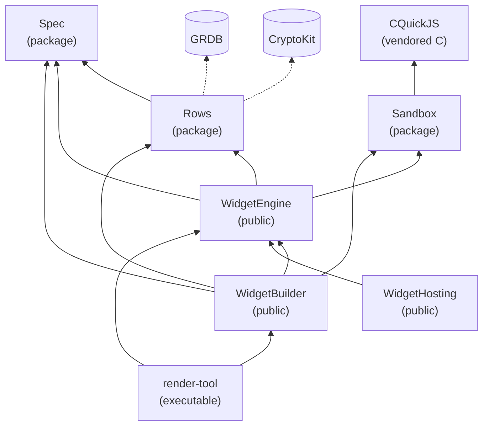

# Modules

One Swift package, `Engine/`, with seven Swift targets, one vendored C target, four test targets, and one C target that only the tests link. Names are placeholders.



## Targets

`scripts/check` reads the "May import" and "Visibility" columns of this table. Keep each "May import" cell a plain comma-separated list of module names.

| Target | Owns | May import | Visibility |
|---|---|---|---|
| `Spec` | The widget document: the exchange JSON grammar, format upgrades, parsing into typed blocks (`Spec.Table`, `Spec.Field<V>`, `Spec.Shape`, `Spec.Effect`, `Spec.Sample`), canonical encoding, refinement compatibility, the synthesized `empty` and `full` states, state files, `Day`, `Weekday`, and `Today`, `Diagnostic`, `JSONValue`. | Foundation | `package` only. Initializers are `internal`, so only this target constructs these types, and only while parsing. |
| `Rows` | Everything persisted: the SQLite schema and migrations, content-addressed revisions and widget heads, rows and cells with clock stamps, the single LWW merge, query compilation and evaluation, effect application, the replica id and hybrid logical clock, content-addressed asset files and the hashing that names them, and every rule that makes two processes safe. | Spec, GRDB, CryptoKit, Synchronization, Foundation | `package` only. The schema and `merge` are `internal`. |
| `Sandbox` | Running a look: source, context JSON, and budget in, tree JSON out. The purity prelude, the step and memory budgets, a fresh QuickJS runtime per run. The JavaScript engine lives here and nowhere else. | CQuickJS, Foundation | `package` only. Knows nothing about widgets, queries, or the vocabulary. |
| `CQuickJS` | QuickJS-ng, vendored unmodified at a pinned tag in `Engine/Vendor/QuickJS` (see its README), outside `Sources/` so the format lint and these rules skip it. | none | C. Not a product; only `Sandbox` links it. |
| `WidgetEngine` | The runtime: `Engine` (`faces`, `perform`, `form`, `widgets`, `delete`, and the static `suspend` and `resume`), its commit hook, and the scratch engine that holds an unsaved draft, the look contract (context encoding, the tree vocabulary, the one tree validator that produces a `Drawing` and checks button rows against the rows the look received), image decoding for renders, the SwiftUI renderer (`FaceView`, `FaceHost`), `Face.traits` (whether a face shows a number and the hue it paints most, for a host suggesting a change), the geometry probe hook, fallback faces. | Spec, Rows, Sandbox, SwiftUI, CoreGraphics, ImageIO, Synchronization, Foundation, os | Public: `Engine` and about a dozen value types. Everything else `package` or private. |
| `WidgetBuilder` | Turning a model reply or a shared widget into a saved revision: `Engine.build`, the build loop that asks a `WidgetModel` and repairs (`Engine.build` from words, `ModelRequest`, reply extraction), `BridgeModel`, the one client of the dev bridge (`Engine/Evals/bridge.py`), `Engine.source(of:)`, `Engine.history(of:)`, `Engine.restore`, `Engine.samples(of:)` and `Engine.load` (sample rows for a draft in a scratch engine), `Engine.checkpoint(of:)` and `Engine.restore(_:)` (undoing a cancelled refinement of a draft in a scratch engine), `Engine.proveReceived`, `Engine.proof`, `Engine.proofs`, `WidgetSource`, image ingest (downscale and encode), the proof matrix, fit analysis, the verdict line, action coverage, PNG encoding. | WidgetEngine, Spec, Rows, Sandbox, SwiftUI, CoreGraphics, ImageIO, Foundation | Public: the builder entry points and their value types, added to `Engine` by extension, and `BridgeModel`. |
| `WidgetHosting` | Everything WidgetKit and App Intents: `Hosting.engine` with the app's reload hook, `RunAction`, the form link (`Hosting.formURL`, `Hosting.formTap`), `PickWidget`, `WidgetChoice` and its query, `HostingIntents`, the timeline provider, `CreationWidget`, `FaceHost.widget`, the family mapping. | WidgetEngine, SwiftUI, WidgetKit, AppIntents, Foundation | Public: what WidgetKit and App Intents require to be visible. |
| `RenderTool` | The command line: arguments, files, exit code, and loop mode against `BridgeModel`. | WidgetBuilder, WidgetEngine, Foundation | Executable. |

Each area has its own test target, so units of work that run in parallel never share a test directory:

- `SpecTests` tests `Spec` through `Spec.parse`, the encoder, and `Today`. It parses the six reference widgets in `Engine/Fixtures/` and every example in `Engine/Reference/blocks.md`.
- `RowsTests` tests `Rows`.
- `LookTests` tests `Sandbox` and the tree validator.
- `EngineTests` tests `WidgetEngine`, `WidgetBuilder`, `WidgetHosting`, and the render tool.
- `CPURendering` (`Engine/Tests/CPURendering`, C, linked by `LookTests`) holds no tests. When the test bundle loads it sets RenderBox's `RB_DISABLE_GPU`, so `ImageRenderer` draws every test render on the CPU. Otherwise RenderBox draws some content on the GPU depending on what the process drew before, the two round edge pixels one level apart, and the PNGs in `Engine/.artifacts/look` changed between runs of the same code.

## Who links what

| Consumer | Links | Does not link |
|---|---|---|
| Widget extension | `WidgetHosting`, and through it `WidgetEngine`, `Spec`, `Rows`, `Sandbox`, GRDB | `WidgetBuilder` (no build, no image ingest, no PNG encoding, no fit analysis) |
| App | `WidgetHosting`, `WidgetBuilder` (and their dependencies) | |
| Render tool and eval harness (Mac) | `WidgetBuilder`, `WidgetEngine` | `WidgetHosting` |
| Backend (Cloudflare Workers) | nothing; see the open questions in RATIONALE about sharing the grammar | |

## Rules the build enforces

`Engine/scripts/check` enforces the first two rules and fails on a violation.

- **Internals are unreachable.** `Spec`, `Rows`, and `Sandbox` are not products and declare nothing `public`, so app code cannot call them even though their modules are built. The check fails on any `public` in a target whose Visibility starts with "`package` only", because one stray `public` would become importable API.
- **Imports follow the table.** Every `import` in a target must appear in its "May import" cell. So only `Rows` imports GRDB and CryptoKit, only `Sandbox` imports CQuickJS, only `WidgetHosting` imports WidgetKit or AppIntents, and only `WidgetEngine`, `WidgetBuilder`, and `WidgetHosting` import SwiftUI.
- **No public name collides with SwiftUI or Foundation.** Found while type-checking the sketch: `Scene`, `Form`, `Host`, `ContentMode`, and `BlendMode` all collided. Public types are named `Face*`, `Input*`, `Widget*`, or are specific enough not to (`Tap`, `Proof`, `FitReport`).
- **A type named like its module keeps its helpers inside it.** `Spec` is a struct in module `Spec`, and `Sandbox` is an actor in module `Sandbox`. Swift then reads `Spec.Table` as a member of the struct, never as a module-qualified name. So the block types are nested in `Spec` (`Spec.Table`, `Spec.Shape`, `Spec.Form`), which also keeps them clear of SwiftUI's `Table`, `Shape`, and `Form`. `Sandbox.Budget` and `Sandbox.Failure` are nested for the same reason.
- **No SwiftUI macros.** The Command Line Tools ship no SwiftUI macro plugin (`@Entry` failed to expand here), so environment keys and previews are written by hand.

## Building and testing on this Mac

Run the whole check from `Engine/`:

```sh
scripts/check
```

It runs, in order, `swift format lint --strict`, the release build, the tests, and the module rules. The two build commands it uses are:

```sh
swift build -c release
swift test
```

They need Xcode selected (`xcode-select -p`). With only the Command Line Tools, plain `swift build` failed and the tests needed extra flags to find `Testing.framework`. GRDB is pinned in `Engine/Package.resolved`.

## The 30 MB widget extension

What the extension holds in memory while rendering, and the cap each owner enforces. Every number is a budget to verify on a device in phase 1, not a measurement.

| Item | Owner | Cap |
|---|---|---|
| Process baseline (Swift runtime, SwiftUI, WidgetKit, archived view) | platform | measure first; everything else fits in what remains |
| JavaScript runtime | `Sandbox` | one fresh QuickJS runtime per run, freed before the run returns. Capped at 12 MB (`Budget.widget`); the reference looks peak at 229 to 256 KB on macOS. |
| SQLite page cache | `Rows` | `cache_size` 512 KB per connection, at most two readers in the extension |
| Decoded images | `WidgetEngine` (`AssetImages`) | decoded once per `faces` call and shared by both entries, at display pixels after crop, within a 1.5 megapixel budget (about 6 MB) for the whole call; each distinct crop counts. A decode past it fails the look, in the widget and in the proof alike. |
| Tree and drawing | `WidgetEngine` | the builder's proof rejects trees over 2,000 nodes |
| Code | linker | unreferenced code costs clean pages only; `WidgetBuilder` is not linked at all |

The extension never decodes a source photo. Ingest happens in the app, and only downscaled, content-addressed files reach the App Group directory.
