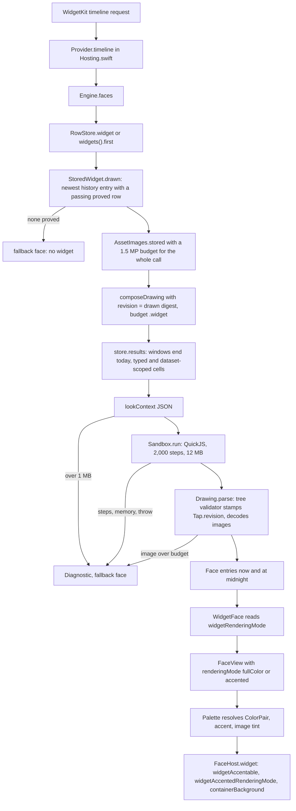
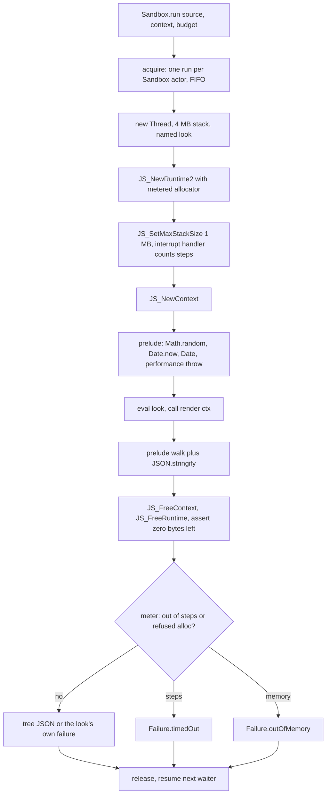
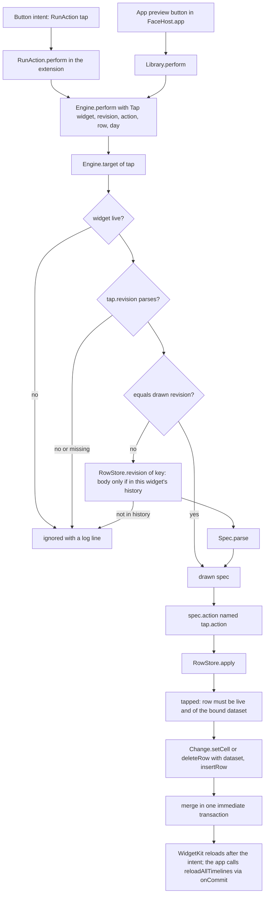
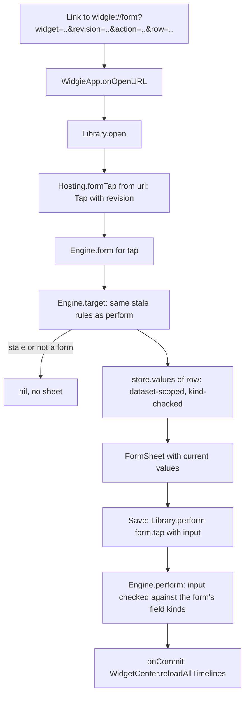
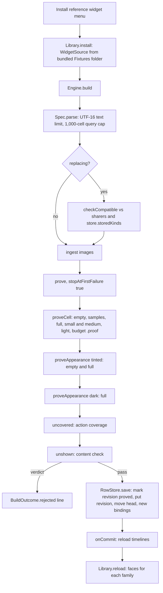
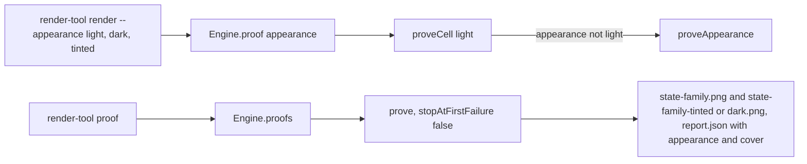
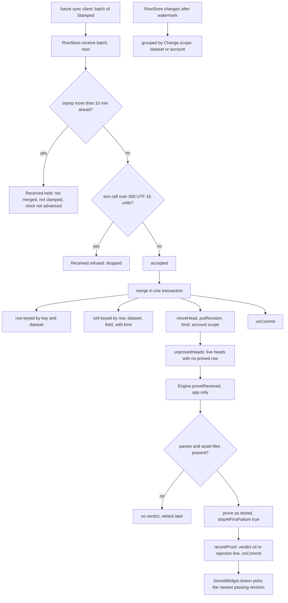
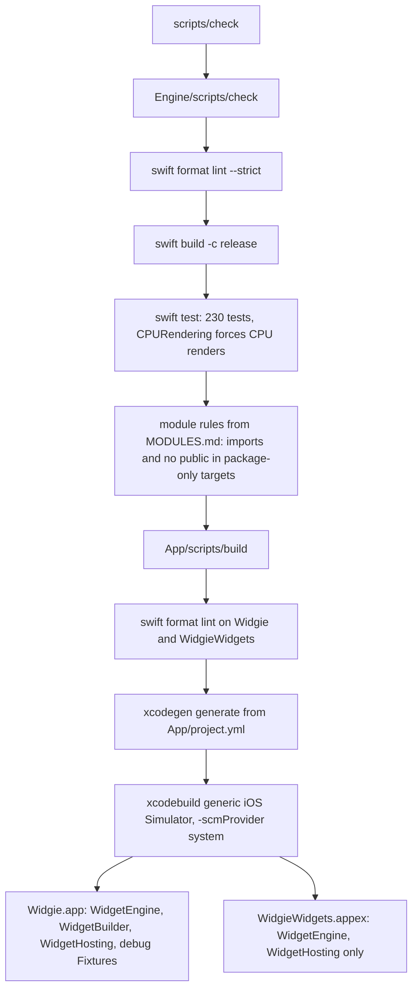

# PR 1: phase 1d review fixes and the iOS app

Branch `phase-1d-review-fixes` into `main`. Three commits:

- Close the phase 1d review findings and run the app on the iOS simulator.
- Check the font allowlist on iOS and fix the habit and to-do looks.
- Put water and the medium size on the home screen, and fix what that showed.

Background reading: [tasks/todo.md](../../tasks/todo.md) ("Phase 0" and "Phase 1d"), [RATIONALE.md](../../docs/engine/RATIONALE.md), [SYNTHESIS.md](../../docs/engine/SYNTHESIS.md), [USAGE.md](../../docs/engine/USAGE.md), [MODULES.md](../../docs/engine/MODULES.md).

## Core changes

- **QuickJS-ng replaces JavaScriptCore.** Looks run in a fresh QuickJS runtime per run, on their own thread, with a step budget and a metered memory budget instead of a time limit. A runaway look now stops and its thread ends. Budgets: widget 2,000 steps and 12 MB, proof 500 steps and 8 MB. QuickJS-ng `v0.18.0` is vendored unmodified in `Engine/Vendor/QuickJS/` as the C target `CQuickJS` (about 85K of the 86K added lines). Only the engine library is copied, with no `std` or `os` module. Do not review those files line by line.
- **Render-time caps on the shared path.** `AssetImages` holds a 1.5 MP pixel budget per `faces` call or proof cell, and each distinct crop counts. `composeDrawing` refuses a `ctx` over 1 MB of JSON. A parse-time cap allows at most 1,000 field values over `list` and `latest` queries. Text length is counted in UTF-16 units. The `full` proof state writes text at the real 300-unit limit. The old fit-report pixel rule is gone.
- **Query windows end today.** `week`, `month`, and `all` gain an upper bound of today, as `today` and `days` already had. A row written ahead for a later day shows on its day.
- **Typed cells.** Each cell stores its kind (`t`, `n`, `b`, `d`) beside its value. Every read takes a cell only when its kind matches the field's kind. The builder also checks a new field kind against the kinds already stored in the dataset.
- **Rows are keyed by (key, dataset).** `setCell` and `deleteRow` now name their dataset, like `insertRow`. A change that names another dataset lands on an identity no read sees. `Change.scope` (`.dataset` or `.account`) groups the outgoing feed. Bindings never leave the account.
- **Bounded `receive`.** `RowStore.receive(_:now:)` holds back changes stamped more than 10 minutes ahead and refuses text cells over the limit. It returns both lists.
- **The `proved` table.** A local, unsynced `proved(revision, verdict)` table. A widget draws its newest revision proved on this device. `Engine.proveReceived()` proves synced heads with the same `prove` as `build`. A rejected revision never draws.
- **Taps carry their revision.** `Tap.revision` is stamped by the tree validator. `RunAction` and the form link carry it. `perform` and `form(for:)` resolve the action from that revision, if it is in the widget's history. A tap with no revision is ignored.
- **Tinted and dark rendering.** Colors may be `{ light, dark }` pairs. Any node may set `accent: true`. Images take `tint`. A package `RenderingMode` environment value drives a `Palette`. The widget host maps WidgetKit's mode into it. Proofs add tinted cells (`empty`, `full`) and a dark cell (`full`) with blank and cover checks.
- **The iOS app and widget extension.** `App/` holds an XcodeGen project ([project.yml](../../App/project.yml)). It has a SwiftUI app that installs the reference fixtures through `engine.build` and previews faces, plus a widget extension that links only `WidgetEngine` and `WidgetHosting`. It has run on the iOS 27.2 simulator with real home screen taps.
- **Checks.** A new top-level [scripts/check](../../scripts/check) runs the engine gate, then [App/scripts/build](../../App/scripts/build). `Engine/scripts/check` drops the Command Line Tools flags now that Xcode is installed. The test count goes from 187 to 231. A test-only C target sets `RB_DISABLE_GPU` so test renders are byte-identical.
- **Fixture looks and the model reference.** The water plus is cut out of its disc and comes before the minus in medium. Habit marks today as a smaller square inside a ring. A done to-do title keeps one line. `namedFontShipsHere` checks every allowlisted font is installed. [look.md](../../Engine/Reference/look.md) and [blocks.md](../../Engine/Reference/blocks.md) teach the new rules.
- **Docs.** [RATIONALE.md](../../docs/engine/RATIONALE.md) and [SYNTHESIS.md](../../docs/engine/SYNTHESIS.md) record decision A (one bounded pull in the timeline provider, not built yet) and decision B (QuickJS-ng). [USAGE.md](../../docs/engine/USAGE.md) and [MODULES.md](../../docs/engine/MODULES.md) were audited against the code.

## 1. Widget render in the extension

WidgetKit asks the timeline provider for entries. The provider calls `Engine.faces`, which loads the drawn widget, runs the look twice (now and at midnight), validates the tree, and returns faces. The view then picks colors from the rendering mode.

Files:

- [Hosting.swift](../../Engine/Sources/WidgetHosting/Hosting.swift): `Provider`, `WidgetFace` (new), `FaceHost.widget` with the new `accent` and `tint` closures, `ImageTint.widgetMode`.
- [Engine.swift](../../Engine/Sources/WidgetEngine/Engine.swift): `faces` passes `stored.revision.hex` into `composeDrawing`.
- [RowStore.swift](../../Engine/Sources/Rows/RowStore.swift): `StoredWidget.drawn` subquery, `widgets()` and `widget(_:)` now return the drawn revision, not the head.
- [LookContract.swift](../../Engine/Sources/WidgetEngine/LookContract.swift): `contextLimit`, `Bindings.revision`, `Bindings.unsaved`.
- [Queries.swift](../../Engine/Sources/Rows/Queries.swift): `Selection(from:through:)`, every window ends today, every cell join checks `dataset` and `kind`.
- [AssetImages.swift](../../Engine/Sources/WidgetEngine/AssetImages.swift): `pixelBudget`, `Failure.overBudget`, the cache keyed by crop and display size.
- [Vocabulary.swift](../../Engine/Sources/WidgetEngine/Vocabulary.swift): the `accent` common prop, the image `tint` prop, the over-budget line, and `header` split out to keep the recursive frame small.
- [Values.swift](../../Engine/Sources/WidgetEngine/Values.swift): `{ light, dark }` color parsing in colors, fills, and gradient stops.
- [Drawing.swift](../../Engine/Sources/WidgetEngine/Drawing.swift): `ColorPair`, `ImageTint`, `Style.accent`, `Picture.tint`.
- [RenderingMode.swift](../../Engine/Sources/WidgetEngine/RenderingMode.swift) (new): `RenderingMode`, `Palette`, the environment keys.
- [NodeView.swift](../../Engine/Sources/WidgetEngine/NodeView.swift) and [FaceView.swift](../../Engine/Sources/WidgetEngine/FaceView.swift): every color goes through `palette`, `AccentGroup`, `PictureView` tint handling, tinted backdrop in `BackgroundView` and `FallbackView`.

Key decisions:

- The look is never told the mode. WidgetKit tells only the view, so one tree must work in every mode, and the renderer resolves it.
- Every non-full-color WidgetKit mode maps to `.accented`. The renderer draws what the system is expected to draw (white at each node's opacity, the tint for accent nodes). On a device the system recolors again by opacity, which should leave this unchanged. A device must confirm it.
- Dark mode is optional. A plain hex color is the same in both schemes, so a yellow sticky note can stay yellow.
- An unproved or rejected head never draws. The widget shows its newest proved revision, or stays hidden.
- Caps live on the path the widget and the proof share (`AssetImages`, `composeDrawing`), so the two cannot disagree. A cap failure is a fallback face with a log line, never a crash.
- The image cache keys on crop and display size, so a look that crops per row pays per crop. This is deliberate: it is what memory really holds.
- `Today` still flips at midnight from a second entry, so day windows change without spending refresh budget.

## 2. Inside `composeDrawing`: the sandbox run

Shared by the widget render (section 1) and every proof cell (section 5). The boundary is unchanged: source and context JSON in, tree JSON out, the same `Failure` cases.

Files:

- [Sandbox.swift](../../Engine/Sources/Sandbox/Sandbox.swift): the actor, `Budget`, `Failure`, `Meter`, `Run.evaluate`, the allocator, `Script`, the prelude.
- [Package.swift](../../Engine/Package.swift): the `CQuickJS` target with `_GNU_SOURCE` and `-w`.
- [Vendor/QuickJS/README.md](../../Engine/Vendor/QuickJS/README.md): the source, tag, commit, what was left out, and how to update.
- [SandboxTests.swift](../../Engine/Tests/LookTests/SandboxTests.swift): runaway loops, memory growth, catching a refused allocation, recursion, `performance.now()`.

Key decisions:

- Budgets count steps, not milliseconds. One step is one interrupt-handler call, every 10,000 interpreter checkpoints. The count depends only on the look and its context, so the Mac proof and the phone agree.
- Memory is metered by a custom allocator, not `JS_SetMemoryLimit`. At its own limit QuickJS often throws `null`, which looks the same as a look's own `throw null`.
- A cap outranks whatever the script did next. A look that catches a refused allocation and returns still fails with the memory line.
- Fresh runtime per run. It costs about 0.2 to 0.4 ms per run on an M4, against 0.1 to 0.15 ms for JavaScriptCore. In return no state is shared and ten runaways leave 0.03 MB behind, against 4.1 MB before.
- Runs on one `Sandbox` are serialized, so one sandbox holds at most one runtime.
- The proof budget is stricter than the widget budget, so a proved look still fits when real rows outgrow the samples.
- QuickJS exposes `performance.now()`. The prelude now blocks it like `Date.now()`.
- Vendored code stays unmodified. Its 592 `-Wshorten-64-to-32` warnings are silenced for `CQuickJS` only.
- No quarantine table. A shipped runaway stops at its budget on every reload and draws a fallback face.

## 3. Home screen tap

A tap on a widget button runs `RunAction` in the extension process. The app's own preview buttons go through the same `Engine.perform`.

Files:

- [Hosting.swift](../../Engine/Sources/WidgetHosting/Hosting.swift): `RunAction` gains the `revision` parameter.
- [Public.swift](../../Engine/Sources/WidgetEngine/Public.swift): `Tap.revision`.
- [Vocabulary.swift](../../Engine/Sources/WidgetEngine/Vocabulary.swift): the tree validator builds every `Tap` with `bindings.revision`.
- [Engine.swift](../../Engine/Sources/WidgetEngine/Engine.swift): `perform`, `target(of:in:)`.
- [RowStore.swift](../../Engine/Sources/Rows/RowStore.swift): `revision(_:of:)`, `apply`, `tapped` (replaces `staleness`), the toggle read that checks `dataset` and `kind`.
- [Merge.swift](../../Engine/Sources/Rows/Merge.swift): `Change` cases that carry `DatasetKey`, `Spec.Cell` stored with its kind code.
- [Library.swift](../../App/Widgie/Library.swift) and [LibraryView.swift](../../App/Widgie/LibraryView.swift): `FaceHost.app` buttons call `Library.perform`.

Key decisions:

- What the user pressed is what runs. A refinement that lands between the render and the press, even one that reuses an action id for another effect, cannot change the press.
- A tap from an older revision still in the history runs that revision's action. Before, a removed action was a no-op.
- A tap with no revision is ignored. Only timelines already on screen before this change are affected, and no release exists.
- The revision must be in this widget's history, so a revision another widget saved never answers for this one.
- The toggle reads the current value only from a cell of the row's dataset and of kind bool. A missing bool reads as false.
- The intent still carries no nonce or expected value. A duplicated insert logs twice, and `toggle` flips the stored value.

## 4. Form link opening the app

A form button is a `Link`, because a widget cannot show input. The link now carries the revision.

Files:

- [Hosting.swift](../../Engine/Sources/WidgetHosting/Hosting.swift): `formURL(for:)` and `formTap(from:)` carry `revision`.
- [WidgieApp.swift](../../App/Widgie/WidgieApp.swift): `onOpenURL`, plus `Engine.suspend` and `Engine.resume` on scene phase.
- [Library.swift](../../App/Widgie/Library.swift): `open`, `showForm`, `perform`.
- [FormSheet.swift](../../App/Widgie/FormSheet.swift): fields by kind, prefilled from `InputForm.fields`.
- [Engine.swift](../../Engine/Sources/WidgetEngine/Engine.swift): `form(for:)`.

Key decisions:

- `form(for:)` and `perform` share `target(of:)`, so the form shown and the write it makes come from the same revision.
- The form sends only fields the user can see a value for. An untouched empty field stays absent.
- The app reloads WidgetKit through the engine's `onCommit`, so no call site can forget it. The extension passes no `onCommit`, because WidgetKit reloads after an intent on its own.
- The app suspends the store when it goes to the background, because iOS kills a suspended app that holds the shared database lock.

## 5. Build and proof in the app

The app installs a bundled fixture through `engine.build`, the same path a model-written widget will take in phase 2. The proof matrix now ends with tinted and dark redraws.

Files:

- [Library.swift](../../App/Widgie/Library.swift): `fixtures`, `install`, `reload`.
- [project.yml](../../App/project.yml): `Engine/Fixtures` copied as a folder resource, excluded in Release.
- [Build.swift](../../Engine/Sources/WidgetBuilder/Build.swift): the stored-kinds check, doc updates for the drawn revision.
- [Document.swift](../../Engine/Sources/Spec/Document.swift): `checkCompatible(_:holding:)`.
- [Proof.swift](../../Engine/Sources/WidgetBuilder/Proof.swift): `appearanceCells`, `proveAppearance`, `draw`, `ProofRender.appearance`, `Engine.proof(appearance:)`.
- [Fit.swift](../../Engine/Sources/WidgetBuilder/Fit.swift): `appearanceVerdict`, `coverShare`, `inkShare` refactor, the pixel rule removed from `verdict`.
- [Source.swift](../../Engine/Sources/WidgetBuilder/Source.swift): the public `Appearance` enum.
- [Samples.swift](../../Engine/Sources/Spec/Samples.swift): `full` writes 300-unit text.
- [Tables.swift](../../Engine/Sources/Spec/Tables.swift) and [Spec.swift](../../Engine/Sources/Spec/Spec.swift): `Limits.allows`, `Limits.queryCells`, `Cell.withinLimits`.
- [JSON.swift](../../Engine/Sources/Spec/JSON.swift): the parser is iterative, so deep nesting costs heap, not thread stack.
- [RowStore.swift](../../Engine/Sources/Rows/RowStore.swift): `save` marks the revision proved in the same transaction.
- [look.md](../../Engine/Reference/look.md), [blocks.md](../../Engine/Reference/blocks.md), [build-prompt.md](../../Engine/Reference/build-prompt.md): the rules the model learns.
- Fixtures: [water](../../Engine/Fixtures/water/widget.json), [habit](../../Engine/Fixtures/habit/widget.json), [todo](../../Engine/Fixtures/todo/widget.json).

Key decisions:

- Proof equals build. `build`, `Engine.proof`, and `Engine.proofs` share `prove` and `composeDrawing`, so the eval tool and the builder cannot disagree.
- Tinted and dark cells redraw the light cell's tree. The look never learns the appearance, so the layout is the light cell's and only the pixels change. The light verdict comes first.
- Which cells: tinted `empty` (sparsest, where a blank or a backdrop shape shows most), tinted `full` (busiest), dark `full` (every color pair in use).
- Tinted checks are a blank check and a cover check: over 50% of the render in one flat non-backdrop color means a full-size shape draws the backdrop. Thresholds came from the fixtures and the eval set.
- Proof taps carry `Bindings.unsaved`, which is not a digest, so a proof tap never names a stored revision.
- The kind check covers cells from deleted widgets, other devices, and other users. A field with no cells may change kind, since nothing can be misread.
- Fixtures install through `engine.build`, not a side door, so the simulator exercised the real proof and QuickJS on iOS.
- Fixture fixes: the water plus is `plus.circle.fill`, a cutout, because Clear mode draws `accent` nodes like the rest and a plus on an accent disc vanished there. In medium the plus comes before the minus, so it does not move when the minus appears and a quick second tap still adds a glass. Habit's today is a smaller square inside a ring, so it stands out once checked. A done to-do title keeps one line and ends in an ellipsis.

## 6. Render tool and evals on the Mac

The command line uses the same proof. It gains `--appearance` for single renders and writes tinted and dark cells for full proofs.

Files:

- [RenderTool.swift](../../Engine/Sources/RenderTool/RenderTool.swift): `--appearance`, file suffixes, the `appearance` key in the report.
- [RenderToolTests.swift](../../Engine/Tests/EngineTests/RenderToolTests.swift).

Key decisions:

- For a dark or tinted single render, the verdict is the light render's line first, then the appearance line, as `build` would report it.
- `cover` appears only on tinted renders. `imagePixels` is now informational, since the budget fails the look itself.

## 7. Sync receive and proving received designs

There is no production caller yet. The sync client is phase 3 and 4 work (decision A). This PR makes the store and builder side safe first, and tests it with two scratch stores in [SyncTests.swift](../../Engine/Tests/RowsTests/SyncTests.swift) and [ReceivedTests.swift](../../Engine/Tests/EngineTests/ReceivedTests.swift).

Files:

- [RowStore.swift](../../Engine/Sources/Rows/RowStore.swift): `receive(_:now:)`, `clockSkew`, `Received`, `changes(after:)` grouped by scope, `unprovedHeads`, `recordProof`, `storedKinds`, `StoredWidget.drawn`.
- [Merge.swift](../../Engine/Sources/Rows/Merge.swift): the schema (row primary key `(key, dataset)`, `cell.dataset`, `cell.kind`, the `proved` table), `Change.scope`, `Scope`, the public `Stamp` and `Stamped` initializers, the merge SQL.
- [Received.swift](../../Engine/Sources/WidgetBuilder/Received.swift) (new): `Engine.proveReceived`.
- [Queries.swift](../../Engine/Sources/Rows/Queries.swift): every read joins cells on `dataset` and `kind`.
- Tests: [SyncTests.swift](../../Engine/Tests/RowsTests/SyncTests.swift), [ReceivedTests.swift](../../Engine/Tests/EngineTests/ReceivedTests.swift), [MergeTests.swift](../../Engine/Tests/RowsTests/MergeTests.swift), [QueryTests.swift](../../Engine/Tests/RowsTests/QueryTests.swift).

Key decisions:

- Rows are keyed by (key, dataset), not guarded. The guard in the original design did not converge: two cells naming different datasets for one row ended differently by arrival order, and so did a forged delete. Keying by the pair gives the same state in every order.
- A cell remembers the dataset it claimed and is read only with a row of that dataset.
- Typed cells need no schema table and no new conflict rule. A redeclared field reads as blank on every path: local, restored, and synced.
- Future stamps are held, not clamped, because clamping would make replicas disagree.
- Oversized text from sync is refused through the same `Spec.Limits.allows` rule a tap obeys.
- `proved` is local and never synced. Each device proves with its own fonts and symbols.
- A revision is proved exactly as stored, because its canonical bytes are what its digest names. Nothing is filled in.
- The extension never proves. It shows the last proved revision meanwhile.
- Bindings, heads, revisions, and widget deletes are account scope. They never reach dataset members.
- Migration 1 was edited in place, as in phase 1b. No store has shipped, so there is no upgrade path. Any old local store (a simulator from before this branch) must be wiped.
- Decision A, not built here: the timeline provider will make one bounded pull (4 second timeout) before it renders. A widget push triggers the reload. The server writes AI block rows ahead of their day, which the today cap makes safe.

## 8. App project and checks

Files:

- [scripts/check](../../scripts/check) (new), [Engine/scripts/check](../../Engine/scripts/check), [App/scripts/build](../../App/scripts/build) (new).
- [App/project.yml](../../App/project.yml) (new): targets, App Group `group.dev.krutikpatel.widgie`, URL scheme `widgie`, `EngineAppGroup` and `EngineURLScheme` Info.plist keys.
- [Widgets.swift](../../App/WidgieWidgets/Widgets.swift): the `WidgetBundle` with only `CreationWidget`, and `AppIntentsPackage` listing `HostingIntents`.
- [WidgieApp.swift](../../App/Widgie/WidgieApp.swift): the same `AppIntentsPackage` in the app.
- Entitlements: [Widgie.entitlements](../../App/Widgie/Widgie.entitlements), [WidgieWidgets.entitlements](../../App/WidgieWidgets/WidgieWidgets.entitlements).
- [.gitignore](../../.gitignore): the generated `.xcodeproj` and Info.plists.
- [Package.swift](../../Engine/Package.swift): `CQuickJS`, `CPURendering`.
- [cpu_rendering.c](../../Engine/Tests/CPURendering/cpu_rendering.c): sets `RB_DISABLE_GPU` when the test bundle loads.
- [ReferenceTests.swift](../../Engine/Tests/LookTests/ReferenceTests.swift): `namedFontShipsHere`.
- [MODULES.md](../../docs/engine/MODULES.md): the `CQuickJS` row and the updated `Sandbox` row, which the check script reads.

Key decisions:

- The project is generated by XcodeGen from checked-in YAML. The `.xcodeproj` is git-ignored, so the project is reviewable text and never conflicts.
- The extension never links `WidgetBuilder`. "No build, no image ingest, no PNG encoding in the extension" is a link-time fact.
- Both targets list `HostingIntents` in `AppIntentsPackage.includedPackages`, because `RunAction` and `PickWidget` live in the package.
- Signing is automatic with an empty team. The simulator accepts it. The team id goes in one place for the device step.
- Xcode's built-in git stalled cloning GRDB, so the build uses `-scmProvider system`.
- `Engine/scripts/check` no longer passes the Command Line Tools framework flags, which mixed two toolchains under Xcode.
- `RB_DISABLE_GPU` is undocumented. If Apple removes it, the pixel flakiness between runs returns, and nothing worse.
- `namedFontShipsHere` runs on macOS in the check. It passed for all 12 families on the iOS 27.2 simulator.
- Simulator testing needs `simslim on <udid> --except widgets,siri --keep com.apple.linkd`. Without `linkd`, every widget stays a grey placeholder.

## Review pointers

Things worth a close look, found while writing this guide:

- `Engine.proveReceived()` has no caller in the app yet, and neither does `RowStore.receive`. That is expected until the sync client lands, but the app will need to call `proveReceived` after every pull, or synced heads never draw.
- `Engine.target(of:)` accepts any revision in the widget's history. That includes an unproved head or a rejected revision. Buttons are only drawn from proved revisions, so only a hand-made intent or URL can reach this. The action is still a closed, parsed block, so the risk is low. Decide if `target` should also require a passing `proved` row.
- `project.yml` excludes the fixtures in Release with `EXCLUDED_SOURCE_FILE_NAMES: Fixtures`. The fixtures are a folder resource. Confirm a Release build really leaves them out.
- `Meter.admit` checks the requested size, but the meter then counts `malloc_size`, which can round up. The count can pass the budget by a few bytes per allocation. It is deterministic, so proofs and widgets still agree.
- Still needs a device: the tinted emulation against iOS 26 tinted and clear, the time per QuickJS step without JIT, a 12 MB runaway plus a full render inside the 30 MB extension, and whether a long press on a widget button runs its action.
