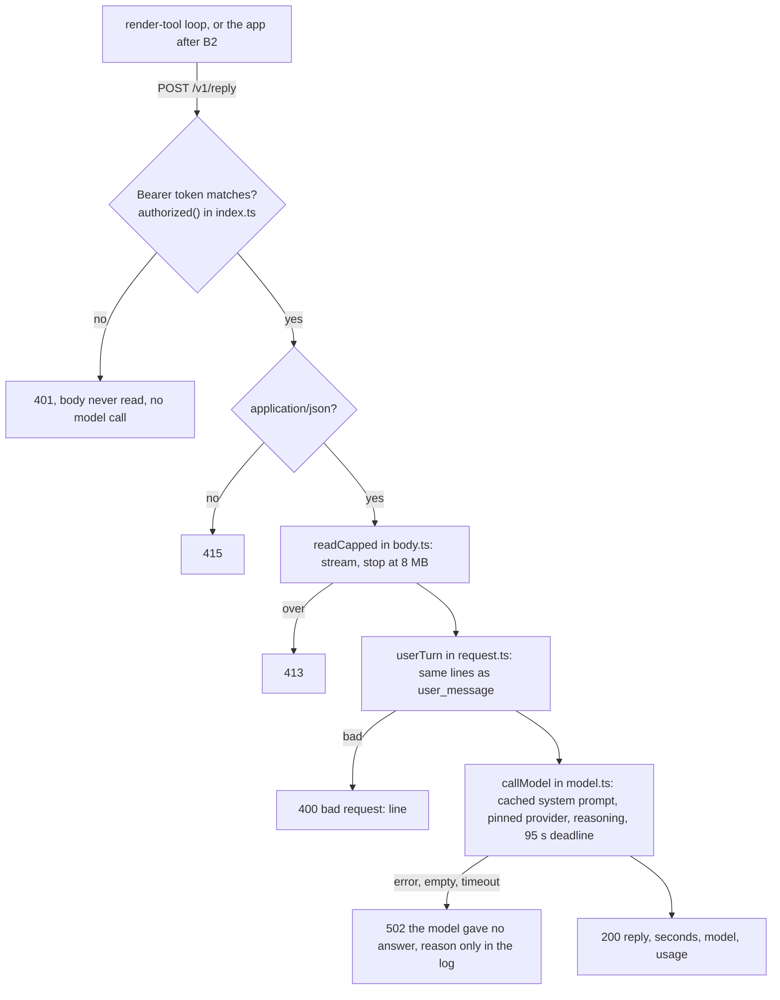
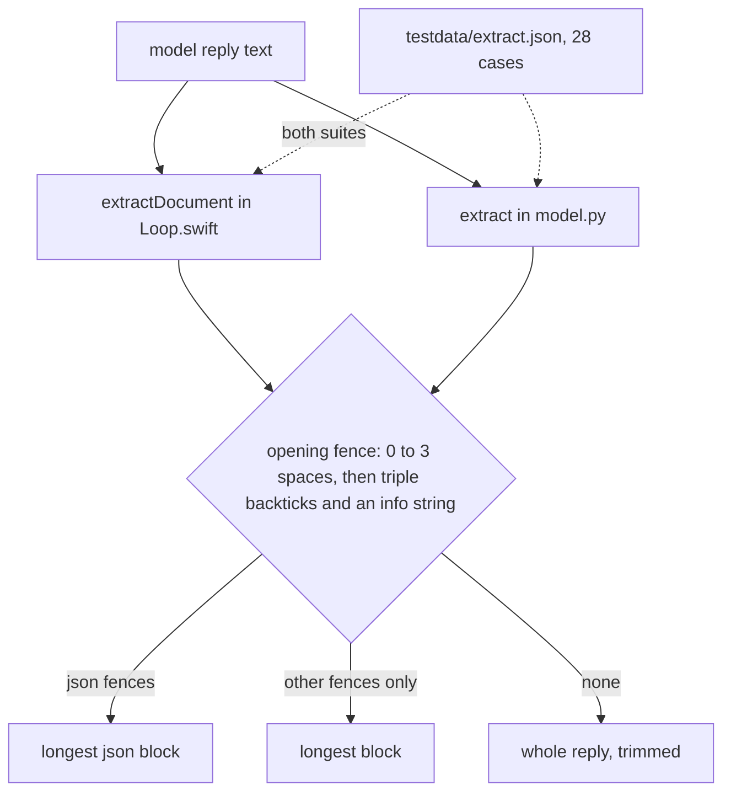
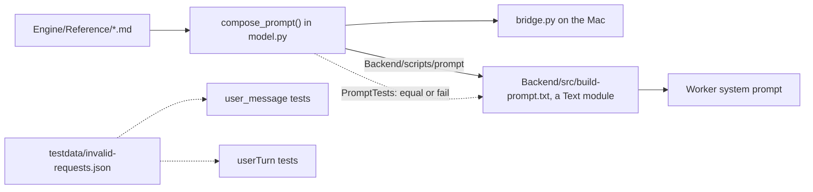

# PR 10: answer /v1/reply from a Cloudflare Worker, behind an operator token

Branch `phase-2b-b1-worker` into `main`. This is B1 of [tasks/phase-2b-backend.md](../../tasks/phase-2b-backend.md), the plan for the backend that replaces the Mac's dev bridge. The plan went through three council rounds before any code; its "B1 results" section records what changed while building.

Background reading: the plan's "Facts", "Shape", and B1 sections, and [bridge.py](../../Engine/Evals/bridge.py), whose contract the Worker keeps.

## Core changes

- **A Worker in `Backend/`.** [index.ts](../../Backend/src/index.ts) answers `POST /v1/reply` with the bridge's contract, `{reply, seconds, model}`, plus an optional `usage`. It refuses a request without the operator token before reading the body, refuses a body that is not JSON or is over 8 MB while streaming it, validates the `ModelRequest`, and calls the model service. Every failure the app sees is a fixed line. One JSON log line per request never holds the words, the document, or the picture.
- **The model service is a setting.** [model.ts](../../Backend/src/model.ts) speaks OpenAI-style chat completions to `MODEL_URL`, with `MODEL`, `PROVIDER` (an OpenRouter provider to pin), and `REASONING` (off or an effort) from [wrangler.jsonc](../../Backend/wrangler.jsonc). Dev runs DeepSeek V4.1 Flash on Together through OpenRouter with reasoning low, the user's choice. Bedrock Mantle works by changing the settings.
- **One prompt, one request grammar.** [Backend/scripts/prompt](../../Backend/scripts/prompt) writes `build-prompt.txt` with the existing `compose_prompt()`, and a Python test fails when it drifts. [request.ts](../../Backend/src/request.ts) ports `user_message`, and both read the new [invalid-requests.json](../../Engine/Evals/testdata/invalid-requests.json), so they refuse a request with the same line.
- **A fence may be indented.** Kimi K2.5 starts its replies with a space before the fence, and both reply extractors, [Loop.swift](../../Engine/Sources/WidgetBuilder/Loop.swift) and [model.py](../../Engine/Evals/model.py), took the closing fence for an empty block. Both now allow up to three spaces, as Markdown does.
- **`render-tool loop` can reach the Worker.** [Model.swift](../../Engine/Sources/WidgetBuilder/Model.swift) gives `BridgeModel` an optional bearer `token`, which [RenderTool.swift](../../Engine/Sources/RenderTool/RenderTool.swift) reads from `WIDGIE_BRIDGE_TOKEN`. B2 removes both with the gate.
- **Checks.** [Backend/scripts/check](../../Backend/scripts/check) runs Biome, `tsc`, and 21 Vitest tests inside workerd, and the top-level [scripts/check](../../scripts/check) runs it between the engine and the app.

## 1. A build request through the Worker

Files: [index.ts](../../Backend/src/index.ts), [body.ts](../../Backend/src/body.ts), [request.ts](../../Backend/src/request.ts), [model.ts](../../Backend/src/model.ts), [env.d.ts](../../Backend/src/env.d.ts), [reply.test.ts](../../Backend/test/reply.test.ts), [request.test.ts](../../Backend/test/request.test.ts).

Key decisions:

- **The gate comes first**, so a caller without the token costs no body read, no parse, and no model call. The comparison is over SHA-256 digests with `timingSafeEqual`, so it is constant time and hides the token's length. An unset token refuses everything, which is how production stays closed until B2.
- **The deadline covers the body.** OpenRouter can send its 200 before the model finishes, so the abort timer runs until the text is read. A 200 whose body carries an error is a failure too.
- **Upstream text never reaches the app.** OpenRouter's error message goes to the log as `reason`; the app gets one fixed line, as it did from the bridge.
- **Base64 is checked with `atob`, not a regex.** On a fresh isolate V8 runs a regex in its interpreter, and the regex took about 5 ms of CPU on a 170 KB picture, close to the Free plan's 10 ms. A length check, a whitespace check, and `atob` accept exactly what Python's strict decoder accepts, in 0.03 ms. Picture builds now use 3 to 7 ms of CPU and text builds about 1 ms, so the plan stays on Workers Free.
- **The service is a setting, not code.** The plan pinned Claude through OpenRouter. The user's AWS account refuses Claude on Bedrock, and OpenRouter's BYOK uses the classic Bedrock path, which the account refuses for every model. Kimi K2.5 worked on Bedrock Mantle but failed four of seven builds on fit. The user chose DeepSeek V4.1 Flash. Since all of these speak chat completions, four vars cover them, and `requestBody` sends OpenRouter's `provider` and `usage` fields only when a provider is set.
- **Together, not DeepSeek's own endpoint.** The OpenRouter account refuses providers that train on paid requests, which excludes DeepSeek's endpoint. Together serves the model at full precision and caches the prompt.

## 2. The reply's document, in the app and in the evals

Files: [Loop.swift](../../Engine/Sources/WidgetBuilder/Loop.swift), [model.py](../../Engine/Evals/model.py), [extract.json](../../Engine/Evals/testdata/extract.json).

Key decisions:

- **Markdown's rule, not a special case for Kimi.** Up to three spaces before a fence is what Markdown allows, and four spaces is an indented code block, so the limit is the format's own. A case at four spaces pins it.
- **One existing case changed its answer.** "an indented fence does not open a block" was pinned with the strict rule, not for a stated reason. Under Markdown's rule a fence and document indented by two spaces give the document, so the case is renamed and expects it.

## 3. Prompt and request parity with the Mac

Key decisions:

- **No second compose implementation.** The Worker imports the generated text, and the Python test is the drift alarm: change anything in `Engine/Reference`, and `scripts/check` fails until `Backend/scripts/prompt` runs.
- **Error lines are shared data.** The malformed cases left `test_model.py` for a file both suites read, and the Python test now asserts the exact line, not only that it raised. The Worker's length caps exist only there, so only Vitest covers them.
- **The app is unchanged.** The Worker's reply adds `usage`, which the app's decoder ignores, and the app still talks to the local bridge until B2 wires `AttestedModel`.

## Live results

Through the deployed dev Worker on DeepSeek V4.1 Flash, reasoning low: water, to-do, habit, word of the day, dog fed, and the R1 picture accepted within two attempts; thinking of you hit one 502 (most likely the 95 s deadline) and was accepted in one attempt on its rerun. The refine and refine-repair bodies answered in about 8 s, and `render-tool refine` accepted both. A second build within five minutes read 16,384 to 17,024 cached prompt tokens. The full comparison with Kimi K2.5 and with reasoning off is in the plan's B1 results. Artifacts are in `Engine/.artifacts/backend/`, not in git.

## Not done here

- App Attest, per-key quotas, the production Worker, and removing the operator token: B2.
- The app on a real endpoint and the device checks: D0 and B3.
- Reasoning low sometimes passes 60 s per attempt. The deadline stays at 95 s until the logs show how often it is hit.
