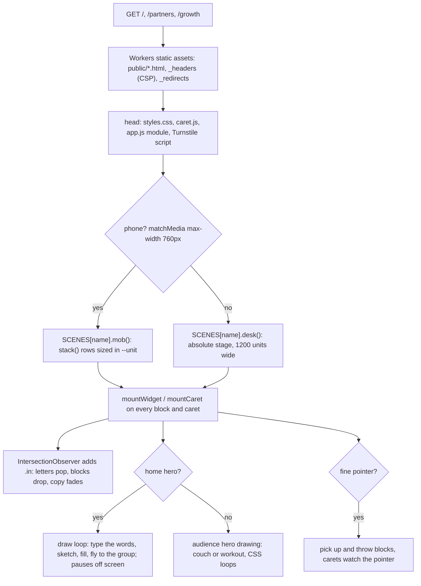
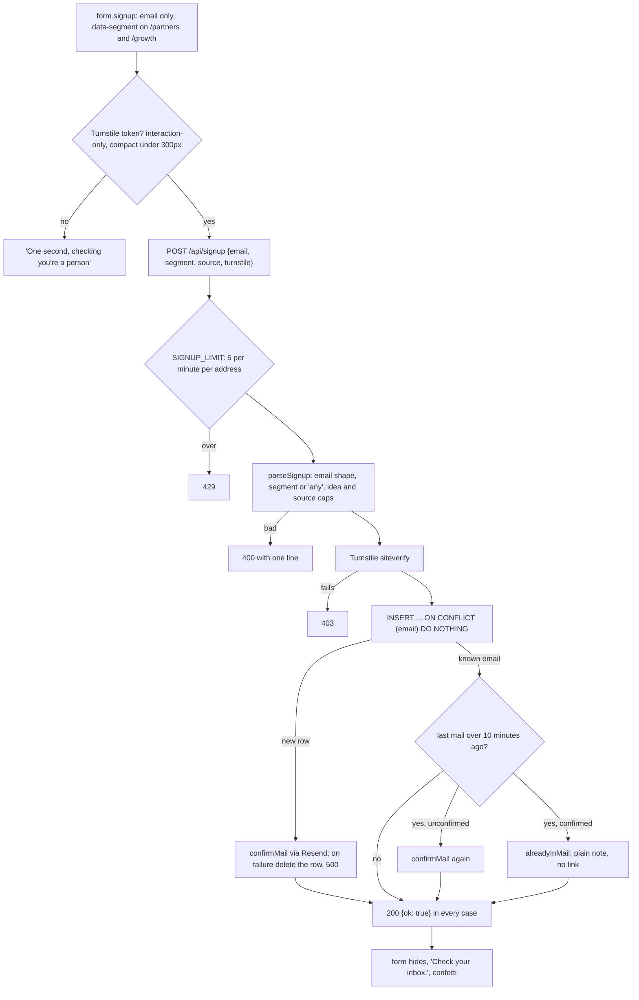
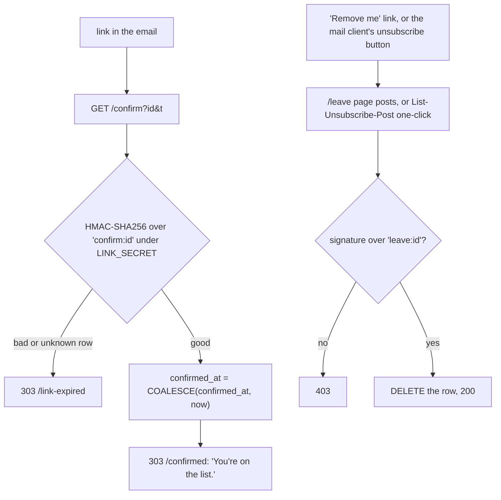

# PR 11: open the Widgie early list, a toy box site that collects emails

Branch `early-access-w1` into `main`. This is W1 of [tasks/early-access.md](../../tasks/early-access.md): a site at widgie.krutikpatel.dev that shows what Widgie does before the app exists and collects the people who want it. The plan's "Decisions", "Review" and "Plan: an email-only list, no invites" sections record how it got here.

Background reading: [docs/research/icp-and-widgets.md](../../docs/research/icp-and-widgets.md) for the two audiences, and the three mocked directions in `docs/design/site-directions/` (the toy box won).

## Core changes

- **A Worker in `Site/`, separate from `Backend/`.** Static pages from `Site/public/` plus three routes in [site.ts](../../Site/src/site.ts): `POST /api/signup`, `GET /confirm`, `POST /api/leave`. A site deploy can never touch the app's API.
- **The toy box world.** Full-bleed color boards that stack like toy box lids, widgets drawn as chunky blocks you can tap (and, with a mouse, pick up and throw), and the caret acting in every scene. One widget source, [widgets.js](../../Site/public/widgets.js), and one caret drawing, [caret.js](../../Site/public/caret.js), shared with the app icon renderer.
- **Three story pages.** `/` opens with the caret drawing widgets from words and a door to each audience. `/partners` ("Made for two.") covers the home you share and the two of you. `/growth` ("Track anything.") covers habits and goals. `/home` and `/us` redirect into `/partners`.
- **Phones first.** Each phone hero opens on its picture right under the headline, scenes scale with the screen from 320px up, the desktop stage keeps scaling down to the phone breakpoint, and keys and fields have phone sizes.
- **An email-only list.** One field. Each row keeps the email, the page it came from (`partners`, `growth`, or `any`), the traffic source, and confirmation. Invites were built, then dropped before merge: the app will share widgets itself.
- **Pages are generated.** [build.mjs](../../Site/pages/build.mjs) writes every HTML page from one template (`npm run pages`); the output is committed and served as is.
- **App icon B3**, the caret peeking in close, in light, dark and tinted ([AppIcon.xcassets](../../App/Widgie/AppIcon.xcassets), [project.yml](../../App/project.yml)).

## 1. A visitor opens a page

Files: [app.js](../../Site/public/app.js), [widgets.js](../../Site/public/widgets.js), [heroes.js](../../Site/public/heroes.js), [caret.js](../../Site/public/caret.js), [styles.css](../../Site/public/styles.css), [build.mjs](../../Site/pages/build.mjs), [_headers](../../Site/public/_headers), [_redirects](../../Site/public/_redirects).

Key decisions:

- **One unit for everything in a scene.** Every widget, block edge, caret and note is sized in `--u`, one iPhone point. On desktop it is `min(0.0834vw, 1.34px)`, a 1200-point stage that tracks the viewport down to the breakpoint, so landscape phones and small tablets never push widgets off the right edge. On phones it is `(100vw - 24px) / 381`, clamped to 0.72-1.04px, so a 381-point scene fills a 320px phone and grows a little on big ones.
- **Phones get their own arrangement, not a shrunk desktop.** Each scene has a `mob()` layout. `stack()` pairs small widgets side by side, gives medium widgets and carets a row, and centers a small widget with no partner.
- **The first phone screen is the product moment.** On phones the hero is a flex column ordered headline, picture, lede, key. The home scene puts the caret and its easel right under "out." so the drawing happens in view; the header key keeps sign-up on the first screen.
- **Motion respects the visitor.** `prefers-reduced-motion` turns off every animation and transition. Without motion the home hero shows its cast greyed with one widget lit. Touch keeps scrolling and tapping; only mouse and pen can pick blocks up.
- **No build step for behavior.** Plain ES modules; only the HTML is generated, so the shared head, header and footer cannot drift between pages.

## 2. Someone joins the list

Files: [site.ts](../../Site/src/site.ts), [email.ts](../../Site/src/email.ts), [app.js](../../Site/public/app.js) (`setupForm`, `renderTurnstile`), [build.mjs](../../Site/pages/build.mjs) (`signupForm`), [0001](../../Site/migrations/0001_signups.sql), [0002](../../Site/migrations/0002_audiences.sql), [0003](../../Site/migrations/0003_email_only.sql), [api.test.ts](../../Site/test/api.test.ts).

Key decisions:

- **The answer never reveals who is on the list.** New, pending and confirmed emails all get `{ok: true}`. A known address gets at most one email per 10 minutes, so the form cannot flood an inbox.
- **A row exists only if its email went out.** If Resend fails, the row is deleted and the person can simply try again.
- **Email only.** The idea field and the audience picker were dropped to cut friction. The API still accepts an optional `idea`, so the field can return without a backend change. A signup from the home page is stored as `any`.
- **No invites.** Pair codes, `/api/pair`, the `/p/<code>` join and share pages, and the invite copy are gone, because the app will have shared widgets built in. `0003_email_only` rebuilds the table without `pair_code` and `joined_via_link`; it ran on production while the table was empty, right before the matching deploy. Old `/p/` links redirect home.
- **Logs never hold an email or an idea.** One JSON line per API request: route, status, milliseconds, and a one-line failure reason.

## 3. Confirming, and leaving

Files: [site.ts](../../Site/src/site.ts) (`confirm`, `leave`, `signedId`), [links.ts](../../Site/src/links.ts), [email.ts](../../Site/src/email.ts), [build.mjs](../../Site/pages/build.mjs) (`confirmed.html`, `leave.html`, `link-expired.html`).

Key decisions:

- **No stored tokens.** Links carry a signature over the row id, with the purpose in the message, so a leave link can never confirm and a confirm link can never delete. Verification is constant time through `crypto.subtle.verify`.
- **Confirm is idempotent**, because mail scanners often open links before the person does.
- **Every email carries one-click unsubscribe** (`List-Unsubscribe` and `List-Unsubscribe-Post`), and leaving deletes the row outright.

## Verification

- 23 Worker tests (Vitest in workerd), Biome and `tsc` pass.
- Checked in phone-sized WebKit (Playwright) at 320×548, 375×667 and 430×800, landscape 844×390, tablet 768×1024 and desktop 1024 and 1280: first screens, scene fit, key and field sizes, and the form.
- End to end locally: signup through the real form, the logged confirmation email, confirm landing on `/confirmed`, and an old `/p/` link landing home.
- Live after deploy: every page returns 200, `/p/<code>` redirects home, `/api/pair` is 404, and a signup with a fake token stops at the Turnstile check (403). A full live signup was not run, to avoid sending a real email.
