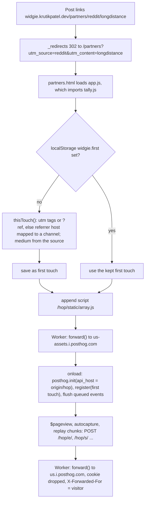
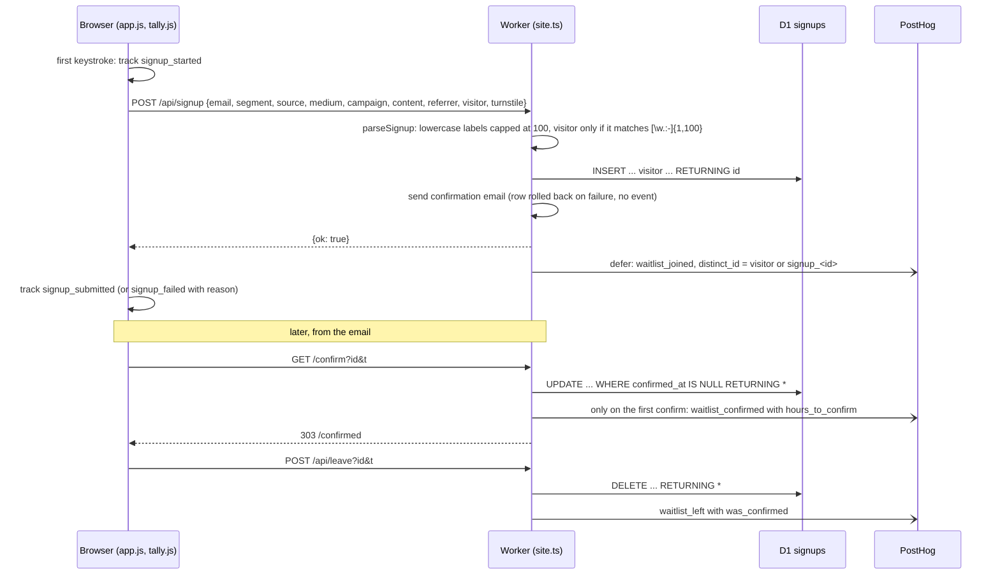
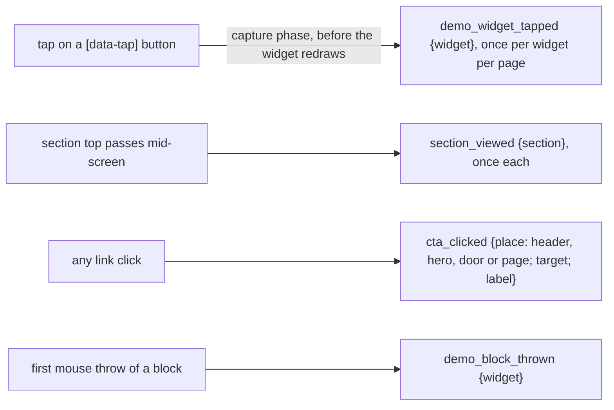

# PR 12: track which posts bring signups to the early list, with PostHog through our own domain

Branch `site-posthog` into `main`. The plan and its result are in [tasks/early-access.md](../../tasks/early-access.md), section "Plan: PostHog tracking for distribution". The posting guide is [docs/marketing/links.md](../marketing/links.md).

## Core changes

- **A new PostHog project, "Widgie"** (US cloud, id 762824). Its home dashboard, "Widgie distribution", ranks channels and posts by confirmed signups.
- **Everything goes through our domain.** The Worker forwards `/hop/*` to PostHog ([posthog.ts](../../Site/src/posthog.ts)). The CSP still only allows `'self'` for scripts and requests.
- **The browser SDK** loads from [tally.js](../../Site/public/tally.js) with cookie persistence, anonymous visitors, heatmaps, web vitals, and session replay with every input masked. A local dev server sends nothing unless the URL has `?tally`.
- **First-touch attribution** (utm source, medium, campaign, content, referring domain) is kept in localStorage and added to every event, so later visits and signups still credit the post that first brought the visitor.
- **Named events** in [app.js](../../Site/public/app.js): `cta_clicked`, `section_viewed`, `demo_widget_tapped`, `demo_block_thrown`, `signup_started`, `signup_submitted`, `signup_failed`, `leave_clicked`.
- **Server events** in [site.ts](../../Site/src/site.ts): `waitlist_joined`, `waitlist_confirmed` and `waitlist_left`. They are sent after the response, under the visitor's PostHog id, which is stored on the row ([0004_visitor.sql](../../Site/migrations/0004_visitor.sql)).
- **Short post links** in [_redirects](../../Site/public/_redirects): `/go/<source>/<post>`, `/partners/<source>/<post>`, `/growth/<source>/<post>`.
- **The privacy page** ([build.mjs](../../Site/pages/build.mjs)) says what PostHog collects and that it never gets an email.

## 1. A visitor arrives from a post

Files: [tally.js](../../Site/public/tally.js), [posthog.ts](../../Site/src/posthog.ts), [site.ts](../../Site/src/site.ts) (`handle`), [wrangler.jsonc](../../Site/wrangler.jsonc) (`run_worker_first` gains `/hop/*`), [_headers](../../Site/public/_headers).

Key decisions:

- **Cookies, no banner.** The user expects mostly US traffic. Cookieless mode was the alternative: no banner and nothing stored, but no replay, no country, and no identity across days.
- **The SDK script is loaded directly instead of through PostHog's inline snippet.** The snippet is inline (the CSP blocks that) and minified (lint fails on it). `array.js` loaded without a stub leaves an uninitialized PostHog on `window`, and `tally.js` calls `init` in `onload`. Events from before that wait in a small queue with their original timestamps.
- **The first touch lives in our localStorage, not only in PostHog.** The form can then credit the right post even when PostHog is blocked, and the server's events still carry it.
- **The proxy path is `/hop`, not `/ingest` or `/posthog`.** Blocker lists know the obvious names.
- **`X-Forwarded-For` is set to `CF-Connecting-IP`.** Otherwise every visitor would look like the Worker, with one location and no bot filtering.
- **The `worker-src 'self' blob: data:` CSP addition** is for the replay recorder's compression worker.

## 2. A visitor signs up and confirms

Files: [site.ts](../../Site/src/site.ts) (`parseSignup`, `signup`, `track`, `listEvent`, `confirm`, `leave`), [posthog.ts](../../Site/src/posthog.ts) (`capture`), [index.ts](../../Site/src/index.ts) (`defer` is `ctx.waitUntil`), [0004_visitor.sql](../../Site/migrations/0004_visitor.sql), [api.test.ts](../../Site/test/api.test.ts).

Key decisions:

- **Server events use the browser's id.** The client funnel (visit, typing, submit) and the server's confirmation join under one person, so "visit to confirmed email, by post" is one funnel. Only the visitor id is stored. Medium, campaign, content and referrer go to PostHog and never into D1.
- **Analytics never touches a response.** Events go through `deps.defer` and failures are logged, never thrown. A test runs signup, confirm and leave with PostHog answering 503.
- **No person profiles** (`$process_person_profile: false`), and no email in any event. A test checks every payload for `@`.
- **Confirm sends an event only on the first confirm.** The `UPDATE` now runs only while `confirmed_at IS NULL`, so mail scanners that open the link first, and second clicks, send nothing. The redirect is unchanged.
- **`$host` comes from `SITE_URL`, not the request.** `wrangler dev` hands the Worker production URLs, so the request host would have slipped dev events past PostHog's localhost test filter.

## 3. The demo widgets, reading and clicks

Files: [app.js](../../Site/public/app.js) (the "Analytics" section, the form, the leave page, the throw handler).

Key decisions:

- **The widget tap listener runs in the capture phase.** The browser run found that a tap redraws the widget, so by the time the click bubbled to `document` its button was detached and the widget name was lost.
- **Read depth uses `rootMargin: 0 0 -50% 0`** rather than a visibility threshold, so it fires once a section reaches mid-screen, however tall the section is on a phone.

## 4. PostHog project and dashboard (outside the repo)

Project "Widgie": app URL set, localhost test filter on by default, heatmaps, web vitals, dead clicks, console logs, and replay with all inputs masked. The dashboard "Widgie distribution" is the project home and holds: confirmed signups and unique visitors (7 days, against the previous 7), signups by audience, visit to confirmed funnel by channel and by post, confirmed signups by channel per day, visitors by channel, visit to signup by landing page and by device, read depth, demo widget taps, and signup failures by reason.
