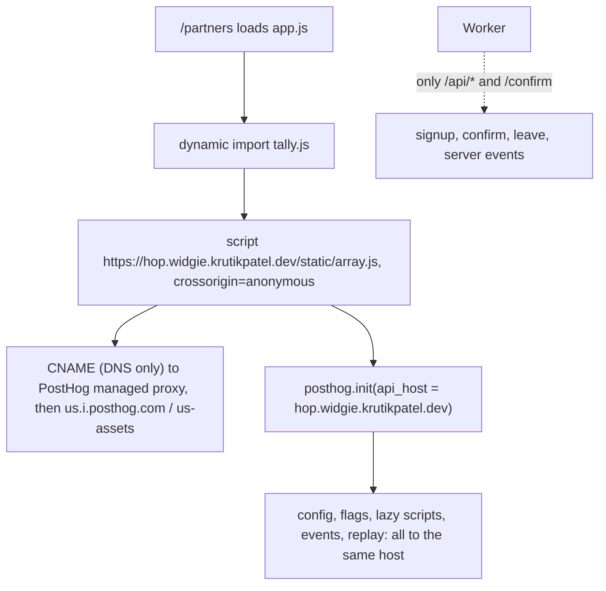

# PR 13: send site analytics through PostHog's managed proxy

Branch `site-managed-proxy` into `main`. It follows [PR 12](12-site-posthog.md), which added PostHog with a Worker proxy at `/hop`. The reasoning is in [tasks/early-access.md](../../tasks/early-access.md), under "Worker request budget".

## Core changes

- **The browser SDK talks to `https://hop.widgie.krutikpatel.dev`,** a PostHog managed proxy behind a DNS-only CNAME on our own domain ([tally.js](../../Site/public/tally.js)).
- **The Worker's `/hop` route is gone,** along with its forwarding code and its tests ([posthog.ts](../../Site/src/posthog.ts), [site.ts](../../Site/src/site.ts), [wrangler.jsonc](../../Site/wrangler.jsonc)). The Worker now runs only for `/api/*` and `/confirm`.
- **The CSP allows the new host** in `script-src` and `connect-src` ([_headers](../../Site/public/_headers)).
- **The SDK script loads with `crossorigin=anonymous`,** so no krutikpatel.dev cookie rides along.
- **Docs:** [links.md](../marketing/links.md) explains `?utm_source=test`, which PostHog's internal-traffic filter drops.

## 1. A visitor loads a page

Files: [tally.js](../../Site/public/tally.js), [_headers](../../Site/public/_headers), [wrangler.jsonc](../../Site/wrangler.jsonc).

Key decisions:

- **Managed proxy over Workers Paid, for now.** With the proxy, analytics never spends Worker requests, so Workers Free only has to cover the list's API. The user will move to the paid plan if traffic needs it.
- **One path, not two.** The Worker proxy was removed rather than kept as a fallback, so there is one place to debug.
- **Blocker resistance stays about the same.** The host is still ours. No common list names PostHog's proxy CNAME target today. The replay recorder's filename was already blocked by name under `/hop` too.
- **Tabs left open across the deploy** keep posting to `/hop` and get refused. Only their analytics events are lost, and `tally.js` is revalidated on every load, so new page views use the new host.
