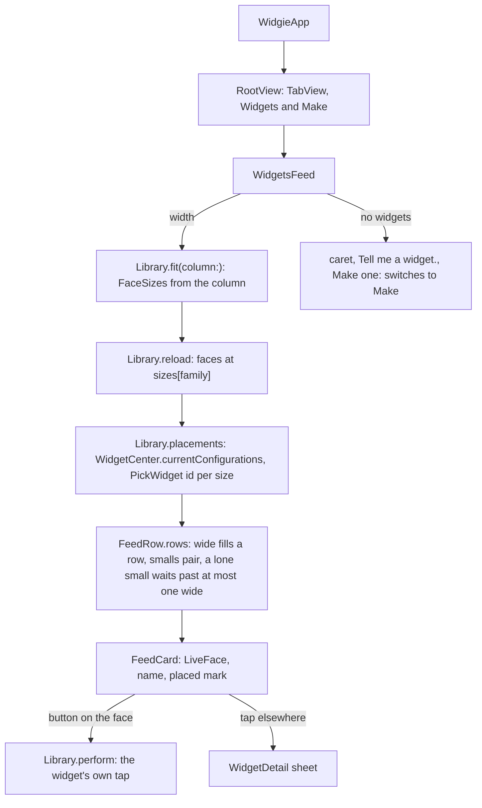
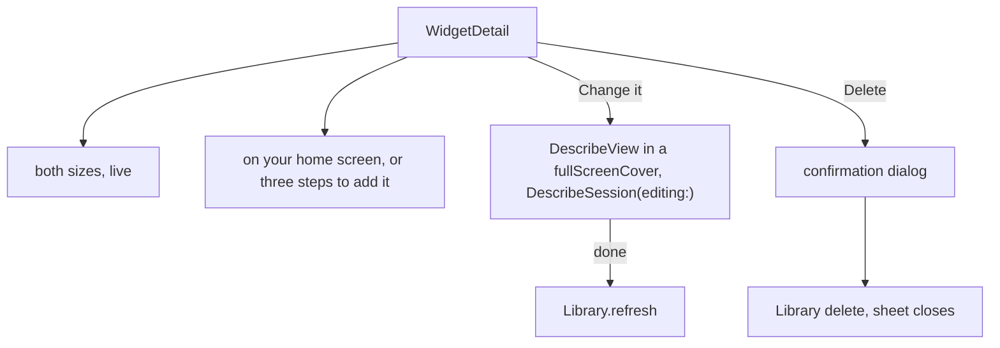
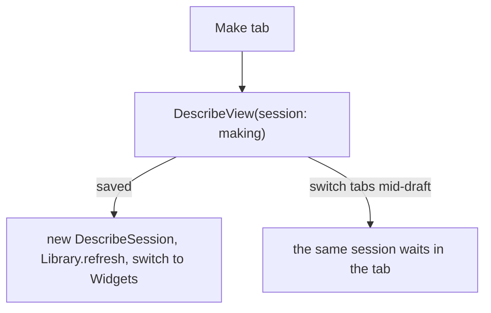
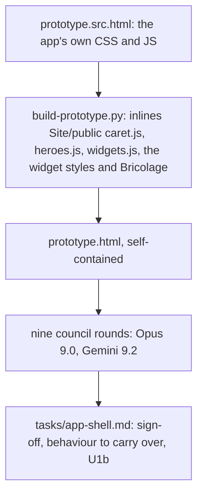

# PR 15: the app shell's tabs, your widgets as a feed, and the approved app design

Branch `app-shell-u1` into `main`. This is U1 of [tasks/app-shell.md](../../tasks/app-shell.md), plus the design work that the rest of the plan builds on: an interactive prototype of all three tabs that the council and the user signed off.

## Core changes

- **Tabs.** [RootView.swift](../../App/Widgie/RootView.swift) puts Widgets and Make in a `TabView`. `WidgieApp` shows it instead of `LibraryView`, which is deleted. The Make tab keeps one `DescribeSession` across tab switches, so looking at your widgets never loses a draft. A form link from a home screen widget switches to Widgets and opens the form there.
- **The feed.** [WidgetsFeed.swift](../../App/Widgie/Widgets/WidgetsFeed.swift) shows every widget as a live face at its home screen size for this screen: wide widgets fill a row and smalls pair up ([FeedLayout.swift](../../App/Widgie/Widgets/FeedLayout.swift), `FeedRow.rows`). A face's own buttons work; a tap elsewhere opens the widget. The empty state is the caret, "Tell me a widget." and Make one. The debug fixtures moved into a long press on the wordmark (DEBUG only).
- **Placement.** [Library.swift](../../App/Widgie/Library.swift) reads `WidgetCenter.currentConfigurations()` on every reload: which widget each home screen widget shows, and in which size. A widget is drawn in the size it is placed in. An unconfigured home screen widget counts as the latest creation, as `WidgetChoiceQuery.defaultResult` does. `FaceSizes` derives both sizes from the column width, so faces render sharp at the feed's size instead of being scaled.
- **Detail.** [WidgetDetail.swift](../../App/Widgie/Widgets/WidgetDetail.swift): both sizes live, whether it is on the home screen and how to add it, Change it (the describe flow in a full screen cover), and Delete with a confirmation.
- **Engine.** [Hosting.swift](../../Engine/Sources/WidgetHosting/Hosting.swift) makes `CreationWidget.kind` and `Family(WidgetFamily)` public, so the app can read placements.
- **The approved design.** [prototype.src.html](../design/app-shell/prototype.src.html) is an interactive prototype of Widgets, Make and Templates, built into the self-contained [prototype.html](../design/app-shell/prototype.html) by [build-prototype.py](../design/app-shell/build-prototype.py), which inlines the landing page's own caret, widgets and styles. It went through nine council rounds until Opus scored it 9.0 and Gemini 9.2, and the user approved it. [tasks/app-shell.md](../../tasks/app-shell.md) records the sign-off, the behaviour to carry over, and a new unit, U1b, that restyles this PR's screens to the prototype.

## 1. Opening the app and looking at your widgets

Files: [RootView.swift](../../App/Widgie/RootView.swift), [WidgetsFeed.swift](../../App/Widgie/Widgets/WidgetsFeed.swift), [FeedLayout.swift](../../App/Widgie/Widgets/FeedLayout.swift), [Library.swift](../../App/Widgie/Library.swift), [Layout.swift](../../App/Widgie/Design/Layout.swift), [FeedTests.swift](../../App/WidgieTests/FeedTests.swift).

Key decisions:

- **Layout B.** Wide widgets span the row and smalls sit in pairs between them, so every face stays readable and live (the user's choice). A small waits past at most one wide for a partner, so the order of your widgets never moves far.
- **Size from placement.** A widget shows in the size it is placed in, medium if placed in both. Unplaced widgets alternate one wide and a pair of smalls, so the feed keeps a rhythm.
- **Faces render at the column size**, not the standard size scaled up, so a small at 179 pt stays sharp.
- **Placement is read on every reload**, and a stale reload is dropped with its placements, so a widget removed from the home screen never comes back as placed.
- **The form and the alert step aside while the detail sheet is up**, because the sheet shows them itself; two sheets never compete.

## 2. Opening a widget: try it, change it, delete it

Files: [WidgetDetail.swift](../../App/Widgie/Widgets/WidgetDetail.swift), [WidgetsFeed.swift](../../App/Widgie/Widgets/WidgetsFeed.swift).

Key decisions:

- **Change it reuses today's describe flow.** U2 replaces it with the chat drawn in the prototype; this PR changes no describe behaviour.
- **A soft fade sits under the bottom button**, so faces scrolling under it never collide with it.

## 3. Making a widget from the Make tab

Files: [RootView.swift](../../App/Widgie/RootView.swift).

Key decisions:

- **The session lives in `RootView`**, not in the tab's view, so the draft survives a tab switch. A save starts a fresh one and shows the new widget in Widgets.

## 4. The design for the rest of the plan

Files: [prototype.src.html](../design/app-shell/prototype.src.html), [build-prototype.py](../design/app-shell/build-prototype.py), [prototype.html](../design/app-shell/prototype.html), [tasks/app-shell.md](../../tasks/app-shell.md), [tasks/lessons.md](../../tasks/lessons.md).

Key decisions:

- **The site's world, not its skin.** The prototype uses the landing page's sky, widgets and type, but the user rejected its thick outlines and hard offset shadows for the app, so every surface is soft. The lesson is in `tasks/lessons.md`.
- **Widgie is the hero of every screen**, as Brainrot builds around its brain: it stands on your first widget and talks, draws your widget in Make, and acts out each Templates category.
- **The built page is committed** so anyone can open it without a build step. `prototype.src.html` is the file to edit; rebuild with `python3 docs/design/app-shell/build-prototype.py`.
- **The first mocks are gone.** `mocks.html` was superseded by the prototype, so the plan points only at the prototype.
