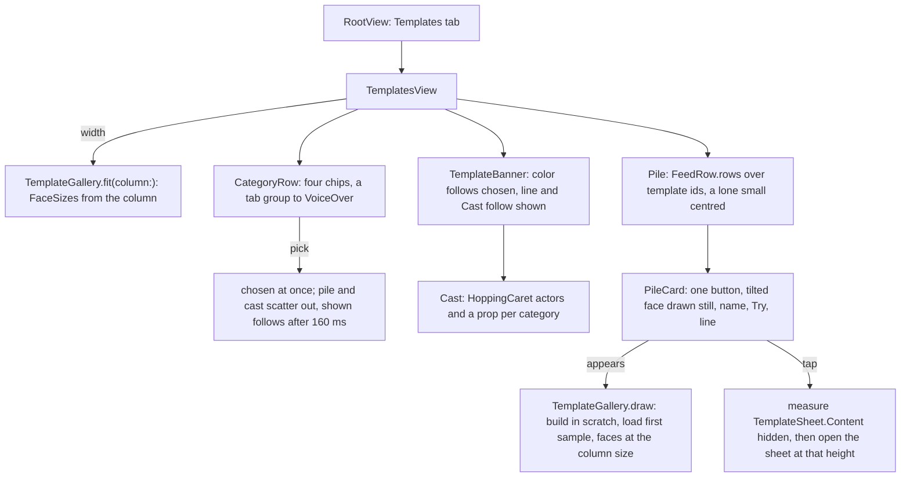
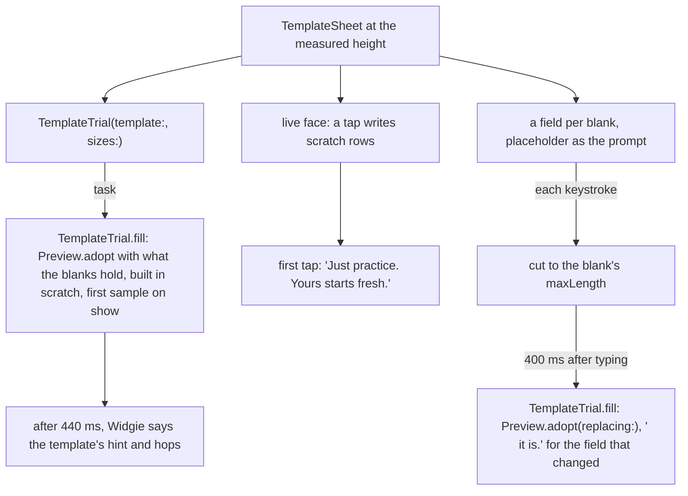
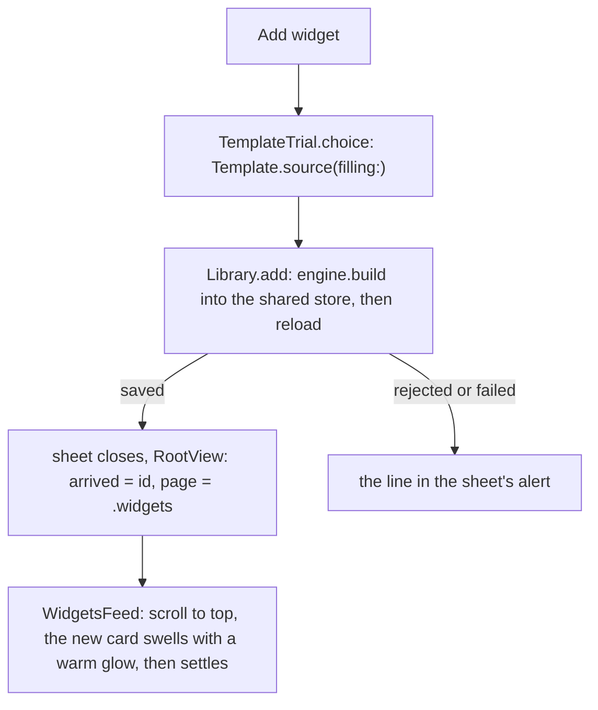
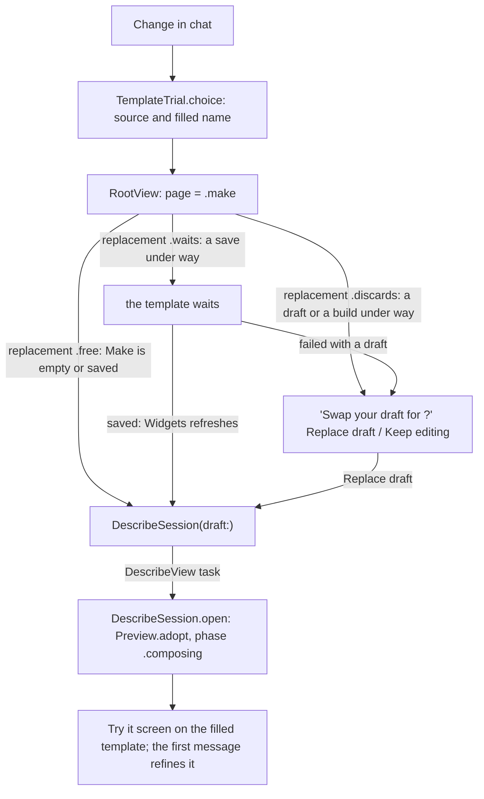
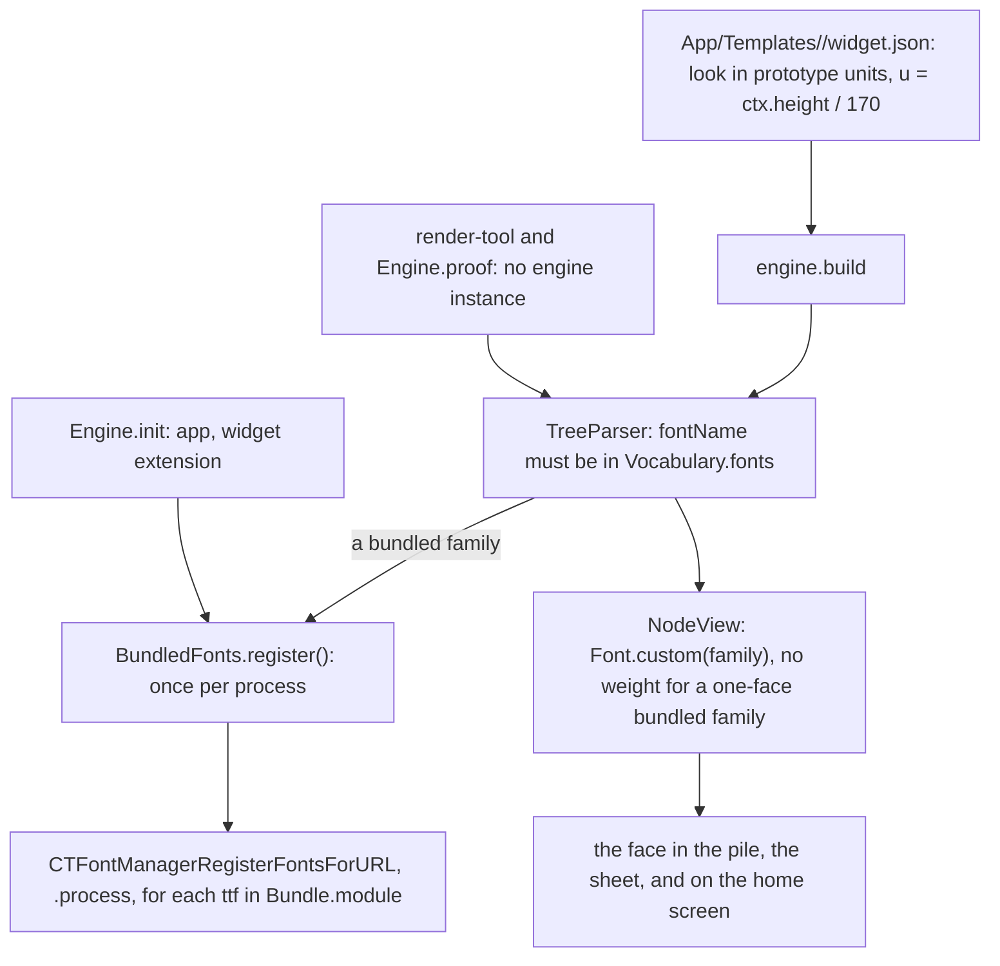

# PR 16: the Templates tab

Branch `app-shell-u3-templates` into `main`. This is U3 of [tasks/app-shell.md](../../tasks/app-shell.md): the Templates tab as drawn in the approved prototype ([prototype.src.html](../design/app-shell/prototype.src.html)), on the app's current ground and font, which U1b replaces.

## Core changes

- **Templates.** Six bundled templates under [App/Templates/](../../App/Templates/), each a `widget.json` and a `template.json` with its name, line, category, order, size in the pile, Widgie's hint, and its blanks, each with a maximum length. [Template.swift](../../App/Widgie/Templates/Template.swift) reads the catalog and fills blanks in the decoded document, cut to their length. A blank in `look` is always a whole quoted literal.
- **Faces from the prototype.** Each template's face is redrawn to match its prototype tile by day and by night: hearts, Luna the puppy, shared groceries (was the to-do list), habit squares with three habits, water with its bottle, and a Spanish word of the day with Know it and Again.
- **Bricolage in the engine.** [Fonts/](../../Engine/Sources/WidgetEngine/Fonts/) holds two static Bricolage Grotesque faces, the script that cuts them and the OFL. [Fonts.swift](../../Engine/Sources/WidgetEngine/Fonts.swift) registers them for the whole process, so looks can name them with `fontName` and the app can use them, and logs one that fails to register.
- **Engine additions for checking faces.** `render-tool --size` draws a face at any size, such as the app's 358x172 medium, and `Face.isFallback` tells a host whether a look really drew.
- **The tab.** [TemplatesView.swift](../../App/Widgie/Templates/TemplatesView.swift) is the third tab in [RootView.swift](../../App/Widgie/RootView.swift): the eyebrow and title, the category chips, the banner ([TemplateBanner.swift](../../App/Widgie/Templates/TemplateBanner.swift)), and the tilted pile. [TemplateGallery.swift](../../App/Widgie/Templates/TemplateGallery.swift) draws each sample face once, lazily, at the column size, in a scratch engine of its own.
- **The sheet.** [TemplateSheet.swift](../../App/Widgie/Templates/TemplateSheet.swift) shows the face live on scratch data with Widgie and its bubble, a field for each blank, Change in chat, and Add widget. [TemplateTrial.swift](../../App/Widgie/Templates/TemplateTrial.swift) owns the scratch face, the typed values, and what Widgie says.
- **Seams in shared code.** `FeedRow` is generic over its id, so the pile and the feed share one layout rule. `Preview` takes face sizes and gains `adopt(_:replacing:)`. `Library.add` builds a source into the library. `DescribeSession(draft:)` starts on an unsaved draft.
- **Design helpers.** [Theme.swift](../../App/Widgie/Design/Theme.swift) gains `display(size:)` (the system font at heavy weight until U1b), `restShadow()`, `KeyButtonStyle`, `SoftCloseButton`, `SquishStyle`, and 22 color tokens. [Caret.swift](../../App/Widgie/Design/Caret.swift) gains `happy` eyes and `HoppingCaret`, and a still caret now keeps its eyes open.

## 1. Browsing templates

Files: [TemplatesView.swift](../../App/Widgie/Templates/TemplatesView.swift), [TemplateBanner.swift](../../App/Widgie/Templates/TemplateBanner.swift), [TemplateGallery.swift](../../App/Widgie/Templates/TemplateGallery.swift), [Template.swift](../../App/Widgie/Templates/Template.swift), [FeedLayout.swift](../../App/Widgie/Widgets/FeedLayout.swift), [TemplateTests.swift](../../App/WidgieTests/TemplateTests.swift).

Key decisions:

- **The prototype's four categories,** For two, Home, Habits and Goals, with no All and no Learning. Word of the day sits in Goals, as in the prototype. The plan says so now.
- **The fixtures map to the prototype's names:** hearts is For two "Thinking of you", dog fed is Home "Pet fed", to-do is Home "Shared groceries", habit is Habits "Habit squares", water is Habits "Water", and word of the day is Goals "Word of the day". Blanks only where a name belongs: who gets the hearts, the pet, the three habits. `Engine/Fixtures/` is untouched, because engine tests read it.
- **One layout rule for the feed and the pile.** `FeedRow` is generic over its id instead of a second copy for templates.
- **Tilt as in the prototype:** smalls alternate at 2.5, 2 and 1.5 degrees, wides at 1, and each face rests at 97 percent so a press straightens and squishes it.
- **Faces are drawn at the column size,** never scaled up, once per template, when its card first appears.
- **A pile face is drawn still** (`FaceHost.still`), so the card is the only button: no look button nests inside it or reaches VoiceOver. A test fails when a pile face is the fallback rather than the look.
- **At the accessibility text sizes** the chips scroll sideways, the banner's line takes the full width over the cast, and every card takes its own row so its words wrap.
- **Motion:** the pile rises in staggered, scatters out and back in on a switch, the cast hops and acts with its prop, the heart beats, and Widgie blinks and sways. Reduce Motion turns all of it off.

## 2. Trying a template

Files: [TemplateSheet.swift](../../App/Widgie/Templates/TemplateSheet.swift), [TemplateTrial.swift](../../App/Widgie/Templates/TemplateTrial.swift), [Preview.swift](../../App/Widgie/Preview.swift), [Theme.swift](../../App/Widgie/Design/Theme.swift), [Caret.swift](../../App/Widgie/Design/Caret.swift).

Key decisions:

- **The native sheet,** for drag to dismiss, focus and VoiceOver, with the prototype's gradient, 36 point corners and a 34 point soft close button. On iOS 26 a sheet below full height floats a little in from the screen's edges; the prototype draws it edge to edge.
- **The sheet is measured before it opens.** A sheet keeps the detent it opened with, so a detent that follows the content after opening never applies. The presenter lays out `TemplateSheet.Content` hidden at the sheet's width, then opens the sheet at that height. The face sizes are fixed before then for the same reason. At the accessibility text sizes the sheet opens full height and scrolls.
- **A preview tap is practice.** It writes to the trial's scratch engine only, and Widgie says so once.
- **The field shows the placeholder as its prompt,** rather than a prefilled value as in the prototype, so typing a name needs no clearing. Empty means the placeholder.
- **A typed name rebuilds the face** after a pause, so the face shows the name as it will be added. Widgie takes up the field that changed, not the first one filled in, and says nothing when a field is cleared.
- **Each blank has a maximum length, so no value a person types can fail to build.** It counts UTF-16 units, the unit of the engine's member names; a character takes at least one, so it also bounds the 40-character widget name. The face sets the real limit: the builder rejects an ellipsis inside a text's first word, so a one-word name must fit whole. 20 for the pet and for who gets the hearts, whose headers may shrink to 0.4, and 12 for each habit. The field cuts after each keystroke, because a text field whose binding refuses a character keeps showing it, and `Template.source(filling:)` cuts again.
- **The face always ends on what the fields show.** `TemplateTrial.fill` runs one build at a time in a task of its own, so a debounce cancelled by the next keystroke never stops a build halfway. Values typed while a build runs, the first one included, are built as soon as it ends, so builds never land out of order.
- **A blank is filled in one pass over the template's text.** A value that holds another blank's `{{key}}` stays as typed, so the result does not depend on the order of the blanks and no value can reach the look's code.
- **Widgie's words never cover the face.** Beside a small face its bubble stays inside its own column; above a face it ends where the face starts, however many lines it takes.

## 3. Adding a template

Files: [TemplateSheet.swift](../../App/Widgie/Templates/TemplateSheet.swift), [Library.swift](../../App/Widgie/Library.swift), [RootView.swift](../../App/Widgie/RootView.swift), [WidgetsFeed.swift](../../App/Widgie/Widgets/WidgetsFeed.swift).

Key decisions:

- **Every template goes through `engine.build`,** the path every widget takes. An app test builds each one with its placeholders, with quotes, a backslash and an emoji, and with every blank past its length in wide letters and in emoji, so Add and Change in chat never meet a rejection a person caused. Another test proves each blank's value changes the face in both sizes.
- **The added widget starts fresh:** the sample data stays in the pile and the sheet.
- **The sheet stays while Add runs.** Swipe and the close button wait for it, because a finished add jumps to Widgets.
- **The highlight is a brief swell and glow,** not the New tag, which U1b adds with Widgie's reaction.
- **`Library.install` now builds through `Library.add`,** so the debug fixtures and templates share one path.

## 4. Changing a template in chat

Files: [RootView.swift](../../App/Widgie/RootView.swift), [DescribeSession.swift](../../App/Widgie/Describe/DescribeSession.swift), [Preview.swift](../../App/Widgie/Preview.swift), [DescribeSessionTests.swift](../../App/WidgieTests/DescribeSessionTests.swift).

Key decisions:

- **The seam is the session's origin.** `DescribeSession` holds what it starts from (nothing, a library widget, or an unsaved draft) instead of an optional id, so a session can never both edit a library widget and start from a template. `editing` is derived from it. An unsaved draft opens like a refinement and Save adds it as a new widget.
- **A replaced draft asks first,** as the design sign-off says, with Replace draft and Keep editing.
- **A save under way is never thrown away.** It cannot be stopped and would land after a discard, so `DescribeSession.replacement` says `.waits` while it runs and the template takes Make's place once it lands, after Widgets refreshes. `DescribeView` refuses to close during a save for the same reason.
- **Make is still today's describe flow.** U2 turns it into the chat.

## 5. The plan

Files: [tasks/app-shell.md](../../tasks/app-shell.md).

Key decisions:

- **U3 is checked off** with what it built. The chat chips' `suggestion` field moves to U2, which uses it.
- **U4 lists only what is left:** the prototype's remaining 13 tiles, in the four categories, each checked against its reference tile.
- **Every face matches its prototype tile, by day and by night,** recorded under U3, and a lesson in [tasks/lessons.md](../../tasks/lessons.md): a prototype spec covers the content, not just the frame.

## 6. Template faces and the engine font

Files: [Fonts.swift](../../Engine/Sources/WidgetEngine/Fonts.swift), [Fonts/cut-bricolage.py](../../Engine/Sources/WidgetEngine/Fonts/cut-bricolage.py), [Vocabulary.swift](../../Engine/Sources/WidgetEngine/Vocabulary.swift), [NodeView.swift](../../Engine/Sources/WidgetEngine/NodeView.swift), [Engine.swift](../../Engine/Sources/WidgetEngine/Engine.swift), [Package.swift](../../Engine/Package.swift), [look.md](../../Engine/Reference/look.md), [build-prompt.txt](../../Backend/src/build-prompt.txt), [MODULES.md](../engine/MODULES.md), [the six templates](../../App/Templates/), [TemplateTests.swift](../../App/WidgieTests/TemplateTests.swift).

Key decisions:

- **Two static faces, not the variable font.** `Bricolage Grotesque Display` (weight 800, 82 percent width, optical size 36) sets big numbers and words. `Bricolage Grotesque Key` (weight 700, 92 percent width, optical size 18) is for keys and bold labels, and U1b uses it for the app. Each is one face, so the renderer passes no weight for them: SwiftUI logs a failure for every weight a family cannot supply.
- **Registered in two places, both idempotent.** `Engine.init` registers them so the app and the extension can use them from launch. The validator registers them when a look names one, because `Engine.proof` and render-tool draw without an engine. Both run one `static let`.
- **One copy in the repo.** The fonts are a WidgetEngine resource. Xcode copies the resource bundle into the app and into the widget extension, about 180 KB each.
- **The model sees the fonts.** `look.md`'s font table and `Vocabulary.fonts` gain both families, a test keeps them equal, `look.md` says the two ignore `weight`, and `Backend/scripts/prompt` regenerated the Worker's prompt. `namedFontShipsHere` registers before it checks.
- **The module check reads only Swift files,** so the cutting script can sit beside the fonts. WidgetEngine may now import CoreText.
- **Looks are drawn in the prototype's units.** Every size is a multiple of `u = ctx.height / 170`, the prototype's widget height, so a face keeps the tile's proportions in the pile, the sheet and on any phone. Bricolage's line is 1.2 times its size where the prototype's is 1.0, so the gaps around a big number are 0.1 of its size shorter.
- **Marks are cut out, not drawn on top.** The heart and check keys are discs with the mark cut out by winding, and the puppy's eyes, nose and mouth are cut out of her head, so all of them still show in tinted and clear mode. A key with words on a solid fill (water's +1 glass, Know it) draws the solid fill in `widgetBackground`, which tinted mode removes, under a faint copy in the tree, so its words stay readable when tinted.
- **Behaviour kept, and added where the tile shows it.** Hearts drops the photo and the unused last-heart query. Pet fed keeps red once 12 hours pass and the undo, which shows top right for an hour after your own feed. Water keeps its undo for ten minutes after a glass. Habit squares tracks three habits (one `checkins` table with a `habit` number) and the footer names the longest streak. Word of the day is Spanish, as on the tile, with `Know it` and `Again` setting a `verdict` and a learned count.
- **Shared groceries shows its newest items in the order they were added, crossed or not.** A row only knows when it was added, not when it was crossed, so no rule that puts open items first can keep a just-crossed item in place once the list is full. This one never moves a row when you cross it, and new items push the oldest off, so crossed ones clear themselves. With more items than fit, an older open item can sit below the fold, and the medium's count still says how many are left. The tile's six items keep the tile's order.
- **A crossed item gets a faint remove mark,** for something added by mistake. Widgets have no long press, and the open list stays as the tile draws it. Add is a small plus beside the count.
- **Habit squares fits any medium width.** The prototype's row is 357.5 units, wider than the app's medium (353.8 units at 358 by 172 points). The squares keep the prototype's size and the name column takes the rest of the row, never under the prototype's 70 units; below that the squares shrink, 3 percent at the app's size. Both margins stay 16 units and the last square sits under "today". Small keeps 5 days, with its squares at 0.72.
- **Copy promises only what works today.** No automation runs on the phone or the server before phase 3, so Word of the day says daily words are on their way, in its line, its hint and its empty face. Nothing syncs before phase 4, so groceries' line says it is on one phone for now and Widgie says sent hearts stay on this phone. The other templates' copy was already true.
- **Remaining differences from the tiles:** the habit footer says "Read: 7 days in a row" where the tile says "Reading", because it shows the habit's own name. The groceries line and Word of the day's line differ from the prototype's because those promised sharing and a daily word. The groceries strike line is SwiftUI's, a little heavier than the browser's. Water's sample glasses are 10 to 14 minutes old, so the pile shows 5 of 8 except in the first quarter hour after midnight.
