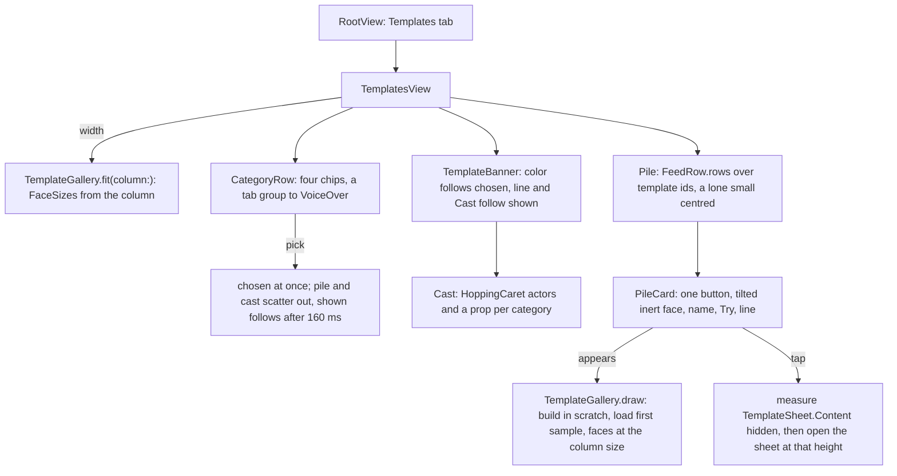
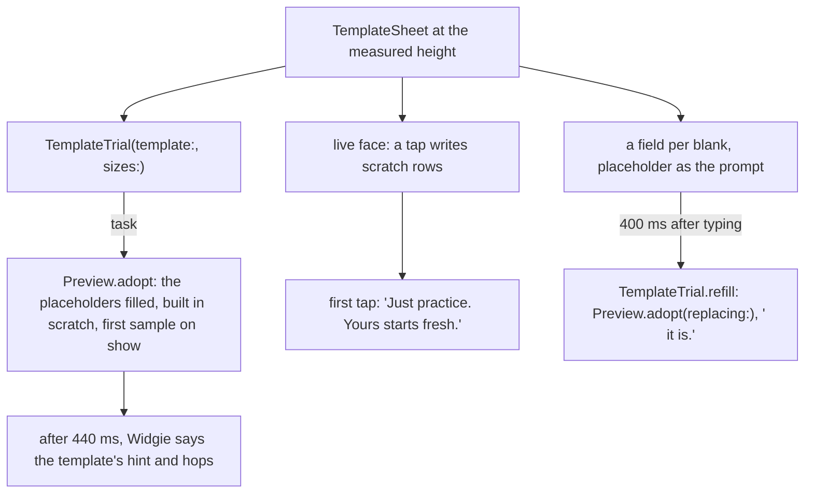
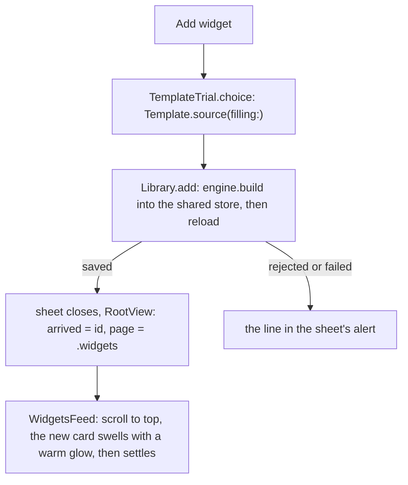
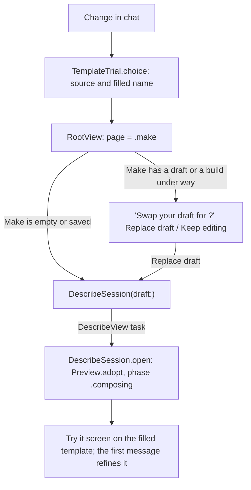

# PR 16: the Templates tab

Branch `app-shell-u3-templates` into `main`. This is U3 of [tasks/app-shell.md](../../tasks/app-shell.md): the Templates tab as drawn in the approved prototype ([prototype.src.html](../design/app-shell/prototype.src.html)), on the app's current ground and font, which U1b replaces.

## Core changes

- **Templates.** The six fixtures are bundled templates under [App/Templates/](../../App/Templates/), each a `widget.json` and a `template.json` with its name, line, category, order, size in the pile, Widgie's hint, and its blanks. [Template.swift](../../App/Widgie/Templates/Template.swift) reads the catalog and fills blanks in the decoded document. A blank in `look` is always a whole quoted literal.
- **The tab.** [TemplatesView.swift](../../App/Widgie/Templates/TemplatesView.swift) is the third tab in [RootView.swift](../../App/Widgie/RootView.swift): the eyebrow and title, the category chips, the banner ([TemplateBanner.swift](../../App/Widgie/Templates/TemplateBanner.swift)), and the tilted pile. [TemplateGallery.swift](../../App/Widgie/Templates/TemplateGallery.swift) draws each sample face once, lazily, at the column size, in a scratch engine of its own.
- **The sheet.** [TemplateSheet.swift](../../App/Widgie/Templates/TemplateSheet.swift) shows the face live on scratch data with Widgie and its bubble, a field for each blank, Change in chat, and Add widget. [TemplateTrial.swift](../../App/Widgie/Templates/TemplateTrial.swift) owns the scratch face, the typed values, and what Widgie says.
- **Seams in shared code.** `FeedRow` is generic over its id, so the pile and the feed share one layout rule. `Preview` takes face sizes and gains `adopt(_:replacing:)`. `Library.add` builds a source into the library. `DescribeSession(draft:)` starts on an unsaved draft.
- **Design helpers.** [Theme.swift](../../App/Widgie/Design/Theme.swift) gains `display(size:)` (the system font at heavy weight until U1b), `restShadow()`, `KeyButtonStyle`, `SoftCloseButton`, `SquishStyle`, and 22 color tokens. [Caret.swift](../../App/Widgie/Design/Caret.swift) gains `happy` eyes and `HoppingCaret`, and a still caret now keeps its eyes open.

## 1. Browsing templates

Files: [TemplatesView.swift](../../App/Widgie/Templates/TemplatesView.swift), [TemplateBanner.swift](../../App/Widgie/Templates/TemplateBanner.swift), [TemplateGallery.swift](../../App/Widgie/Templates/TemplateGallery.swift), [Template.swift](../../App/Widgie/Templates/Template.swift), [FeedLayout.swift](../../App/Widgie/Widgets/FeedLayout.swift), [TemplateTests.swift](../../App/WidgieTests/TemplateTests.swift).

Key decisions:

- **The prototype's four categories,** For two, Home, Habits and Goals, with no All and no Learning. Word of the day sits in Goals, as in the prototype. The plan says so now.
- **The fixtures map to the prototype's names:** hearts is For two "Thinking of you", dog fed is Home "Pet fed", to-do is Home "To-do list", habit is Habits "Habit squares", water is Habits "Water", and word of the day is Goals "Word of the day". Blanks only where a name belongs: who gets the hearts, the pet, the habit. `Engine/Fixtures/` is untouched, because engine tests read it.
- **One layout rule for the feed and the pile.** `FeedRow` is generic over its id instead of a second copy for templates.
- **Tilt as in the prototype:** smalls alternate at 2.5, 2 and 1.5 degrees, wides at 1, and each face rests at 97 percent so a press straightens and squishes it.
- **Faces are drawn at the column size,** never scaled up, once per template, when its card first appears.
- **At the accessibility text sizes** the chips scroll sideways, the banner's line takes the full width over the cast, and every card takes its own row so its words wrap.
- **Motion:** the pile rises in staggered, scatters out and back in on a switch, the cast hops and acts with its prop, the heart beats, and Widgie blinks and sways. Reduce Motion turns all of it off.

## 2. Trying a template

Files: [TemplateSheet.swift](../../App/Widgie/Templates/TemplateSheet.swift), [TemplateTrial.swift](../../App/Widgie/Templates/TemplateTrial.swift), [Preview.swift](../../App/Widgie/Preview.swift), [Theme.swift](../../App/Widgie/Design/Theme.swift), [Caret.swift](../../App/Widgie/Design/Caret.swift).

Key decisions:

- **The native sheet,** for drag to dismiss, focus and VoiceOver, with the prototype's gradient, 36 point corners and a 34 point soft close button. On iOS 26 a sheet below full height floats a little in from the screen's edges; the prototype draws it edge to edge.
- **The sheet is measured before it opens.** A sheet keeps the detent it opened with, so a detent that follows the content after opening never applies. The presenter lays out `TemplateSheet.Content` hidden at the sheet's width, then opens the sheet at that height. The face sizes are fixed before then for the same reason. At the accessibility text sizes the sheet opens full height and scrolls.
- **A preview tap is practice.** It writes to the trial's scratch engine only, and Widgie says so once.
- **The field shows the placeholder as its prompt,** rather than a prefilled value as in the prototype, so typing a name needs no clearing. Empty means the placeholder.
- **A typed name rebuilds the face** after a pause, so the face shows the name as it will be added.

## 3. Adding a template

Files: [TemplateSheet.swift](../../App/Widgie/Templates/TemplateSheet.swift), [Library.swift](../../App/Widgie/Library.swift), [RootView.swift](../../App/Widgie/RootView.swift), [WidgetsFeed.swift](../../App/Widgie/Widgets/WidgetsFeed.swift).

Key decisions:

- **Every template goes through `engine.build`,** the path every widget takes. An app test builds each one with its placeholders and with quotes, a backslash and an emoji.
- **The added widget starts fresh:** the sample data stays in the pile and the sheet.
- **The highlight is a brief swell and glow,** not the New tag, which U1b adds with Widgie's reaction.
- **`Library.install` now builds through `Library.add`,** so the debug fixtures and templates share one path.

## 4. Changing a template in chat

Files: [RootView.swift](../../App/Widgie/RootView.swift), [DescribeSession.swift](../../App/Widgie/Describe/DescribeSession.swift), [Preview.swift](../../App/Widgie/Preview.swift), [DescribeSessionTests.swift](../../App/WidgieTests/DescribeSessionTests.swift).

Key decisions:

- **The seam is the session's origin.** `DescribeSession` holds what it starts from (nothing, a library widget, or an unsaved draft) instead of an optional id, so a session can never both edit a library widget and start from a template. `editing` is derived from it. An unsaved draft opens like a refinement and Save adds it as a new widget.
- **A replaced draft asks first,** as the design sign-off says, with Replace draft and Keep editing.
- **Make is still today's describe flow.** U2 turns it into the chat.

## 5. The plan

Files: [tasks/app-shell.md](../../tasks/app-shell.md).

Key decisions:

- **U3 is checked off** with what it built. The chat chips' `suggestion` field moves to U2, which uses it.
- **U4 lists only what is left** from the landing page, in the four categories.
