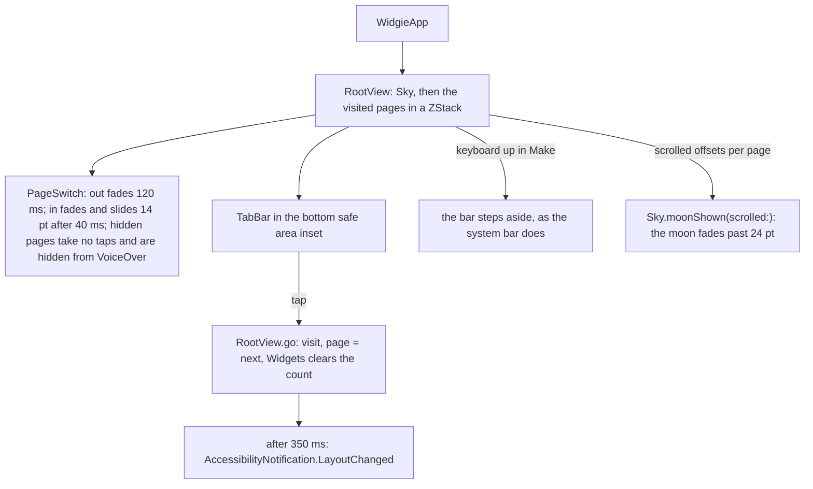
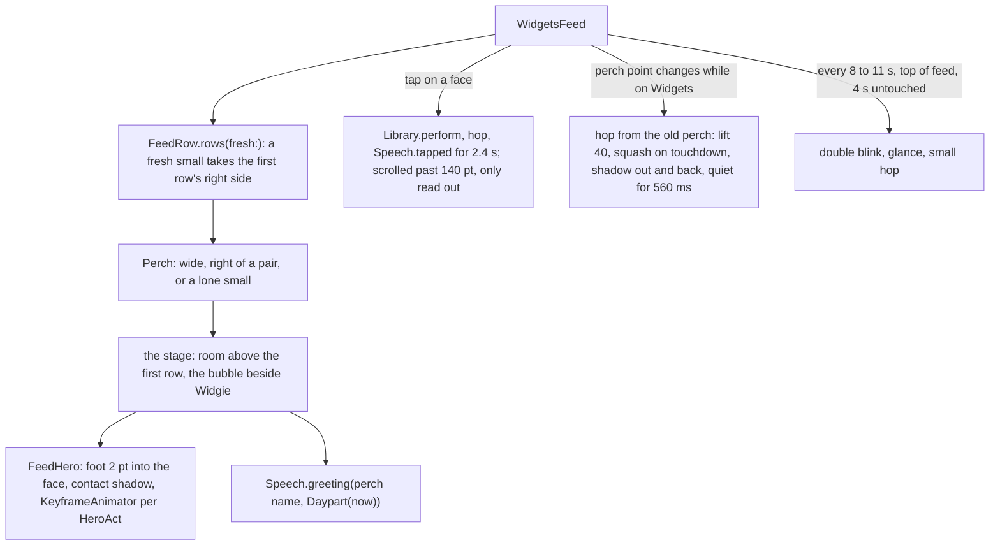
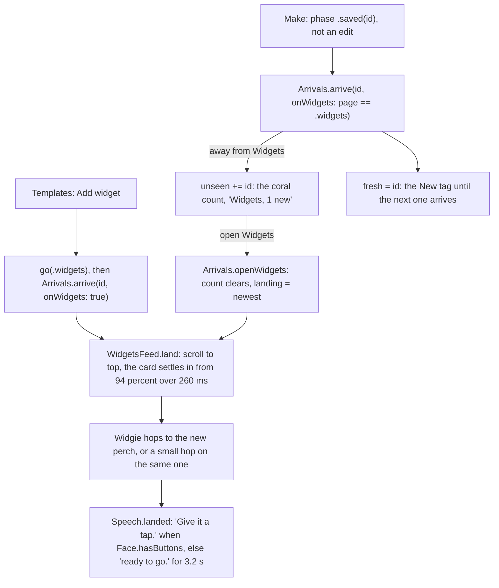
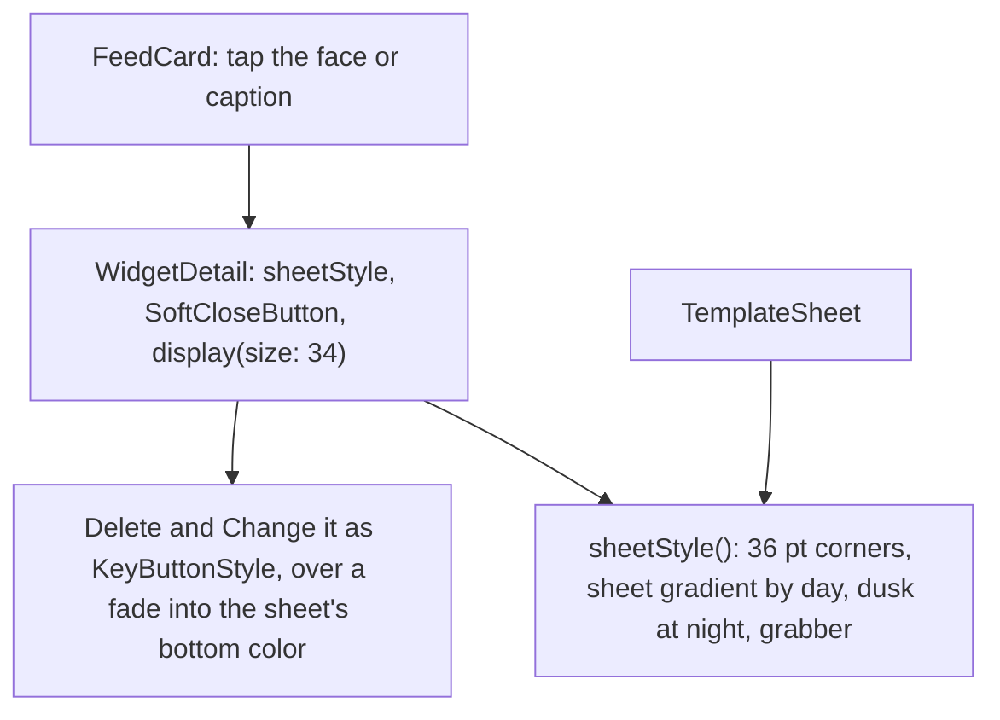

# PR 17: the shell restyled to the prototype, with Widgie on the feed and our own tab bar

Branch `app-shell-u1b` into `app-shell-u3-templates` (stacked on PR 16). This is U1b of [tasks/app-shell.md](../../tasks/app-shell.md): the sky, Bricolage, Widgie standing on the first row and talking, soft cards, and the custom glass tab bar, as drawn in the approved [prototype](../design/app-shell/prototype.src.html).

## Core changes

- **The sky.** [Sky.swift](../../App/Widgie/Design/Sky.swift) is the ground of every screen: the day gradient with two drifting clouds, and in dark mode the dusk with 26 twinkling stars and a crescent moon that fades once the page scrolls past 24 points. The colors are tokens in `WidgieColors.xcassets`. The flat ground and the dot grid are gone.
- **Type.** `display(size:)` and the keys in [Theme.swift](../../App/Widgie/Design/Theme.swift) use the Bricolage Display and Key faces that PR 16 bundled in the engine, scaled with Dynamic Type. The app ships no second copy.
- **The tab bar.** [RootView.swift](../../App/Widgie/RootView.swift) holds the three pages in a container of its own instead of `TabView`, each built on its first visit and kept alive. [TabBar.swift](../../App/Widgie/TabBar.swift) draws the frosted bar, the springing highlight, the Make key with Widgie in it, and the coral count from [Arrivals.swift](../../App/Widgie/Widgets/Arrivals.swift).
- **The feed.** [WidgetsFeed.swift](../../App/Widgie/Widgets/WidgetsFeed.swift) has the date, a greeting from the clock, and the count line, and Widgie ([FeedHero.swift](../../App/Widgie/Widgets/FeedHero.swift)) standing on the first row with a bubble. [Speech.swift](../../App/Widgie/Widgets/Speech.swift) holds every line. [FeedCard.swift](../../App/Widgie/Widgets/FeedCard.swift) has the soft cards, the press, the New tag, and the phone mark. `FeedRow.rows` gains `fresh:`.
- **The detail sheet** uses the shared `sheetStyle()` with Template's sheet, a soft close button, and Delete and Change it as keys.
- **Engine.** `Face.hasButtons` in [Public.swift](../../Engine/Sources/WidgetEngine/Public.swift), so Widgie asks for a tap only when there is something to tap.

## 1. Opening the app and switching tabs

Files: [RootView.swift](../../App/Widgie/RootView.swift), [TabBar.swift](../../App/Widgie/TabBar.swift), [Sky.swift](../../App/Widgie/Design/Sky.swift), [ShellTests.swift](../../App/WidgieTests/ShellTests.swift).

Key decisions:

- **One sky behind all pages,** not one per page, so the cross-fade between tabs never shows the window behind a half-faded ground. Make's describe flow draws its own sky only in a full screen cover.
- **Pages are built on their first visit and then stay alive,** as `TabView` did, so Templates draws its faces only when you open it and Make keeps its session across switches.
- **The layout notification after the switch.** Without it, VoiceOver kept the old page's safe area content (Make's Build it and photo button) reachable while another tab showed. `accessibilityHidden` alone did not reach it.
- **The tab labels keep their size** at the accessibility text sizes, as the system tab bar's do, with the large content viewer on a long press.
- **The bar is a tab bar to VoiceOver:** each tab is one element, the chosen one carries the selected trait, and Widgets reads "Widgets, 2 new" while it has a count.

## 2. Widgie on the feed

Files: [WidgetsFeed.swift](../../App/Widgie/Widgets/WidgetsFeed.swift), [FeedHero.swift](../../App/Widgie/Widgets/FeedHero.swift), [Speech.swift](../../App/Widgie/Widgets/Speech.swift), [FeedLayout.swift](../../App/Widgie/Widgets/FeedLayout.swift), [Caret.swift](../../App/Widgie/Design/Caret.swift), [FeedTests.swift](../../App/WidgieTests/FeedTests.swift), [ShellTests.swift](../../App/WidgieTests/ShellTests.swift).

Key decisions:

- **Lines name the widget and what happened, never its data,** as the plan's decision says. The greeting follows the clock: morning from 5, afternoon from 12, and "I'll keep an eye on Water tonight." from 17, so the words match the time while the night look follows dark mode.
- **A size rhythm counted from the oldest widget.** U1 counted from the newest, so every new widget changed the size of every unplaced one, and a new widget at the top was always wide. Now a new widget never resizes the others, and a new small can take the first row's right side under Widgie.
- **A third perch for a lone small at the top,** with Widgie talking toward the empty half of the row; the prototype only knew pairs and wides.
- **The perch's height ignores the bubble.** A bubble of many lines grows the room above the first row, but Widgie never hops because of its own words. Widgie is laid out from the stage's bottom, so it stays planted however tall the room grows.
- **Overlapping hops keep Widgie talking.** Each hop takes a number, and only the latest one gives Widgie its voice back.
- **At the accessibility text sizes** each small takes its own row so its name wraps, and Widgie stands near the edge so its bubble has the most room.
- **The empty state waits for the first load,** so "Tell me a widget." never flashes at launch.

## 3. A new widget arriving

Files: [Arrivals.swift](../../App/Widgie/Widgets/Arrivals.swift), [RootView.swift](../../App/Widgie/RootView.swift), [WidgetsFeed.swift](../../App/Widgie/Widgets/WidgetsFeed.swift), [FeedCard.swift](../../App/Widgie/Widgets/FeedCard.swift), [Library.swift](../../App/Widgie/Library.swift), [Public.swift](../../Engine/Sources/WidgetEngine/Public.swift).

Key decisions:

- **`Arrivals` is one value type** holding the New tag, the unseen ids, and the widget landing now, so the badge rule is tested without views: a save while away counts, a save on Widgets lands at once and counts nothing, and opening Widgets clears the count and lands the newest.
- **A template's Add widget still switches to Widgets,** as U3 built it, so it lands at once. The prototype stayed on Templates with a toast; the badge covers Make saves and anything else saved while away.
- **The landing owns Widgie's hop.** While a landing is under way, a changed first row does not start a hop of its own, so Widgie reacts once, after the scroll.
- **The New tag and the count last while the app runs;** nothing is stored.
- **`Face.hasButtons`** is the one engine change: the app cannot see a face's drawing, and "Give it a tap." on a widget with nothing to tap would be wrong.

## 4. The detail sheet and the shared styles

Files: [WidgetDetail.swift](../../App/Widgie/Widgets/WidgetDetail.swift), [TemplateSheet.swift](../../App/Widgie/Templates/TemplateSheet.swift), [Theme.swift](../../App/Widgie/Design/Theme.swift).

Key decisions:

- **One `sheetStyle()`** for the template sheet and the detail sheet, instead of a second copy of the presentation modifiers.
- **Delete moves from a trash glyph in the top bar to a quiet key** beside Change it, since the prototype's sheet keeps only the close button up top. The confirmation is unchanged.
- **Faces stay soft:** a close shadow and a lifted one, no outline, with a 0.5 point hairline at night only, because the faces nearly match the dusk.
