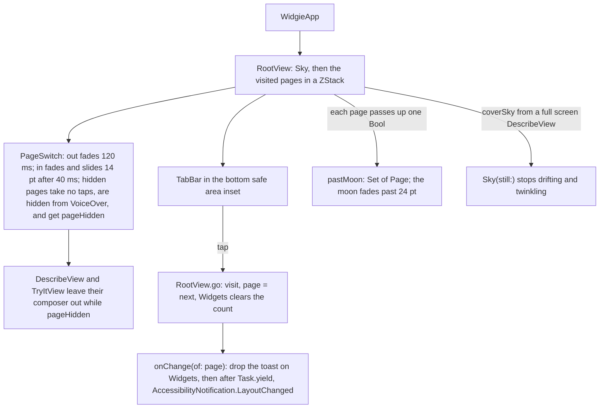
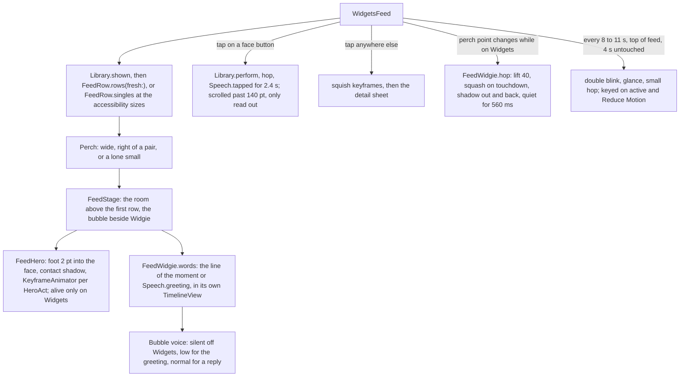
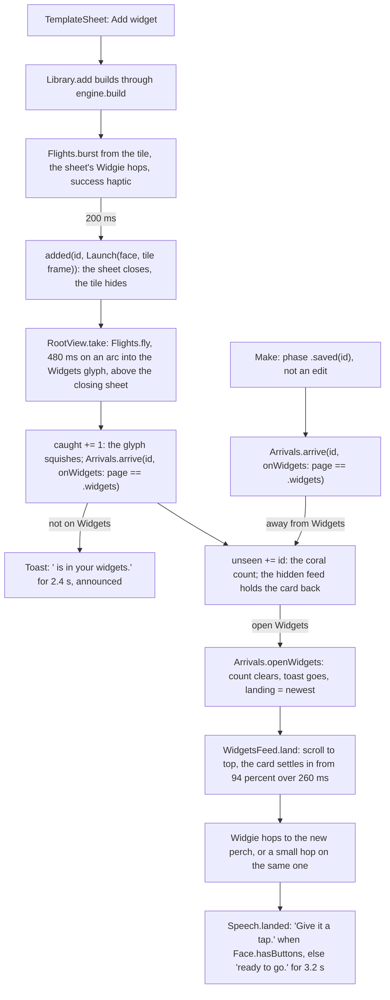
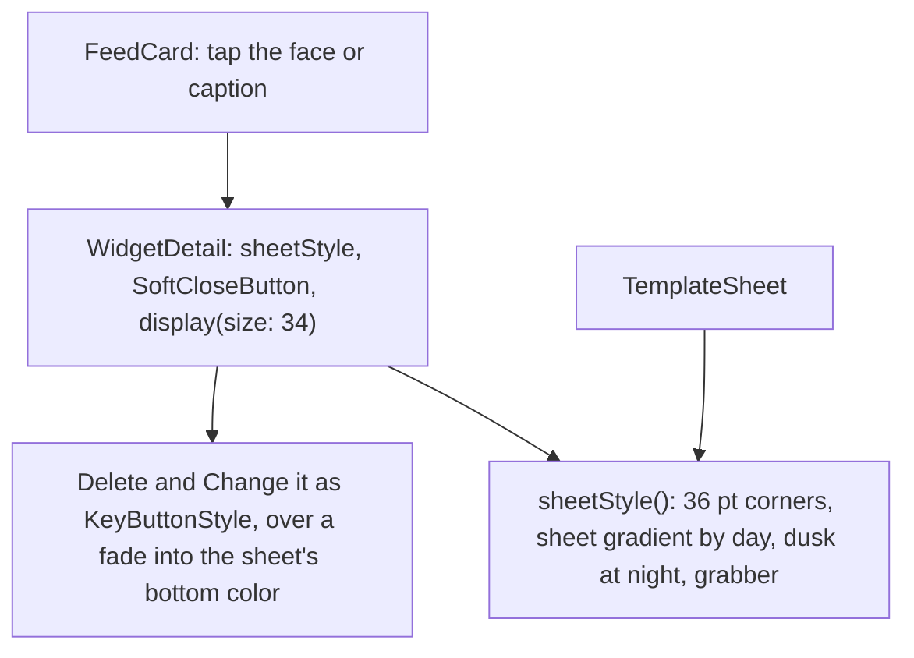

# PR 17: the shell restyled to the prototype, with Widgie on the feed and our own tab bar

Branch `app-shell-u1b` into `main`. This is U1b of [tasks/app-shell.md](../../tasks/app-shell.md): the sky, Bricolage, Widgie standing on the first row and talking, soft cards, the custom glass tab bar, and Add widget as the approved [prototype](../design/app-shell/prototype.src.html) draws it.

## Core changes

- **The sky.** [Sky.swift](../../App/Widgie/Design/Sky.swift) is the ground of every screen: the day gradient with two drifting clouds, and in dark mode the dusk with 26 twinkling stars and a crescent moon that fades once the page scrolls past 24 points. It stops animating under a full screen cover. The colors are tokens in `WidgieColors.xcassets`.
- **Type.** `display(size:)` and the keys in [Theme.swift](../../App/Widgie/Design/Theme.swift) use the Bricolage Display and Key faces that PR 16 bundled in the engine, scaled with Dynamic Type.
- **The tab bar.** [RootView.swift](../../App/Widgie/RootView.swift) holds the three pages in a container of its own instead of `TabView`, each built on its first visit and kept alive. [TabBar.swift](../../App/Widgie/TabBar.swift) draws the frosted bar, the springing highlight, the Make key with Widgie in it, the coral count from [Arrivals.swift](../../App/Widgie/Widgets/Arrivals.swift), and the Widgets glyph's squish as a widget flies in.
- **The feed.** [WidgetsFeed.swift](../../App/Widgie/Widgets/WidgetsFeed.swift) has the date, a greeting from the clock, and the count line. Widgie ([FeedHero.swift](../../App/Widgie/Widgets/FeedHero.swift)) stands on the first row with a bubble; its state is `FeedWidgie`, read only by `FeedStage` and `EmptyHero`. [Speech.swift](../../App/Widgie/Widgets/Speech.swift) holds every line. [FeedCard.swift](../../App/Widgie/Widgets/FeedCard.swift) has the soft cards, the squish on the tap that opens one, the New tag, and the phone mark. `FeedRow.rows` gains `fresh:`, and `FeedRow.singles` lays out one widget a row at the accessibility text sizes.
- **Add widget.** [Flight.swift](../../App/Widgie/Flight.swift) draws the confetti and the tile's flight into the Widgets tab in a pass-through window above the sheets. [Toast.swift](../../App/Widgie/Toast.swift) is "<name> is in your widgets." The person stays on Templates.
- **The detail sheet** uses the shared `sheetStyle()` with Template's sheet, a soft close button, and Delete and Change it as keys.
- **Engine.** `Face.hasButtons` in [Public.swift](../../Engine/Sources/WidgetEngine/Public.swift), so Widgie asks for a tap only when there is something to tap.

## 1. Opening the app and switching tabs

Files: [RootView.swift](../../App/Widgie/RootView.swift), [TabBar.swift](../../App/Widgie/TabBar.swift), [Sky.swift](../../App/Widgie/Design/Sky.swift), [DescribeView.swift](../../App/Widgie/Describe/DescribeView.swift), [TryItView.swift](../../App/Widgie/Describe/TryItView.swift), [ShellTests.swift](../../App/WidgieTests/ShellTests.swift).

Key decisions:

- **One sky behind all pages,** not one per page, so the cross-fade between tabs never shows the window behind a half-faded ground. Make's describe flow draws its own sky only in a full screen cover, and that cover tells the app's sky to hold still: a cover never sends `onDisappear` to the views under it. Measured with a frame probe: 20 frames a second under a cover before, none after.
- **Scrolling rebuilds nothing.** A page reports only whether it is past the moon (`onScrollGeometryChange(for: Bool.self)`), so `RootView.body` changes twice per scroll at most, not every frame.
- **Pages are built on their first visit and then stay alive,** as `TabView` did, so Templates draws its faces only when you open it and Make keeps its session across switches.
- **Make's composer leaves the tree while Make is hidden.** Content in a scroll view's safe area inset escaped the page's `accessibilityHidden`, and also an `accessibilityHidden` on itself, and `axe describe-ui` showed Build it and the photo button on Widgets and Templates long after a switch. The old 350 ms layout post did not change that. Now the layout post waits only for the switch to apply.
- **The tab labels keep their size** at the accessibility text sizes, as the system tab bar's do, with the large content viewer on a long press.
- **The bar is a tab bar to VoiceOver:** each tab is one element, the chosen one carries the selected trait, and Widgets reads "Widgets, 2 new" while it has a count. The badge exists only while there is a count, since one scaled to nothing still reached VoiceOver as "0".
- **Tapping the status bar** scrolls the visible page to the top with all three pages alive, checked on the simulator.

## 2. Widgie on the feed

Files: [WidgetsFeed.swift](../../App/Widgie/Widgets/WidgetsFeed.swift), [FeedHero.swift](../../App/Widgie/Widgets/FeedHero.swift), [FeedCard.swift](../../App/Widgie/Widgets/FeedCard.swift), [Speech.swift](../../App/Widgie/Widgets/Speech.swift), [FeedLayout.swift](../../App/Widgie/Widgets/FeedLayout.swift), [TemplateSheet.swift](../../App/Widgie/Templates/TemplateSheet.swift) (`Bubble`), [Caret.swift](../../App/Widgie/Design/Caret.swift), [FeedTests.swift](../../App/WidgieTests/FeedTests.swift), [ShellTests.swift](../../App/WidgieTests/ShellTests.swift).

Key decisions:

- **Lines name the widget and what happened, never its data,** as the plan's decision says. The greeting follows the clock: morning from 5, afternoon from 12, and "I'll keep an eye on Water tonight." from 17.
- **Only Widgie redraws for Widgie.** `FeedWidgie` is an observable model the feed drives but never reads in `body`; `FeedStage` and `EmptyHero` read it. The feed's scroll offset and last touch live in a plain box (`Activity`) that taps, the landing and the idle loop read. The clock's `TimelineView` wraps only the header and the bubble.
- **A size rhythm counted from the oldest widget,** so adding a widget never resizes the others and a new small can take the first row's right side under Widgie. Deleting an older unplaced widget shifts the rhythm for the unplaced ones after it; the plan records that.
- **The card opens on a tap gesture, not a button around the face.** A button folds the face's buttons into itself for VoiceOver: Undo became a custom action of the card and unlabeled buttons vanished. Three ways of tracking the press each broke something on the simulator: a SwiftUI long press froze scrolling of the whole feed or blocked the context menu, and a UIKit recognizer swallowed the tap. So the face squishes on the tap that opens it, and a hold gets the context menu's own lift. `axe describe-ui` shows each face button as its own element and the caption as one button reading the name, "new" and "on your home screen", with Change it as an action.
- **A third perch for a lone small at the top,** with Widgie talking toward the empty half of the row.
- **At the accessibility text sizes** each widget takes its own row, newest first, so a new small is the first row and Widgie names the widget it stands on. Splitting the fresh pair had put its older partner first.
- **Widgie speaks only from the page that shows.** The hidden feed's greeting changed when a save landed or the clock passed 12:00 or 17:00, and VoiceOver read it from another tab.
- **The perch's height ignores the bubble,** so Widgie never hops because of its own words, and overlapping hops keep Widgie talking: only the latest hop gives its voice back.
- **The empty state waits for the first load,** and a failed first load still counts as loaded, so the feed never stays blank.

## 3. A new widget arriving

Files: [TemplateSheet.swift](../../App/Widgie/Templates/TemplateSheet.swift), [TemplateTrial.swift](../../App/Widgie/Templates/TemplateTrial.swift), [TemplatesView.swift](../../App/Widgie/Templates/TemplatesView.swift), [Flight.swift](../../App/Widgie/Flight.swift), [Toast.swift](../../App/Widgie/Toast.swift), [RootView.swift](../../App/Widgie/RootView.swift), [TabBar.swift](../../App/Widgie/TabBar.swift), [Arrivals.swift](../../App/Widgie/Widgets/Arrivals.swift), [WidgetsFeed.swift](../../App/Widgie/Widgets/WidgetsFeed.swift), [Library.swift](../../App/Widgie/Library.swift), [Public.swift](../../Engine/Sources/WidgetEngine/Public.swift).

Key decisions:

- **Add widget follows the prototype's `#s-add`,** superseding U3's switch to Widgets: burst and hop, the flight while the sheet closes, the glyph's squish, the count, and the toast, with the person left on Templates. With Reduce Motion there is no burst or flight; the tile dims as the sheet closes and the toast fades in.
- **The flight draws in a window of its own.** A sheet covers everything in the app's window while it closes, so a flyer drawn there would spend the flight under the sheet. The window sits one level above, takes no touches, is hidden from VoiceOver, and shows only while something flies. Frames come from `.global`, which is window space in both windows.
- **`Arrivals` is one value type** holding the New tag, the unseen ids, and the widget landing now. Tests: a save while away counts, a save on Widgets lands at once, opening Widgets clears the count and lands the newest, opening it with nothing new changes nothing, and a template added from Templates badges and lands only when Widgets opens.
- **A card arriving on the hidden page waits hidden,** so it never shows at full strength and then blinks out as its landing starts.
- **The landing owns Widgie's hop.** While a landing is under way, a changed first row does not start a hop of its own.
- **The New tag and the count last while the app runs;** nothing is stored.

## 4. The detail sheet and the shared styles

Files: [WidgetDetail.swift](../../App/Widgie/Widgets/WidgetDetail.swift), [TemplateSheet.swift](../../App/Widgie/Templates/TemplateSheet.swift), [Theme.swift](../../App/Widgie/Design/Theme.swift).

Key decisions:

- **One `sheetStyle()`** for the template sheet and the detail sheet.
- **Delete moves from a trash glyph in the top bar to a quiet key** beside Change it, since the prototype's sheet keeps only the close button up top. The confirmation is unchanged.
- **Faces stay soft:** a close shadow and a lifted one, no outline, with a 0.5 point hairline at night only, because the faces nearly match the dusk.
