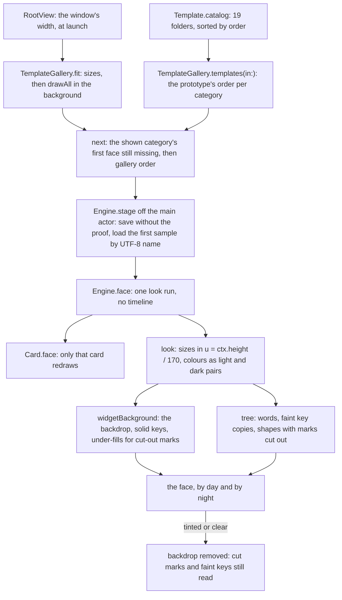
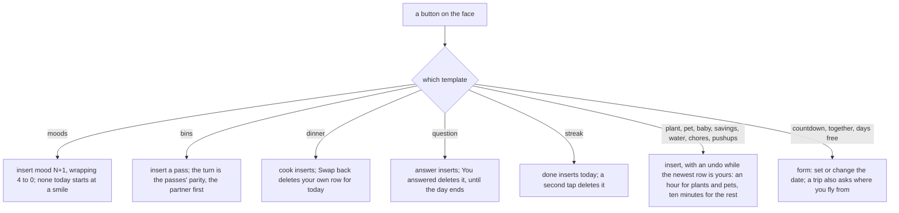
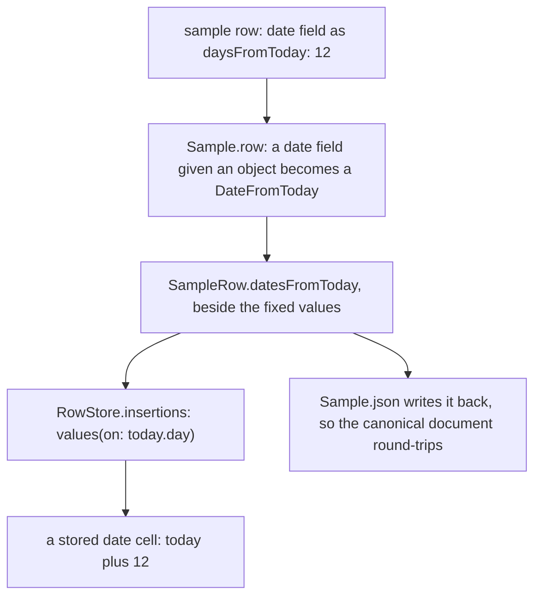

# PR 18: the prototype's other 13 templates

Branch `app-shell-u4-content` into `main`. This is U4 of [tasks/app-shell.md](../../tasks/app-shell.md). The user asked for every template to match the approved prototype ([prototype.src.html](../design/app-shell/prototype.src.html)). U3 made six templates. This PR adds the other 13, each with real behaviour and a face that matches its tile by day and by night.

## Core changes

- **13 templates** in [App/Templates/](../../App/Templates/), in the prototype's four categories and its order: For two [our-moods](../../App/Templates/our-moods/), [trip-countdown](../../App/Templates/trip-countdown/), [days-together](../../App/Templates/days-together/) and [todays-question](../../App/Templates/todays-question/); Home [bins-night](../../App/Templates/bins-night/), [plant-care](../../App/Templates/plant-care/), [dinner-tonight](../../App/Templates/dinner-tonight/), [baby-feeds](../../App/Templates/baby-feeds/) and [chores-scoreboard](../../App/Templates/chores-scoreboard/); Habits [streak](../../App/Templates/streak/) and [pushups](../../App/Templates/pushups/); Goals [savings-jar](../../App/Templates/savings-jar/) and [days-free](../../App/Templates/days-free/).
- **Faces drawn from the tiles.** Each look uses the prototype's units (`u = ctx.height / 170`) and the site's colours, type and art: the boarding pass, the five mood faces, the lotus rings, the pushups ring, Fuji with its torii, and the medal.
- **Dates in samples.** [Samples.swift](../../Engine/Sources/Spec/Samples.swift) accepts `{"daysFromToday": 12}` for a date field, and [RowStore.swift](../../Engine/Sources/Rows/RowStore.swift) resolves it against the day the sample is seeded. [blocks.md](../../Engine/Reference/blocks.md) and the Worker's [build-prompt.txt](../../Backend/src/build-prompt.txt) describe it.
- **Rows that stay on today.** A sample row can say `{"minutesAgo": 3, "staysToday": true}`: that many minutes back, or as today began if that is later. Plant care's "just watered", water's last glass, and the undo samples use it, so nothing slips to yesterday just after midnight.
- **A pile with no grey.** [Engine.stage](../../Engine/Sources/WidgetBuilder/Samples.swift) saves a proved template into a scratch engine without the builder's proof, and [Engine.face](../../Engine/Sources/WidgetEngine/Engine.swift) draws one face without a timeline. [TemplateGallery.swift](../../App/Widgie/Templates/TemplateGallery.swift) draws all 19 faces off the main actor from launch, the shown category first, and each card observes only its own face.
- **Undo everywhere a tap writes a row.** Pushups and chores now take back your newest tap for ten minutes, as baby feeds, savings and water do, and plant care for an hour. No pile sample shows an undo at any hour.
- **Order and tests.** Shared groceries, water, and word of the day moved to their prototype places. [TemplateTapTests.swift](../../App/WidgieTests/TemplateTapTests.swift) taps faces and reads what they then show, by picture and by text recognition. [tasks/app-shell.md](../../tasks/app-shell.md) ticks U4.

## 1. A template's face in the pile and the sheet

Files: the 13 template folders, [Template.swift](../../App/Widgie/Templates/Template.swift), [TemplateGallery.swift](../../App/Widgie/Templates/TemplateGallery.swift), [TemplatesView.swift](../../App/Widgie/Templates/TemplatesView.swift), [RootView.swift](../../App/Widgie/RootView.swift), [Samples.swift](../../Engine/Sources/WidgetBuilder/Samples.swift) (`stage`), [Engine.swift](../../Engine/Sources/WidgetEngine/Engine.swift) (`face`), [TemplateTests.swift](../../App/WidgieTests/TemplateTests.swift).

Key decisions:

- **The pile skips the proof.** Each face used to run `engine.build`: 14 to 16 offscreen renders on the main actor and the look runs of the whole proof matrix, then a full timeline, for one picture. The bundled templates are proved by the app's tests at their placeholders, awkward values, longest values and "me", so the pile stages them as they are and draws one face. Add widget still builds into the library, which proves the filled template, and the sheet's trial still builds, so a typed value is proved before it shows.
- **Measured on the iPhone 18 Pro simulator**, fresh launch, Templates opened 3 s after launch, then each category once, with log timestamps (three runs each). Before: a category's first face landed 0.85 to 1.8 s after the tap and its last 1.3 to 2.8 s after (Home was slowest, 2.7 to 2.8 s). After: every category had all its faces drawn at the moment of the tap, because all 19 were drawn 0.39 to 0.47 s after launch (1.2 s on the first launch after an install). The first face costs about 160 to 200 ms (opening the store, registering fonts, the first look run), the rest about 15 ms each, one at a time on the engine's sandbox.
- **Warmed once the window's width is known.** RootView reports the width at launch, so faces are ready before the tab opens. A later width change draws them again at the new size, and a drawing that lands after the change is dropped.
- **The feed and the previews draw one face too.** `Library.reload` and `Preview.draw` kept only `.current` of a timeline; they now call `Engine.face`.
- **The first sample is the tile.** The gallery shows the sample whose name sorts first by UTF-8 bytes, so each template names its tile's state to sort first: "a day from thirsty", "a trip in twelve days", "due a feed".
- **Samples do not drift with the time of day.**
  - Counts within today use rows placed with `daysAgo: 0`.
  - Baby feeds counts the feeds in the last 24 hours rather than since midnight, which suits night feeds and keeps the sample at five dots at any hour.
  - Dates use `daysFromToday`.
  - A row that must count as today but read as minutes old uses `staysToday`.
  - `everySampleLooksTheSameJustAfterMidnightAsAtNoon` draws every sample of every template at 00:01 and at noon on a Monday, in both sizes, and requires the same picture. The earlier claim that render.py's `--times` checked midnight was wrong: `render-tool` draws a proof at noon of the given day, so it never saw 00:01. That is how plant care's "1 day since watering" and water's lost glasses got past it.
- **Day and night through light and dark colour pairs**, as each tile's night style in the prototype's CSS sets them. Plant care, baby feeds, pushups, days free and today's question look the same at night, as their tiles do.
- **Readable in tinted mode.**
  - Marks are cut out of their shapes: the checks, the medal's star and ring, and Fuji's snow. A fill in the backdrop shows through each cut in full colour.
  - Solid keys sit in the backdrop under a faint copy that carries the words: Pass it on, I'll cook, I did one, +$50, +10, and the boarding pass.
  - The mood faces keep their fills in the backdrop and their ink in the tree, so tinted mode shows them as line drawings.
- **Fits any size.** Every empty state, sample and full state was rendered at 338x158 and at the app's 170x170, 184x184, 354x170 and 358x172, with no spill and no cut text, and with no ellipsis in an empty state.
- **Blank lengths are measured.** Each blank's `maxLength` is the longest run of wide letters, and half as many emoji, that the proof still accepts. Those are 20 for the plant, the fund and who you cook with, 18 for the destination, 16 for the baby-feeds partner and today's question, 15 for the moods partner and the bins rota, and 12 for the chores rival.
- **Remaining differences from the tiles.**
  - The savings line says "$25 a week to make it by June", because it divides what is left by the weeks until the end of June. The tile's "$95" was a made-up number.
  - Our moods says "A face each, on one phone for now" where the prototype says "Share how you're feeling", because sharing comes in phase 4.
  - The dated templates' hints say to tap and set the date, because the prototype's widgets had no data to set.
  - Small widths, which the prototype never drew, have layouts of their own: the savings small shows its percent under the amount, and today's question in small names your partner above the key.

## 2. Tapping a face

Files: the templates' `widget.json`, [TemplateTests.swift](../../App/WidgieTests/TemplateTests.swift) (`TemplateBehaviourTests`), [TemplateTapTests.swift](../../App/WidgieTests/TemplateTapTests.swift), [TemplateBench.swift](../../App/WidgieTests/TemplateBench.swift).

Key decisions:

- **Every tap does what the tile shows, honestly.** Nothing on a face is decoration that a tap cannot change.
- **The shared templates work on one phone until phase 4.** Their hints say "For now it stays on this phone", as hearts and groceries do in U3. The partner's side shows a faint face, "Ask Sam too", or nobody cooking, never a made-up answer. No line implies Sam can tap on this phone: baby feeds says "tap after each feed, even Sam's", and plant care's hint now says it stays on this phone too.
- **Today's question needs no automation.** It picks the day's question from 60 written into the look, the same for both of you on the same date, and all 60 fit both sizes without ellipsis. It also carries an automation that writes a question at 06:00. When automations run, that question takes over, and nothing on the face promises it.
- **Bins night has no automation.** The turn moves when someone takes the bins out, which only a person knows.
- **A mis-tap can always be fixed.** Pushups and chores now have the same short undo as the others, beside their key. It shows while the newest row of today is yours and under ten minutes old.
- **No pile sample shows an undo, at any hour.** A start-of-today row alone could not promise that, because just after midnight every row of today is minutes old. So the pile's samples end on Sam's row (chores) or are Sam's (pushups, water's "five so far"), which no look shows, and the own-row undo cannot appear. Each of these templates has another sample that does show the undo, which the proof's action coverage needs: "just did ten", "just did one", "goal met". `noUndoShowsInThePileAtAnyHour` checks 00:01, 09:59, 12:59 and 23:59.
- **A blank never becomes a sample's author.** Samples wrote `"by": "{{partner}}"`, and the engine reads "me" in any case as the person, so a partner named "me" turned Sam's rows into yours and our moods failed to build. Every sample author is now the fixed "Sam", the looks name the partner from the blank, and baby feeds says the blank instead of the row's author. The catalog test builds every template with each blank set to "me" and "Me".
- **The savings plan at the deadline.** In June's last week it says "$760 to go by the end of June", and on June 30 "$760 to go, and June ends today", instead of a weekly amount with no weeks left.
- **The tests tap and read.** `TemplateBench` stages a template in a scratch engine, finds its buttons by drawing it with a recording `FaceHost`, performs them at chosen times, and reads the face by picture or by Vision text recognition. They cover each timed undo's length and own-row rule, bins alternating, chores counted as yours, the trip's Today, Home and "1 day", the next medal, the savings plan through June, and each dated template reading the date its form sets and then a new one.

## 3. A date that moves with the sample

Files: [Samples.swift](../../Engine/Sources/Spec/Samples.swift), [Spec.swift](../../Engine/Sources/Spec/Spec.swift), [RowStore.swift](../../Engine/Sources/Rows/RowStore.swift), [SampleTests.swift](../../Engine/Tests/SpecTests/SampleTests.swift), [AuthorTests.swift](../../Engine/Tests/RowsTests/AuthorTests.swift), [blocks.md](../../Engine/Reference/blocks.md), [build-prompt.txt](../../Backend/src/build-prompt.txt).

Key decisions:

- **Why the engine changed.** A sample means the same thing on any day, as `daysAgo` already ensures for rows, but a fixed date value broke that. A countdown's sample would count down to a date that passes within days, and "1,204 days together" is beyond what a row's `daysAgo` can reach (400). A blank cannot fix it, because a placeholder is a fixed string too.
- **Samples only.** Actions and `where` filters still take fixed dates. The object form is resolved when a sample is seeded, so the stored rows, queries and looks see an ordinary date.
- **The limit is a century either way** (`Limits.daysFromToday`), and a malformed object gets the date field's rule naming both forms.
- **The model can use it too.** The reference shows a countdown and an anniversary, so a widget the model builds can have samples that last.

## 4. The plan

Files: [tasks/app-shell.md](../../tasks/app-shell.md).

Key decisions:

- **U4 is ticked**, with what each template does and the sizes it was checked at.
- **The lines and hints follow U3's review rules.** No copy promises cross-phone sharing or an automation.
