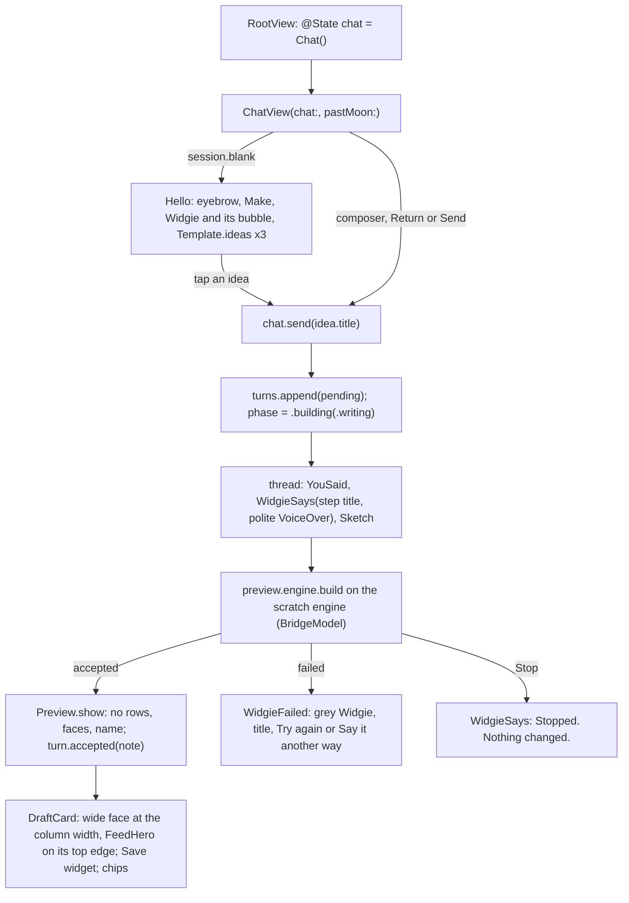
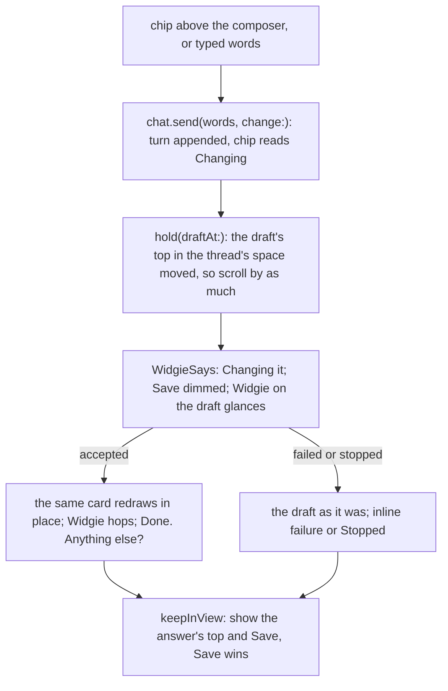
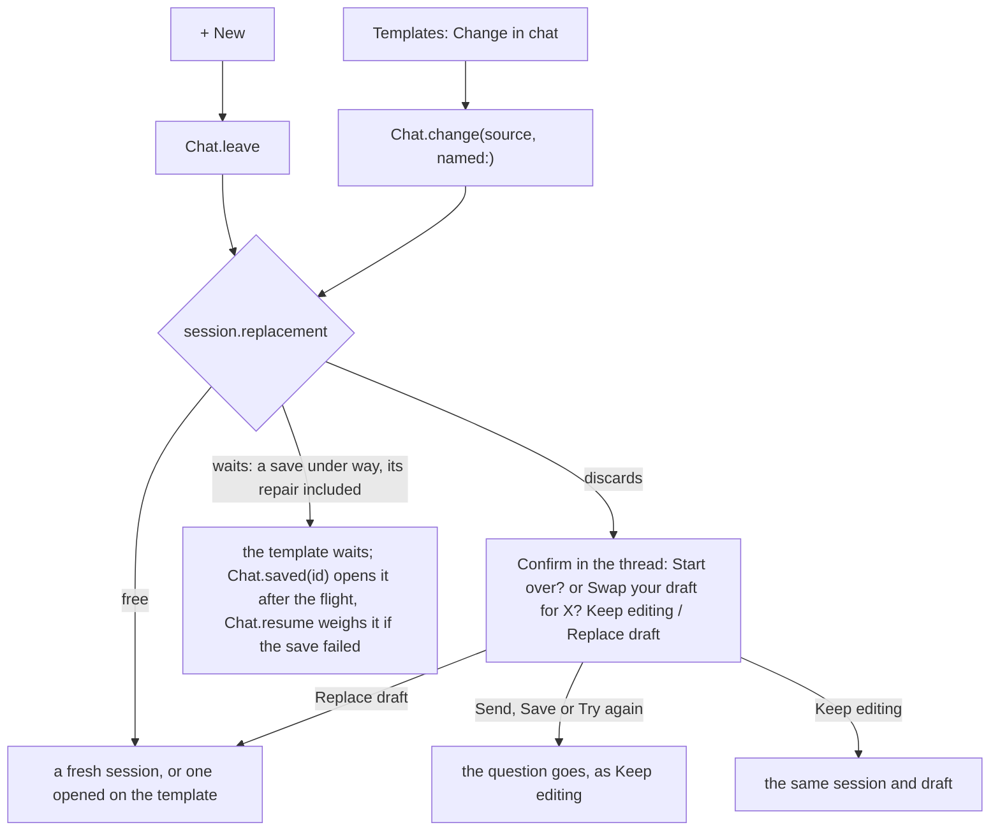
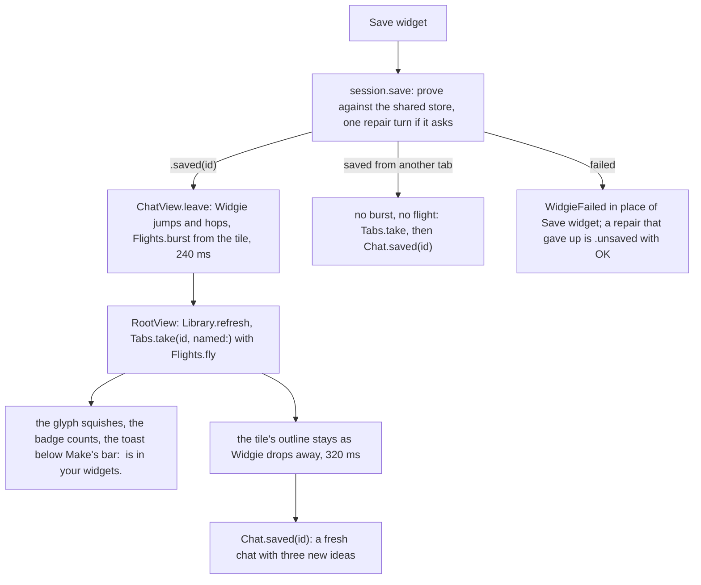
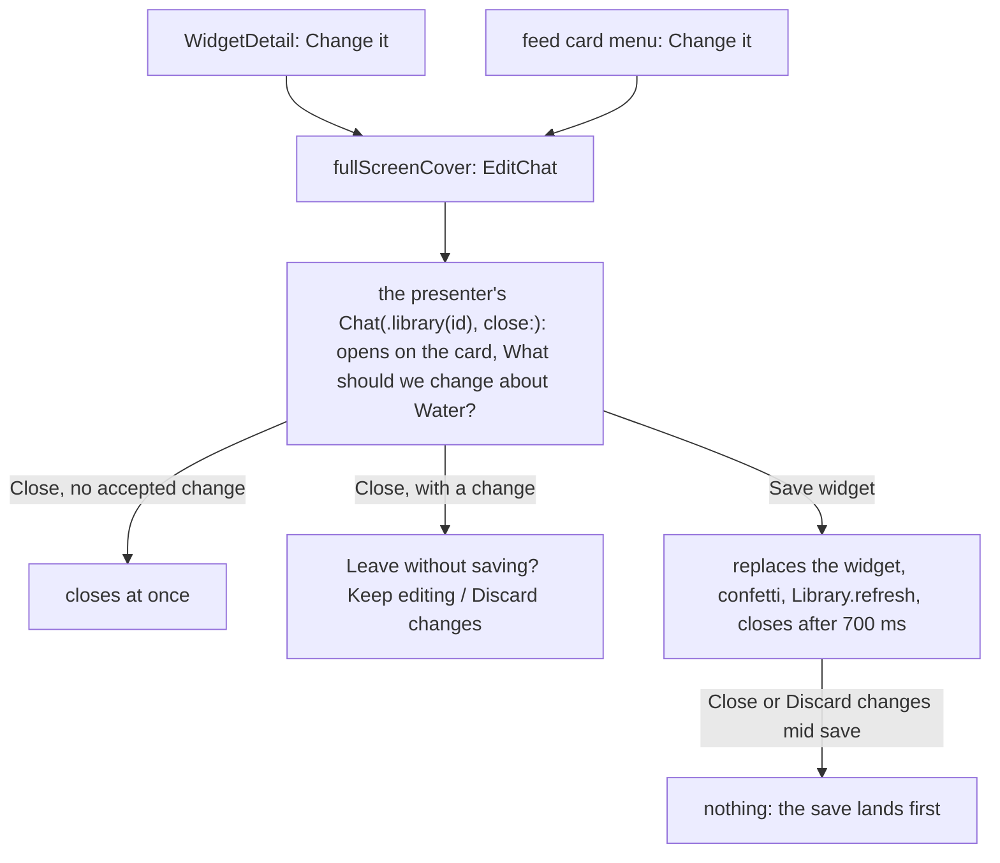

# PR 19: Make as the prototype's chat with Widgie

Branch `app-shell-u2-chat` into `main`. This is U2 of [tasks/app-shell.md](../../tasks/app-shell.md): Make becomes the chat the approved [prototype](../design/app-shell/prototype.src.html) draws, where Widgie is the one you talk to and it draws your widget.

## Core changes

- **Every turn stays.** [DescribeSession.swift](../../App/Widgie/Describe/DescribeSession.swift) keeps `turns: [Turn]`, each with a typed result: pending, accepted with Widgie's note, failed, or cancelled. `Phase.failed` names the work it interrupted (`open`, `turn`, `save`), so the chat knows where a failure goes and what Try again runs. One `init(_ origin:)` replaces the `editing:` and `draft:` initializers. A failed turn still never replaces the draft, and a failure no longer blocks the next message.
- **The chat.** [ChatView.swift](../../App/Widgie/Describe/ChatView.swift) replaces `DescribeView`, `TryItView` and `SavedView`, which are deleted. It holds the empty page with three idea cards, the thread of bubbles, the sketch that becomes the tile, the live draft with Widgie on it, Save widget, the inline failure and replace prompts, the change chips, and the composer with Stop. `EditChat` is the same chat in a full screen cover for Change it.
- **The chat's model.** [Chat.swift](../../App/Widgie/Describe/Chat.swift) owns the session, the ideas, and the question asked before a draft goes (`startOver`, `swap`, `leave`). It takes over the template hand-over that `RootView` did with a confirmation dialog. The chat's work goes through `Chat.send`, `save` and `retry`, which drop a question still up, and `replace` refuses while a save runs.
- **Save is Add widget's path.** [RootView.swift](../../App/Widgie/RootView.swift) runs a Make save through `Tabs.take` and `Flights.fly`, the same calls as a template's Add widget: confetti, the flight into the Widgets glyph, the badge, the toast, which sits below Make's bar. Then `Chat.saved(id)` starts a fresh chat, if that save's session is still the chat's.
- **Ideas from the catalog.** Every `template.json` has a required `suggestion` (title, subtitle, SF Symbol, tint), U4's 13 included, and `Template.ideas` picks three, one per category, shuffled per chat ([Template.swift](../../App/Widgie/Templates/Template.swift)).
- **A draft starts empty.** `Preview(startsEmpty:)` draws a draft from no rows, as Save will put it on the home screen, and exposes the draft's `name`. The samples menu and `Preview.states`/`select` are gone.
- **Dead code removed.** The primary, compact and chip button styles, `ChipColor`, `Outline`, `CloseButton`, `Column`, the unused `Wordmark`, and 15 colorsets they used. New tokens: `WidgieYouFill`, `WidgieComposer`, and the six idea tints.

## 1. Opening Make and sending a first message

Files: [ChatView.swift](../../App/Widgie/Describe/ChatView.swift), [DescribeSession.swift](../../App/Widgie/Describe/DescribeSession.swift), [Preview.swift](../../App/Widgie/Preview.swift), [Template.swift](../../App/Widgie/Templates/Template.swift), [ChatTests.swift](../../App/WidgieTests/ChatTests.swift), [DescribeSessionTests.swift](../../App/WidgieTests/DescribeSessionTests.swift).

Key decisions:

- **The reply, Save and the chips land on the same frame.** All three read the same session state, which the accepted turn changes in one main actor job after `Preview.show` has drawn the faces.
- **The sketch traces the edge in 2.2 seconds, then keeps riding it** a lap every 7 seconds until the build lands, because a real build takes 15 to 40 seconds. It starts and ends where Widgie stands on the tile, so the drawing becomes the tile with Widgie in place. With Reduce Motion it is drawn whole and still.
- **A draft starts empty**, as the sign-off asks: a new pet tracker says "Not fed" and a counter shows 0, which is what Save will put on the home screen. Template sheets keep their first sample.
- **The draft card is the wide face at the column's width** (362 points on a 402 point phone), since an AI-made widget has both sizes and the wide one shows the most.
- **Widgie's notes name the widget, never its data**, as on Widgets: "Here's Water. Give it a tap." on a first draft, "Done. Anything else?" on a change.
- **Idea cards send their title**, the words the bubble shows. Every template has one; a test checks each reads, has its own title, and names an SF Symbol that exists.
- **The empty page stands where the prototype does**: Widgie's foot 72 points from the column's right edge and 206 down on the prototype's 100 by 13 radial shadow, and the bubble ending 138 points in, at most 212 wide. iOS moves a word down rather than leave one alone on the last line, so the greeting breaks after "make" by hand while that line fits (`ViewThatFits`), and wraps normally when it does not.
- **A failure does not block the composer.** You can act on it or say something else; the failure stays in the thread without its action.
- **`.unopened` keeps a full screen** (the broken bridge and Close), because there is nothing to chat about.

## 2. Asking for a change

Files: [ChatView.swift](../../App/Widgie/Describe/ChatView.swift), [DescribeSession.swift](../../App/Widgie/Describe/DescribeSession.swift).

Key decisions:

- **The draft stays put while a change lands**, as the prototype's `refine` does: the thread scrolls by as much as the new messages pushed the card down, then scrolls only as far as it takes to show the answer and Save. Checked on the simulator: the card stayed at y 316 from the send through Changing it. When a taller failure landed, the thread scrolled 59 points so the answer's top showed under the bar, as the prototype's `keepInView` does.
- **Positions are read in the thread's own coordinate space** for the draft, so a scroll in flight never counts as a move, and kept in a `Track` box that `body` never reads, so scrolling rebuilds nothing (U1b's rule). A scroll's aim is remembered until it arrives, so a second scroll does not start from a half-finished first one.
- **120 points of room under Save** keep the thread scrollable, so the draft can always stay where it is.
- **The chips are read off the draft** (`Changes.suggested(for: traits, used:)`): a color across the wheel and a bigger number. As in the prototype, a chip leaves once its turn lands (`Turn.change`, `usedChanges`), and a used recolor gives way to "Change the colors", so "Make it teal" never flips to "Make it red". A chip whose turn failed stays.
- **Busy chips sit at 0.6**, as the prototype's `.quick.busy`, dimmed once by the chip style.

## 3. Starting over and changing a template in chat

Files: [Chat.swift](../../App/Widgie/Describe/Chat.swift), [RootView.swift](../../App/Widgie/RootView.swift), [ChatTests.swift](../../App/WidgieTests/ChatTests.swift).

Key decisions:

- **The question is asked in the thread**, with the draft still in view, as the prototype's `confirmReplace` does, instead of the system confirmation dialog. VoiceOver lands on Keep editing and hears the question.
- **"+ New" replaces the plan's "Start over" menu item**, as drawn.
- **A save cannot be stopped**, so a template chosen during one waits for it to land, and nothing is asked. A save's repair turn stays in `.saving`, so it waits too. `Chat.replace` refuses while a save runs: before, Save with Start over still up and then Replace draft left the widget landing in a session nobody watched.
- **Going on drops the question.** A message, Save or Try again answers it as Keep editing, as the prototype's `refine` and `saved` remove `.confirm`.

## 4. Saving

Files: [ChatView.swift](../../App/Widgie/Describe/ChatView.swift), [RootView.swift](../../App/Widgie/RootView.swift), [Tabs.swift](../../App/Widgie/Tabs.swift), [Flight.swift](../../App/Widgie/Flight.swift).

Key decisions:

- **Save follows the prototype, not the plan's top-bar Save and Saved overlay**: the key under the draft, and the same flight, badge and toast as a template's Add widget, through the same calls. With Reduce Motion there is no burst or flight, and the toast fades in.
- **The person stays on Make**, as on Templates; the widget lands when they open Widgets. The toast sits 96 points lower on Make, below the bar (the prototype's `.toast.low`), and leaves when they leave Make.
- **Saved while on another tab, nothing bursts or flies** from the hidden page, and Make's VoiceOver lines and greeting stay quiet off its page, as the feed's voice does.
- **Widgie jumps on the saved draft** (`Caret.Pose.jump`, happy eyes), then drops away once the tile lands, as the prototype's `saved` draws it.

## 5. Changing a library widget

Files: [ChatView.swift](../../App/Widgie/Describe/ChatView.swift) (`EditChat`), [WidgetDetail.swift](../../App/Widgie/Widgets/WidgetDetail.swift), [WidgetsFeed.swift](../../App/Widgie/Widgets/WidgetsFeed.swift).

Key decisions:

- **The same chat edits a widget**, with "Change it" as its title and Close instead of New. The cover has its own sky and counts itself in `SkyCovers`, as before.
- **Nothing flies on an edit**: the widget is already in Widgets, under the cover.
- **The presenter makes the `Chat`** as it opens the cover (`changing: Chat?`), since a `State` built in `EditChat.init` made a new chat, catalog read and scratch preview included, on every redraw of the parent.
- **Close and Discard changes wait for a save**, its repair turn included. Before, Save with Leave without saving? up and then Discard changes closed the cover while the change still landed in the library, and the feed showed the old face.

## Verification

- `App/scripts/build` on the U1b simulator: format lint, build, 128 app tests passing (138 with parameterized cases), 22 of them in `ChatTests`, which start their drafts empty as Make does. The review round added: Try again reruns a failed turn and a failed save, and does nothing after a give-up or a repair that gave up; Stop on a first build; a chip leaves once its change lands; Save while Start over or Leave without saving is up drops it and the save lands, with Replace and Discard refused; Close during a save's repair; a template chosen while a save waits for the app or repairs; a template opened during the flight stays; a message drops a swap question; every template offers its own idea with a real symbol; and in `TabsTests`, a toast on Make sits low and leaves with Make. Reverting each fix fails its test (checked by mutation).
- `scripts/check` green.
- On the simulator against the dev bridge on Sonnet: a create from typed words and from an idea card, refines through chips, a cancel of a first build and of a change, a bridge that is down, a give-up through a stand-in bridge whose replies never build, the replace prompt, a save with its flight and toast, and an edit of a library widget with Leave and Save. Light and dark, the largest text size, and Reduce Motion, side by side with the prototype's own captures.
- Review round on the simulator, against a stand-in bridge: chips after use ("Make it teal" gives "Bigger number, Change the colors", then "Change the colors"), Save with Start over up (the prompt fades as the spinner starts, and the save lands with the jump, the drop and the low toast), Save with Leave without saving? up in the edit cover (Discard does nothing and the detail shows the saved change), a save that lands while on Templates (with a temporary 3 s delay in the save, not committed: no burst or flight, the toast at the top of Templates), and Make's empty page light and dark with the moon at night, each side by side with the prototype's captures.
- `log stream --predicate 'category == "describe"'`: creates in 29.7 and 35.1 s, changes in 15.2 to 17.2 s. App seconds, preview shown minus the bridge's model time, 0.37 to 1.56, median 0.5, against PR 8's median of 0.55.
