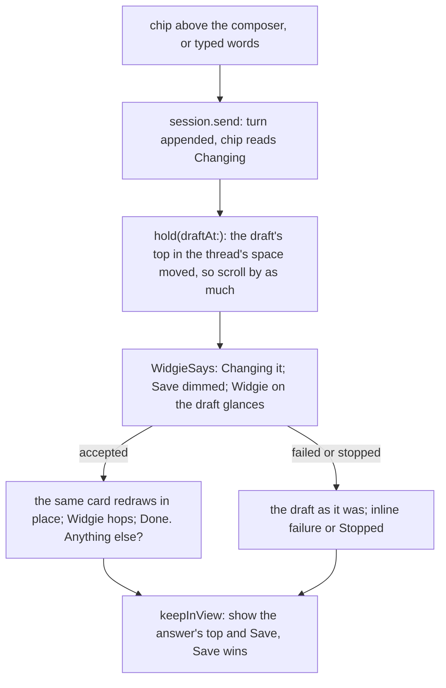
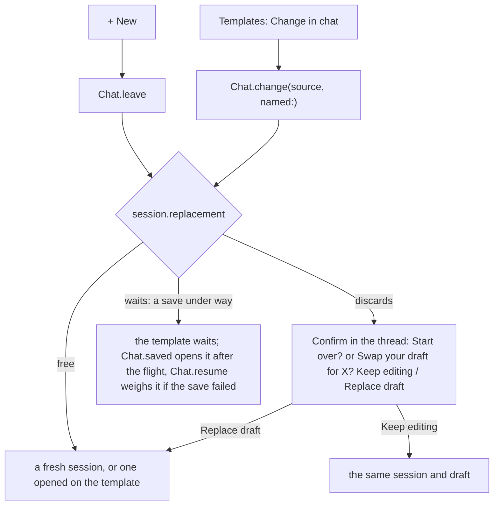
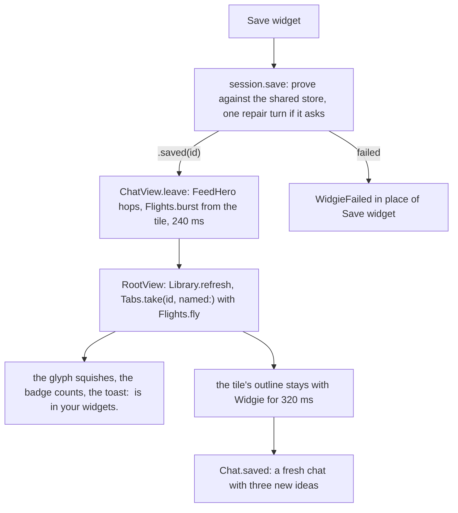
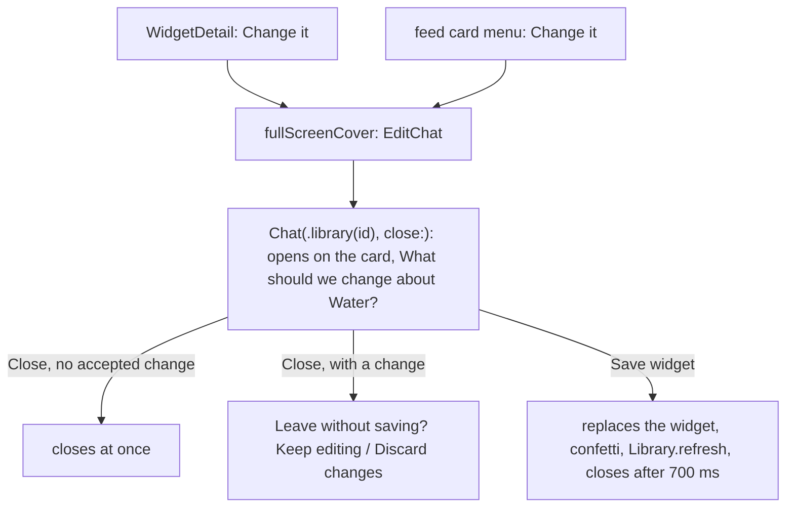

# PR 19: Make as the prototype's chat with Widgie

Branch `app-shell-u2-chat` into `main`. This is U2 of [tasks/app-shell.md](../../tasks/app-shell.md): Make becomes the chat the approved [prototype](../design/app-shell/prototype.src.html) draws, where Widgie is the one you talk to and it draws your widget.

## Core changes

- **Every turn stays.** [DescribeSession.swift](../../App/Widgie/Describe/DescribeSession.swift) keeps `turns: [Turn]`, each with a typed result: pending, accepted with Widgie's note, failed, or cancelled. `Phase.failed` names the work it interrupted (`open`, `turn`, `save`), so the chat knows where a failure goes and what Try again runs. One `init(_ origin:)` replaces the `editing:` and `draft:` initializers. A failed turn still never replaces the draft, and a failure no longer blocks the next message.
- **The chat.** [ChatView.swift](../../App/Widgie/Describe/ChatView.swift) replaces `DescribeView`, `TryItView` and `SavedView`, which are deleted. It holds the empty page with three idea cards, the thread of bubbles, the sketch that becomes the tile, the live draft with Widgie on it, Save widget, the inline failure and replace prompts, the change chips, and the composer with Stop. `EditChat` is the same chat in a full screen cover for Change it.
- **The chat's model.** [Chat.swift](../../App/Widgie/Describe/Chat.swift) owns the session, the ideas, and the question asked before a draft goes (`startOver`, `swap`, `leave`). It takes over the template hand-over that `RootView` did with a confirmation dialog.
- **Save is Add widget's path.** [RootView.swift](../../App/Widgie/RootView.swift) runs a Make save through `Tabs.take` and `Flights.fly`, the same calls as a template's Add widget: confetti, the flight into the Widgets glyph, the badge, the toast. Then `Chat.saved()` starts a fresh chat.
- **Ideas from the catalog.** Each `template.json` gains a `suggestion` (title, subtitle, SF Symbol, tint), and `Template.ideas` picks three, one per category, shuffled per chat ([Template.swift](../../App/Widgie/Templates/Template.swift)).
- **A draft starts empty.** `Preview(startsEmpty:)` draws a draft from no rows, as Save will put it on the home screen, and exposes the draft's `name`. The samples menu and `Preview.states`/`select` are gone.
- **Dead code removed.** The primary, compact and chip button styles, `ChipColor`, `Outline`, `CloseButton`, `Column`, the unused `Wordmark`, and 15 colorsets they used. New tokens: `WidgieYouFill`, `WidgieComposer`, and the six idea tints.

## 1. Opening Make and sending a first message

Files: [ChatView.swift](../../App/Widgie/Describe/ChatView.swift), [DescribeSession.swift](../../App/Widgie/Describe/DescribeSession.swift), [Preview.swift](../../App/Widgie/Preview.swift), [Template.swift](../../App/Widgie/Templates/Template.swift), [ChatTests.swift](../../App/WidgieTests/ChatTests.swift), [DescribeSessionTests.swift](../../App/WidgieTests/DescribeSessionTests.swift).

Key decisions:

- **The reply, Save and the chips land on the same frame.** All three read the same session state, which the accepted turn changes in one main actor job after `Preview.show` has drawn the faces.
- **The sketch traces the edge in 2.2 seconds, then keeps riding it** a lap every 7 seconds until the build lands, because a real build takes 15 to 40 seconds. It starts and ends where Widgie stands on the tile, so the drawing becomes the tile with Widgie in place. With Reduce Motion it is drawn whole and still.
- **A draft starts empty**, as the sign-off asks: a new pet tracker says "Not fed" and a counter shows 0, which is what Save will put on the home screen. Template sheets keep their first sample.
- **The draft card is the wide face at the column's width** (362 points on a 402 point phone), since an AI-made widget has both sizes and the wide one shows the most.
- **Widgie's notes name the widget, never its data**, as on Widgets: "Here's Water. Give it a tap." on a first draft, "Done. Anything else?" on a change.
- **Idea cards send their title**, the words the bubble shows. A template without a `suggestion` is not offered.
- **A failure does not block the composer.** You can act on it or say something else; the failure stays in the thread without its action.
- **`.unopened` keeps a full screen** (the broken bridge and Close), because there is nothing to chat about.

## 2. Asking for a change

Files: [ChatView.swift](../../App/Widgie/Describe/ChatView.swift), [DescribeSession.swift](../../App/Widgie/Describe/DescribeSession.swift).

Key decisions:

- **The draft stays put while a change lands**, as the prototype's `refine` does: the thread scrolls by as much as the new messages pushed the card down, then scrolls only as far as it takes to show the answer and Save. Checked on the simulator: the card stayed at y 316 from the send through Changing it. When a taller failure landed, the thread scrolled 59 points so the answer's top showed under the bar, as the prototype's `keepInView` does.
- **Positions are read in the thread's own coordinate space** for the draft, so a scroll in flight never counts as a move, and kept in a `Track` box that `body` never reads, so scrolling rebuilds nothing (U1b's rule). A scroll's aim is remembered until it arrives, so a second scroll does not start from a half-finished first one.
- **120 points of room under Save** keep the thread scrollable, so the draft can always stay where it is.
- **The chips are today's suggestions** (`Changes.suggested`, from `Face.traits`), moved out of the deleted try-it screen.

## 3. Starting over and changing a template in chat

Files: [Chat.swift](../../App/Widgie/Describe/Chat.swift), [RootView.swift](../../App/Widgie/RootView.swift), [ChatTests.swift](../../App/WidgieTests/ChatTests.swift).

Key decisions:

- **The question is asked in the thread**, with the draft still in view, as the prototype's `confirmReplace` does, instead of the system confirmation dialog. VoiceOver lands on Keep editing and hears the question.
- **"+ New" replaces the plan's "Start over" menu item**, as drawn.
- **A save cannot be stopped**, so a template chosen during one waits for it to land, and nothing is asked.

## 4. Saving

Files: [ChatView.swift](../../App/Widgie/Describe/ChatView.swift), [RootView.swift](../../App/Widgie/RootView.swift), [Tabs.swift](../../App/Widgie/Tabs.swift), [Flight.swift](../../App/Widgie/Flight.swift).

Key decisions:

- **Save follows the prototype, not the plan's top-bar Save and Saved overlay**: the key under the draft, and the same flight, badge and toast as a template's Add widget, through the same calls. With Reduce Motion there is no burst or flight, and the toast fades in.
- **The person stays on Make**, as on Templates; the widget lands when they open Widgets.

## 5. Changing a library widget

Files: [ChatView.swift](../../App/Widgie/Describe/ChatView.swift) (`EditChat`), [WidgetDetail.swift](../../App/Widgie/Widgets/WidgetDetail.swift), [WidgetsFeed.swift](../../App/Widgie/Widgets/WidgetsFeed.swift).

Key decisions:

- **The same chat edits a widget**, with "Change it" as its title and Close instead of New. The cover has its own sky and counts itself in `SkyCovers`, as before.
- **Nothing flies on an edit**: the widget is already in Widgets, under the cover.

## Verification

- `App/scripts/build` on the U1b simulator: format lint, build, 97 app tests passing, 13 of them new in `ChatTests` (turns and notes, a change that gives up keeps the draft, a message after a failure, a draft starts empty, chips from traits, New and Keep editing, the template swap, editing origin and Leave, save resetting the chat, a template waiting out a save, ideas from the catalog).
- `scripts/check` green.
- On the simulator against the dev bridge on Sonnet: a create from typed words and from an idea card, refines through chips, a cancel of a first build and of a change, a bridge that is down, a give-up through a stand-in bridge whose replies never build, the replace prompt, a save with its flight and toast, and an edit of a library widget with Leave and Save. Light and dark, the largest text size, and Reduce Motion, side by side with the prototype's own captures.
- `log stream --predicate 'category == "describe"'`: creates in 29.7 and 35.1 s, changes in 15.2 to 17.2 s. App seconds, preview shown minus the bridge's model time, 0.37 to 1.56, median 0.5, against PR 8's median of 0.55.
