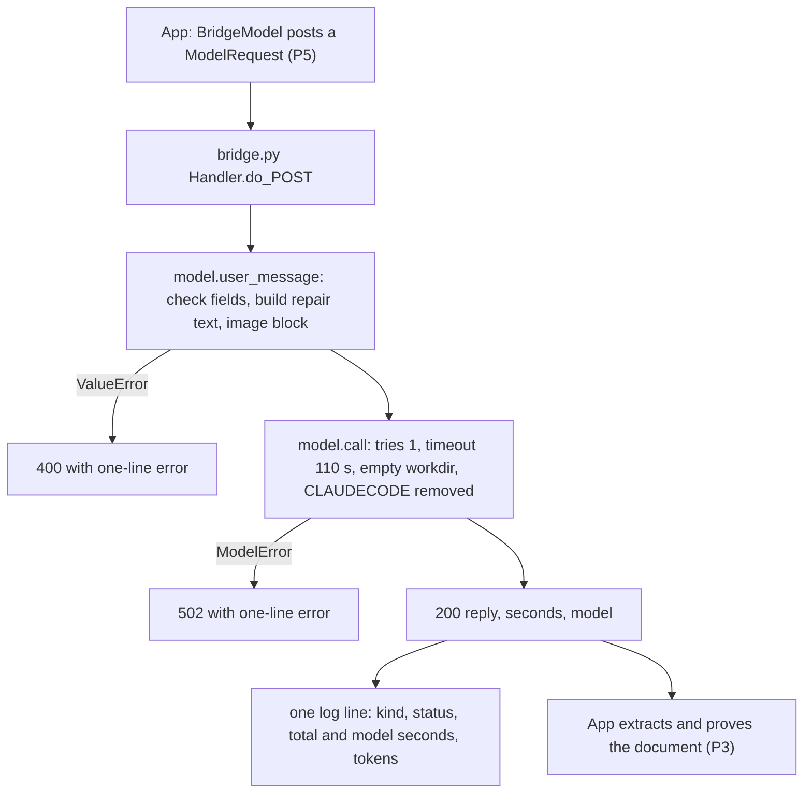
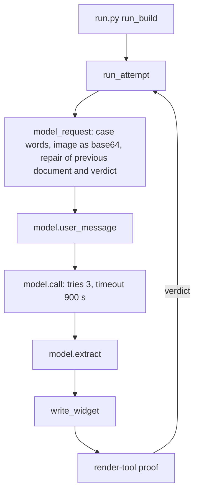

# PR 2: share the model call and add the dev bridge

Branch `phase-2-p1-model-bridge` into `main`. This is P1 of [tasks/phase-2-app-flow.md](../../tasks/phase-2-app-flow.md), which this PR also adds.

Background reading: the plan's "Facts this plan rests on", "The data shape", and P1 sections. Also read [USAGE.md](../../docs/engine/USAGE.md) section 3, which covers what the backend sends the model.

## Core changes

- **One model module.** [model.py](../../Engine/Evals/model.py) holds `compose_prompt`, `user_message`, `call`, and `extract`, moved from `run.py`. `user_message` takes the app's `ModelRequest` as a dict (`words`, `image`, `repair`). The eval harness and the bridge build the same bytes for the same request.
- **The dev bridge.** [bridge.py](../../Engine/Evals/bridge.py) is a standard-library HTTP server on `127.0.0.1:8787`. `POST /v1/reply` returns `{"reply", "seconds", "model"}`, and `GET /health` returns `ok`. It makes one model try with a 110 s timeout. A bad body gets a 400 and a failed model call gets a 502, each with a one-line error.
- **The eval harness keeps its behavior.** [run.py](../../Engine/Evals/run.py) builds a `ModelRequest` from each case and calls `model.py`. It keeps three tries and a 900 s timeout.
- **Byte fixtures.** [testdata/](../../Engine/Evals/testdata/) holds the exact stream-json lines the old `run.py` sent for create, create with an image, repair, and repair with an image. It also holds the reply-extraction cases, which the Swift loop tests in P3 will share.
- **The checks.** [test_model.py](../../Engine/Evals/test_model.py) has 7 tests, and [Engine/scripts/check](../../Engine/scripts/check) runs them.
- **The plan.** [phase-2-app-flow.md](../../tasks/phase-2-app-flow.md) covers P1 to P6, with the six changes agreed before P1 and P1's boxes checked.

## 1. The app asks the bridge for a widget

The app (P5) posts a `ModelRequest`. The bridge turns it into Claude Code's stream-json input, runs `claude -p` with the build prompt and no tools, and returns the raw reply. The app extracts the document and proves it itself.

Files:

- [bridge.py](../../Engine/Evals/bridge.py): `handler`, `kind`, `main`. `send` ignores a client that hangs up, so a cancel in the app does not print a traceback.
- [model.py](../../Engine/Evals/model.py): `user_message`, `call`.

Key decisions:

- **The service owns the prompt.** The app sends meaning, not message text, so prompt changes never need an app release. The real backend keeps this contract.
- **One try, 110 s.** A retry inside the bridge would outlive the app's 120 s request, so the app could never tell a slow answer from a lost one.
- **A refine is refused, not ignored.** `current` raises until P2 adds a refine mode. Ignoring it would look like a working refine that changed nothing.
- **A reply with no fence is still a 200.** The app's build rejects it like any other bad document, and the loop repairs it.

## 2. The eval harness builds a widget

`run.py` behaves as before. Only where the message comes from changed.

Files:

- [run.py](../../Engine/Evals/run.py): `model_request` replaces `repair_message` and `message_content`.
- [test_model.py](../../Engine/Evals/test_model.py): the golden test asserts the bytes the `claude` process would receive, through the real `call`.

Key decisions:

- **Proved identical against a fake `claude`.** The old and new `run.py` ran against a fake `claude` that records what it receives. The arguments, stdin, and environment are byte-identical, and all 57 output files match apart from timings.
- **No sleep after the last failed try.** The old code slept 5 s even after the final failure. That would have delayed the bridge's 502 by 5 s. `run.py`'s records do not change.
- **The test runs by discovery.** `python3 -I -m unittest discover -s Engine/Evals -p 'test_*.py'`. The path form cannot import the test under `-I`.

## Verification

- `scripts/check` passes at the head.
- `run.py` on the four reference cases with Haiku: run `p1-move-2` and the old code's run `p1-before` each accepted 4 of 4. Run `p1-move` lost word of the day to a repeated two-line text verdict, with inputs proven identical.
- The bridge on Sonnet returned a create, the R1 reference image, and a repair of a broken document. Each was `accepted` by `render-tool proof`, re-proved by hand. The R1 reply copies the picture's LCD layout, color, and type closely.
- Bridge overhead: 0.9 to 3.1 ms of its own work per call against an instant fake `claude`. Live wall time minus model time was -0.02 to +0.05 s, within the 0.1 s rounding.
