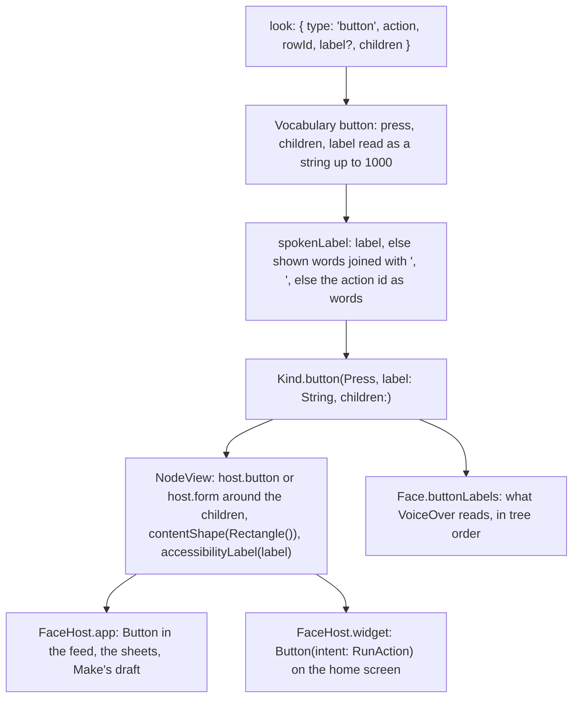
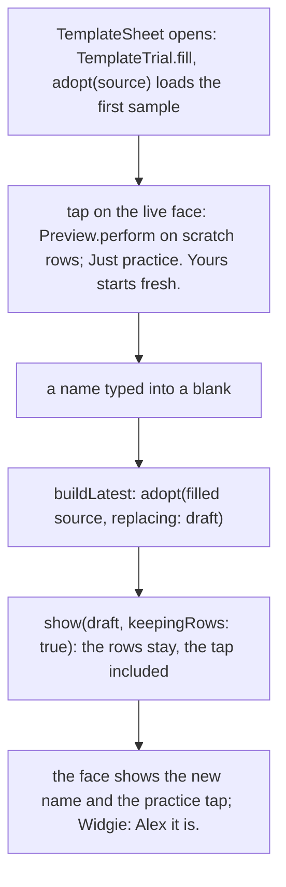
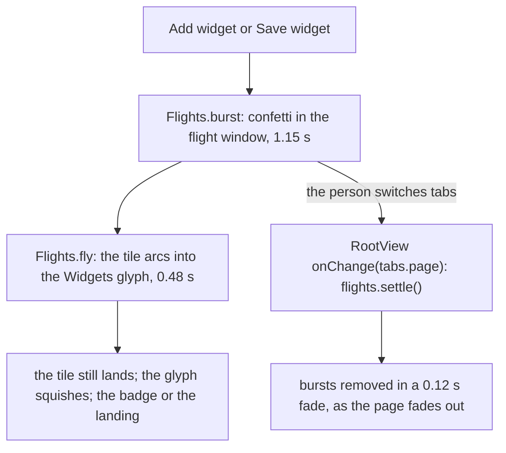
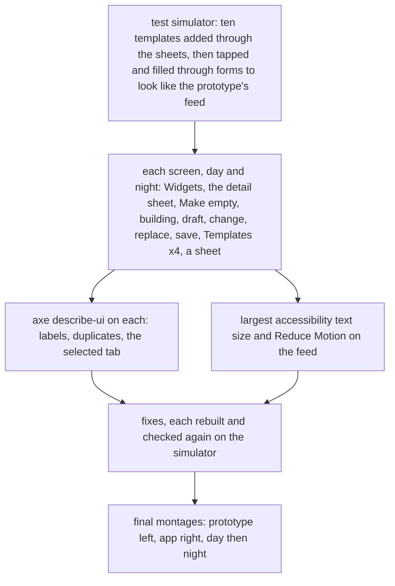

# PR 20: the polish and end-to-end pass, and VoiceOver labels for face buttons

Branch `app-shell-u5-polish` into `main`. This is U5 of [tasks/app-shell.md](../../tasks/app-shell.md), the last unit: a walk over every screen of the app shell against the approved [prototype](../design/app-shell/prototype.src.html), light and dark, at the largest text size and with Reduce Motion, with every screen's accessibility tree read, and the fixes the walk found.

## Core changes

- **A face's buttons speak.** The look vocabulary's `button` takes a `label` ([Vocabulary.swift](../../Engine/Sources/WidgetEngine/Vocabulary.swift)). `Kind.button` carries the resolved label, never empty: the look's label, else the words the button shows, joined with commas, else its action's id as words ("markFed" reads "Mark fed"). [NodeView.swift](../../Engine/Sources/WidgetEngine/NodeView.swift) puts it on the button, so the app, the sheets, Make's draft and the home screen widget all read it. `Face.buttonLabels` exposes what VoiceOver reads, for tests. [look.md](../../Engine/Reference/look.md) teaches it and its examples use it; the Worker prompt is regenerated ([build-prompt.txt](../../Backend/src/build-prompt.txt)).
- **Every icon-only key in the 19 templates says which one it is**: "Fed Luna", "Send Sam a heart", "Read, today, done", "Your mood, okay", "Remove Basil", "Undo". The whole-tile buttons read their number and what a tap does ("Lisbon, 12 days until our trip"). The edits are plain look changes in `App/Templates/*/widget.json`.
- **A button's whole frame is its target.** The renderer gives a button's label a rectangular content shape, so a plus in a 30 point frame takes taps, and VoiceOver's outline, across 30 points instead of the 11 the glyph covers.
- **Practice survives a typed name.** `Preview.adopt(_:replacing:)` shows a new revision of the draft on show without reloading its sample ([Preview.swift](../../App/Widgie/Preview.swift)), so a tap tried in a template sheet stays when the person then types a name.
- **Confetti leaves with its page.** `Flights.settle()` fades out the confetti in the air when the tab changes ([Flight.swift](../../App/Widgie/Flight.swift), [RootView.swift](../../App/Widgie/RootView.swift)); a tile in flight still lands.
- **What the walk fixed**: the template sheet's blank fields and a form's fields had no VoiceOver label; the detail sheet read two identical "Fed Luna" keys with nothing to tell them apart; a form's question trailed off in the bar ("When do you fly, and..."); opening a widget or a template in chat scrolled Widgie's first line under the title; the Templates title sat 8 points lower than the other pages' titles and the prototype's.

## 1. A face button, from the look to VoiceOver

Files: [Vocabulary.swift](../../Engine/Sources/WidgetEngine/Vocabulary.swift), [Drawing.swift](../../Engine/Sources/WidgetEngine/Drawing.swift), [NodeView.swift](../../Engine/Sources/WidgetEngine/NodeView.swift), [Public.swift](../../Engine/Sources/WidgetEngine/Public.swift), [look.md](../../Engine/Reference/look.md), [LabelTests.swift](../../Engine/Tests/LookTests/LabelTests.swift), [MistakeTests.swift](../../Engine/Tests/LookTests/MistakeTests.swift), [TemplateTests.swift](../../App/WidgieTests/TemplateTests.swift).

Key decisions:

- **Both an optional label and a fallback.** A label the look writes says what the key means ("Fed Luna"); the fallback means a model that forgets one still gets a usable button, never a blank one. A model on Sonnet wrote labels on its own after the prompt change ("Mark the dog fed", "Log a feeding").
- **Shown words win over the action's name**, so "Know it" reads "Know it", not "Know". The label wins over both, so "+10" can read "Add 10 pushups".
- **The label is resolved once, in validation**, so the renderer stays total and every host gets the same words. It is not part of `Tap`, which is Codable for the App Intent and the form link.
- **A label may be as long as a text** (1000 characters). The first limit, 100, failed the proof for groceries in the full state, whose rows carry 1000-character titles: a label built from a row must never reject a widget.
- **An empty or blank label falls back** rather than failing the look, since a look often writes `label: done ? 'Done' : ''`.
- **The app test reads every template in every proved state**, both sizes: every label reads something, no two read the same (except in the synthesized full state, which repeats one title in every row), and a table pins the icon-only keys' words.

## 2. Practice in a template sheet, then a typed name

Files: [Preview.swift](../../App/Widgie/Preview.swift), [TemplateTrial.swift](../../App/Widgie/Templates/TemplateTrial.swift), [TemplateTests.swift](../../App/WidgieTests/TemplateTests.swift).

Key decisions:

- **Kept, not replayed.** Filling a blank changes only the widget's name and the look's constants. No template's samples use a blank, and the tables stay the same, so the rows the draft has are exactly what a reload would give plus the person's taps. On the simulator, Thinking of you went from "you sent 3" to 4 on a practice tap and stayed at 4 as "Sam" became "Alex".
- **Only `adopt(_:replacing:)` keeps rows.** A first adopt and every Make turn still load afresh, since a change in chat may change the tables.

## 3. A tab switch during Add widget or Save

Files: [Flight.swift](../../App/Widgie/Flight.swift), [RootView.swift](../../App/Widgie/RootView.swift), [ShellTests.swift](../../App/WidgieTests/ShellTests.swift).

Key decisions:

- **The tile keeps flying.** It lands in the tab bar, which every page shares, and its landing drives the badge and the count.
- **The window still goes when nothing flies**, through the burst's own timer, so `settle` adds no lifecycle of its own.

## 4. The end-to-end pass

Files: [TemplateSheet.swift](../../App/Widgie/Templates/TemplateSheet.swift), [FormSheet.swift](../../App/Widgie/FormSheet.swift), [WidgetDetail.swift](../../App/Widgie/Widgets/WidgetDetail.swift), [ChatView.swift](../../App/Widgie/Describe/ChatView.swift), [TemplatesView.swift](../../App/Widgie/Templates/TemplatesView.swift).

Key decisions:

- **Only a change holds the draft in place.** `hold(draftAt:)` scrolls by as much as new messages pushed the draft down; on opening an edit, Widgie's first line went in above the card and the hold hid it under the title. It now holds only once there are turns.
- **The detail sheet's faces are groups named "Medium size" and "Small size"**, so VoiceOver says which of the two "Fed Luna" keys it is on.
- **A form's question wraps to two lines** in the bar instead of trailing off.
- **The feed in the screenshots holds ten widgets.** The size rhythm counts from the oldest, and ten (the prototype's nine plus Word of the day under them) put Lisbon, Groceries and Japan fund wide as the prototype does. Nothing is on the simulator's home screen, so no card wears the phone mark.

Open, not fixed here:

- The feed's pull to refresh control shows in the accessibility tree ("Refreshing content") while the Widgets page is hidden behind another tab, as the composer once did. Removing `.refreshable` while hidden would rebuild the scroll view and lose its position, and the simulator cannot run VoiceOver to prove whether focus reaches it, so it is left for a device check.
- In the template pile, the inert faces' text carries the button's label under the card's own label. VoiceOver reads only the card, which is one control, but `axe` shows the inner words.
- Page titles sit 3 to 6 points lower than the prototype's, and the Templates chips 8 lower: SwiftUI sets Bricolage on a 1.2 line where the prototype's CSS sets 0.98, so a 40 point title takes a 48 point box instead of 39. Trimming it touches every display title and the perches measured from them, so it is left for a follow-up.

## Side-by-sides

Twenty montages, each one state with the prototype on the left and the app on the right, day then night, were made with the prototype tooling and handed over with this PR: the feed at the top and scrolled, a tap on a live face, the empty feed (app only, the prototype has none), a widget landing with the New tag, the detail sheet beside the prototype's sheet style, Make empty, building, with a draft and chips, with a change landed, and asking to replace a draft, Add widget's flight and its toast, the four Templates categories, a template sheet, and the feed at the largest text size and with Reduce Motion.
