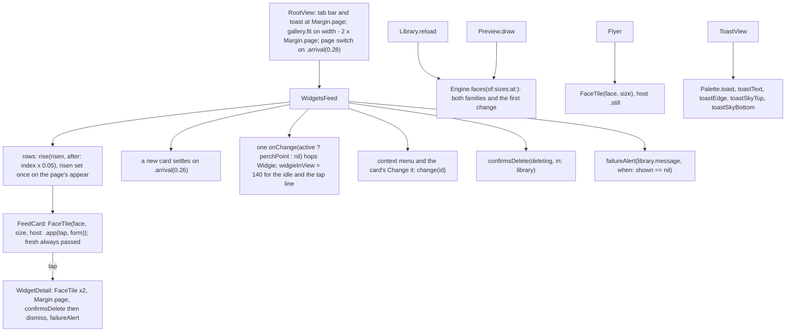
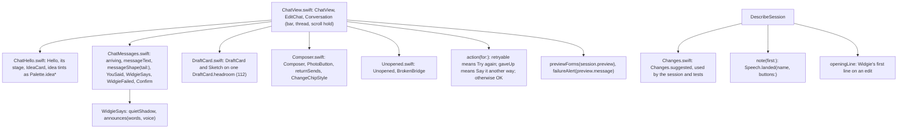
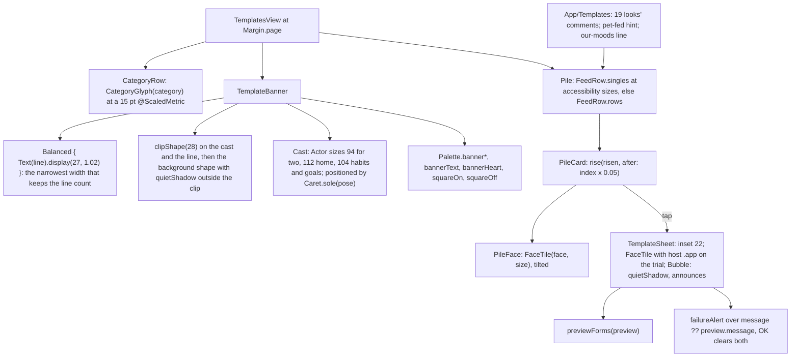
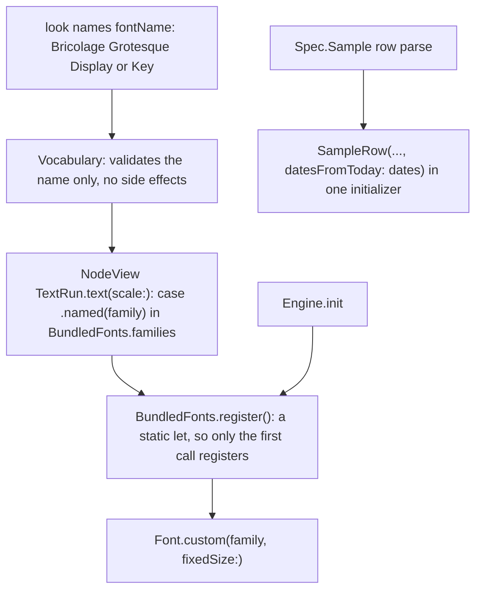
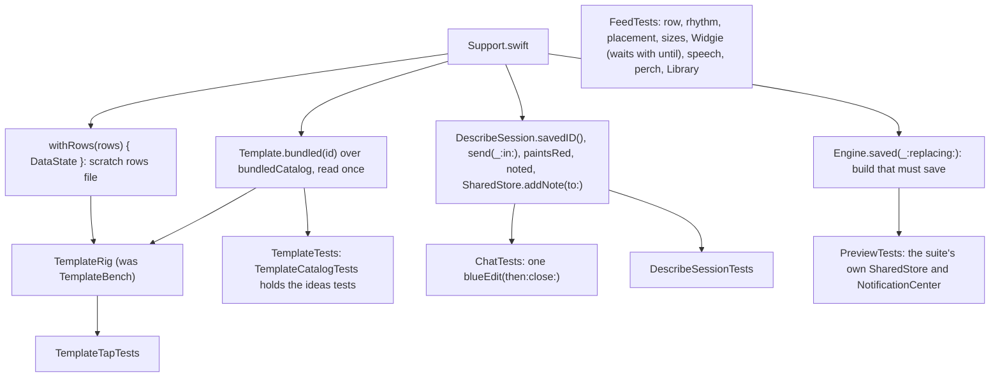

# PR 21: the cleanup after the five app shell units

Branch `app-shell-cleanup` into `main`. This is U6 of [tasks/app-shell.md](../../tasks/app-shell.md): the five units (PRs 16 to 20) each passed review alone, but together they left the same pieces written several times over. Three fresh reviews (the shell and feed, Make, templates and the engine) found the work below, done in three passes (A, B, C). Behaviour does not change. The look changes only where it moves toward the approved [prototype](../design/app-shell/prototype.src.html), and those items are marked "look" below.

## Core changes

- **One shared design layer.** [Layout.swift](../../App/Widgie/Design/Layout.swift) gains `Margin.page` (20), `FaceTile` (a face or its grey placeholder, framed and shadowed, with `FaceTile.corner`) and `Balanced`. [Theme.swift](../../App/Widgie/Design/Theme.swift) gains `quietShadow`, `announces`, `failureAlert`, `rise(_:after:)`, `Animation.arrival(duration:)`, `Squish`, `MiniButtonStyle`, `MiniLabelStyle` and `IconGrid`. `confirmsDelete` sits in [WidgetDetail.swift](../../App/Widgie/Widgets/WidgetDetail.swift) and `previewForms` in [FormSheet.swift](../../App/Widgie/FormSheet.swift). Each one replaces copies spread across the feed, the detail sheet, the flight, the pile, the template sheet and Make.
- **Every color goes through `Palette`.** The toast gets five new colorsets in place of its `colorScheme` branches. The banner, square and idea colors move from `Color(.widgie...)` at each use to `Palette` tokens.
- **Make's 1,333-line `ChatView.swift` is split by responsibility** into [Changes.swift](../../App/Widgie/Describe/Changes.swift), [ChatHello.swift](../../App/Widgie/Describe/ChatHello.swift), [ChatMessages.swift](../../App/Widgie/Describe/ChatMessages.swift), [DraftCard.swift](../../App/Widgie/Describe/DraftCard.swift), [Composer.swift](../../App/Widgie/Describe/Composer.swift) and [Unopened.swift](../../App/Widgie/Describe/Unopened.swift). [ChatView.swift](../../App/Widgie/Describe/ChatView.swift) is now 484 lines. Failure actions read `Failure.retryable`, the first note uses `Speech.landed`, the three messages share one shape and one text style, and a few names are clearer.
- **The Templates tab moves closer to the prototype (look).** The banner's shadow shows again. The chips draw the prototype's heart, house, leaf and star as shapes. The banner line wraps balanced, as CSS `text-wrap: balance` does. The banner Widgies use the prototype's sizes and stand on the sole of their foot. Our moods keeps the prototype's line.
- **Template content.** The 19 looks no longer mention "the prototype" in their comments, since a look is sent to the model on Change in chat. Pet fed's hint says it stays on this phone.
- **Engine.** A bundled font registers where its text is drawn, not in the parser. `SampleRow.datesFromToday` is set in the initializer. A doc comment is rewrapped.
- **Tests.** Shared helpers in [Support.swift](../../App/WidgieTests/Support.swift) replace about a dozen copies. The template catalog is read once. `TemplateBench` is renamed `TemplateRig`. The Widgets tests now live together in [FeedTests.swift](../../App/WidgieTests/FeedTests.swift). No test was lost: `scripts/check` is green with zero warnings (engine 106, backend 26, app 136).

## 1. The Widgets feed, the detail sheet and the shell

Files: [Layout.swift](../../App/Widgie/Design/Layout.swift), [Theme.swift](../../App/Widgie/Design/Theme.swift), [Sky.swift](../../App/Widgie/Design/Sky.swift), [Caret.swift](../../App/Widgie/Design/Caret.swift), [RootView.swift](../../App/Widgie/RootView.swift), [TabBar.swift](../../App/Widgie/TabBar.swift), [Toast.swift](../../App/Widgie/Toast.swift), [Flight.swift](../../App/Widgie/Flight.swift), [Library.swift](../../App/Widgie/Library.swift), [Preview.swift](../../App/Widgie/Preview.swift), [WidgetsFeed.swift](../../App/Widgie/Widgets/WidgetsFeed.swift), [FeedCard.swift](../../App/Widgie/Widgets/FeedCard.swift), [WidgetDetail.swift](../../App/Widgie/Widgets/WidgetDetail.swift), [Speech.swift](../../App/Widgie/Widgets/Speech.swift), the five `WidgieToast*.colorset` folders.

Other tidy-ups in this pass: the unused `coversSky(_:)` flag, `CursorBar.blinking` and `Daypart`'s calendar parameter are removed. `TabBar`'s callback is renamed from `target` to `locate`, so it no longer shadows the flight's `target`. The count line builds its words once. `TabGlyph` and `PhoneMark` share one `IconGrid`. `Library.reloads` and `Preview`'s `drawings`/`shows` counters are `@ObservationIgnored`. The debug fixtures (`fixtures`, `fixture(_:)`, `install(_:)`) compile only in `DEBUG`. `Caret.lift`'s comment now names `HoppingCaret`.

Key decisions:

- **`rise(_:after:)` takes a `risen` flag instead of keeping its own state.** The feed owns one `risen` for the page. When a new widget re-pairs rows, it re-creates the card views, and a modifier with its own `@State` would play the rise again. The pile's `PileCard` holds its own `risen`, so each card still rises once when it appears. The pile now uses the feed's spring (bounce 0.2 instead of 0.25).
- **`announces` and its `Voice` live in Design.** `Voice` (silent, low, normal) used to be `Bubble.Voice` in the template sheet, so the shared layer depended on a Templates type.
- **The page margin is `Margin.page`,** not `Page.margin`, so it never reads like the tab bar's `Tabs.Page`.
- **`Balanced` needs text that wraps freely.** With a `lineLimit` or a `minimumScaleFactor` the text never grows taller as it narrows, so the search would shrink it to nothing. Its doc comment says so.
- **One arrival curve, by name.** The page switch and a card settling into the feed both used `timingCurve(0.22, 0.8, 0.26, 1)`. Each caller still passes its own duration.
- **`failureAlert` takes a `when` condition.** The feed and the detail sheet both watch `library.message`. The feed's alert yields while a sheet is shown, as its inline condition did before.
- **`confirmsDelete` presents a `WidgetID?`.** The detail sheet moves from a `Bool` to the same `deleting` binding the feed uses, and the message reads `library.placed[id]`, so both screens say the same thing. `WidgetDetail.deleteMessage` is gone.
- **`showForm` stays duplicated.** `Library` and `Preview` now share the face loop through `Engine.faces(of:sizes:at:)`. Each keeps its own `showForm`, since sharing a one-call method would add more code than it removes.
- **The toast's light text is the same color as before.** `WidgieToastText` by day is `#121A2E`, which is `Palette.ink`. The day hairline is clear, as `faceEdge` is, so the stroke can always be drawn with no branch on the color scheme.

## 2. Make's chat

Files: [ChatView.swift](../../App/Widgie/Describe/ChatView.swift), [ChatHello.swift](../../App/Widgie/Describe/ChatHello.swift), [ChatMessages.swift](../../App/Widgie/Describe/ChatMessages.swift), [DraftCard.swift](../../App/Widgie/Describe/DraftCard.swift), [Composer.swift](../../App/Widgie/Describe/Composer.swift), [Unopened.swift](../../App/Widgie/Describe/Unopened.swift), [Changes.swift](../../App/Widgie/Describe/Changes.swift), [DescribeSession.swift](../../App/Widgie/Describe/DescribeSession.swift), [Picture.swift](../../App/Widgie/Describe/Picture.swift), [Speech.swift](../../App/Widgie/Widgets/Speech.swift), [FormSheet.swift](../../App/Widgie/FormSheet.swift), [Theme.swift](../../App/Widgie/Design/Theme.swift).

Key decisions:

- **Split by responsibility, with moved code left as it was.** Apart from the renames below, the diff in the new files is a move. The views that were `private` in one file (`Hello`, `YouSaid`, `WidgieSays`, `DraftCard`, `Sketch`, `Composer`, `Unopened`, `ChangeChipStyle`) are now module-internal so `Conversation` can reach them. Helpers that only one file uses stay `private` or `fileprivate` (`IdeaCard`, `PhotoButton`, `BrokenBridge`, `messageShape`, `messageText`). `Squish`, `MiniButtonStyle` and `MiniLabelStyle` move to Theme, since the Templates tab uses them too.
- **Facts are read from their owner instead of repeated.** `action(for:)` used to list failure cases a second time. It now reads `Failure.retryable`, the same check `retry()` uses. The draft's first note is `Speech.landed`, the feed's own wording.
- **One message shape.** `messageShape(tail:)` gives the bubble 20 point corners, with a tight 6 point corner at the bottom on the speaker's side. That is the same geometry the three copies drew. `messageText()` is the shared 15.5 semibold with -0.15 tracking. `YouSaid` keeps its own `lineSpacing(2)`.
- **Clearer names.** The session's `opening` becomes `openingLine`, so it is no longer confused with `Phase.opening`. The thread's `reply` array becomes `results`, so it is no longer confused with the reply's position. `react(was:now:)` becomes `react(to:)`, since the old value was never read. `Picture.modelSide` is private, and `Thumbnail` drops a default size that no caller used.
- **Hello's idea cards keep their own rise.** They come up 14 points with their own delays, unlike the feed's 18. They are not part of this cleanup.

## 3. The Templates tab and the template sheet

Files: [TemplatesView.swift](../../App/Widgie/Templates/TemplatesView.swift), [TemplateBanner.swift](../../App/Widgie/Templates/TemplateBanner.swift), [TemplateSheet.swift](../../App/Widgie/Templates/TemplateSheet.swift), [Layout.swift](../../App/Widgie/Design/Layout.swift), [Theme.swift](../../App/Widgie/Design/Theme.swift), [Caret.swift](../../App/Widgie/Design/Caret.swift), [FeedLayout.swift](../../App/Widgie/Widgets/FeedLayout.swift), [pet-fed/template.json](../../App/Templates/pet-fed/template.json), [our-moods/template.json](../../App/Templates/our-moods/template.json), and `App/Templates/*/widget.json` (comments only).

Key decisions:

- **The banner's shadow shows (look).** The outer `clipShape` used to cut away the shadow along with everything else. The clip now wraps only the cast and the line, and the background shape casts `quietShadow` outside it. `quietShadow` is the speech bubbles' two-layer shadow (the prototype's `--quiet`), now shared by the banner, the sheet's `Bubble` and `WidgieSays`. The banner used `restShadow` before.
- **All four chip glyphs are shapes, for consistency (look).** `CategoryGlyph` fills the prototype's heart, house, leaf and star on a 24 unit grid. Not only the glyphs that looked different were converted: all four are, so the row comes from one source at one weight and scale. The leaf's vein winds the other way from the leaf, so the nonzero fill cuts it out with no even-odd rule. `Category.symbol` is gone. The heart that beats over the two Widgies is still an SF Symbol, since it is not a chip.
- **`Balanced` emulates CSS `text-wrap: balance` (look).** It measures the line count at the offered width, then binary searches (to 0.5 points) for the narrowest width that keeps that count. It reports that width, so placing the text breaks the same lines. Habits now reads "See your / weeks fill up" and Goals "Little wins / add up", as in the prototype. It is a `Layout` around the one `Text`, with no fixed widths for each category.
- **Banner Widgies stand on `Caret.sole`, like the feed's (look).** `Caret.foot` is the center of the foot's round cap. Anchoring on it sank the cap below the floor and hid the floor shadow under the banner's edge. `Caret.sole` is the bottom of the cap, which is the point the feed's Widgie and Make's draft already stand on. The sizes are the prototype's (94, 112, 104, 104). Before, they were drawn about 1.2 times larger (112, 134, 124, 124).
- **Our moods' honesty lives in the hint.** Its line goes back to the prototype's "Share how you're feeling". The old "A face each, on one phone for now" was cut off in the pile, and the hint already says "For now it stays on this phone", as every other shared template's hint does. Pet fed's and Shared groceries' hints gain the same sentence. Groceries keeps its line, "Cross it off, on one phone for now", because the prototype's "Cross it off for both" promises sync, which comes in phase 4.
- **The look comments stop naming the prototype.** Change in chat sends a look to the model, which has never seen the prototype. Comments now explain sizes in the look's own terms (`u`, 1/170 of the widget's height) and describe drawings directly. Only comments change. No look code changes.
- **The pile uses `FeedRow.singles`, as the feed does.** At accessibility sizes a small card becomes `.pair(id, nil)` at full width instead of `.wide(id)`. Since a pile card takes the column's width at those sizes anyway, the layout is the same.
- **The sheet names its 22 point inset** (`TemplateSheet.inset`), and `sizes(width:)` uses it in place of a literal 44.

## 4. The engine: fonts, sample rows

Files: [NodeView.swift](../../Engine/Sources/WidgetEngine/NodeView.swift), [Vocabulary.swift](../../Engine/Sources/WidgetEngine/Vocabulary.swift), [Fonts.swift](../../Engine/Sources/WidgetEngine/Fonts.swift), [Samples.swift](../../Engine/Sources/Spec/Samples.swift), [Tables.swift](../../Engine/Sources/Spec/Tables.swift).

Key decisions:

- **Register where the text is drawn.** A static proof draws without an engine, so `Engine.init` registering is not enough. Before, the parser registered the font as a side effect of reading the name. Drawing is the step that actually needs the font. `register()` is a `static let` touch, so calling it on every draw costs nothing after the first.
- **`datesFromToday` is a `let`.** Generated rows pass `[]` and parsed rows pass their dates, so a `SampleRow` is complete as soon as it is built.

## 5. The test suite

Files: [Support.swift](../../App/WidgieTests/Support.swift), [TemplateRig.swift](../../App/WidgieTests/TemplateRig.swift), [TemplateTapTests.swift](../../App/WidgieTests/TemplateTapTests.swift), [TemplateTests.swift](../../App/WidgieTests/TemplateTests.swift), [ChatTests.swift](../../App/WidgieTests/ChatTests.swift), [DescribeSessionTests.swift](../../App/WidgieTests/DescribeSessionTests.swift), [PreviewTests.swift](../../App/WidgieTests/PreviewTests.swift), [FeedTests.swift](../../App/WidgieTests/FeedTests.swift), [ShellTests.swift](../../App/WidgieTests/ShellTests.swift), [RedrawTests.swift](../../App/WidgieTests/RedrawTests.swift).

Key decisions:

- **The catalog cache lives in test support, not in the app.** The rig looks up a template for every face it stages, so `Template.bundled` reads `catalog()` once into a private static. The app's `Template.catalog()` is left as it was. The catalog tests that check reading itself still call `catalog(in:)` directly.
- **`Engine.saved` records an issue and throws** when a build does not save. It replaces the repeated `guard case .saved` blocks, and `SharedStore.build` is built on it.
- **Tests sit with what they test.** The Widgets suites (`LibraryTests` included, moved from `PreviewTests`) are in `FeedTests.swift`. The ideas and `Seeded` tests move to `TemplateCatalogTests`, without the folder count that suite already checks. `ShellTests` keeps arrivals, tabs, flights and the moon.
- **The form test in `FeedTests` keeps its own `note` field** instead of using the shared `noted`, since it names that field again in the form.
- **Fewer builds, the same coverage.** There are no repeated "me" builds. The label test uses one face instead of a timeline. There is one undo list fixture, and `petFed` takes `startsEmpty`. The app count stays at 136.

## Left out on purpose

- The badge's spacer stacks (an alignment guide could replace them).
- Moving `cut-bricolage.py` out of `Sources/`. PR 16 kept it beside the fonts on purpose.
- Folding `Template.Info` into `Template`.
- Renaming blank keys. They are internal, and the labels already match.

## How it was checked

`scripts/check` passed with zero warnings after each pass. Simulator screenshots of the Templates tab were compared against the prototype for the look items, in all four categories, light and dark. The Widgets and Make tabs were compared before and after passes A and B, and showed no change.
