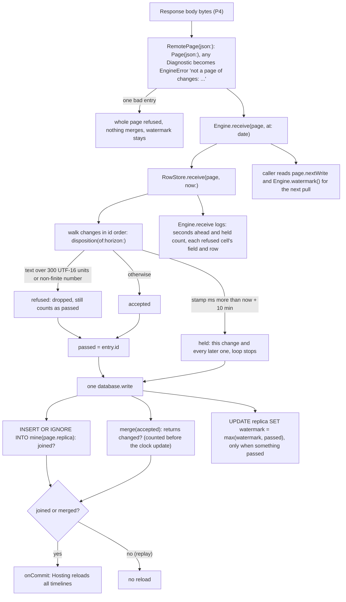
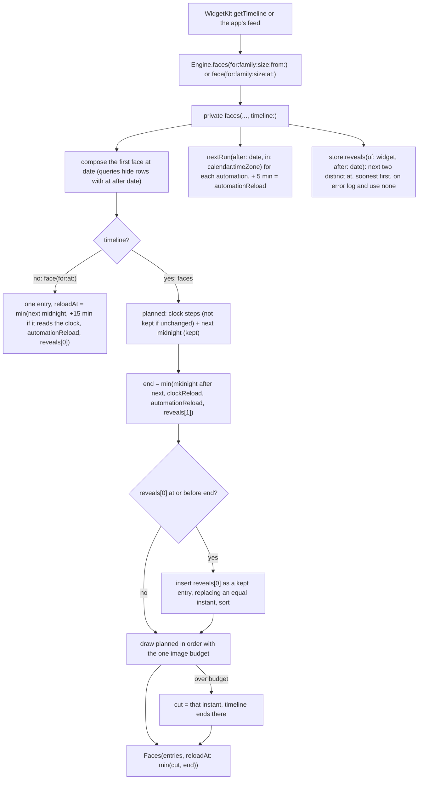
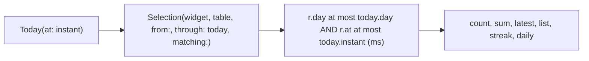
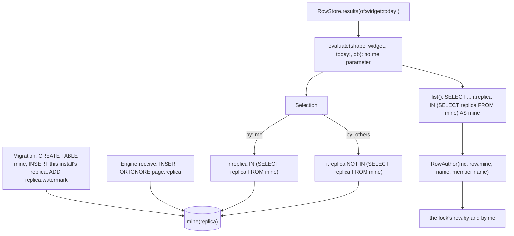
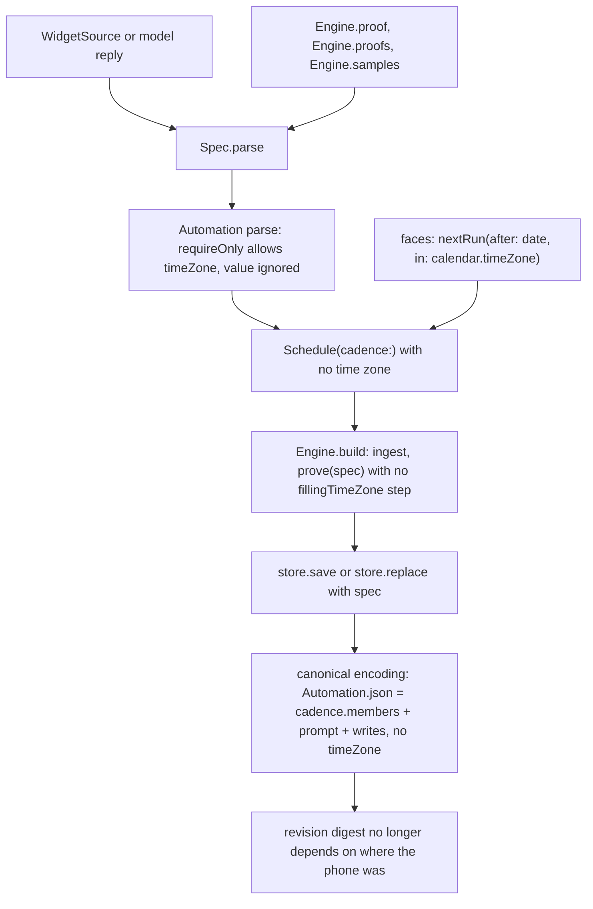
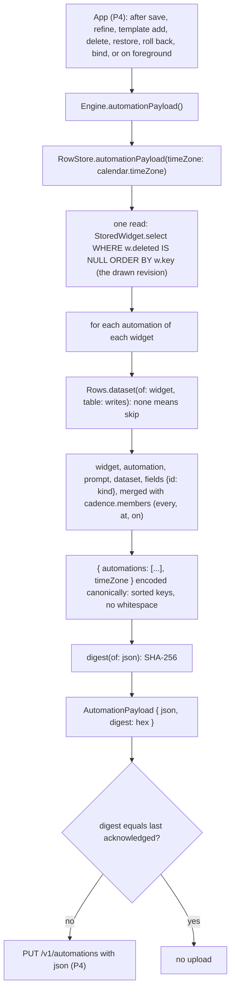
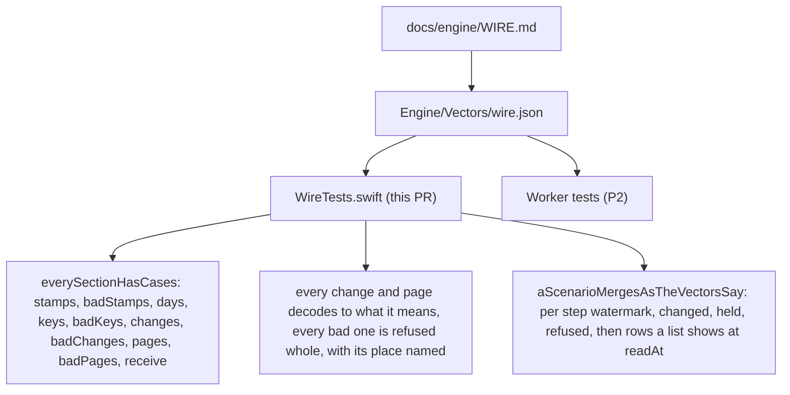

# PR 22: the engine takes in remote rows

Branch `phase-3-p1-engine` into `main`. This is P1 of [tasks/phase-3-ai-block.md](../../tasks/phase-3-ai-block.md) (see its "P1 results" note). The engine learns to take in a page of changes the server wrote, to keep an automation's row hidden until its time, to count the account's automation rows as the person's own, and to hand the app the bytes it uploads. There is no network code here: P4 moves the bytes, P2 and P3 build the Worker on the same format.

Background reading: [WIRE.md](../engine/WIRE.md) (the format), and the new [RATIONALE.md](../engine/RATIONALE.md) paragraphs "Pages from the server", "Who the person is: `mine`", "Rows reveal at their `at`", and "Automations follow the phone's time zone" (lines 43 to 49).

## Core changes

- **A wire format with shared vectors.** [WIRE.md](../engine/WIRE.md) defines one JSON object per `Stamped` change (`insertRow`, `setCell`, `deleteRow`), the pull page `{ replica, changes: [{ id, change }], nextWrite }`, what the server writes, and the automation payload. A stamp travels as a decimal string, since `ms << 16` passes 2^53. [wire.json](../../Engine/Vectors/wire.json) holds good and bad stamps, days, keys, changes, and pages, plus eight `receive` scenarios. [Wire.swift](../../Engine/Sources/Rows/Wire.swift) decodes strictly: exact keys, lowercase ids, UUIDv7 row keys, whole integers, and a page decodes whole or not at all.
- **`Engine.receive(_:at:)` merges a page in one transaction.** It walks changes in id order, stops at the first held one (stamped more than 10 minutes ahead), drops refused cells for good, adds the page's replica to `mine`, and moves the watermark to `max(old, last passed id)`. `RemotePage(json:)` parses the bytes, and `Engine.watermark()` gives the next pull's `after`.
- **`onCommit` runs only when something changed.** `merge` now returns whether it wrote anything (counted with `totalChangesCount` before the clock update). Both `RowStore.receive` overloads use it, so a replayed page or batch reloads no widget.
- **A local `mine` table.** A new migration creates `mine(replica)`, seeds it with this install's replica, and adds `replica.watermark`. `where by me`, `where by others`, and `RowAuthor.me` read `mine` instead of comparing with the local replica.
- **Rows reveal at their `at`.** Every query selection keeps the day cap and adds `r.at <= now`. `RowStore.reveals(of:after:)` returns the next two hidden instants. `faces` draws an entry at the first (inside the image budget) and ends the timeline by the second. `face(for:at:)` caps `reloadAt` at the first.
- **Automations follow the phone's time zone.** `Schedule.timeZone` and `Spec.fillingTimeZone` are gone. `nextRun(after:in:)` takes the zone, and the engine passes its calendar's (`.autoupdatingCurrent` by default). The builder no longer writes a zone into the document. An old `timeZone` key is read past and never written again.
- **`Engine.automationPayload()`** returns `AutomationPayload { json, digest }`: canonical JSON of every automation of each live widget (its drawn revision), with the dataset its `writes` table is bound to, its field kinds, and the phone's time zone. The digest is the SHA-256 hex of the bytes.
- **Small visibility changes** for the new code: `Stamp.milliseconds` and `JSONValue.described` become `package`, `Spec.Name.accepts(_:)` checks a field id that arrives outside a document, and `Cadence.members` is shared by the document encoder and the payload.
- **Tests.** [WireTests.swift](../../Engine/Tests/RowsTests/WireTests.swift) runs every vector, [RemoteRowsTests.swift](../../Engine/Tests/RowsTests/RemoteRowsTests.swift) covers hiding and `mine` at the store, and [RemoteTests.swift](../../Engine/Tests/EngineTests/RemoteTests.swift) covers reveals in a real timeline, pulls, and the payload digest. The time zone tests in [DocumentTests.swift](../../Engine/Tests/SpecTests/DocumentTests.swift) are rewritten, and the "unknown time zone" mistake case is removed.
- **Docs.** [WIRE.md](../engine/WIRE.md) is new. [RATIONALE.md](../engine/RATIONALE.md), [USAGE.md](../engine/USAGE.md) (new section 3c), and [MODULES.md](../engine/MODULES.md) describe the reveal rule, `mine`, the watermark, and the time zone rule. The plan ticks P1 and adds its results.

## 1. A pull page arrives: `Engine.receive`

The transport (P4) fetches `GET /v1/changes?after=<watermark>` and hands the body to `RemotePage(json:)`, then calls `Engine.receive`. Everything after that is one write transaction.

Files:

- [Public.swift:133](../../Engine/Sources/WidgetEngine/Public.swift#L133): `RemotePage`, its `init(json:)` and `nextWrite`.
- [Wire.swift:24](../../Engine/Sources/Rows/Wire.swift#L24): `Page.init(json:)`, strictly increasing ids, `changes[i]: ` prefix on an entry's error. [Wire.swift:51](../../Engine/Sources/Rows/Wire.swift#L51): `Stamped.init(wire:)`. [Wire.swift:97](../../Engine/Sources/Rows/Wire.swift#L97): `Fields`, the exact-keys reader with `uuid`, `rowKey` (UUIDv7), `stamp` (digits, no leading zero), and `cell`.
- [Engine.swift:294](../../Engine/Sources/WidgetEngine/Engine.swift#L294): `Engine.receive(_:at:)` and its two log lines (300, 306). [Engine.swift:312](../../Engine/Sources/WidgetEngine/Engine.swift#L312): `watermark()`.
- [RowStore.swift:592](../../Engine/Sources/Rows/RowStore.swift#L592): `receive(_ page:now:)`. The held slice is taken at line 600, `passed` is set at 607, `mine` at 612, the watermark at 616, the hook at 621. [RowStore.swift:627](../../Engine/Sources/Rows/RowStore.swift#L627): `watermark()`. [RowStore.swift:637](../../Engine/Sources/Rows/RowStore.swift#L637): `disposition(of:horizon:)`, shared with the batch `receive`.
- [RowStore.swift:569](../../Engine/Sources/Rows/RowStore.swift#L569): the batch `receive(_:now:)`, which now fires `onCommit` only when `merge` reports a change (line 581).
- [Merge.swift:316](../../Engine/Sources/Rows/Merge.swift#L316): `merge` returns `Bool`, with the count taken at line 344 before `UPDATE replica SET clock`.
- [Merge.swift:94](../../Engine/Sources/Rows/Merge.swift#L94): the migration that creates `mine` and adds `replica.watermark`.

Key decisions:

- **A page decodes whole or not at all.** One bad change from the server stops the pull until the server is fixed, instead of skipping a change the phone would never ask for again. The error names the entry (`changes[1]: ...`).
- **A held change stops the page.** The watermark is one number, so it cannot skip a change that must come again. Everything from the first held change on is returned in `held`, nothing past it merges, and the watermark stops at the last change before it. A held change at index 0 leaves the watermark untouched.
- **A refused change counts as passed.** It can never become valid, so asking for it again would only stall the pull.
- **The watermark is `max(old, new)` inside the merge's transaction.** The app and the extension each pull with their own engine, so neither can move it backwards, and a crash cannot separate the rows from the watermark.
- **The first pull reloads once even when empty.** Adding the replica to `mine` counts as a change, because it can flip `by me` on rows already stored. Every later replay of the same page changes nothing and reloads nothing. Without this, each placed widget's reload would pull, commit, and reload again.
- **`changed` is counted before the clock moves.** `UPDATE replica SET clock = max(...)` always counts as a row change in SQLite, so counting after it would make every replay look like a change.
- **The engine parses, the transport only moves bytes.** `RemotePage` is raw on purpose, so the phone has one reader of the format. The 16 automations per account limit is left to the server (P2). There is no phone-to-server encoder yet; phase 4 adds it against the same vectors.

## 2. A widget timeline render: `faces` and `face(for:at:)` with the reveal rule

A row the server writes ahead (word of the day, written about a day early for 06:00) must not show at midnight of its day or the moment it arrives. It shows from its `at` on, and WidgetKit draws the entry at that date with no network.

The query side of the rule, used by every shape:

Files:

- [Engine.swift:78](../../Engine/Sources/WidgetEngine/Engine.swift#L78): `faces(for:family:size:from:)`. [Engine.swift:88](../../Engine/Sources/WidgetEngine/Engine.swift#L88): `face(for:family:size:at:)`. [Engine.swift:92](../../Engine/Sources/WidgetEngine/Engine.swift#L92): the shared body. The time zone is passed at line 153, reveals are read at 158, `end` is computed at 183, the reveal is inserted at 187, and the result is built at 203.
- [RowStore.swift:417](../../Engine/Sources/Rows/RowStore.swift#L417): `reveals(of:after:)`, `SELECT DISTINCT at ... WHERE dataset IN (bindings of the widget) AND deleted IS NULL AND at > ? ORDER BY at LIMIT 2`.
- [Queries.swift:16](../../Engine/Sources/Rows/Queries.swift#L16): `Selection` takes `through today: Today` instead of a `Day` and the `me` string. The new condition is at line 26.
- Tests: [RemoteTests.swift:72](../../Engine/Tests/EngineTests/RemoteTests.swift#L72) (entries at evening, midnight, and 06:00, `reloadAt` at 06:05, a single face reloads at the run) and [RemoteTests.swift:109](../../Engine/Tests/EngineTests/RemoteTests.swift#L109) (a revealed row reads 0 minutes ago and matches a tap at that time). [RemoteRowsTests.swift:32](../../Engine/Tests/RowsTests/RemoteRowsTests.swift#L32) (every shape hides the row until its `at`) and [RemoteRowsTests.swift:53](../../Engine/Tests/RowsTests/RemoteRowsTests.swift#L53) (the next two hidden instants).

Key decisions:

- **A row needs both its day and its instant.** The day cap stays and `at <= now` is added, so nothing that already showed changes. Rows written on the phone always have a past `at`, so taps are unchanged.
- **One reveal entry, and the timeline ends by the second.** Two automations a few minutes apart both land on time: the first gets an entry, and the reload at the second draws the next. Drawing every future reveal would spend the image budget on faces that a reload replaces anyway.
- **A reveal entry is kept even when it draws the same tree.** Like the midnight entry, its date matters, unlike the clock steps, which are dropped when the picture does not change.
- **The reveal is inside the image budget.** If the budget runs out before it, the timeline is cut at that instant and the next call draws it with a fresh budget, the same rule every later entry follows.
- **A reveal past `end` is not drawn.** The timeline reloads at `end`, and that call sees the reveal again.
- **`reveals` reads every dataset the widget is bound to,** including the binding of a table a later revision dropped. At worst that adds an entry that draws the same picture.
- **A peer clock running ahead now delays its rows** by the skew (at most 10 minutes, since more is held) instead of showing them with a negative age.
- **A store read error falls back to no reveals** and a log line, since `faces` never throws.

## 3. A query reads `by me` or `by others`

`me` means the person, not the install. The engine now reads it from the local `mine` table, which holds this install's replica and the account's automation replica once a page names it.

Files:

- [Merge.swift:94](../../Engine/Sources/Rows/Merge.swift#L94): the migration.
- [Queries.swift:45](../../Engine/Sources/Rows/Queries.swift#L45) and [Queries.swift:47](../../Engine/Sources/Rows/Queries.swift#L47): the two filters. [Queries.swift:69](../../Engine/Sources/Rows/Queries.swift#L69): `evaluate` without `me`. [Queries.swift:180](../../Engine/Sources/Rows/Queries.swift#L180) and [Queries.swift:186](../../Engine/Sources/Rows/Queries.swift#L186): the `mine` column and `RowAuthor`.
- [RowStore.swift:958](../../Engine/Sources/Rows/RowStore.swift#L958): `RowAuthor`, whose doc comment now names `mine`.
- Tests: [RemoteRowsTests.swift:77](../../Engine/Tests/RowsTests/RemoteRowsTests.swift#L77) (an automation row counts as `by others` until a page names its replica, then as `by me`), and the `receive` scenario "an empty page records the automation replica" in [wire.json](../../Engine/Vectors/wire.json).

Key decisions:

- **A table, not a column on `replica`.** Phase 4 adds the person's other devices to the same set, so the queries will not change again.
- **The server writes under its own automation replica.** Writing under the phone's replica would break the stamp's uniqueness. So "a row an automation writes counts as the person's own" (`blocks.md`) needs `mine`.
- **`mine` is local and never synced,** like `member`. Each store decides who is its person.
- **A small subquery per read.** `mine` has one or two rows, so `IN (SELECT ...)` costs nothing and keeps `Selection` free of an extra argument. The partial index `row_live(dataset, day, at)` still serves the selection.
- **The migration seeds `mine` from `replica`,** so an existing store's own rows stay `by me` with no pull.

## 4. Building and saving a widget: the time zone leaves the document

Automations run in the phone's current zone (decision 3 of the plan), so the document no longer records the zone it was built in.

Files:

- [Automations.swift:25](../../Engine/Sources/Spec/Automations.swift#L25): `nextRun(after:in:)`. [Automations.swift:58](../../Engine/Sources/Spec/Automations.swift#L58): `timeZone` stays in `requireOnly` with a comment, and its reader is gone. [Automations.swift:122](../../Engine/Sources/Spec/Automations.swift#L122): `json`. [Automations.swift:129](../../Engine/Sources/Spec/Automations.swift#L129): `Cadence.members`.
- [Document.swift:95](../../Engine/Sources/Spec/Document.swift#L95): `fillingDigests` builds the `Spec` directly; `fillingTimeZone` and `replacing` are gone.
- [Build.swift:62](../../Engine/Sources/WidgetBuilder/Build.swift#L62): `prove(spec, ...)`, then `save` and `replace` at lines 67 and 69. The step list in the doc comment loses step 4.
- [Proof.swift:26](../../Engine/Sources/WidgetBuilder/Proof.swift#L26), [Proof.swift:67](../../Engine/Sources/WidgetBuilder/Proof.swift#L67), [Samples.swift:29](../../Engine/Sources/WidgetBuilder/Samples.swift#L29): `Spec.parse(source.json)` without the fill.
- Tests: [DocumentTests.swift:58](../../Engine/Tests/SpecTests/DocumentTests.swift#L58) (a saved zone is read past and never written), [DocumentTests.swift:80](../../Engine/Tests/SpecTests/DocumentTests.swift#L80) to 106 (`nextRun` in a given zone, including the spring-forward day, and the same automation at 06:00 in New York and Los Angeles). [MistakeTests.swift](../../Engine/Tests/SpecTests/MistakeTests.swift) loses "unknown time zone", and [FixtureTests.swift](../../Engine/Tests/SpecTests/FixtureTests.swift) loses its `timeZone == nil` check.

Key decisions:

- **The key is read past, not refused.** Revisions already stored on the dev phone carry `timeZone`, and stored bytes are never rewritten, so they must keep parsing. Their digests do not change.
- **Its value is not validated any more.** Nothing reads it, so `"Mars/Base"` parses. The "unknown time zone" mistake is removed for that reason.
- **New revisions hash the same wherever they were built.** A refinement made after a move is not a different revision for that reason alone. Refining an old widget writes a revision without the key.
- **The zone lives once, in the payload.** A move changes the payload digest, which triggers the re-upload (section 5), and the server computes each row's `day` in that zone.
- **The engine's calendar is `.autoupdatingCurrent` by default** ([Engine.swift:20](../../Engine/Sources/WidgetEngine/Engine.swift#L20)), so a long-lived `Hosting.engine` follows a zone change without restarting.

## 5. The automation payload for upload

The app uploads the account's automations with `PUT /v1/automations` after any change that can move them, and on foreground when the digest differs from the last one the server acknowledged (P4).

Files:

- [Engine.swift:321](../../Engine/Sources/WidgetEngine/Engine.swift#L321): `automationPayload()`, the hex digest at line 324.
- [Public.swift:151](../../Engine/Sources/WidgetEngine/Public.swift#L151): `AutomationPayload`.
- [RowStore.swift:341](../../Engine/Sources/Rows/RowStore.swift#L341): the store side. The dataset lookup is at line 348, the cadence merge at 360, and the top-level object at 363.
- [Automations.swift:129](../../Engine/Sources/Spec/Automations.swift#L129): `Cadence.members`, shared with the document encoder.
- [WIRE.md](../engine/WIRE.md), section "The automation payload".
- Tests: [RemoteTests.swift:190](../../Engine/Tests/EngineTests/RemoteTests.swift#L190) (entries name the dataset, fields, and zone), [RemoteTests.swift:213](../../Engine/Tests/EngineTests/RemoteTests.swift#L213) (save, restore, delete), [RemoteTests.swift:231](../../Engine/Tests/EngineTests/RemoteTests.swift#L231) (roll back), [RemoteTests.swift:245](../../Engine/Tests/EngineTests/RemoteTests.swift#L245) (time zone).

Key decisions:

- **Replace-all, not a diff.** The whole account's automations go up every time, so the upload is idempotent, leaves no orphans, and needs no outbox.
- **The drawn revision defines the automation,** not the head. A refinement that this device has not proved yet does not change what runs, the same rule rendering follows.
- **An automation whose `writes` table has no binding is skipped.** Without a dataset the server has nowhere to write.
- **Canonical bytes, so the digest is stable.** Keys are sorted and there is no whitespace. The server can hash the body it receives the same way and compare.
- **The engine builds the bytes.** Only it knows the bindings, and the app only compares a digest and sends the body.

## 6. The wire format and its shared vectors

Not a runtime entry point, but the contract P2's Worker tests read from the same file.

Files:

- [WIRE.md](../engine/WIRE.md): values (line 9), a change (23), a page (59), what the server writes (80), the payload (89).
- [wire.json](../../Engine/Vectors/wire.json): 12 sections, including the eight `receive` scenarios (empty page, word written ahead, replay, held, refused text, tombstone in either order, larger stamp then larger replica, watermark never backwards).
- [WireTests.swift:56](../../Engine/Tests/RowsTests/WireTests.swift#L56) to [WireTests.swift:149](../../Engine/Tests/RowsTests/WireTests.swift#L149).

Key decisions:

- **A stamp is a decimal string.** `ms << 16` passes 2^53, which a JavaScript number cannot hold exactly. No sign, no leading zero, digits only.
- **The route carries the version** (`/v1/changes`), so a server never sends a format the phone cannot read.
- **Decoding limits and merge limits are separate.** A text of any length decodes; merging refuses one over 300 UTF-16 units. A change far ahead decodes; merging holds it. So the vectors test decoding and the scenarios test merging.
- **Strict keys on both sides.** A missing key, an unknown key, or a wrong type is refused, and `null` is allowed only for `nextWrite`, so the two readers cannot drift.
- **The server's write rules are written down now** (one stamp per run, its own replica, `at` is the run time, `day` in the uploaded zone, a UUIDv7 key kept on the task, tombstones for future rows of a changed automation), so P2 and P3 build against a fixed page.
