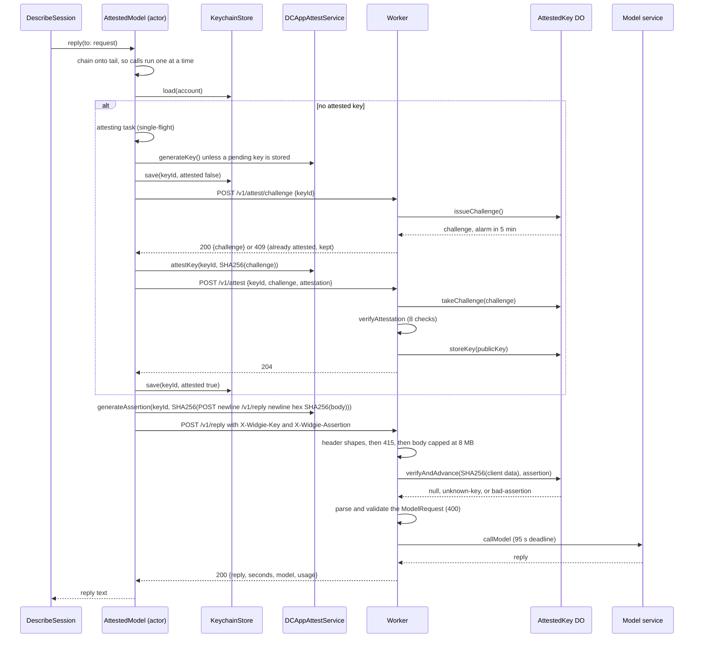
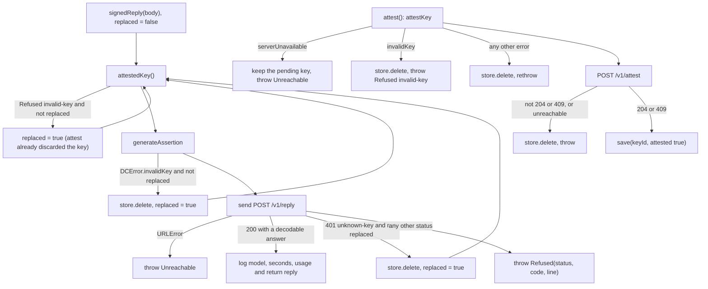
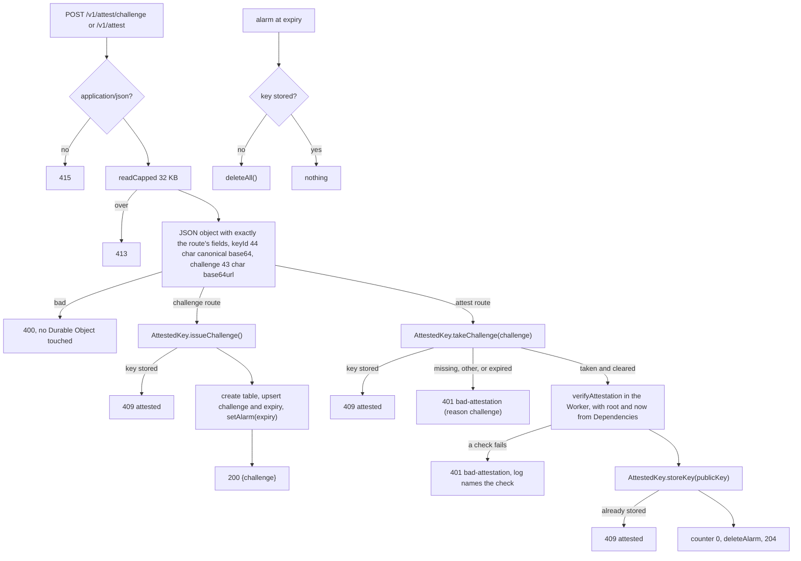
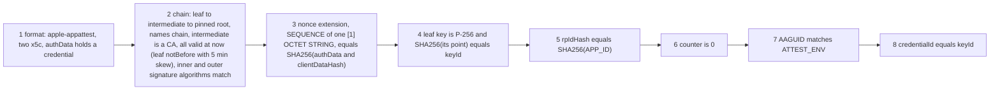
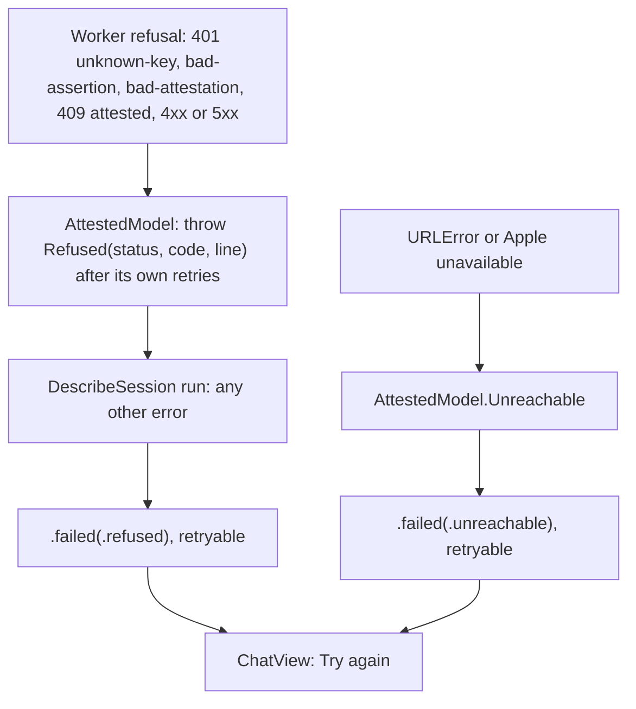
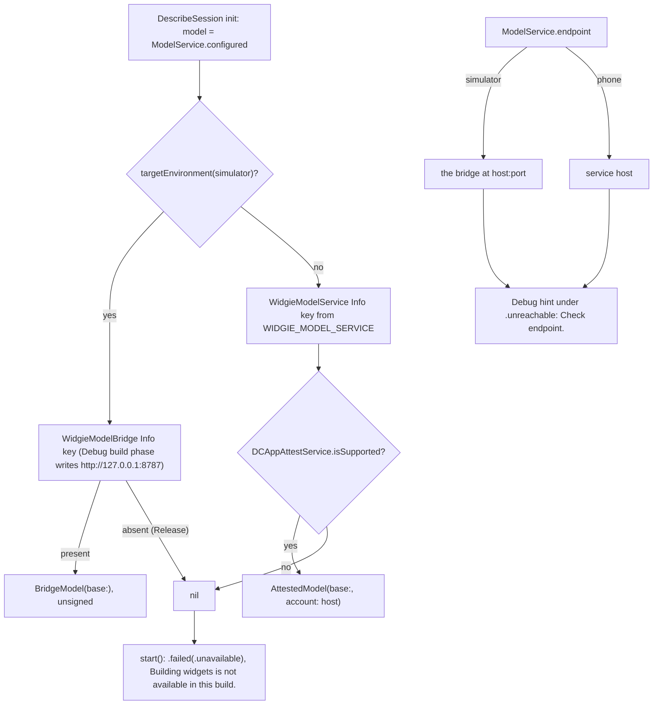
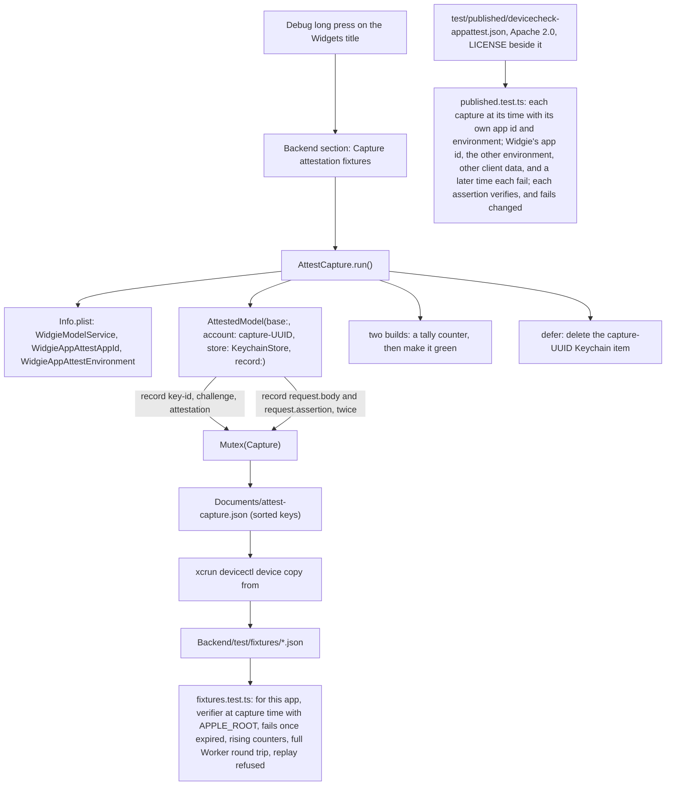

# PR 23: App Attest for the Worker and the app

Branch `phase-2b-b2` into `main`. This is B2 of [tasks/phase-2b-backend.md](../../tasks/phase-2b-backend.md) (lines 98 to 159, with its "B2 wire protocol", "B2 progress", "Usage limits removed", and "PR 23 review fixes" notes). The operator bearer gate from B1 is gone. Every `/v1/reply` now carries an App Attest assertion from a key the Worker attested once, each key's public point and assertion counter live in its own SQLite Durable Object, and the phone signs its builds through a new `AttestedModel`. The simulator keeps the local bridge. The device fixtures and the live checks are still open in the plan.

There are no usage limits for now: the user removed the attest rate limit and the daily build quota on 2026-11-27, and they come back later. What stands between a caller and the model is the body caps (8 MB, 32 KB), input validation, and a valid assertion from an attested key with a rising counter. The OpenRouter credit limit per environment bounds spend meanwhile. The deployed Workers still carry the old rate limit and quota until this branch is deployed.

Background reading: the plan's "B2 wire protocol" (the exact bytes both sides build) and Apple's "Validating apps that connect to your server", which [attestation.ts](../../Backend/src/attestation.ts) follows check by check.

## Core changes

- **Two attest routes.** `POST /v1/attest/challenge {keyId}` answers a one-use challenge (32 random bytes, base64url) stored for five minutes in that key's object. `POST /v1/attest {keyId, challenge, attestation}` takes the challenge, runs the eight checks, and stores the key's public point with counter 0, answering 204. Both refuse bodies over 32 KB. No rate limit.
- **A dependency-free verifier.** [cbor.ts](../../Backend/src/cbor.ts) and [der.ts](../../Backend/src/der.ts) are minimal strict readers, [bytes.ts](../../Backend/src/bytes.ts) holds base64, hex, SHA-256, and byte comparison, and [apple-root.ts](../../Backend/src/apple-root.ts) pins Apple's App Attest root. [attestation.ts](../../Backend/src/attestation.ts) has `verifyAttestation` (format, chain, nonce, key id, rpIdHash, counter, environment AAGUID, credential id) and `verifyAssertion`. The root and the clock are passed in, so tests use a synthetic chain. The leaf's notBefore allows five minutes of clock skew.
- **Real Apple attestations in the tests.** Seven captures from iPhones on iOS 14.2 to 14.4, published by the open-source `devicecheck-appattest` project under the Apache License 2.0, are in [test/published/](../../Backend/test/published/) with the licence text and a note of the source and changes. [published.test.ts](../../Backend/test/published.test.ts) runs the verifier on each at its capture time against the real root, with their own app id and environment, and verifies their assertions.
- **`AttestedKey`, a SQLite-backed Durable Object per key.** It holds the public key, the assertion counter, and a pending challenge. It writes nothing in its constructor or on a refusal, creates its table only right before a write, and an alarm deletes an object whose challenge expired without a stored key.
- **`/v1/reply` is signed.** It requires `X-Widgie-Key` and `X-Widgie-Assertion`. The client data is `METHOD \n PATH \n hex SHA256(body)`, and only its hash and the assertion go to `verifyAndAdvance`, which checks the signature and requires and stores a rising counter before any model call. Refusals carry a `code`: `unknown-key`, `bad-assertion`, `bad-attestation`, `attested`.
- **The B1 gate is gone.** `OPERATOR_TOKEN`, `BridgeModel.token`, and `WIDGIE_BRIDGE_TOKEN` in `render-tool loop` are removed. `render-tool loop --bridge` can no longer reach a deployed Worker; the Mac evals use the local bridge.
- **`AttestedModel` in the app.** An actor conforming to `WidgetModel` that creates, attests, and stores one key per environment in the Keychain, signs each request, replaces a lost key once per call, attests single-flight, and sends signed calls one at a time in counter order. A key that failed attestation is kept only when Apple's service was unavailable. The key store, attestor, and transport are injected.
- **`ModelService` picks the model once.** The simulator in Debug uses the local bridge, a phone uses `AttestedModel` against `WidgieModelService` (the `dev` Worker in Debug, `production` in Release), and anything else has no service. It replaces `BridgeModel.configured`.
- **No new copy.** Every refusal from the service is `.refused`. The Debug hint under an unreachable failure names the endpoint in use instead of always "the bridge".
- **Signing and entitlements.** `DEVELOPMENT_TEAM` is `Z23KXVBB26`. The single `entitlements:` block becomes `Widgie-Debug.entitlements` (`appattest-environment` `development`) and `Widgie-Release.entitlements` (`production`), both keeping the App Group, set per configuration.
- **Debug fixture capture.** A "Backend" section in the Debug long press on the Widgets title runs `AttestCapture`, which attests a fresh key against `dev`, sends two signed builds, writes `Documents/attest-capture.json` in the shape [fixtures.test.ts](../../Backend/test/fixtures.test.ts) reads with the app id and environment from the Info.plist, and deletes its Keychain item.
- **Tests.** Worker: [attestation.test.ts](../../Backend/test/attestation.test.ts) (each numbered check and every chain and parse check, each shown to fail when its check is removed), [published.test.ts](../../Backend/test/published.test.ts) (the real captures), [attested-key.test.ts](../../Backend/test/attested-key.test.ts) (the object's guarantees, including a race test that fails if the counter is read before the check's await), [attest.test.ts](../../Backend/test/attest.test.ts) (the routes), [reply.test.ts](../../Backend/test/reply.test.ts) (rewritten around the signature), and [fixtures.test.ts](../../Backend/test/fixtures.test.ts) (skips until a Widgie capture is checked in), all built on [helpers/appattest.ts](../../Backend/test/helpers/appattest.ts). App: [AttestedModelTests.swift](../../App/WidgieTests/AttestedModelTests.swift) and one case in [DescribeSessionTests.swift](../../App/WidgieTests/DescribeSessionTests.swift).

## 1. A build request from the phone: attest once, then a signed `/v1/reply`

A person sends words in Make. `DescribeSession` calls `model.reply(to:)`, which on a phone is `AttestedModel`. The first call ever attests a key; every call signs with it.

The retry rules inside `signedReply`, and what `attest()` does with a key that failed:

Files:

- [AttestedModel.swift:57](../../App/Widgie/Describe/AttestedModel.swift#L57): `reply(to:)`, the `tail` chain that orders calls and the cancellation handler. [AttestedModel.swift:73](../../App/Widgie/Describe/AttestedModel.swift#L73): `signedReply`, with the attestation's `invalid-key` retry at line 79, the assertion's `invalidKey` retry at line 87, and the `unknown-key` retry at line 109.
- [AttestedModel.swift:120](../../App/Widgie/Describe/AttestedModel.swift#L120): `attestedKey()`, single-flight through `attesting`. [AttestedModel.swift:134](../../App/Widgie/Describe/AttestedModel.swift#L134): `attest()`, reusing a pending key (line 136), treating a 409 on the challenge as attested (line 144), keeping the key on `serverUnavailable` (line 156) and discarding it on `invalidKey` (line 158), on any other error (line 162), and when the server does not take the attestation (line 181).
- [AttestedModel.swift:206](../../App/Widgie/Describe/AttestedModel.swift#L206): `clientDataHash(body:method:path:)`. [AttestedModel.swift:265](../../App/Widgie/Describe/AttestedModel.swift#L265): `KeychainStore`, `kSecAttrAccessibleAfterFirstUnlockThisDeviceOnly` at line 282.
- [index.ts:92](../../Backend/src/index.ts#L92): `reply`. Header shapes at line 97, the body cap at 104, the client data at 111, `verifyAndAdvance` at 112, validation from 115, the model call at 137.
- [attested-key.ts:75](../../Backend/src/attested-key.ts#L75): `verifyAndAdvance`, with no `await` from line 89 to the write, and the `verify` field it calls at line 28. [attestation.ts:124](../../Backend/src/attestation.ts#L124): `verifyAssertion`.
- Tests: [AttestedModelTests.swift:16](../../App/WidgieTests/AttestedModelTests.swift#L16) through line 144 (first call attests, later calls do not, `invalidKey` and `unknown-key` replacement, `bad-assertion` keeps the key, `serverUnavailable` keeps the pending key, any other attestation failure or a refused attestation discards it, an `invalidKey` attestation is replaced once within the call, two calls attest once and arrive in order). [reply.test.ts:70](../../Backend/test/reply.test.ts#L70) (the signature block) and [attested-key.test.ts:127](../../Backend/test/attested-key.test.ts#L127) (`verifyAndAdvance`; the race test at line 154 holds both requests inside the signature check until both are there).

Key decisions:

- **The signature comes before the body is parsed.** An unsigned caller costs no read and no parse: missing or malformed headers are 401 `bad-assertion` even with an oversized body. The flip side is that a signed request with an invalid `ModelRequest` still advances the counter; the app never sends one.
- **The client data binds method, path, and body.** An assertion for one route or one body never works on another, and the body itself never goes to the Durable Object, only its hash.
- **The counter stays, the quota went.** The rising counter is what stops replay, so it is security, not a limit. The daily quota and the attest rate limit were removed by the user on 2026-11-27 and come back later.
- **A lost key is replaced once per call.** `invalidKey` (the phone lost it, after a restore, from an assertion or an attestation) and `unknown-key` (the server does not know it) both re-attest once. `bad-assertion` fails the build and keeps the key, so a server-side bug cannot burn keys.
- **A key that failed attestation is kept only for `serverUnavailable`,** as Apple's guidance says. Any other `attestKey` error, or an attestation the server does not take (`bad-attestation`, a 5xx, or no answer), discards it, since Apple has already seen it, and the next build makes a new key.
- **Signed calls are serialized.** Assertion counters must reach the server in order, or the second request would be a replay. The `tail` task makes each call wait for the previous one.
- **One key per environment.** The Keychain account is the service host, so switching between `dev` and `production` builds never presents a key to a Worker that did not attest it.

## 2. The attestation routes: `/v1/attest/challenge` and `/v1/attest`

The eight checks, in order, each with its own failing test:

Files:

- [index.ts:152](../../Backend/src/index.ts#L152): `challenge`. [index.ts:164](../../Backend/src/index.ts#L164): `attest`, with the context at line 174, `takeChallenge` at 183, `verifyAttestation` at 185, `storeKey` at 187. [index.ts:193](../../Backend/src/index.ts#L193): `attestBody`, the shared type, cap, and exact fields. [index.ts:228](../../Backend/src/index.ts#L228): `keyIdBytes`, canonical spelling only.
- [attested-key.ts:31](../../Backend/src/attested-key.ts#L31): `issueChallenge`. [attested-key.ts:47](../../Backend/src/attested-key.ts#L47): `takeChallenge`. [attested-key.ts:59](../../Backend/src/attested-key.ts#L59): `storeKey`. [attested-key.ts:97](../../Backend/src/attested-key.ts#L97): `alarm`. [attested-key.ts:103](../../Backend/src/attested-key.ts#L103): `row()`, which reads `sqlite_master` first so a lookup never creates a table.
- [attestation.ts:62](../../Backend/src/attestation.ts#L62): `verifyAttestation`, checks at lines 70 to 108, the leaf curve at line 96. [attestation.ts:48](../../Backend/src/attestation.ts#L48): `aaguid`. [attestation.ts:43](../../Backend/src/attestation.ts#L43): `LEAF_CLOCK_SKEW_MS`. [attestation.ts:174](../../Backend/src/attestation.ts#L174): `chainedLeaf`, validity and name checks from line 193. [attestation.ts:207](../../Backend/src/attestation.ts#L207): `nonceExtension`, its structure check at line 212.
- [der.ts:133](../../Backend/src/der.ts#L133): `parseCertificate`, the inner and outer algorithm check at line 145, [der.ts:194](../../Backend/src/der.ts#L194): `signedBy`, [der.ts:219](../../Backend/src/der.ts#L219): `rawSignature` (DER ECDSA to fixed-width `r‖s` for WebCrypto). [cbor.ts:11](../../Backend/src/cbor.ts#L11): `decodeCbor`.
- [wrangler.jsonc](../../Backend/wrangler.jsonc): `APP_ID`, `ATTEST_ENV`, and the `ATTESTED_KEY` binding with migration `v1` (`new_sqlite_classes`). No `QUOTA_PER_DAY` and no `ATTEST_LIMIT`. [env.d.ts](../../Backend/src/env.d.ts) types them.
- Tests: [attest.test.ts:58](../../Backend/test/attest.test.ts#L58) (the round trip, 409s, one-use challenges, nothing stored on failure, nothing sensitive logged) and [attest.test.ts:131](../../Backend/test/attest.test.ts#L131) (refusals before any Durable Object, no rate limit). [attestation.test.ts:62](../../Backend/test/attestation.test.ts#L62) (one block per numbered check, with the chain's name, validity, skew, and algorithm cases in block 2 from line 103). [published.test.ts:44](../../Backend/test/published.test.ts#L44) (each real capture). [attested-key.test.ts:33](../../Backend/test/attested-key.test.ts#L33) to line 125 (no storage for unknown keys, challenge expiry and alarm, alarm racing attestation).

Key decisions:

- **The Worker verifies, not the object.** Attestation runs between `takeChallenge` and `storeKey`, so tests can inject the root and the clock through `Dependencies`. The guarantees still hold: the challenge is deleted before any check runs, and `storeKey` re-checks that the key is unattested.
- **Nothing is written for a stranger.** No constructor writes, no write on a refusal, and the table is created only right before a write. Random key ids never leave objects behind, and a `storeKey` after the alarm cleared the object still works.
- **One method, no `await` between read and write.** The Durable Object's input gate then makes each method's write atomic, and `verifyAndAdvance` reads the counter again after the signature check's await, which is what makes "exactly one of two concurrent requests passes" hold.
- **Shapes are checked before any object is named.** A malformed `keyId`, challenge, or attestation is a 400 from the Worker, and only the canonical 44-character spelling of a key id passes, so one key never has two objects.
- **Skew only on the leaf's notBefore.** Apple issues the leaf the moment the phone attests, so a Worker clock a little behind Apple's would refuse a fresh attestation. The intermediate and root are years old and get none.
- **The receipt is not checked.** Phase 2b needs proof of a genuine app instance, not Apple's fraud metric.
- **The class was created SQLite-backed** (migration `v1`). A key-value class can never change backend, and phases 3 and 4 want SQL. Objects made while the quota existed keep its two unused columns, which have defaults, so every statement works on either table (tested).
- **The log never holds a key id, a challenge, or an attestation,** only the route, status, time, code, and the failing check's name.

## 3. Refusals into the chat UI

With the limits gone, nothing the service refuses gets its own failure.

Files:

- [index.ts:37](../../Backend/src/index.ts#L37): `REFUSALS`, the codes and their statuses. [index.ts:78](../../Backend/src/index.ts#L78): `refuse`, which logs the code.
- [DescribeSession.swift:37](../../App/Widgie/Describe/DescribeSession.swift#L37): the failure cases, with no daily limit. [DescribeSession.swift:432](../../App/Widgie/Describe/DescribeSession.swift#L432): `AttestedModel.Unreachable` maps to `.unreachable`, and anything else to `.refused`.
- [ChatView.swift:286](../../App/Widgie/Describe/ChatView.swift#L286): `action(for:)`, unchanged.
- Tests: [DescribeSessionTests.swift:143](../../App/WidgieTests/DescribeSessionTests.swift#L143) (a 401, a 429, and a 502 refusal are each `.refused`). [reply.test.ts:150](../../Backend/test/reply.test.ts#L150) and [attested-key.test.ts:183](../../Backend/test/attested-key.test.ts#L183) (no daily limit), [attest.test.ts:184](../../Backend/test/attest.test.ts#L184) (no rate limit).

Key decisions:

- **No usage limits for now, by the user's call (2026-11-27).** The daily quota (`QUOTA_PER_DAY`, `daily-quota`, the `dailyLimit` failure and its copy) and the attest rate limit (`ATTEST_LIMIT`, `rate-limited`) are removed, and come back later. The OpenRouter credit limit per environment is the backstop meanwhile.

## 4. The simulator path

The simulator has no App Attest, so a Debug build there keeps talking to the bridge on the Mac.

Files:

- [ModelService.swift:12](../../App/Widgie/Describe/ModelService.swift#L12): `configured`, decided once at compile time and launch. [ModelService.swift:23](../../App/Widgie/Describe/ModelService.swift#L23): `endpoint`.
- [DescribeSession.swift:146](../../App/Widgie/Describe/DescribeSession.swift#L146): the default `model:` argument. [DescribeSession.swift:274](../../App/Widgie/Describe/DescribeSession.swift#L274): no model means `.unavailable`.
- [ChatMessages.swift:120](../../App/Widgie/Describe/ChatMessages.swift#L120): the Debug hint.
- [project.yml:49](../../App/project.yml#L49): `WidgieModelService: $(WIDGIE_MODEL_SERVICE)`, and the App Attest app id and environment keys at lines 52 and 53. [project.yml:59](../../App/project.yml#L59): the Debug bridge build phase, comment updated. [project.yml:83](../../App/project.yml#L83): per-configuration `CODE_SIGN_ENTITLEMENTS`, `WIDGIE_APP_ATTEST_ENVIRONMENT`, and `WIDGIE_MODEL_SERVICE`.
- [Widgie-Debug.entitlements](../../App/Widgie/Widgie-Debug.entitlements) and [Widgie-Release.entitlements](../../App/Widgie/Widgie-Release.entitlements).
- [Model.swift:60](../../Engine/Sources/WidgetBuilder/Model.swift#L60): `BridgeModel` loses `token`. [RenderTool.swift:491](../../Engine/Sources/RenderTool/RenderTool.swift#L491): `render-tool loop` builds a plain `BridgeModel`. The deleted `App/Widgie/Describe/BridgeModel.swift` held the old `configured`.

Key decisions:

- **A compile-time switch, not a runtime one.** `#if targetEnvironment(simulator)` keeps the plain-HTTP bridge and its ATS exception out of any phone build's code path, and a Release build carries no bridge key at all.
- **Two checked-in entitlement files.** XcodeGen's `entitlements:` writes one file, and the App Attest environment must differ between Debug (`development`, matching the `dev` Worker's AAGUID) and Release (`production`). `WIDGIE_APP_ATTEST_ENVIRONMENT` names the same value for the Info.plist, next to `CODE_SIGN_ENTITLEMENTS` in each configuration.
- **No App Attest means no service,** shown as the existing "not available" failure instead of an unsigned fallback that the Worker would refuse anyway.
- **App Attest code stays in the app target.** `WidgetBuilder` may not import DeviceCheck, CryptoKit, or Security (`docs/engine/MODULES.md`), so `AttestedModel` lives in `App/Widgie/Describe/`.

## 5. The Debug capture and the real attestations in the tests

Real attestations become test fixtures that check the verifier against Apple's real root: the phone's own captures once the device step runs, and seven published ones now.

Files:

- [AttestCapture.swift:32](../../App/Widgie/Describe/AttestCapture.swift#L32): `run()`, Debug only. The configuration is read at line 35, and the fresh account and its cleanup are at lines 55 to 57.
- [AttestedModel.swift:37](../../App/Widgie/Describe/AttestedModel.swift#L37): the `record` hook, called at lines 99, 100, and 165 to 167.
- [WidgetsFeed.swift:168](../../App/Widgie/Widgets/WidgetsFeed.swift#L168): the "Backend" menu section.
- [fixtures.test.ts:1](../../Backend/test/fixtures.test.ts#L1): the fixture shape, and the skip at line 45 while `test/fixtures/` is empty. [biome.json](../../Backend/biome.json) excludes `test/fixtures`.
- [published.test.ts:1](../../Backend/test/published.test.ts#L1) and [test/published/](../../Backend/test/published/): the seven captures, their source (pinned to commit `37723e6` of `veehaitch/devicecheck-appattest`), the licence note, the changes made, and the Apache License 2.0 text.

Key decisions:

- **The capture runs the real `AttestedModel`,** through the same code path as a build, so a fixture proves the bytes the app actually sends, not a copy of the protocol.
- **A fresh Keychain account per capture,** so it always attests a new key and never disturbs the app's own, deleted when the capture ends so runs leave nothing behind.
- **The app id and environment come from the build,** so a capture from a Release build or another team names what it really attested with, and fixtures.test.ts's "is for this app" check means something.
- **The verifier is checked at the capture time,** and the same fixture must fail once the leaf expires, so a stored capture stays a valid test after its certificates lapse.
- **Published captures until the phone's.** The Apache License 2.0 permits redistribution with the licence text, attribution, and a note of changes, all in `test/published/`. They are another app's, so they run with their own app id, environment, and client data hash as parameters. The Widgie device capture remains the final gate.
