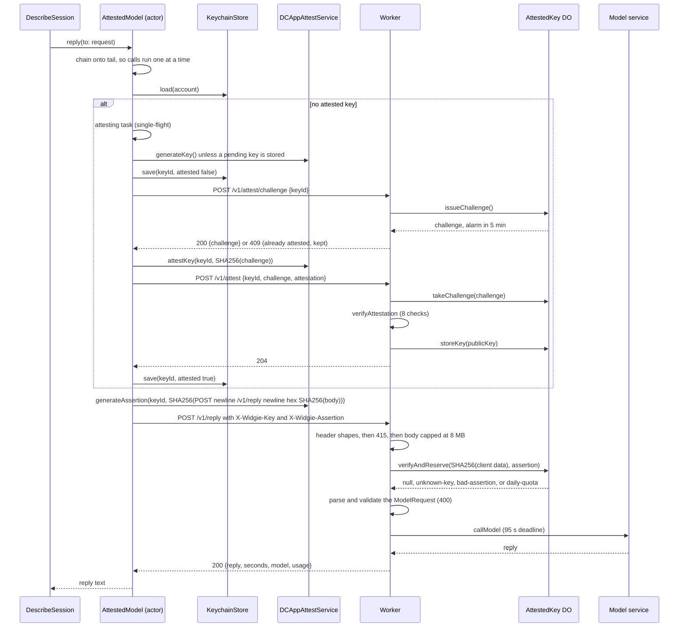
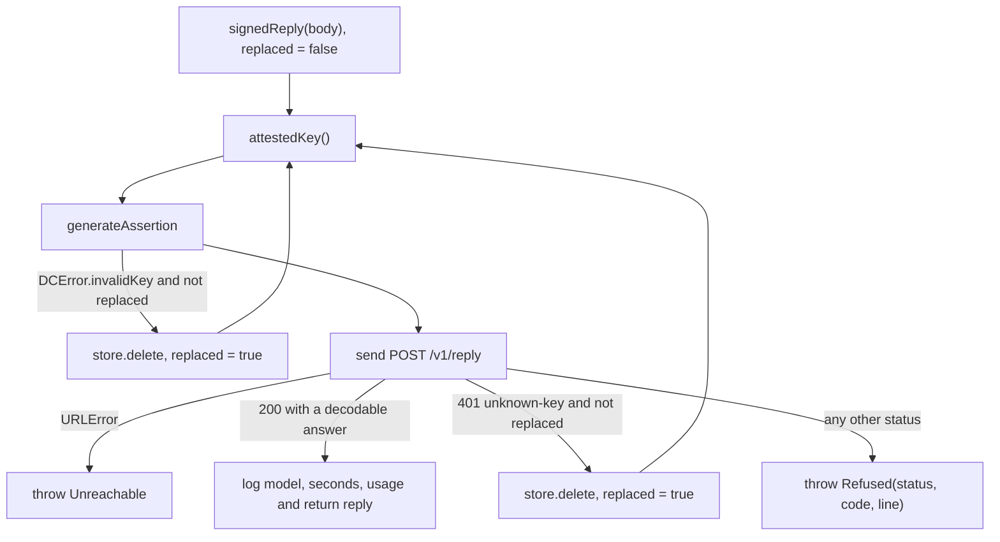
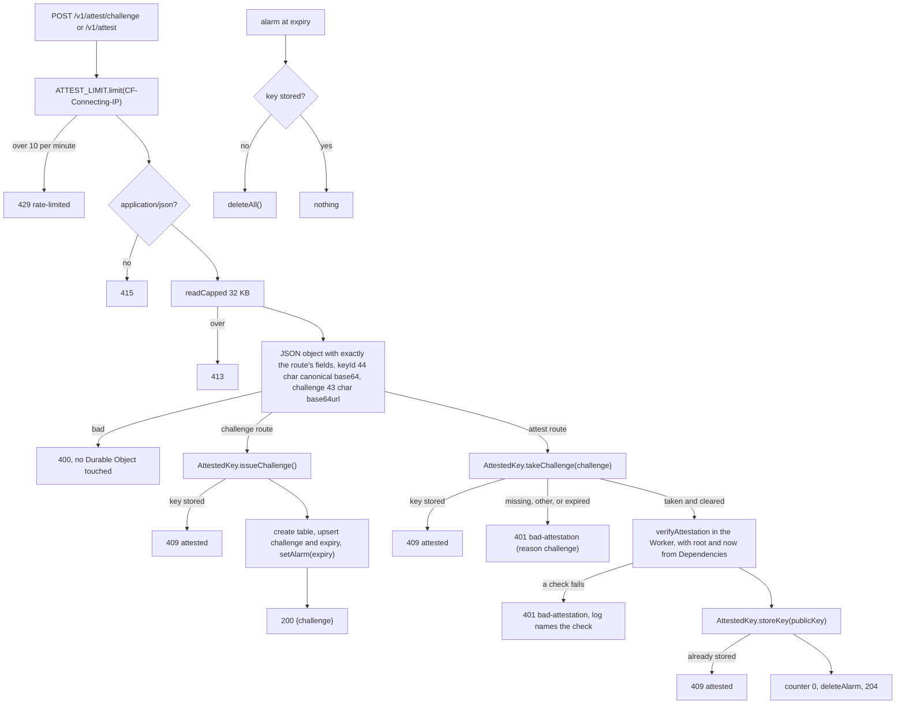
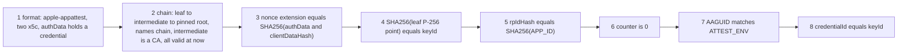
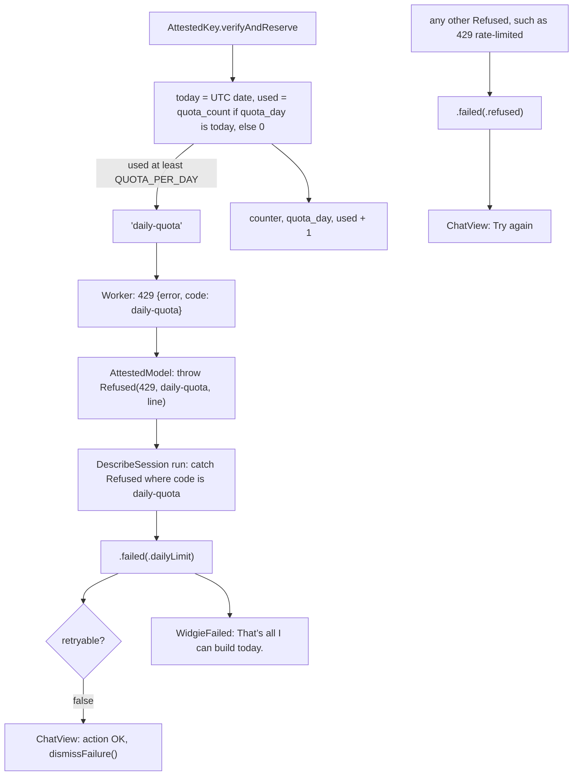
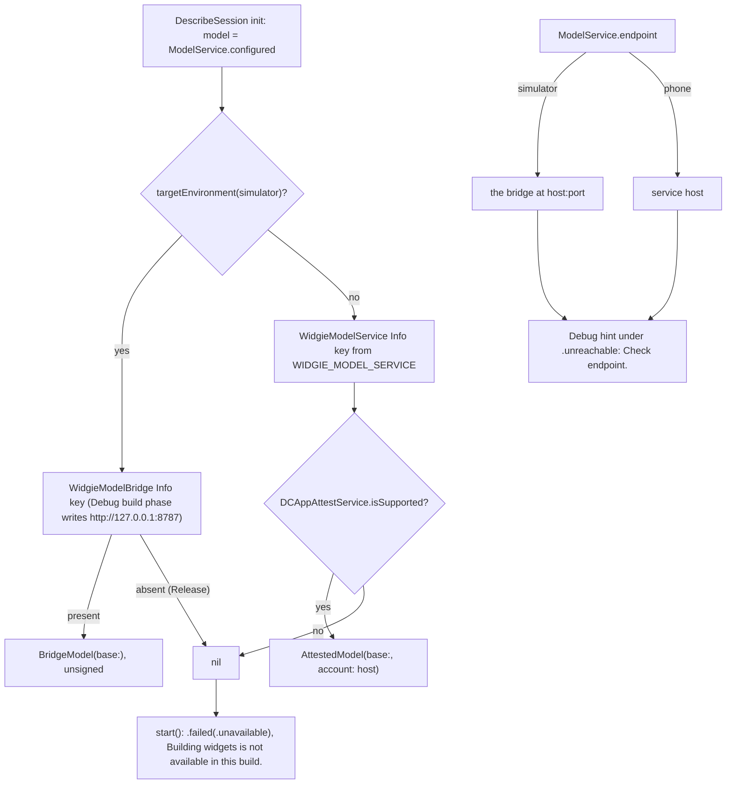
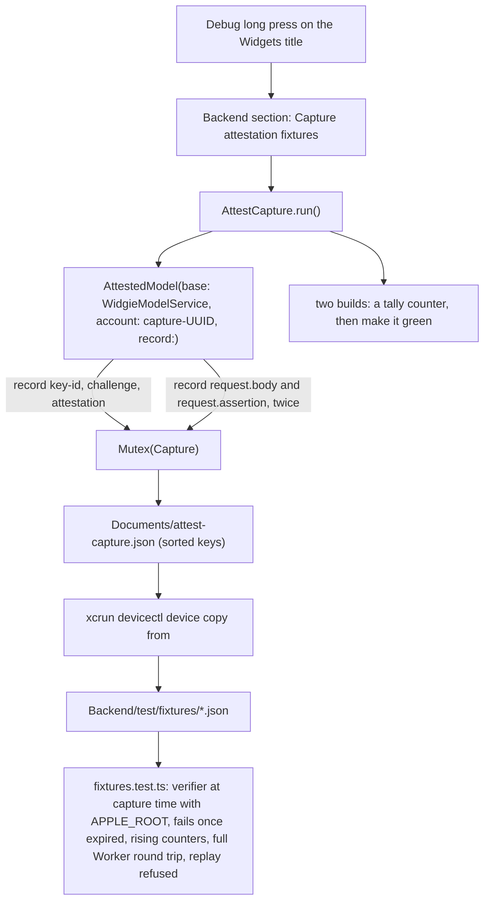

# PR 23: App Attest for the Worker and the app

Branch `phase-2b-b2` into `main`. This is B2 of [tasks/phase-2b-backend.md](../../tasks/phase-2b-backend.md) (lines 98 to 148, with its "B2 wire protocol" and "B2 progress" notes). The operator bearer gate from B1 is gone. Every `/v1/reply` now carries an App Attest assertion from a key the Worker attested once, each key gets a daily quota in its own SQLite Durable Object, and the phone signs its builds through a new `AttestedModel`. The simulator keeps the local bridge. The device fixtures, the live checks, and the review gate on the daily limit copy are still open in the plan.

Background reading: the plan's "B2 wire protocol" (the exact bytes both sides build) and Apple's "Validating apps that connect to your server", which [attestation.ts](../../Backend/src/attestation.ts) follows check by check.

## Core changes

- **Two attest routes.** `POST /v1/attest/challenge {keyId}` answers a one-use challenge (32 random bytes, base64url) stored for five minutes in that key's object. `POST /v1/attest {keyId, challenge, attestation}` takes the challenge, runs the eight checks, and stores the key's public point with counter 0, answering 204. Both routes sit behind a Workers rate limit (10 per 60 s per client address) and refuse bodies over 32 KB.
- **A dependency-free verifier.** [cbor.ts](../../Backend/src/cbor.ts) and [der.ts](../../Backend/src/der.ts) are minimal strict readers, [bytes.ts](../../Backend/src/bytes.ts) holds base64, hex, SHA-256, and byte comparison, and [apple-root.ts](../../Backend/src/apple-root.ts) pins Apple's App Attest root. [attestation.ts](../../Backend/src/attestation.ts) has `verifyAttestation` (format, chain, nonce, key id, rpIdHash, counter, environment AAGUID, credential id) and `verifyAssertion`. The root and the clock are passed in, so tests use a synthetic chain.
- **`AttestedKey`, a SQLite-backed Durable Object per key.** It holds the public key, the assertion counter, today's quota, and a pending challenge. It writes nothing in its constructor or on a refusal, creates its table only right before a write, and an alarm deletes an object whose challenge expired without a stored key.
- **`/v1/reply` is signed.** It requires `X-Widgie-Key` and `X-Widgie-Assertion`. The client data is `METHOD \n PATH \n hex SHA256(body)`, and only its hash and the assertion go to `verifyAndReserve`, which checks the signature, requires a rising counter, and takes one unit of the day's quota (40 per key per UTC day, never refunded) before any model call. Refusals carry a `code`: `unknown-key`, `bad-assertion`, `bad-attestation`, `attested`, `daily-quota`, `rate-limited`.
- **The B1 gate is gone.** `OPERATOR_TOKEN`, `BridgeModel.token`, and `WIDGIE_BRIDGE_TOKEN` in `render-tool loop` are removed. `render-tool loop --bridge` can no longer reach a deployed Worker; the Mac evals use the local bridge.
- **`AttestedModel` in the app.** An actor conforming to `WidgetModel` that creates, attests, and stores one key per environment in the Keychain, signs each request, replaces a lost key once per call, attests single-flight, and sends signed calls one at a time in counter order. The key store, attestor, and transport are injected.
- **`ModelService` picks the model once.** The simulator in Debug uses the local bridge, a phone uses `AttestedModel` against `WidgieModelService` (the `dev` Worker in Debug, `production` in Release), and anything else has no service. It replaces `BridgeModel.configured`.
- **A daily limit failure in the chat.** A 429 `daily-quota` becomes `DescribeSession.Failure.dailyLimit` ("That’s all I can build today."), which is not retryable, so its message offers OK. Any other 429 stays `.refused`. The Debug hint under an unreachable failure names the endpoint in use instead of always "the bridge".
- **Signing and entitlements.** `DEVELOPMENT_TEAM` is `Z23KXVBB26`. The single `entitlements:` block becomes `Widgie-Debug.entitlements` (`appattest-environment` `development`) and `Widgie-Release.entitlements` (`production`), both keeping the App Group, set per configuration.
- **Debug fixture capture.** A "Backend" section in the Debug long press on the Widgets title runs `AttestCapture`, which attests a fresh key against `dev`, sends two signed builds, and writes `Documents/attest-capture.json` in the shape [fixtures.test.ts](../../Backend/test/fixtures.test.ts) reads.
- **Tests.** Worker: [attestation.test.ts](../../Backend/test/attestation.test.ts) (each numbered check, the chain's times, the decoders), [attested-key.test.ts](../../Backend/test/attested-key.test.ts) (the object's guarantees), [attest.test.ts](../../Backend/test/attest.test.ts) (the routes), [reply.test.ts](../../Backend/test/reply.test.ts) (rewritten around the signature), and [fixtures.test.ts](../../Backend/test/fixtures.test.ts) (skips until a capture is checked in), all built on [helpers/appattest.ts](../../Backend/test/helpers/appattest.ts). App: [AttestedModelTests.swift](../../App/WidgieTests/AttestedModelTests.swift) and one new case in [DescribeSessionTests.swift](../../App/WidgieTests/DescribeSessionTests.swift).

## 1. A build request from the phone: attest once, then a signed `/v1/reply`

A person sends words in Make. `DescribeSession` calls `model.reply(to:)`, which on a phone is `AttestedModel`. The first call ever attests a key; every call signs with it.

The retry rules inside `signedReply`:

Files:

- [AttestedModel.swift:55](../../App/Widgie/Describe/AttestedModel.swift#L55): `reply(to:)`, the `tail` chain that orders calls and the cancellation handler. [AttestedModel.swift:71](../../App/Widgie/Describe/AttestedModel.swift#L71): `signedReply`, with the `invalidKey` retry at line 78 and the `unknown-key` retry at line 100.
- [AttestedModel.swift:111](../../App/Widgie/Describe/AttestedModel.swift#L111): `attestedKey()`, single-flight through `attesting`. [AttestedModel.swift:120](../../App/Widgie/Describe/AttestedModel.swift#L120): `attest()`, reusing a pending key (line 123), treating a 409 on the challenge as attested (line 131), and mapping `serverUnavailable` and `invalidKey` (lines 143 and 145).
- [AttestedModel.swift:183](../../App/Widgie/Describe/AttestedModel.swift#L183): `clientDataHash(body:method:path:)`. [AttestedModel.swift:242](../../App/Widgie/Describe/AttestedModel.swift#L242): `KeychainStore`, `kSecAttrAccessibleAfterFirstUnlockThisDeviceOnly` at line 259.
- [index.ts:93](../../Backend/src/index.ts#L93): `reply`. Header shapes at line 98, the body cap at 105, the client data at 113, `verifyAndReserve` at 114, validation from 117, the model call at 139.
- [attested-key.ts:81](../../Backend/src/attested-key.ts#L81): `verifyAndReserve`, with no `await` from line 95 to the write. [attestation.ts:120](../../Backend/src/attestation.ts#L120): `verifyAssertion`.
- Tests: [AttestedModelTests.swift:16](../../App/WidgieTests/AttestedModelTests.swift#L16) through line 89 (first call attests, later calls do not, `invalidKey` and `unknown-key` replacement, `bad-assertion` keeps the key, two calls attest once and arrive in order). [reply.test.ts:70](../../Backend/test/reply.test.ts#L70) (the signature block) and [attested-key.test.ts:126](../../Backend/test/attested-key.test.ts#L126) (`verifyAndReserve`, including two concurrent requests with one counter).

Key decisions:

- **The signature comes before the body is parsed.** An unsigned caller costs no read and no parse: missing or malformed headers are 401 `bad-assertion` even with an oversized body. The flip side is that a signed request with an invalid `ModelRequest` still spends a quota unit; the app never sends one.
- **The client data binds method, path, and body.** An assertion for one route or one body never works on another, and the body itself never goes to the Durable Object, only its hash.
- **Quota is taken before the model call and never refunded,** because the model service bills a call the Worker stopped waiting for.
- **A lost key is replaced once per call.** `invalidKey` (the phone lost it, after a restore) and `unknown-key` (the server does not know it) both re-attest once. `bad-assertion` fails the build and keeps the key, so a server-side bug cannot burn keys.
- **Signed calls are serialized.** Assertion counters must reach the server in order, or the second request would be a replay. The `tail` task makes each call wait for the previous one.
- **A pending key is reused.** If Apple's service is unavailable during attestation, the key made for it stays in the Keychain, and the next build tries to attest it instead of minting a new one.
- **One key per environment.** The Keychain account is the service host, so switching between `dev` and `production` builds never presents a key to a Worker that did not attest it.

## 2. The attestation routes: `/v1/attest/challenge` and `/v1/attest`

The eight checks, in order, each with its own failing test:

Files:

- [index.ts:154](../../Backend/src/index.ts#L154): `challenge`. [index.ts:166](../../Backend/src/index.ts#L166): `attest`, with the context at line 176, `takeChallenge` at 185, `verifyAttestation` at 187, `storeKey` at 189. [index.ts:195](../../Backend/src/index.ts#L195): `attestBody`, the shared rate limit, type, cap, and exact fields. [index.ts:233](../../Backend/src/index.ts#L233): `keyIdBytes`, canonical spelling only.
- [attested-key.ts:37](../../Backend/src/attested-key.ts#L37): `issueChallenge`. [attested-key.ts:53](../../Backend/src/attested-key.ts#L53): `takeChallenge`. [attested-key.ts:65](../../Backend/src/attested-key.ts#L65): `storeKey`. [attested-key.ts:111](../../Backend/src/attested-key.ts#L111): `alarm`. [attested-key.ts:117](../../Backend/src/attested-key.ts#L117): `row()`, which reads `sqlite_master` first so a lookup never creates a table.
- [attestation.ts:58](../../Backend/src/attestation.ts#L58): `verifyAttestation`, checks at lines 66 to 104. [attestation.ts:44](../../Backend/src/attestation.ts#L44): `aaguid`. [attestation.ts:170](../../Backend/src/attestation.ts#L170): `chainedLeaf`. [attestation.ts:201](../../Backend/src/attestation.ts#L201): `nonceExtension`.
- [der.ts:133](../../Backend/src/der.ts#L133): `parseCertificate`, [der.ts:194](../../Backend/src/der.ts#L194): `signedBy`, [der.ts:219](../../Backend/src/der.ts#L219): `rawSignature` (DER ECDSA to fixed-width `r‖s` for WebCrypto). [cbor.ts:11](../../Backend/src/cbor.ts#L11): `decodeCbor`.
- [wrangler.jsonc](../../Backend/wrangler.jsonc): `APP_ID`, `ATTEST_ENV`, `QUOTA_PER_DAY`, the `ATTESTED_KEY` binding with migration `v1` (`new_sqlite_classes`), and `ATTEST_LIMIT` with a separate `namespace_id` per environment. [env.d.ts](../../Backend/src/env.d.ts) types them.
- Tests: [attest.test.ts:60](../../Backend/test/attest.test.ts#L60) (the round trip, 409s, one-use challenges, nothing stored on failure, nothing sensitive logged) and [attest.test.ts:133](../../Backend/test/attest.test.ts#L133) (refusals before any Durable Object, the rate limit). [attestation.test.ts:59](../../Backend/test/attestation.test.ts#L59) (one block per numbered check). [attested-key.test.ts:32](../../Backend/test/attested-key.test.ts#L32) to line 115 (no storage for unknown keys, challenge expiry and alarm, alarm racing attestation).

Key decisions:

- **The Worker verifies, not the object.** Attestation runs between `takeChallenge` and `storeKey`, so tests can inject the root and the clock through `Dependencies`. The guarantees still hold: the challenge is deleted before any check runs, and `storeKey` re-checks that the key is unattested.
- **Nothing is written for a stranger.** No constructor writes, no write on a refusal, and the table is created only right before a write. Random key ids never leave objects behind, and a `storeKey` after the alarm cleared the object still works.
- **One method, no `await` between read and write.** The Durable Object's input gate then makes each method atomic, which is what makes "exactly one of two concurrent requests passes" hold.
- **Shapes are checked before any object is named.** A malformed `keyId`, challenge, or attestation is a 400 from the Worker, and only the canonical 44-character spelling of a key id passes, so one key never has two objects.
- **The receipt is not checked.** Phase 2b needs proof of a genuine app instance, not Apple's fraud metric.
- **The class was created SQLite-backed** (migration `v1`). A key-value class can never change backend, and phases 3 and 4 want SQL.
- **The log never holds a key id, a challenge, or an attestation,** only the route, status, time, code, and the failing check's name.

## 3. The quota and limit path into the chat UI

Files:

- [attested-key.ts:17](../../Backend/src/attested-key.ts#L17): `quotaPerDay`, default 40, anything but a whole number throws. [attested-key.ts:98](../../Backend/src/attested-key.ts#L98): the day and the count.
- [index.ts:36](../../Backend/src/index.ts#L36): `REFUSALS`, the codes and their statuses. [index.ts:79](../../Backend/src/index.ts#L79): `refuse`, which logs the code.
- [DescribeSession.swift:54](../../App/Widgie/Describe/DescribeSession.swift#L54): `case dailyLimit`, not retryable at line 61, its title at line 75. [DescribeSession.swift:435](../../App/Widgie/Describe/DescribeSession.swift#L435): `AttestedModel.Unreachable` maps to `.unreachable`, and line 438 maps `daily-quota` to `.dailyLimit`.
- [ChatView.swift:286](../../App/Widgie/Describe/ChatView.swift#L286): `action(for:)`, unchanged, offers OK for a non-retryable failure.
- [vitest.config.ts](../../Backend/vitest.config.ts): `QUOTA_PER_DAY` is 2 in tests.
- Tests: [attested-key.test.ts:164](../../Backend/test/attested-key.test.ts#L164) (the third call is `daily-quota`, no refunds) and line 171 (a new UTC day resets). [reply.test.ts:150](../../Backend/test/reply.test.ts#L150) (no model call once spent). [DescribeSessionTests.swift:143](../../App/WidgieTests/DescribeSessionTests.swift#L143) (`daily-quota` is `.dailyLimit`, `rate-limited` is `.refused`).

Key decisions:

- **Per key, per UTC day, counted in dispatched model calls,** not builds. One build can send several requests (repairs), so the limit is a call budget. A reinstall starts a new quota; the attest rate limit and the model service's credit limit bound that.
- **Only `daily-quota` gets its own failure.** Retrying cannot help, so it is not retryable and offers OK. Any other 429 stays a refusal.
- **The copy is in Widgie's first person,** like the other chat failures, and still has to pass the review gate (the plan's unchecked item).

## 4. The simulator path

The simulator has no App Attest, so a Debug build there keeps talking to the bridge on the Mac.

Files:

- [ModelService.swift:12](../../App/Widgie/Describe/ModelService.swift#L12): `configured`, decided once at compile time and launch. [ModelService.swift:23](../../App/Widgie/Describe/ModelService.swift#L23): `endpoint`.
- [DescribeSession.swift:149](../../App/Widgie/Describe/DescribeSession.swift#L149): the default `model:` argument. [DescribeSession.swift:276](../../App/Widgie/Describe/DescribeSession.swift#L276): no model means `.unavailable`.
- [ChatMessages.swift:120](../../App/Widgie/Describe/ChatMessages.swift#L120): the Debug hint.
- [project.yml:49](../../App/project.yml#L49): `WidgieModelService: $(WIDGIE_MODEL_SERVICE)`. [project.yml:53](../../App/project.yml#L53): the Debug bridge build phase, comment updated. [project.yml:78](../../App/project.yml#L78): per-configuration `CODE_SIGN_ENTITLEMENTS` and `WIDGIE_MODEL_SERVICE`.
- [Widgie-Debug.entitlements](../../App/Widgie/Widgie-Debug.entitlements) and [Widgie-Release.entitlements](../../App/Widgie/Widgie-Release.entitlements).
- [Model.swift:67](../../Engine/Sources/WidgetBuilder/Model.swift#L67): `BridgeModel` loses `token`. [RenderTool.swift:491](../../Engine/Sources/RenderTool/RenderTool.swift#L491): `render-tool loop` builds a plain `BridgeModel`. The deleted `App/Widgie/Describe/BridgeModel.swift` held the old `configured`.

Key decisions:

- **A compile-time switch, not a runtime one.** `#if targetEnvironment(simulator)` keeps the plain-HTTP bridge and its ATS exception out of any phone build's code path, and a Release build carries no bridge key at all.
- **Two checked-in entitlement files.** XcodeGen's `entitlements:` writes one file, and the App Attest environment must differ between Debug (`development`, matching the `dev` Worker's AAGUID) and Release (`production`).
- **No App Attest means no service,** shown as the existing "not available" failure instead of an unsigned fallback that the Worker would refuse anyway.
- **App Attest code stays in the app target.** `WidgetBuilder` may not import DeviceCheck, CryptoKit, or Security (`docs/engine/MODULES.md`), so `AttestedModel` lives in `App/Widgie/Describe/`.

## 5. The Debug capture

Real attestations from the phone become test fixtures that check the verifier against Apple's real root.

Files:

- [AttestCapture.swift:31](../../App/Widgie/Describe/AttestCapture.swift#L31): `run()`, Debug only. The fresh account is at line 50.
- [AttestedModel.swift:35](../../App/Widgie/Describe/AttestedModel.swift#L35): the `record` hook, called at lines 90, 91, and 149 to 151.
- [WidgetsFeed.swift:168](../../App/Widgie/Widgets/WidgetsFeed.swift#L168): the "Backend" menu section.
- [fixtures.test.ts:1](../../Backend/test/fixtures.test.ts#L1): the fixture shape, and the skip at line 45 while `test/fixtures/` is empty. [biome.json](../../Backend/biome.json) excludes `test/fixtures`.

Key decisions:

- **The capture runs the real `AttestedModel`,** through the same code path as a build, so a fixture proves the bytes the app actually sends, not a copy of the protocol.
- **A fresh Keychain account per capture,** so it always attests a new key and never disturbs the app's own.
- **The verifier is checked at the capture time,** and the same fixture must fail once the leaf expires, so a stored capture stays a valid test after its certificates lapse.
- **No captures are committed yet.** Seven public App Attest captures from the open-source `devicecheck-appattest` project were run locally against the pinned root and confirmed that WebCrypto verifies with the nonce as its data. The phone's own captures land with the device step.
