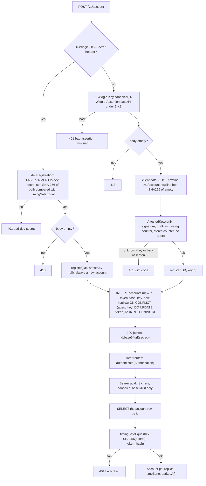
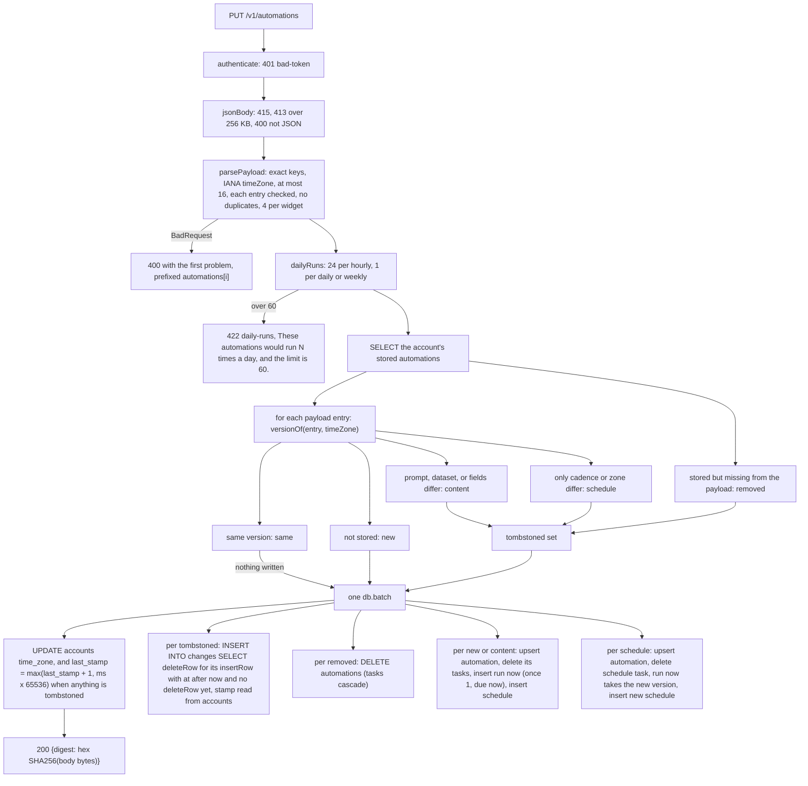
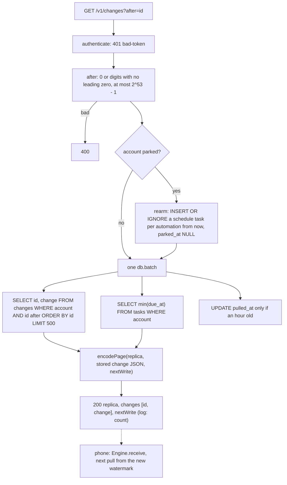
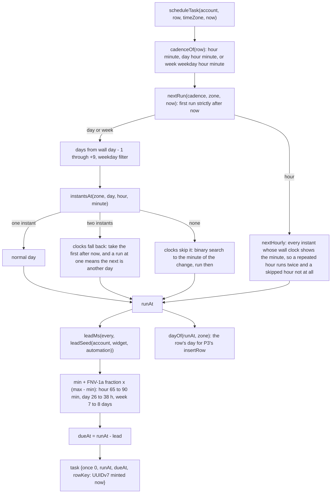

# PR 24: accounts, automations, and the pull in the Worker

Branch `phase-3-p2-worker` into `phase-2b-b2` (PR 23). This is P2 of [tasks/phase-3-ai-block.md](../../tasks/phase-3-ai-block.md) (see its "P2 results" note). The Worker gets a D1 database, accounts with a bearer token, a replace-all upload of the account's automations that turns into versions, tasks, and tombstones, and a pull that returns the account's changes in the wire format. Nothing runs an automation yet: P3 adds the cron that claims due tasks and the Queue consumer that writes rows. Nothing is deployed and no real D1 database exists yet.

The branch merges the wire format commit from P1 (`fbd865f`, via `71cf631`), which brings `docs/engine/WIRE.md`, `Engine/Vectors/wire.json`, and the Swift reader. Review it in PR 22. Here it is the contract: the Worker writes exactly what [WIRE.md](../engine/WIRE.md) defines and is checked against the same vectors. The Swift files in the diff (`Wire.swift`, `RowStore.swift`, `Merge.swift`, `WireTests.swift`, `JSON.swift`, `Spec.swift`) all come from that merge.

Background reading: [WIRE.md](../engine/WIRE.md) sections "What the server writes" (line 80) and "The automation payload" (line 89), and the plan's "How it works (decided)" (lines 72 to 87).

## Core changes

- **A D1 schema.** [0001_automations.sql](../../Backend/migrations/0001_automations.sql) creates `accounts` (token hash, attest key, automation replica, `last_stamp`, time zone, `pulled_at`, `parked_at`), `automations` (the uploaded payload plus a `version`), `tasks` (`once`, `run_at`, `row_key`, `due_at`, `claimed_until`, `attempts`, at most one of each kind per automation), `changes` (`AUTOINCREMENT` ids, the wire JSON, and its key columns repeated), and `spend` (dollars per UTC day). Indexes `tasks(due_at)` and `changes(account, id)`. Foreign keys cascade from `accounts`.
- **`POST /v1/account`.** An empty body signed with the B2 App Attest key (`POST\n/v1/account\n<hex SHA-256 of nothing>`) answers `{token}`. A new `AttestedKey.verify` checks and stores the counter without taking build quota. One account per attest key: registering again returns the same account with a new token, in one `INSERT ... ON CONFLICT (attest_key)` statement. On `dev` only, an `X-Widgie-Dev-Secret` header carrying `DEV_REGISTRATION_SECRET` registers a new account for the simulator.
- **A bearer token.** `<account id>.<secret>`, the secret 32 random bytes as base64url. Only the SHA-256 is stored, and it is compared with `crypto.subtle.timingSafeEqual`. Refusals are 401 `bad-token`.
- **`PUT /v1/automations`.** Replaces the account's automations with the payload from WIRE.md, read strictly and checked against `Spec.swift`'s limits (16 per account, 4 per widget, prompts of 1 to 2,000 grapheme clusters, 16 fields, reserved ids, canonical cadence spellings, an IANA zone). Over 60 runs a day is 422 `daily-runs` with a line the app shows. Answers `{digest}`, the SHA-256 of the bytes received.
- **Versions, tasks, tombstones in one D1 batch.** A version hashes prompt, cadence, time zone, dataset, and fields. New, or a changed prompt or table: a run now plus the next scheduled run. A changed cadence or zone: only the schedule moves. Any change or removal: a `deleteRow` for each of the automation's rows whose `at` is still ahead, under one new stamp of the account's automation replica, selected inside the same batch.
- **`GET /v1/changes?after=<id>`.** At most 500 changes with ids above `after`, oldest first, the account's automation `replica`, and `nextWrite` (the earliest `due_at` of the account's tasks). A pull records `pulled_at` at most once an hour and re-arms a parked account.
- **Schedule math for P3.** [schedule.ts](../../Backend/src/schedule.ts) has `nextRun` (Foundation's `.nextTime` rules over `Intl` time zones), `dayOf`, `isTimeZone`, `runsPerDay`, and `leadMs`: daily 26 to 38 hours, weekly 7 to 8 days, hourly 65 to 90 minutes, at a stable FNV-1a offset per automation.
- **A wire writer, no reader.** [wire.ts](../../Backend/src/wire.ts) writes stamps, UUIDv7 row keys, day indexes, changes, and pages. The strict reader stays the phone's; phase 4 adds a TypeScript reader with the refusal vectors.
- **Upkeep for P3's daily cron.** [upkeep.ts](../../Backend/src/upkeep.ts): `parkIdle` (30 days without a pull), `deleteIdle` (90 days), `spendAllows`, and `addSpend`.
- **Routes carry their method.** `ROUTES` maps each path to one method, so `GET /v1/changes` and `PUT /v1/automations` sit beside the POST routes. The shared `jsonBody` reads a capped JSON body for the attest routes and the upload.
- **Tests: 229 Worker tests, 150 new.** [account.test.ts](../../Backend/test/account.test.ts), [automations.test.ts](../../Backend/test/automations.test.ts), [changes.test.ts](../../Backend/test/changes.test.ts), [schedule.test.ts](../../Backend/test/schedule.test.ts), [upkeep.test.ts](../../Backend/test/upkeep.test.ts), and [wire.test.ts](../../Backend/test/wire.test.ts), on [helpers/accounts.ts](../../Backend/test/helpers/accounts.ts). [vitest.config.ts](../../Backend/vitest.config.ts) reads the migrations in Node and [setup.ts](../../Backend/test/setup.ts) applies them to the local D1 before each file. The test configuration is production's with `DEV_REGISTRATION_SECRET` set, so a test can prove production refuses it.
- **D1 setup before the first deploy.** [wrangler.jsonc](../../Backend/wrangler.jsonc) binds `DB` with placeholder database ids and adds `ENVIRONMENT`. From `Backend/`:

  ```sh
  npx wrangler d1 create widgie
  npx wrangler d1 create widgie-dev
  # put the two printed database ids in wrangler.jsonc in place of the PLACEHOLDER values
  npx wrangler d1 migrations apply widgie-dev --env dev --remote
  npx wrangler d1 migrations apply widgie --remote
  npx wrangler secret put DEV_REGISTRATION_SECRET --env dev
  ```

## 1. Registering an account: `POST /v1/account`

The phone (P4) registers once with its App Attest key and keeps the token in a Keychain group the extension shares. The simulator, which cannot attest, uses the dev secret on `dev`.



Files:

- [index.ts:217](../../Backend/src/index.ts#L217): `account`. The dev branch at line 222, the signed branch from line 230, the client data at line 235, `verify` at 236. [index.ts:242](../../Backend/src/index.ts#L242): `devRegistration`. [index.ts:248](../../Backend/src/index.ts#L248): `isEmpty`, a `readCapped` of 0 bytes. [index.ts:52](../../Backend/src/index.ts#L52): the two new refusal codes.
- [attested-key.ts:90](../../Backend/src/attested-key.ts#L90): `verify`, sharing `check` (line 94) with `verifyAndReserve`. The no-quota branch is at line 112.
- [accounts.ts:22](../../Backend/src/accounts.ts#L22): `register`. [accounts.ts:38](../../Backend/src/accounts.ts#L38): `authenticate`, with the canonical spelling check at line 43 and the constant-time compare at line 58.
- [0001_automations.sql:7](../../Backend/migrations/0001_automations.sql#L7): `accounts`, `attest_key UNIQUE` and `replica UNIQUE`.
- [wrangler.jsonc](../../Backend/wrangler.jsonc): `ENVIRONMENT` is `production` at the top level and `dev` under `env.dev`. [env.d.ts](../../Backend/src/env.d.ts): `ENVIRONMENT`, `DEV_REGISTRATION_SECRET`, `DB`.
- Tests: [account.test.ts:38](../../Backend/test/account.test.ts#L38) (a token, same account on re-register and the old token stops working, no build quota taken, replay and misdirected assertions, a body refused), [account.test.ts:102](../../Backend/test/account.test.ts#L102) (production refuses the right secret, dev accepts it, wrong or empty or unconfigured is refused), [account.test.ts:134](../../Backend/test/account.test.ts#L134) (malformed and non-canonical tokens).

Key decisions:

- **The token, not an assertion, guards sync routes.** The widget extension has no App Attest key and an attest key changes on reinstall, so App Attest is used once to name the account and a token does the rest (as the phase 2b plan recorded).
- **Registration takes no build quota** but still stores the counter, so a captured registration cannot be replayed.
- **One statement makes or finds the account.** `ON CONFLICT (attest_key)` means two concurrent registrations of one key can never make two accounts. Re-registering rotates the token, so the previous token stops working.
- **The token carries the account id.** The id finds the row with a primary key lookup, and only the secret's hash is compared, in constant time with `timingSafeEqual`, the one comparison in Workers that is.
- **Only the canonical token spelling passes.** The 43rd base64url character holds two bits that must be zero, so one secret never has two accepted spellings.
- **The dev path is closed twice.** It needs `ENVIRONMENT` to be `dev` and the secret to be set, so production refuses it even if the secret were configured there. A dev registration makes a new account each time, since the simulator has no key to name one by.

## 2. Uploading automations: `PUT /v1/automations`

The phone sends every automation of the account after any change that can move them. The Worker diffs the payload against what it holds and writes the result in one batch.



Files:

- [index.ts:261](../../Backend/src/index.ts#L261): `automations`, the run limit at line 276, the digest at line 282. [index.ts:299](../../Backend/src/index.ts#L299): `jsonBody`. [index.ts:41](../../Backend/src/index.ts#L41): `MAX_AUTOMATIONS_BODY`.
- [automations.ts:22](../../Backend/src/automations.ts#L22): `LIMITS`. [automations.ts:70](../../Backend/src/automations.ts#L70): `parsePayload`. [automations.ts:108](../../Backend/src/automations.ts#L108): one entry, with the grapheme count at line 121. [automations.ts:137](../../Backend/src/automations.ts#L137): `cadence`, canonical `"06:00"` and `":15"` only. [automations.ts:162](../../Backend/src/automations.ts#L162): `fieldKinds`. [automations.ts:104](../../Backend/src/automations.ts#L104): `dailyRuns`.
- [automations.ts:238](../../Backend/src/automations.ts#L238): `versionOf`. [automations.ts:285](../../Backend/src/automations.ts#L285): `replaceAutomations`. The plan is chosen at lines 300 to 311, the stamp statement at 321, tombstones at 330, removals at 348, upserts and tasks from 355.
- [automations.ts:252](../../Backend/src/automations.ts#L252): `scheduleTask` (section 4). [automations.ts:265](../../Backend/src/automations.ts#L265): `insertTask`, with `ifAbsent` for re-arming.
- [0001_automations.sql:22](../../Backend/migrations/0001_automations.sql#L22): `automations`. [0001_automations.sql:39](../../Backend/migrations/0001_automations.sql#L39): `tasks`, `UNIQUE (account, widget, automation, once)`. [0001_automations.sql:60](../../Backend/migrations/0001_automations.sql#L60): `changes`.
- [wire.ts:58](../../Backend/src/wire.ts#L58): `nextStamp`, the rule the SQL stamp mirrors. [wire.ts:90](../../Backend/src/wire.ts#L90): `mintRowKey`.
- Tests: [automations.test.ts:94](../../Backend/test/automations.test.ts#L94) (a new automation gets a run now and its schedule), [automations.test.ts:148](../../Backend/test/automations.test.ts#L148) (same payload changes nothing, content change, cadence change, zone change, removal), [automations.test.ts:226](../../Backend/test/automations.test.ts#L226) (tombstones: rows ahead only, one rising stamp even when the clock goes back, once per row, never for an unchanged automation), [automations.test.ts:286](../../Backend/test/automations.test.ts#L286) (payload refusals, limits at their edge, Swift's character count, exactly 60 runs passes).

Key decisions:

- **Replace-all.** The upload is idempotent, has no orphans, and needs no outbox on the phone. An automation missing from the payload is a removal.
- **The version decides the work.** A content change (prompt, dataset, fields) gets a run now so a refine shows at once, and a fresh schedule with a new row key. A schedule-only change keeps the pending run now and its row key, gives it the new version, and moves only the schedule. An unchanged automation writes nothing.
- **Tombstones are selected inside the batch.** The batch is one D1 transaction, so a P3 runner's write either lands before the tombstones (and is deleted by them) or after (and finds its version gone, so the version guard drops it).
- **One stamp per write, taken in SQL.** `max(last_stamp + 1, ms * 65536)` runs in the same transaction, so two writers never take the same stamp and the stamp rises even if the Worker's clock goes back. It is taken only when there is something to tombstone.
- **Only rows still ahead are tombstoned.** A revealed row (`at` at or before now) stays as history. A row that already has a `deleteRow` is skipped, so a second change writes no duplicate.
- **The cadence takes only the canonical spellings** the engine writes. Swift's reader also takes `"+6:00"`, which no payload carries.
- **The payload is read strictly** (unknown, missing, or wrongly typed keys are refused), except duplicate JSON keys, since `JSON.parse` keeps the last.
- **The digest is of the bytes received,** which the phone compares with its own `automationPayload().digest` to know the server has its latest.
- **An upload does not unpark.** The app pulls on foreground first, and the pull re-arms.

## 3. Pulling changes: `GET /v1/changes?after=<id>`

The app and the extension (P4) pull with their watermark and hand the bytes to `RemotePage(json:)`.



Files:

- [index.ts:287](../../Backend/src/index.ts#L287): `changes`, the `after` check at line 292. [index.ts:94](../../Backend/src/index.ts#L94): `encoded` on the responder, for a body already encoded.
- [accounts.ts:64](../../Backend/src/accounts.ts#L64): `pull`, the batch at line 71, `nextWrite` at line 82. [accounts.ts:88](../../Backend/src/accounts.ts#L88): `rearm`. [accounts.ts:11](../../Backend/src/accounts.ts#L11): `PAGE_SIZE`.
- [wire.ts:159](../../Backend/src/wire.ts#L159): `encodePage`, from changes as the table stores them. [wire.ts:137](../../Backend/src/wire.ts#L137): `encodeChange`, keys in WIRE.md's order, which P3's runner will use to fill `changes.change`.
- [upkeep.ts:12](../../Backend/src/upkeep.ts#L12): `parkIdle` (marks and deletes tasks). [upkeep.ts:23](../../Backend/src/upkeep.ts#L23): `deleteIdle` (cascades). [upkeep.ts:34](../../Backend/src/upkeep.ts#L34): `spendAllows`, [upkeep.ts:40](../../Backend/src/upkeep.ts#L40): `addSpend`.
- [0001_automations.sql:73](../../Backend/migrations/0001_automations.sql#L73): `changes_account (account, id)`, the pull's index.
- Tests: [changes.test.ts:64](../../Backend/test/changes.test.ts#L64) (empty page with the replica, paging by 500 in the wire format, `after` skipping other accounts' ids, `nextWrite` is the earliest `due_at`, bad `after`, `pulled_at` hourly, re-arm, a schedule uploaded while parked is kept). [upkeep.test.ts:38](../../Backend/test/upkeep.test.ts#L38) (park, delete, spend). [wire.test.ts:82](../../Backend/test/wire.test.ts#L82) (every good change and page vector written byte for byte from what it means).

Key decisions:

- **Ids only grow.** `AUTOINCREMENT` never reuses an id after cleanup, so a phone's watermark stays valid forever. Ids may skip, as WIRE.md allows, since one table serves every account.
- **The page is assembled from stored bytes.** Each change is encoded once when it is written, and a pull only joins strings, so it costs almost no CPU.
- **`nextWrite` is the earliest `due_at`,** when the server expects to write, not the earliest `run_at`. It can be in the past while a due task waits for the cron, which makes the extension pull at its next render.
- **Every page names the replica,** even an empty one, so the first pull puts the automation replica in the phone's `mine`.
- **A pull is the liveness signal.** `pulled_at` is written at most once an hour to spare D1 writes. A parked account (30 days idle) is re-armed by its next pull with `INSERT OR IGNORE`, so a schedule an upload made meanwhile stays.
- **The Worker writes the format and reads none of it.** The good vectors are checked by building each change from its `means` and comparing bytes, so the test never trusts the writer's own reading. The refusal vectors wait for phase 4's TypeScript reader.

## 4. The schedule math P3's cron will use: `nextRun` and lead times

Each task's `run_at` is the row's `at` and its `due_at` is when the cron should claim it. P2 computes both on upload and re-arm; P3's runner will call the same `scheduleTask` after each run.



Files:

- [schedule.ts:123](../../Backend/src/schedule.ts#L123): `nextRun`. [schedule.ts:146](../../Backend/src/schedule.ts#L146): `instantsAt`, the skipped-time search at line 155. [schedule.ts:168](../../Backend/src/schedule.ts#L168): `nextHourly`. [schedule.ts:114](../../Backend/src/schedule.ts#L114): `offset`, from `Intl.DateTimeFormat.formatToParts`. [schedule.ts:109](../../Backend/src/schedule.ts#L109): `dayOf`. [schedule.ts:76](../../Backend/src/schedule.ts#L76): `isTimeZone`, names only, no offsets.
- [schedule.ts:28](../../Backend/src/schedule.ts#L28): `LEADS`. [schedule.ts:36](../../Backend/src/schedule.ts#L36): `leadMs`, with the FNV-1a fraction at line 42. [schedule.ts:23](../../Backend/src/schedule.ts#L23): `runsPerDay`.
- [automations.ts:247](../../Backend/src/automations.ts#L247): `leadSeed`. [automations.ts:252](../../Backend/src/automations.ts#L252): `scheduleTask`.
- [wire.ts:111](../../Backend/src/wire.ts#L111): `dayIndex`, Hinnant's `days_from_civil`, the same index as Swift's `Day`.
- Tests: [schedule.test.ts:37](../../Backend/test/schedule.test.ts#L37) (daily: wall time, spring forward, fall back runs once, the second of a repeated time only when asked from between, half-hour zones, 06:00 local on every day of a year, Lord Howe's half-hour gap), [schedule.test.ts:132](../../Backend/test/schedule.test.ts#L132) (weekly, including a skipped time on its day), [schedule.test.ts:158](../../Backend/test/schedule.test.ts#L158) (hourly across both changes), [schedule.test.ts:192](../../Backend/test/schedule.test.ts#L192) (leads stay in their windows and are stable). [wire.test.ts:48](../../Backend/test/wire.test.ts#L48) (day vectors from 0001-01-01 through 9999-12-31).

Key decisions:

- **Foundation's rules, with one deliberate difference.** `nextRun` matches every case printed from `Calendar.nextDate(... .nextTime)` across DST in New York, London, Santiago, Havana, Kolkata, and Lord Howe, except where Foundation skips a run: a weekly time the clocks skip (Foundation moves a week) and a time inside Lord Howe's half-hour gap (Foundation moves a day). The Worker runs at the moment the clocks change in both, the plan's rule. The phone only uses its `nextRun` for its reload time, so the server's answer decides when a row shows. P3's exported vectors should include these cases, and `Automations.swift` should adopt the same rule or the vectors record the difference.
- **`Intl` carries the tz database,** the same one Foundation reads, so no zone data ships with the Worker.
- **Leads are more than one period.** A row is on the phone a full period before its time, so its timeline entry changes the face offline and a cron minute missed during a deploy costs nothing.
- **Each automation has a stable place in its window,** hashed from account, widget, and automation id, so one time zone's 06:00 does not reach the model service at once, and a re-upload does not move the due time.
- **The daily run limit counts 24 for hourly,** the most a cadence runs in one calendar day; the repeated hour on a fall-back day is not counted.
- **The row key is minted with the task,** so a replayed P3 write reuses it and lands on the same row.
