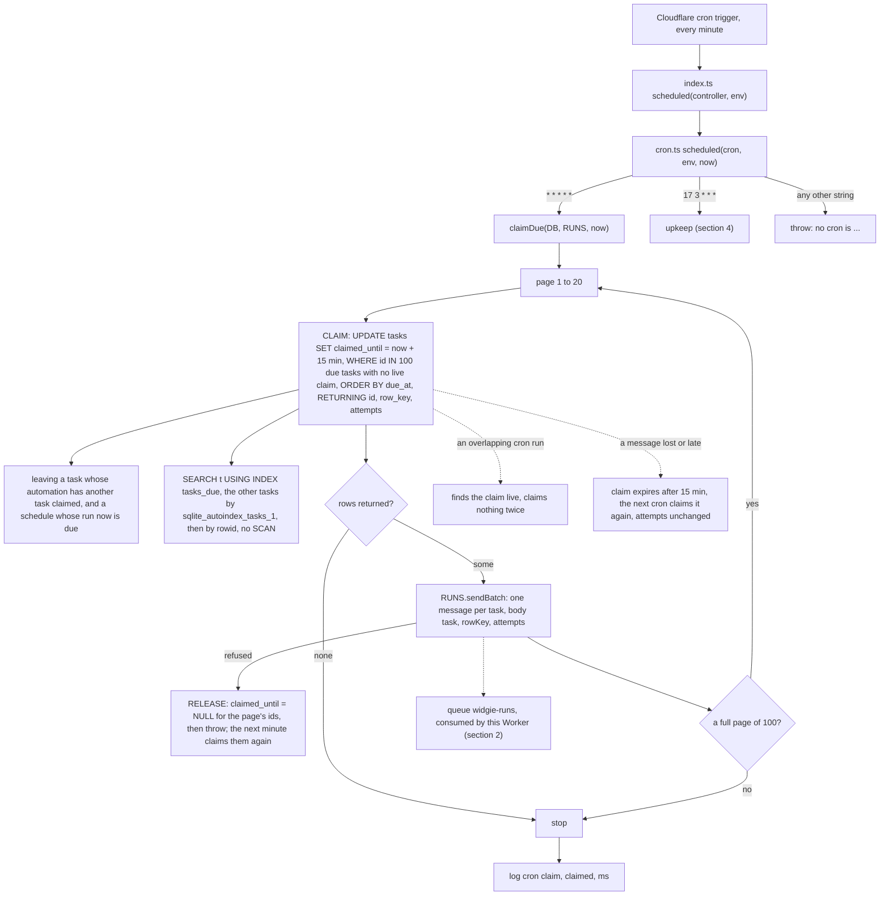
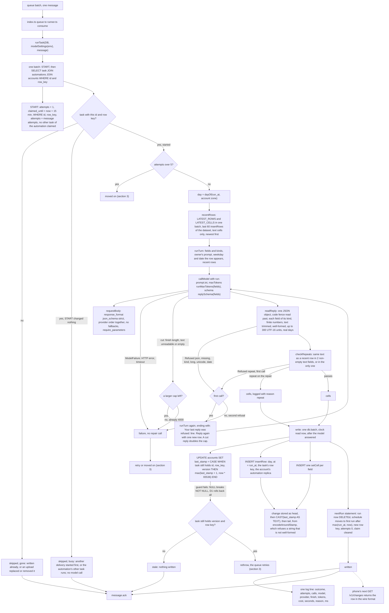
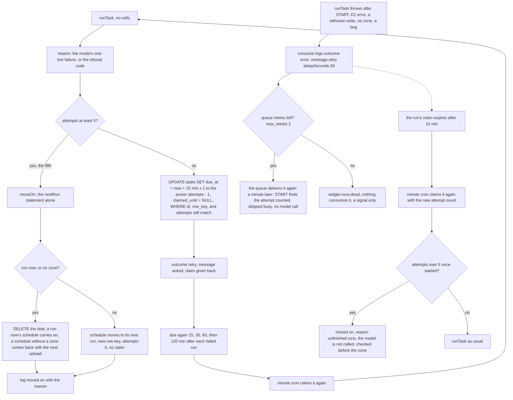
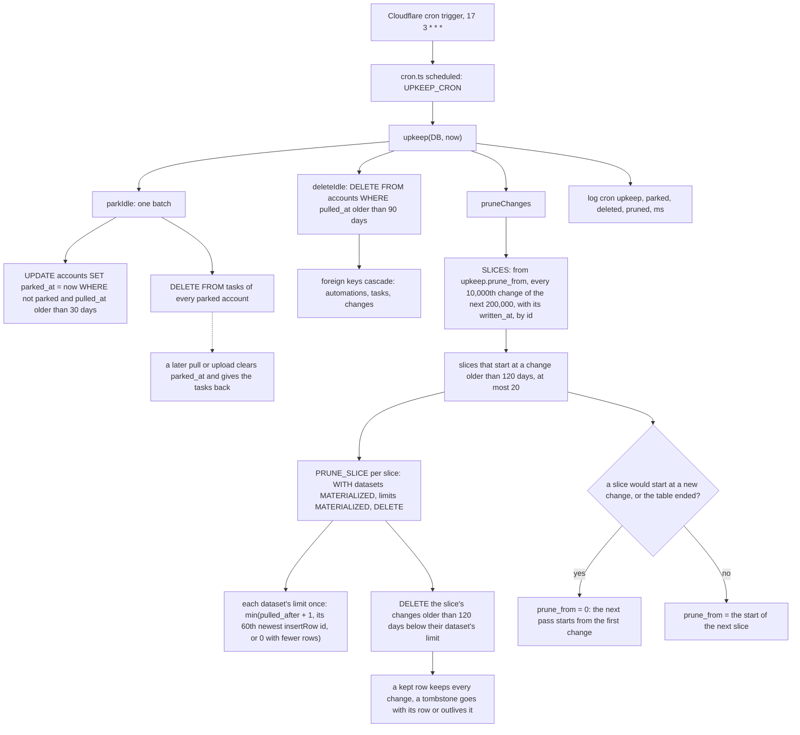
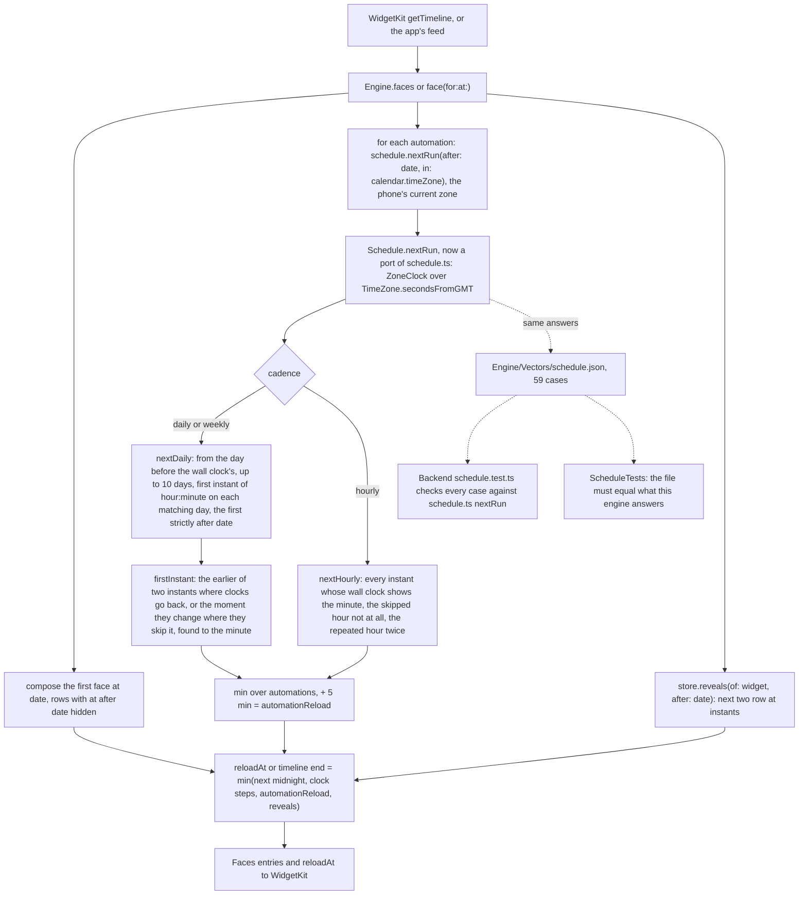

# PR 25: the cron and the runner in the Worker

Branch `phase-3-p3-runner` into `phase-3-p2-worker` (PR 24). This is P3 of [tasks/phase-3-ai-block.md](../../tasks/phase-3-ai-block.md) (see its "P3 results" note, line 145). P2 gave the Worker accounts, automations, tasks, and a pull. Here the Worker starts running them: a cron every minute claims the due tasks into a queue, the queue consumer asks the model for one row with structured output, checks it and its repeats with one repair call, and writes it in one D1 batch guarded by the task's version, and a daily cron parks, deletes, and prunes. On the phone side, the engine's `nextRun` becomes a port of the Worker's `schedule.ts`, and both sides check the same exported vectors. Nothing is deployed, and no queue, database, or secret exists yet; the live 20-automation `dev` run (the one unchecked P3 item) is the user's.

Background reading: [WIRE.md](../engine/WIRE.md) section "What the server writes" (line 82: one stamp per write, the automation replica, `at` is the run time, `day` is the day of `at`, a UUIDv7 row key kept on the task), the plan's "How it works (decided)" (lines 72 to 87, especially "Each run sees its recent rows" and "The reply is checked, not trusted"), and PR 24's guide for the schema and the upload's revision trick, which the write here reuses.

**No usage limits for now** (removed by the user on 2026-11-27): no runs per day and no spend cap. The OpenRouter key's credit limit is the backstop. `max_concurrency` and `max_tokens` here protect OpenRouter and bound one reply, they are not quotas.

## Core changes

- **Two crons.** [cron.ts](../../Backend/src/cron.ts) and `triggers.crons` in both environments of [wrangler.jsonc](../../Backend/wrangler.jsonc#L51): `* * * * *` claims due tasks, `17 3 * * *` runs the upkeep, and any other cron string throws. A claim is one statement, `CLAIM`: `UPDATE tasks SET claimed_until = now + 15 min WHERE id IN (due, unclaimed or expired, no other task of the automation claimed, not a schedule whose run now is due, ORDER BY due_at LIMIT 100) RETURNING id, row_key, attempts`, read through `tasks_due`. A claim is not an attempt. Pages of 100 (the most one `sendBatch` takes), at most 20 pages a minute; a page `sendBatch` refuses is released at once. Each message is `{task, rowKey, attempts}`.
- **A queue the Worker consumes itself.** `RUNS` produces to `widgie-runs` (`widgie-dev-runs` on dev). The consumer takes one message per batch with `max_concurrency` 20, so each run has its own invocation and CPU budget and at most 20 model calls run at once. A message whose run throws is retried twice, 60 s apart, and then kept in `widgie-runs-dead` (`widgie-dev-runs-dead`), which nothing consumes. [index.ts:64](../../Backend/src/index.ts#L64) adds `scheduled` and `queue` handlers beside `fetch`.
- **The runner.** [runner.ts](../../Backend/src/runner.ts): start the run (`START`: count the attempt and renew the claim, only while the task holds the message's row key and attempt count and no other task of its automation is claimed) in one batch with the read of the task, its automation, and its account; skip a gone task or a busy one; read back the dataset's last 60 rows, call the model, check the reply, repair once, then write the row and move the task on in one batch. [run.ts](../../Backend/src/run.ts) holds the plain functions: the user turn, the token cap, the JSON schema, the reply reader, and the repeat check. [run-prompt.txt](../../Backend/src/run-prompt.txt) is the fixed system prompt, cached like the build prompt.
- **Structured output: supported, and on.** OpenRouter lists `response_format` and `structured_outputs` for `deepseek/deepseek-v4.1-flash-1017` on all three Together endpoints (checked 2026-11-27). `STRUCTURED_OUTPUT` is `"on"` in both environments. [model.ts](../../Backend/src/model.ts) gains `CallOptions` (`maxTokens`, `schema`), `modelSettings(env)`, a `json_schema` `response_format` with `strict: true`, `provider.require_parameters: true` when a schema goes, and the reply's `finish` reason (also on a `ModelFailure` for a reply with no text). The build route sends no schema and is unchanged. A run's `max_tokens` is 1,000 plus 250 per text field, at most 4,000; a cut reply is repaired with twice the cap.
- **The reply is checked, then checked for repeats.** One JSON object (a code fence is read past), every field present and of its kind, finite numbers, text trimmed, well-formed UTF-16, and at most 300 UTF-16 units, dates `YYYY-MM-DD` of a real day, keys the table lacks dropped. A reply repeats a recent row when it has that row's text (case and surrounding space ignored) in two of its non-empty text fields, or in its only one. A refusal gets one repair call naming the reason; a model failure gets none. A repair that repeats is written, with `reason: "repeat"` in the log.
- **No lone surrogate reaches the wire.** `cell()` refuses text that is not well-formed (`unicode`), and [wire.ts:140](../../Backend/src/wire.ts#L140) `encodeChange` refuses any change whose strings are not, so the phone's JSON reader, which refuses a half surrogate pair with the whole page, never gets one. [WIRE.md](../engine/WIRE.md) states the rule and [wire.json](../../Engine/Vectors/wire.json) gains a bad page for it.
- **A version-guarded write.** The batch's first statement takes the account's stamp only while the task still holds the version and row key it was read with, and otherwise sets `last_stamp` to NULL, which `NOT NULL` refuses, so D1 rolls back the whole batch (P2's revision trick). Then the `insertRow`, one `setCell` per field, each stored as `head || last_stamp || tail` around the stamp ([wire.ts:174](../../Backend/src/wire.ts#L174) `encodeAroundStamp`), and the task moved on: a run now is deleted, a schedule moves to the first run after `max(run_at, now)` with a new row key.
- **Failures back off, five move on.** A run that fails gives its claim back and moves `due_at` to 15, 30, 60, then 120 minutes after it. The fifth failed attempt moves the task to its next run, and so does a run that starts after five runs that never finished, without calling the model.
- **One log line a run, never the prompt or the row.** `{run, task, outcome, attempts, calls, model, provider, finish, input_tokens, cached_tokens, output_tokens, cost_usd, seconds, reason, ms}`, where `reason` is a refusal code, the model service's one-line failure, or `gone` / `busy` for a skipped message. Each cron run logs `{cron, claimed}` or `{cron, parked, deleted, pruned}` with `ms`.
- **Upkeep prunes old changes, a bounded slice at a time.** [upkeep.ts](../../Backend/src/upkeep.ts) adds `pruneChanges` and `upkeep` beside P2's `parkIdle` and `deleteIdle`: a change goes when it is older than 120 days, its account's last pull has passed it, and its id is below its dataset's 60th newest `insertRow`. Each run deletes in at most 20 set-based statements of 10,000 changes each from a place kept in the new one-row `upkeep` table ([0001_automations.sql:88](../../Backend/migrations/0001_automations.sql#L88)), so it stays at 25 queries however large `changes` grows. [plans.test.ts](../../Backend/test/plans.test.ts) asserts the plans.
- **The engine's `nextRun` is a port of `schedule.ts`.** [Automations.swift:37](../../Engine/Sources/Spec/Automations.swift#L37) drops `Calendar.nextDate(... .nextTime)` for `ZoneClock` over `TimeZone.secondsFromGMT(for:)`. It now agrees with the server in the three places Foundation did not: a weekly time the clocks skip, a time in Lord Howe's half-hour gap, and a repeated time asked from between its two instants. [ScheduleTests.swift](../../Engine/Tests/SpecTests/ScheduleTests.swift) exports 59 cases to [schedule.json](../../Engine/Vectors/schedule.json), and [schedule.test.ts](../../Backend/test/schedule.test.ts) checks every one. [RATIONALE.md](../engine/RATIONALE.md) records the rule.
- **Small moves.** `oneLine` moves from `index.ts` to [request.ts:23](../../Backend/src/request.ts#L23) so the runner shares it. `scheduleTask` ([automations.ts:271](../../Backend/src/automations.ts#L271)) takes an optional `after`, so a late task can skip the runs it missed. `env.d.ts` adds `STRUCTURED_OUTPUT` and `RUNS`.
- **Tests: 391 Worker tests, 129 new.** [cron.test.ts](../../Backend/test/cron.test.ts), [runner.test.ts](../../Backend/test/runner.test.ts), [run.test.ts](../../Backend/test/run.test.ts), [plans.test.ts](../../Backend/test/plans.test.ts), additions to [upkeep.test.ts](../../Backend/test/upkeep.test.ts), [request.test.ts](../../Backend/test/request.test.ts), [wire.test.ts](../../Backend/test/wire.test.ts), and [schedule.test.ts](../../Backend/test/schedule.test.ts), on [helpers/runs.ts](../../Backend/test/helpers/runs.ts) (a queue that keeps what it is sent and a scripted model). The engine's `ScheduleTests` (5 tests) replace no existing test, every `DocumentTests` case still passes, and `WireTests` refuses the new bad page.
- **Review fixes (after the first review of this PR).** One task of an automation runs at a time (sections 1 and 2), a claim is not an attempt and a duplicate delivery calls no model (sections 1 to 3), a lone surrogate is refused and never encoded (section 2), a repair that repeats is written and the token cap scales (section 2), the prune goes in bounded slices (section 4), one run per queue batch with a 60 s retry delay (sections 2 and 3), and St. John's and Chatham join the vectors (section 5).
- **Setup before the first deploy**, beyond P2's database steps. From `Backend/`:

  ```sh
  npx wrangler queues create widgie-runs
  npx wrangler queues create widgie-runs-dead
  npx wrangler queues create widgie-dev-runs
  npx wrangler queues create widgie-dev-runs-dead
  # if not set yet, for each environment
  npx wrangler secret put MODEL_API_KEY
  npx wrangler secret put MODEL_API_KEY --env dev
  ```

## 1. The minute cron claims due tasks

Every minute the Worker claims the tasks whose `due_at` has passed and whose claim is free or expired, and sends them to the queue. A task is due a lead before its run time (daily 26 to 38 hours, weekly 7 to 8 days, hourly 65 to 90 minutes), so the row reaches the phone a full period before it shows. The tasks of one automation are claimed one at a time.



Files:

- [index.ts:64](../../Backend/src/index.ts#L64): the `scheduled` handler, which passes `controller.cron` and `Date.now()`.
- [cron.ts:20](../../Backend/src/cron.ts#L20): `CLAIM_CRON` and `UPKEEP_CRON` (line 22), the same two strings as [wrangler.jsonc:51](../../Backend/wrangler.jsonc#L51) and [wrangler.jsonc:88](../../Backend/wrangler.jsonc#L88). [cron.ts:26](../../Backend/src/cron.ts#L26): `CLAIM_MS`, `CLAIM_PAGE`, `CLAIM_PAGES`. [cron.ts:34](../../Backend/src/cron.ts#L34): `siblingClaimed`, the guard the claim and the run share. [cron.ts:42](../../Backend/src/cron.ts#L42): `CLAIM`. [cron.ts:52](../../Backend/src/cron.ts#L52): `RELEASE`. [cron.ts:56](../../Backend/src/cron.ts#L56): `scheduled`, the dispatch and its log lines. [cron.ts:71](../../Backend/src/cron.ts#L71): `claimDue`, the page loop and the release on a refused `sendBatch` (line 87).
- [0001_automations.sql:62](../../Backend/migrations/0001_automations.sql#L62): `tasks_due`, from P2; the tasks' `UNIQUE (account, widget, automation, once)` serves the sibling lookups.
- [runner.ts:45](../../Backend/src/runner.ts#L45): `RunMessage`, `{task, rowKey, attempts}`.
- [automations.ts:271](../../Backend/src/automations.ts#L271): `scheduleTask`, which sets every `due_at` the claim reads. [schedule.ts:32](../../Backend/src/schedule.ts#L32): `leadMs`.
- Tests: [cron.test.ts:31](../../Backend/test/cron.test.ts#L31) (every due task claimed once with its row key and attempts, no attempt counted), [cron.test.ts:53](../../Backend/test/cron.test.ts#L53) (one task of an automation at a time, the run now first, the schedule while a failed run now backs off), [cron.test.ts:73](../../Backend/test/cron.test.ts#L73) (tasks not yet due stay), [cron.test.ts:84](../../Backend/test/cron.test.ts#L84) (an expired claim is claimed again with no attempt), [cron.test.ts:94](../../Backend/test/cron.test.ts#L94) (two crons never claim one task), [cron.test.ts:109](../../Backend/test/cron.test.ts#L109) (at most a page per batch), [cron.test.ts:125](../../Backend/test/cron.test.ts#L125) (a refused page is released and claimed the next minute), [cron.test.ts:146](../../Backend/test/cron.test.ts#L146) (the two crons and a refused third), [plans.test.ts:21](../../Backend/test/plans.test.ts#L21) (the claim reads through `tasks_due` and the tasks' unique key).

Key decisions:

- **The cron claims, the queue runs.** A cron invocation can wait on only 6 connections at once, so model calls go through the queue, whose `max_concurrency` bounds how many reach OpenRouter together (20).
- **One statement claims.** D1 runs one write at a time, so two overlapping cron runs can never claim the same task: the second finds the claim live. There is no lock table and no separate retry machinery.
- **A claim is a lease, not an attempt.** It only keeps the task out of other claims while its message waits or runs. A message that is lost or waits past its claim leaves `claimed_until` to expire and the next cron claims the task again, with the same attempt count, so a skipped minute or a lost message costs a delay, never a row or an attempt. The runner counts attempts when a run starts (section 2).
- **A refused page is given back.** When `sendBatch` throws, the page's claims are cleared (only those still holding this claim's time) and the error thrown, so those tasks go out the next minute instead of after 15.
- **One task of an automation at a time, the run now first.** A new or refined automation's run now and schedule are both due at once (every lead is longer than its period). Run together they would read the same recent rows and could write the same item twice. The claim leaves a task whose automation has another task claimed, and a schedule whose run now is due, so the schedule goes after the run now has written, with its row in the recent rows. While a failed run now backs off (claim given back, not due), the schedule may run.
- **Pages of 100, at most 20 a minute.** 100 is the most one `sendBatch` takes. More than 2,000 due tasks wait for the next minute, earliest `due_at` first.
- **The cron string is checked.** `cron.ts` names the same two strings as `wrangler.jsonc`, and any other string throws, so a cron added to `wrangler.jsonc` that `cron.ts` does not know fails loudly instead of doing nothing.

## 2. The queue consumer runs one task: start, model call, checks, guarded write, next run

Each message names a task, the row key it held when claimed, and the runs it had started. The consumer gets one message per batch, and each run ends in one of `written`, `stale`, `skipped`, `retry` (section 3), or `moved on` (section 3).



Files:

- [index.ts:67](../../Backend/src/index.ts#L67): the `queue` handler. [wrangler.jsonc:52](../../Backend/wrangler.jsonc#L52): the producer and consumer settings (batch 1, timeout 5, retries 2, concurrency 20, dead-letter queue), and again for dev at line 89. [wrangler.jsonc:37](../../Backend/wrangler.jsonc#L37): `STRUCTURED_OUTPUT`.
- [runner.ts:68](../../Backend/src/runner.ts#L68): `START`. [runner.ts:72](../../Backend/src/runner.ts#L72): `CUT`, the refusal a cut reply gets. [runner.ts:101](../../Backend/src/runner.ts#L101): `consume`, ack on return and `retry({delaySeconds: 60})` on a throw. [runner.ts:124](../../Backend/src/runner.ts#L124): `runTask`: the start and read at 140, `gone` at 155, `busy` at 157, the unfinished-runs check at 158, the zone check at 165, the two-call loop at 179 (the cut check at 188, a repair's repeat at 193, the larger cap at 204), the write at 218. [runner.ts:235](../../Backend/src/runner.ts#L235): `spending`, the usage and cost summed over the calls.
- [runner.ts:253](../../Backend/src/runner.ts#L253): `LATEST_ROWS` and `LATEST_CELLS` (256). [runner.ts:262](../../Backend/src/runner.ts#L262): `recentRows`.
- [runner.ts:279](../../Backend/src/runner.ts#L279): `INSERT_CHANGE`. [runner.ts:284](../../Backend/src/runner.ts#L284): `write`: the guard at 299, the changes at 306, the stale check at 330. [runner.ts:349](../../Backend/src/runner.ts#L349): `nextRun`, the statement that moves a task on.
- [run.ts:12](../../Backend/src/run.ts#L12): `RECENT_ROWS`, `RUN_TOKENS` (16), `TEXT_LIMIT` (18). [run.ts:24](../../Backend/src/run.ts#L24): `runMaxTokens`. [run.ts:31](../../Backend/src/run.ts#L31): `Refused`, a `code` for the log and a `line` for the model. [run.ts:44](../../Backend/src/run.ts#L44): `runTurn`. [run.ts:77](../../Backend/src/run.ts#L77): `replySchema`. [run.ts:97](../../Backend/src/run.ts#L97): `readReply` and `cell` (117, the well-formed check at 122). [run.ts:164](../../Backend/src/run.ts#L164): `checkRepeats`.
- [run-prompt.txt](../../Backend/src/run-prompt.txt): the system prompt, which says a category field may repeat (line 11) and how to leave a text empty (line 13).
- [model.ts:47](../../Backend/src/model.ts#L47): `ModelFailure` with `finish`. [model.ts:61](../../Backend/src/model.ts#L61): `modelSettings`. [model.ts:72](../../Backend/src/model.ts#L72): `requestBody` with `CallOptions`. [model.ts:109](../../Backend/src/model.ts#L109): `callModel`, which now returns `finish`.
- [wire.ts:140](../../Backend/src/wire.ts#L140): `encodeChange`, which refuses a string that is not well-formed. [wire.ts:174](../../Backend/src/wire.ts#L174): `encodeAroundStamp`, which checks the split it makes.
- [WIRE.md](../engine/WIRE.md) "Values": every string is well-formed Unicode. [wire.json](../../Engine/Vectors/wire.json): the bad page "a text with half of a surrogate pair".
- [automations.ts:271](../../Backend/src/automations.ts#L271): `scheduleTask(..., after)`.
- Tests: [runner.test.ts:121](../../Backend/test/runner.test.ts#L121) (one stamp under the account's replica, and the pull returns the row in the wire format), [runner.test.ts:153](../../Backend/test/runner.test.ts#L153) (every kind), [runner.test.ts:168](../../Backend/test/runner.test.ts#L168) (the schedule moves, its lead in its window), [runner.test.ts:197](../../Backend/test/runner.test.ts#L197) (a late schedule skips the runs it missed), [runner.test.ts:205](../../Backend/test/runner.test.ts#L205) (`day` across DST), [runner.test.ts:229](../../Backend/test/runner.test.ts#L229) (an upload while the model answers: nothing written), [runner.test.ts:244](../../Backend/test/runner.test.ts#L244) (a replaced or removed task), [runner.test.ts:254](../../Backend/test/runner.test.ts#L254) (a replay writes once, and of two deliveries at once one calls the model), [runner.test.ts:271](../../Backend/test/runner.test.ts#L271) (a delivery during a run, and a late one after a failed run, call no model), [runner.test.ts:295](../../Backend/test/runner.test.ts#L295) (a message that waited past its claim costs no attempt), [runner.test.ts:317](../../Backend/test/runner.test.ts#L317) (a new automation's schedule runs after its run now and sees its row), [runner.test.ts:339](../../Backend/test/runner.test.ts#L339) (schema, `require_parameters`, the token cap), [runner.test.ts:367](../../Backend/test/runner.test.ts#L367) (a repeat refused and asked once more with its line), [runner.test.ts:396](../../Backend/test/runner.test.ts#L396) (read back by dataset), [runner.test.ts:409](../../Backend/test/runner.test.ts#L409) (a category repeats, the item does not), [runner.test.ts:429](../../Backend/test/runner.test.ts#L429) (a repair that repeats is written and logged), [runner.test.ts:449](../../Backend/test/runner.test.ts#L449) (a lone surrogate is refused, never stored, and the page stays readable), [runner.test.ts:497](../../Backend/test/runner.test.ts#L497) (the cap grows with text fields), [runner.test.ts:511](../../Backend/test/runner.test.ts#L511) (a cut reply is repaired with twice the cap, and not at the most), [runner.test.ts:618](../../Backend/test/runner.test.ts#L618) (the log), [runner.test.ts:645](../../Backend/test/runner.test.ts#L645) (ack, and retry a minute later), [run.test.ts:19](../../Backend/test/run.test.ts#L19) (the reader), [run.test.ts:72](../../Backend/test/run.test.ts#L72) (the repeat rule), [run.test.ts:118](../../Backend/test/run.test.ts#L118) (the turn and the schema), [request.test.ts:99](../../Backend/test/request.test.ts#L99) (schema only when the setting is on), [wire.test.ts:88](../../Backend/test/wire.test.ts#L88) (every wire vector around its stamp), [wire.test.ts:96](../../Backend/test/wire.test.ts#L96) (a string that is not well-formed is refused), [plans.test.ts:32](../../Backend/test/plans.test.ts#L32) (the start by id and the tasks' key), [plans.test.ts:39](../../Backend/test/plans.test.ts#L39) (the read-back through `changes_dataset`).

Key decisions:

- **Structured output finding: Together serves it, so it is on.** OpenRouter's endpoint list for `deepseek/deepseek-v4.1-flash-1017` (`/api/v1/models/deepseek/deepseek-v4.1-flash-1017/endpoints`, checked 2026-11-27) shows `response_format` and `structured_outputs` for `together`, `together/us`, and `together/fast`. A run sends `response_format: {type: "json_schema", json_schema: {name: "row", strict: true, schema}}`, the schema an object with exactly the table's fields (text and date as strings, number, boolean), all required, no others. `provider.require_parameters: true` goes with it, so a provider that would silently ignore the schema refuses instead. `STRUCTURED_OUTPUT` turns it off for an endpoint that does not serve it, and then the reply is checked exactly the same way.
- **The schema is a hint, the reader is the check.** Lengths and dates are not in the schema, since providers differ in which keywords they enforce; `readReply` checks them every time. The phone's `receive` still refuses anything over the limits.
- **A run starts once.** `START` is the one place a run counts an attempt, and it only matches while the task still has the attempt count the message carries, so of two deliveries of one message, or of two claims' messages, exactly one runs; the rest end as `skipped` / `busy` without a model call. It also refuses while another task of the automation holds a live claim, so even a stray message cannot run a schedule beside its run now. It renews the claim for the run, so the cron does not claim the task again while the model answers.
- **No lone surrogate on the wire.** The model's JSON can carry `\ud83d` alone, which `JSON.parse` turns into a lone surrogate and `JSON.stringify` writes back as the same escape, which the phone's reader refuses with the whole page, stopping the account's sync for good. `cell()` refuses it as `unicode` (so it goes through the repair), and `encodeChange` refuses any change with such a string, so the invariant holds in one place for every change the Worker stores; the other strings (row key, dataset, replica, field, stamp) are minted or validated ids anyway.
- **The repeat rule is "two text fields, or the only one", not "any text value matches".** Matching any one field would refuse every Word of the Day after the first whose `kind` is "noun" (the template's part of speech), and once every part of speech had been used, every reply, so the widget would stop getting words; its `verdict` is empty in every row, which is why empty text does not count. With this rule the same word with its part of speech, the same question, or the same quote with its author is refused, and a new noun is not. What it misses: a table with exactly two text fields where only the key one repeats (a word with a reworded definition). The prompt lists the recent rows and says not to repeat them, so the check is a backstop, and P5's evals measure it.
- **A repair that repeats is written.** The rule still refuses every reply of a table whose only non-empty text is a category (a mood of the day, or a two-text table whose other field is always empty), so it is checked on the first reply only; a repair that repeats is written and logged with `reason: "repeat"`. A repeated row beats a widget that stops getting rows, and the dev run counts how often it happens.
- **One repair, only for a refused or cut reply.** The repair turn ends with the refusal's `line`. A model failure (HTTP error, timeout) gets no repair call and waits for the backoff in section 3.
- **The cap scales, and a cut reply gets a larger one.** `max_tokens` is 1,000 plus 250 per text field (300 UTF-16 units can take as many tokens in some scripts), at most 4,000, so the word table keeps 1,500. A reply with `finish: "length"` whose text does not read, or with no text because thinking took the cap, is `cut`: the repair goes with twice the cap, at most 4,000, and when the cap is already 4,000 the repair could not do better, so it is skipped.
- **The read-back is by dataset, not automation.** A refine that renames the automation keeps its history. Only text cells are read; rows with no text are left out of the turn and the check.
- **The guard reuses P2's NULL trick.** A `CASE ... END` with no `ELSE` gives NULL when the task no longer holds the version and row key, `last_stamp` is `NOT NULL`, and D1 rolls back the whole batch. An upload that changed the automation while the model was answering therefore leaves nothing behind, and a run that outlived its claim and a later run of the same task write the row at most once. After a failed batch, `write` reads the task again: gone or changed is `stale`, still held means a real D1 error, rethrown for the queue to retry.
- **The stamp is taken in SQL, and the stored bytes are still `encodeChange`'s.** The stamp is not known until the batch runs, so each change is stored as `head || CAST(last_stamp AS TEXT) || tail`. `encodeAroundStamp` splits `encodeChange`'s output around the stamp (the second-to-last key, before `replica`) and throws if the split is not exact, and a test runs every wire vector through it.
- **The clock is read when the batch is written.** The stamp, `written_at`, and the next run's `now` are taken after the model has answered, not when the run started.
- **A message names its task by id and row key.** No task with both means the run was written already (the task moved to a new row key, or a run now was deleted) or an upload replaced or removed it. SQLite may give a replacement the same id, never the same row key, so there is one outcome, `skipped` / `gone`, for all of them.
- **One message per batch.** Workers Free gives each invocation 10 ms of CPU, so batches of 4 would share one budget; one message per batch with `max_concurrency` 20 keeps the same bound on OpenRouter (20 calls) with a budget per run.
- **A late schedule skips the runs it missed.** The next run is the first after `max(run_at, now)`, so an account that was parked or a backlog after an outage writes one row, not one per missed period.
- **Everything the model sees is the owner's.** The turn holds the fields, the owner's prompt, the day, and the owner's own recent rows. The log holds codes and numbers, never the prompt or the row.

## 3. A failed run: backoff, five attempts, and the dead-letter queue

There are two kinds of failure. A run that ends without a row (no answer from the model, or the replies refused) is handled by the runner itself. A run that throws (D1 failing, a bug) is handled by the queue and then the cron. Attempts count runs that started, never claims.



Files:

- [runner.ts:60](../../Backend/src/runner.ts#L60): `MAX_ATTEMPTS` (5), `BACKOFF` (line 62, 15 minutes), and `RETRY_DELAY_S` (line 64, 60 s). [runner.ts:222](../../Backend/src/runner.ts#L222): the reason, the fifth-attempt check at 223, and the backoff update, which gives the claim back, at 227. [runner.ts:158](../../Backend/src/runner.ts#L158): the unfinished-runs check, before the zone check at 165. [runner.ts:341](../../Backend/src/runner.ts#L341): `moveOn`. [runner.ts:349](../../Backend/src/runner.ts#L349): `nextRun`, which deletes a run now, or a schedule whose account has no zone (line 350).
- [runner.ts:101](../../Backend/src/runner.ts#L101): `consume`, the `catch` that logs and calls `message.retry({delaySeconds: 60})` (line 117).
- [runner.ts:330](../../Backend/src/runner.ts#L330): a failed write batch whose task is still held is rethrown, which is one way into the queue's retries.
- [wrangler.jsonc:59](../../Backend/wrangler.jsonc#L59): `max_retries` 2 and `dead_letter_queue` (line 61), and again for dev at lines 96 and 98.
- [runner.ts:68](../../Backend/src/runner.ts#L68): `START`, the one statement that adds an attempt.
- Tests: [runner.test.ts:562](../../Backend/test/runner.test.ts#L562) (four retries with gaps of 15, 30, 60, and 120 minutes, then the schedule moves to its next run with a new row key and nothing written), [runner.test.ts:585](../../Backend/test/runner.test.ts#L585) (five failures delete a run now and the schedule stays), [runner.test.ts:593](../../Backend/test/runner.test.ts#L593) (five unfinished runs move the task on without a model call), [runner.test.ts:604](../../Backend/test/runner.test.ts#L604) (an account with no zone throws, counts the attempt, and the task moves on instead of looping), [runner.test.ts:473](../../Backend/test/runner.test.ts#L473) (refused twice: retry, claim given back), [runner.test.ts:490](../../Backend/test/runner.test.ts#L490) (no repair after a model failure), [runner.test.ts:645](../../Backend/test/runner.test.ts#L645) (a throw is retried a minute later).

Key decisions:

- **The cron is the retry mechanism.** The runner does not re-enqueue anything. It moves `due_at`, gives the claim back, and the minute cron does the rest; the guard on `attempts` keeps a slow run from touching the task after a later run started.
- **Attempts count runs, not claims.** A claim used to add the attempt, so a failed `sendBatch` or a message that waited past its claim burned attempts and could drop a run without any model call. Now `START` counts it, so only a run that actually started costs one.
- **The gap doubles with each attempt.** 15, 30, 60, then 120 minutes, 225 minutes in all. That fits inside a daily or weekly lead, so a daily row that fails a few times still lands ahead of its time. A reviewer note: an hourly lead is 65 to 90 minutes, so an hourly row that fails three times is written after its `at` (it then shows at once) or, after five, skipped for that hour.
- **Five attempts, then the task moves on.** A run now is deleted, since the schedule task already covers the automation. A schedule moves to its next run, so one bad period never stops a widget for good. The failure is logged as `moved on` with its reason.
- **A run that keeps throwing still moves on.** A queue retry of a run that started is a no-op (its attempt is counted), the run's claim expires, and the cron's next claim starts a new attempt; after five unfinished runs the next start moves the task on without a call. That check comes before the zone check, and a schedule with no zone is deleted rather than placed, so even an account without a zone ends instead of looping.
- **The dead-letter queue is a signal, not a recovery path.** Nothing consumes `widgie-runs-dead`. The task is safe because its claim expires either way, so a dead letter only says that something threw three times in a row.
- **A refused reply and a model failure are both `retry`.** The log's `reason` tells them apart (`json`, `missing`, `kind`, `long`, `unicode`, `date`, `repeat`, `cut`, or the service's one-line failure), so the dev run can count repeats and bad replies separately.

## 4. The daily cron: parking, deletion, and pruning

At 03:17 UTC the upkeep runs three steps in order: park accounts idle for 30 days, delete accounts idle for 90 days, and prune old changes every pull has passed while keeping each dataset's recent rows for the repeat check. The prune reads a bounded part of `changes` each day and goes on the next day from where it stopped.



Files:

- [cron.ts:61](../../Backend/src/cron.ts#L61): the upkeep branch and its log line.
- [upkeep.ts:19](../../Backend/src/upkeep.ts#L19): `upkeep`, the order. [upkeep.ts:28](../../Backend/src/upkeep.ts#L28): `parkIdle` and [upkeep.ts:39](../../Backend/src/upkeep.ts#L39): `deleteIdle`, both from P2. [upkeep.ts:8](../../Backend/src/upkeep.ts#L8): `PARK_AFTER`, `DELETE_AFTER`, `KEEP_CHANGES`, and `PRUNE` (line 16, 10,000 rows a slice, 20 slices a run). [upkeep.ts:46](../../Backend/src/upkeep.ts#L46): `SLICES`. [upkeep.ts:58](../../Backend/src/upkeep.ts#L58): `PRUNE_SLICE`. [upkeep.ts:84](../../Backend/src/upkeep.ts#L84): `pruneChanges`, the slice count, the pass end, and the place.
- [run.ts:12](../../Backend/src/run.ts#L12): `RECENT_ROWS`, the 60 rows both the read-back and the prune use.
- [accounts.ts:96](../../Backend/src/accounts.ts#L96): `rearm`, from P2, which a pull calls on a parked account.
- [0001_automations.sql:67](../../Backend/migrations/0001_automations.sql#L67): `changes` with `written_at`, `changes_account` and `changes_dataset` at lines 82 and 85, and the one-row `upkeep` table at line 88.
- Tests: [upkeep.test.ts:39](../../Backend/test/upkeep.test.ts#L39) (parking and a pull bringing tasks back), [upkeep.test.ts:58](../../Backend/test/upkeep.test.ts#L58) (an upload unparks), [upkeep.test.ts:85](../../Backend/test/upkeep.test.ts#L85) (deletion cascades), [upkeep.test.ts:146](../../Backend/test/upkeep.test.ts#L146) (pruned once the pull passed them, each dataset's last 60 rows kept whole), [upkeep.test.ts:166](../../Backend/test/upkeep.test.ts#L166) (newer than 120 days stays), [upkeep.test.ts:172](../../Backend/test/upkeep.test.ts#L172) (the daily upkeep runs all three), [upkeep.test.ts:179](../../Backend/test/upkeep.test.ts#L179) (small slices over 31 runs prune the same 23 changes as one run, and the pass ends at the end of the table), [upkeep.test.ts:204](../../Backend/test/upkeep.test.ts#L204) (a pass that reaches new changes ends and the next starts from the first change), [plans.test.ts:47](../../Backend/test/plans.test.ts#L47) (the slices by rowid, a slice's datasets by rowid range, the limits through `sqlite_autoindex_accounts_1` and `changes_dataset`, the deletes through `changes_account`, and scans only of the two materialized lists).

Key decisions:

- **Park, then delete, then prune.** Deletion runs before pruning, so the prune does not read the changes of accounts deleted that night.
- **A change goes only after every pull has passed it.** `id <= pulled_after` (the account's last pull watermark, from P2) means a phone that has not pulled yet never misses a change. Older than 120 days is the other condition, checked on each change's `written_at`.
- **Each dataset keeps its last 60 rows whole.** The repeat check reads them back, so the prune cuts below the 60th newest `insertRow`. A row's changes all have ids at or above its `insertRow`'s (its `setCell`s are written in the same batch, its `deleteRow` later), so a kept row keeps every change, and a tombstone either goes with its row or outlives it. A phone that pulls from the start never sees a row its tombstone should hide.
- **Set-based and bounded, from a stored place.** The first version read every old dataset and sent one delete per dataset, which at scale passes Workers Free's 50 queries per invocation. Now each slice is one statement that works out each of its datasets' limits once (materialized, so the correlated subqueries run once per dataset, not per change) and deletes in one go, and a run does at most 20 slices of 10,000 changes: with parking and deleting, at most 25 queries, each reading a bounded number of rows however large `changes` grows, and the Worker's CPU is awaiting D1. The place is a one-row `upkeep` table, so a pass over the old changes spans as many days as it needs.
- **A pass ends at the new changes.** Ids and write times rise together, so a slice that would start at a change newer than 120 days has nothing old after it; the pass ends there (or at the end of the table) and the next run starts from the first change again, where the changes kept for now (a dataset's last rows, or ones a pull had not passed) are looked at once more.
- **03:17 UTC, away from the top of the hour.**

## 5. A timeline build on the phone with the ported `nextRun`

The engine's `faces` and `face(for:at:)` add a reload five minutes after the next automation run, so the widget asks for a new timeline about when the server's row has been written and pulled. Before this PR the engine used Foundation's `.nextTime` matching, which disagreed with the server in three DST cases. `Engine.swift` is unchanged; what it calls now answers the server's rule.



Files:

- [Engine.swift:153](../../Engine/Sources/WidgetEngine/Engine.swift#L153): the `nextRun` call in the phone's current zone, `automationReload` at line 156, `reveals` at 161, the single-face `reloadAt` at 170, and the timeline `end` at 174. Unchanged in this PR.
- [RowStore.swift:421](../../Engine/Sources/Rows/RowStore.swift#L421): `reveals(of:after:)`, from P1, the other input to the timeline end.
- [Automations.swift:22](../../Engine/Sources/Spec/Automations.swift#L22): a `package init(cadence:)` for the tests. [Automations.swift:37](../../Engine/Sources/Spec/Automations.swift#L37): `nextRun(after:in:)` and its doc comment, the rule and where Foundation differs. [Automations.swift:55](../../Engine/Sources/Spec/Automations.swift#L55): `ZoneClock`, `nextDaily` at 68, `firstInstant` at 84, `nextHourly` at 102.
- [schedule.ts:131](../../Backend/src/schedule.ts#L131): the Worker's `nextRun`, `firstInstant` at 152, `nextHourly` at 173. The port mirrors these function for function, in seconds instead of milliseconds.
- [schedule.json](../../Engine/Vectors/schedule.json): 59 cases (New York, St. John's (a negative half-hour offset), Santiago, Lord Howe, and Chatham (a 45-minute offset) across both 2026 changes, London's two, Kolkata, UTC, daily, weekly, and hourly, single steps from just before, at, between, and at the second of a repeated time).
- [ScheduleTests.swift:14](../../Engine/Tests/SpecTests/ScheduleTests.swift#L14): the file must equal the engine's answers (`WIDGIE_WRITE_VECTORS=1 swift test --filter ScheduleTests` rewrites it, also when a new tz database moves a zone's changes, as the doc comment at line 9 says). Hand checks at line 31 (a skipped weekly time), 39 (Lord Howe's gap), 47 (a repeated time asked from between), and 56 (hourly on the fall-back night). The cases are at line 88.
- [schedule.test.ts:28](../../Backend/test/schedule.test.ts#L28): every vector, run in a chain from `after`, each test named with its zone and failing with "<zone> diverges from the engine's tz data". The file's header names the vectors as the reference and says they follow the tz database (line 8); the Foundation-printed cases below them stay, with the three where the server differs marked (lines 125, 166, and 190).
- [RATIONALE.md](../engine/RATIONALE.md): "Automations follow the phone's time zone" gains the rule and the shared vectors.

Key decisions:

- **The server's rule wins, and the phone follows it.** The server decides when a row is written and shows; the phone only uses `nextRun` for its reload time. So the engine was aligned to `schedule.ts`, not the other way round: a daily or weekly time the clocks skip runs at the moment they change (Foundation moved a weekly run a week and a Lord Howe gap time a day), and a time that happens twice runs once, at the first, even asked from between the two (Foundation took the second, so a daily run could happen twice).
- **A port, not `Calendar.nextDate`.** Foundation's matching has no setting for these three cases, so the engine computes from `secondsFromGMT(for:)` exactly as `schedule.ts` does from `Intl`, and the code reads side by side.
- **The hourly rule is intact on both sides.** On the fall-back night an hourly run happens in each real hour (New York 05:15Z and 06:15Z, both 01:15; Santiago 02:30Z and 03:30Z; Lord Howe's half-hour repeat at 14:45Z and 15:15Z), and only daily and weekly times that happen twice run once. The vectors cover all of these.
- **The engine exports the vectors and the Worker checks them.** `ScheduleTests` fails while the file differs from the engine, so a change to the Swift rule cannot ship without rewriting the file, and the Worker's test then shows whether `schedule.ts` still agrees. Both pass unchanged on the server side.
- **The vectors follow the tz database.** The runs come from Foundation's tz data on one side and Intl's on the other, so the file is regenerated when a tz release moves a zone's changes, and a Worker case that fails names its zone, which tells a runtime whose tz data lags from a rule that broke.
- **Odd offsets are covered.** St. John's (-03:30 and -02:30) and Chatham (+12:45 and +13:45) across both of their changes, daily times skipped and repeated, hourly runs through both nights, and a repeated time asked from between its two instants.
- **The phone's current zone, as before.** `Engine.swift` still passes `calendar.timeZone`, so someone who moves keeps their 06:00, and the upload carries the same zone the server computes `day` in.
