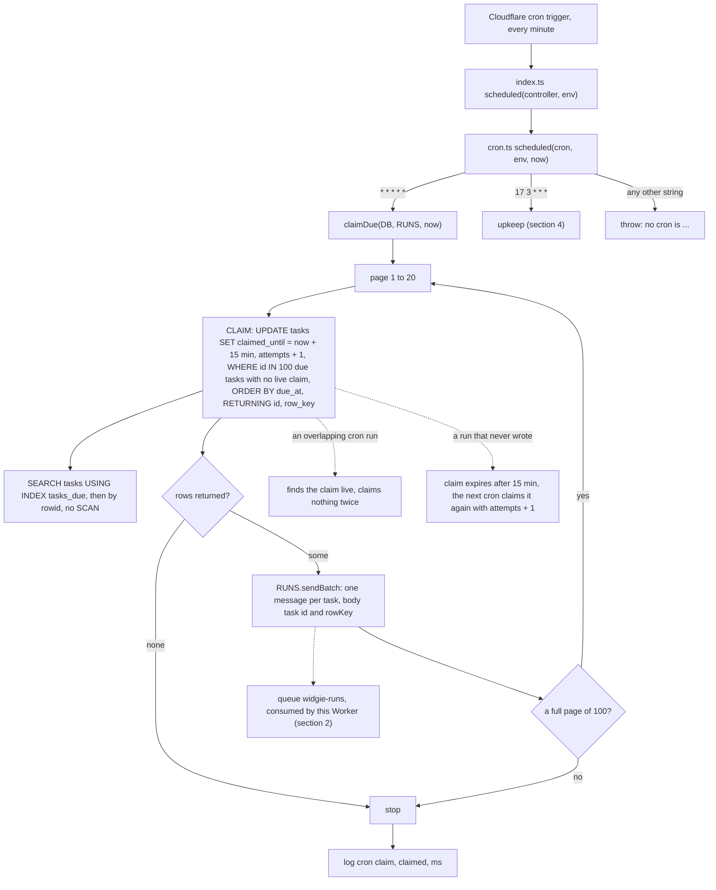
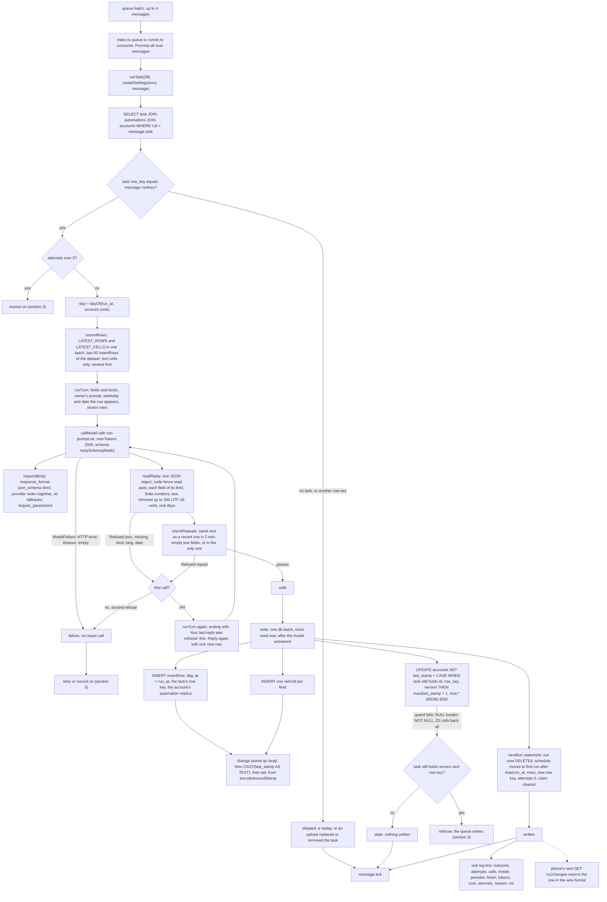
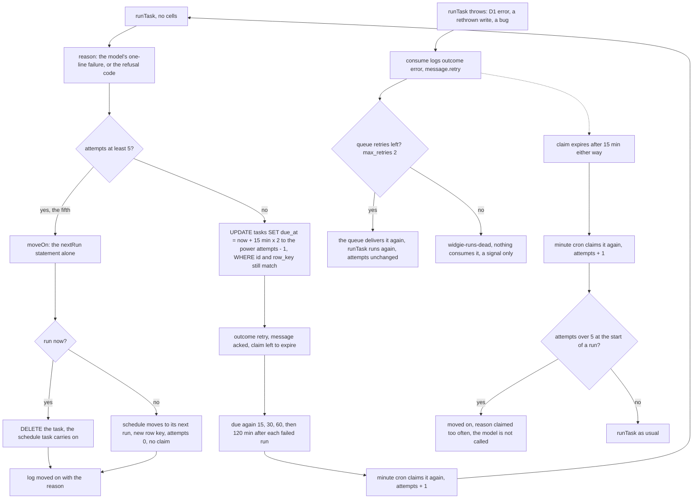
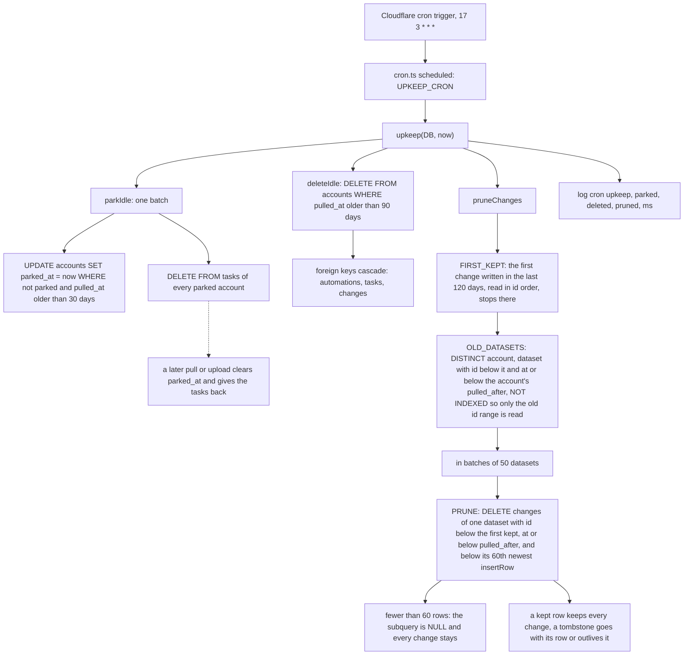

# PR 25: the cron and the runner in the Worker

Branch `phase-3-p3-runner` into `phase-3-p2-worker` (PR 24). This is P3 of [tasks/phase-3-ai-block.md](../../tasks/phase-3-ai-block.md) (see its "P3 results" note, line 145). P2 gave the Worker accounts, automations, tasks, and a pull. Here the Worker starts running them: a cron every minute claims the due tasks into a queue, the queue consumer asks the model for one row with structured output, checks it and its repeats with one repair call, and writes it in one D1 batch guarded by the task's version, and a daily cron parks, deletes, and prunes. On the phone side, the engine's `nextRun` becomes a port of the Worker's `schedule.ts`, and both sides check the same exported vectors. Nothing is deployed, and no queue, database, or secret exists yet; the live 20-automation `dev` run (the one unchecked P3 item) is the user's.

Background reading: [WIRE.md](../engine/WIRE.md) section "What the server writes" (line 82: one stamp per write, the automation replica, `at` is the run time, `day` is the day of `at`, a UUIDv7 row key kept on the task), the plan's "How it works (decided)" (lines 72 to 87, especially "Each run sees its recent rows" and "The reply is checked, not trusted"), and PR 24's guide for the schema and the upload's revision trick, which the write here reuses.

**No usage limits for now** (removed by the user on 2026-11-27): no runs per day and no spend cap. The OpenRouter key's credit limit is the backstop. `max_concurrency` and `max_tokens` here protect OpenRouter and bound one reply, they are not quotas.

## Core changes

- **Two crons.** [cron.ts](../../Backend/src/cron.ts) and `triggers.crons` in both environments of [wrangler.jsonc](../../Backend/wrangler.jsonc#L50): `* * * * *` claims due tasks, `17 3 * * *` runs the upkeep, and any other cron string throws. A claim is one statement, `CLAIM`: `UPDATE tasks SET claimed_until = now + 15 min, attempts = attempts + 1 WHERE id IN (due, unclaimed or expired, ORDER BY due_at LIMIT 100) RETURNING id, row_key`, read through `tasks_due`. Pages of 100 (the most one `sendBatch` takes), at most 20 pages a minute. Each message is `{task, rowKey}`.
- **A queue the Worker consumes itself.** `RUNS` produces to `widgie-runs` (`widgie-dev-runs` on dev). The consumer takes batches of 4 (5 s timeout) with `max_concurrency` 5, so at most 20 model calls at once, and runs a batch's messages together. A message whose run throws is retried twice and then kept in `widgie-runs-dead` (`widgie-dev-runs-dead`), which nothing consumes. [index.ts:64](../../Backend/src/index.ts#L64) adds `scheduled` and `queue` handlers beside `fetch`.
- **The runner.** [runner.ts](../../Backend/src/runner.ts): read the task with its automation and account, skip it when no task holds both the message's id and row key, read back the dataset's last 60 rows, call the model, check the reply, repair once, then write the row and move the task on in one batch. [run.ts](../../Backend/src/run.ts) holds the plain functions: the user turn, the JSON schema, the reply reader, and the repeat check. [run-prompt.txt](../../Backend/src/run-prompt.txt) is the fixed system prompt, cached like the build prompt.
- **Structured output: supported, and on.** OpenRouter lists `response_format` and `structured_outputs` for `deepseek/deepseek-v4.1-flash-1017` on all three Together endpoints (checked 2026-11-27). `STRUCTURED_OUTPUT` is `"on"` in both environments. [model.ts](../../Backend/src/model.ts) gains `CallOptions` (`maxTokens`, `schema`), `modelSettings(env)`, a `json_schema` `response_format` with `strict: true`, `provider.require_parameters: true` when a schema goes, and the reply's `finish` reason. The build route sends no schema and is unchanged. A run's `max_tokens` is 1,500.
- **The reply is checked, then checked for repeats.** One JSON object (a code fence is read past), every field present and of its kind, finite numbers, text trimmed and at most 300 UTF-16 units, dates `YYYY-MM-DD` of a real day, keys the table lacks dropped. A reply repeats a recent row when it has that row's text (case and surrounding space ignored) in two of its non-empty text fields, or in its only one. A refusal gets one repair call naming the reason; a model failure gets none.
- **A version-guarded write.** The batch's first statement takes the account's stamp only while the task still holds the version and row key it was read with, and otherwise sets `last_stamp` to NULL, which `NOT NULL` refuses, so D1 rolls back the whole batch (P2's revision trick). Then the `insertRow`, one `setCell` per field, each stored as `head || last_stamp || tail` around the stamp ([wire.ts:161](../../Backend/src/wire.ts#L161) `encodeAroundStamp`), and the task moved on: a run now is deleted, a schedule moves to the first run after `max(run_at, now)` with a new row key.
- **Failures back off, five move on.** A run that fails leaves its claim to expire and moves `due_at` to 15, 30, 60, then 120 minutes after it. The fifth failed attempt moves the task to its next run, and so does a task claimed more than five times, without calling the model.
- **One log line a run, never the prompt or the row.** `{run, task, outcome, attempts, calls, model, provider, finish, input_tokens, cached_tokens, output_tokens, cost_usd, seconds, reason, ms}`, where `reason` is a refusal code or the model service's one-line failure. Each cron run logs `{cron, claimed}` or `{cron, parked, deleted, pruned}` with `ms`.
- **Upkeep prunes old changes.** [upkeep.ts](../../Backend/src/upkeep.ts) adds `pruneChanges` and `upkeep` beside P2's `parkIdle` and `deleteIdle`: a change goes when it is older than 120 days, its account's last pull has passed it, and its id is below its dataset's 60th newest `insertRow`. Every statement reads by id range or index, and [plans.test.ts](../../Backend/test/plans.test.ts) asserts the plans.
- **The engine's `nextRun` is a port of `schedule.ts`.** [Automations.swift:37](../../Engine/Sources/Spec/Automations.swift#L37) drops `Calendar.nextDate(... .nextTime)` for `ZoneClock` over `TimeZone.secondsFromGMT(for:)`. It now agrees with the server in the three places Foundation did not: a weekly time the clocks skip, a time in Lord Howe's half-hour gap, and a repeated time asked from between its two instants. [ScheduleTests.swift](../../Engine/Tests/SpecTests/ScheduleTests.swift) exports 49 cases to [schedule.json](../../Engine/Vectors/schedule.json), and [schedule.test.ts](../../Backend/test/schedule.test.ts) checks every one. [RATIONALE.md](../engine/RATIONALE.md) records the rule.
- **Small moves.** `oneLine` moves from `index.ts` to [request.ts:23](../../Backend/src/request.ts#L23) so the runner shares it. `scheduleTask` ([automations.ts:271](../../Backend/src/automations.ts#L271)) takes an optional `after`, so a late task can skip the runs it missed. `env.d.ts` adds `STRUCTURED_OUTPUT` and `RUNS`.
- **Tests: 367 Worker tests, 105 new.** [cron.test.ts](../../Backend/test/cron.test.ts), [runner.test.ts](../../Backend/test/runner.test.ts), [run.test.ts](../../Backend/test/run.test.ts), [plans.test.ts](../../Backend/test/plans.test.ts), additions to [upkeep.test.ts](../../Backend/test/upkeep.test.ts), [request.test.ts](../../Backend/test/request.test.ts), [wire.test.ts](../../Backend/test/wire.test.ts), and [schedule.test.ts](../../Backend/test/schedule.test.ts), on [helpers/runs.ts](../../Backend/test/helpers/runs.ts) (a queue that keeps what it is sent and a scripted model). The engine's `ScheduleTests` (5 tests) replace no existing test, and every `DocumentTests` case still passes.
- **Setup before the first deploy**, beyond P2's database steps. From `Backend/`:

  ```sh
  npx wrangler queues create widgie-runs
  npx wrangler queues create widgie-runs-dead
  npx wrangler queues create widgie-dev-runs
  npx wrangler queues create widgie-dev-runs-dead
  # if not set yet, for each environment
  npx wrangler secret put MODEL_API_KEY
  npx wrangler secret put MODEL_API_KEY --env dev
  ```

## 1. The minute cron claims due tasks

Every minute the Worker claims the tasks whose `due_at` has passed and whose claim is free or expired, and sends them to the queue. A task is due a lead before its run time (daily 26 to 38 hours, weekly 7 to 8 days, hourly 65 to 90 minutes), so the row reaches the phone a full period before it shows.



Files:

- [index.ts:64](../../Backend/src/index.ts#L64): the `scheduled` handler, which passes `controller.cron` and `Date.now()`.
- [cron.ts:13](../../Backend/src/cron.ts#L13): `CLAIM_CRON` and `UPKEEP_CRON` (line 15), the same two strings as [wrangler.jsonc:50](../../Backend/wrangler.jsonc#L50) and [wrangler.jsonc:87](../../Backend/wrangler.jsonc#L87). [cron.ts:18](../../Backend/src/cron.ts#L18): `CLAIM_MS`, `CLAIM_PAGE`, `CLAIM_PAGES`. [cron.ts:25](../../Backend/src/cron.ts#L25): `CLAIM`. [cron.ts:32](../../Backend/src/cron.ts#L32): `scheduled`, the dispatch and its log lines. [cron.ts:47](../../Backend/src/cron.ts#L47): `claimDue`, the page loop.
- [0001_automations.sql:60](../../Backend/migrations/0001_automations.sql#L60): `tasks_due`, from P2.
- [runner.ts:36](../../Backend/src/runner.ts#L36): `RunMessage`, `{task, rowKey}`.
- [automations.ts:271](../../Backend/src/automations.ts#L271): `scheduleTask`, which sets every `due_at` the claim reads. [schedule.ts:32](../../Backend/src/schedule.ts#L32): `leadMs`.
- Tests: [cron.test.ts:30](../../Backend/test/cron.test.ts#L30) (every due task claimed once with an attempt and its row key), [cron.test.ts:51](../../Backend/test/cron.test.ts#L51) (tasks not yet due stay), [cron.test.ts:64](../../Backend/test/cron.test.ts#L64) (an expired claim is claimed again), [cron.test.ts:74](../../Backend/test/cron.test.ts#L74) (two crons never claim one task), [cron.test.ts:87](../../Backend/test/cron.test.ts#L87) (at most a page per batch), [cron.test.ts:105](../../Backend/test/cron.test.ts#L105) (the two crons and a refused third), [plans.test.ts:18](../../Backend/test/plans.test.ts#L18) (the claim reads through `tasks_due`).

Key decisions:

- **The cron claims, the queue runs.** A cron invocation can wait on only 6 connections at once, so model calls go through the queue, whose `max_batch_size` and `max_concurrency` bound how many reach OpenRouter together (20).
- **One statement claims.** D1 runs one write at a time, so two overlapping cron runs can never claim the same task: the second finds the claim live. There is no lock table and no separate retry machinery.
- **A claim is a lease, not a promise.** A run that fails, throws, or whose message is lost leaves `claimed_until` to expire, and the next cron claims the task again. A skipped minute or a lost message costs a delay, never a row.
- **A claim counts an attempt.** `attempts + 1` happens in the claim itself, so the runner can back off and move a task on even when its runs keep throwing before they reach the model.
- **Pages of 100, at most 20 a minute.** 100 is the most one `sendBatch` takes. More than 2,000 due tasks wait for the next minute, earliest `due_at` first.
- **A new schedule task is due at once.** Every lead is longer than its period, so the next row is written now and the run after it is due a period later.
- **The cron string is checked.** `cron.ts` names the same two strings as `wrangler.jsonc`, and any other string throws, so a cron added to `wrangler.jsonc` that `cron.ts` does not know fails loudly instead of doing nothing.

## 2. The queue consumer runs one task: model call, checks, guarded write, next run

Each message names a task and the row key it held when claimed. The consumer runs the batch's messages together, and each run ends in one of `written`, `stale`, `skipped`, `retry` (section 3), or `moved on` (section 3).



Files:

- [index.ts:67](../../Backend/src/index.ts#L67): the `queue` handler. [wrangler.jsonc:51](../../Backend/wrangler.jsonc#L51): the producer and consumer settings (batch 4, timeout 5, retries 2, concurrency 5, dead-letter queue), and again for dev at line 88. [wrangler.jsonc:36](../../Backend/wrangler.jsonc#L36): `STRUCTURED_OUTPUT`.
- [runner.ts:80](../../Backend/src/runner.ts#L80): `consume`, ack on return and `retry()` on a throw. [runner.ts:103](../../Backend/src/runner.ts#L103): `runTask`: the read at 119, the skip at 130, the claimed-too-often check at 134, the two-call loop at 148, the write at 171. [runner.ts:185](../../Backend/src/runner.ts#L185): `spending`, the usage and cost summed over both calls.
- [runner.ts:203](../../Backend/src/runner.ts#L203): `LATEST_ROWS` and `LATEST_CELLS` (206). [runner.ts:212](../../Backend/src/runner.ts#L212): `recentRows`.
- [runner.ts:229](../../Backend/src/runner.ts#L229): `INSERT_CHANGE`. [runner.ts:234](../../Backend/src/runner.ts#L234): `write`: the guard at 250, the changes at 256, the stale check at 281. [runner.ts:298](../../Backend/src/runner.ts#L298): `nextRun`, the statement that moves a task on.
- [run.ts:12](../../Backend/src/run.ts#L12): `RECENT_ROWS`, `RUN_MAX_TOKENS`, `TEXT_LIMIT`. [run.ts:23](../../Backend/src/run.ts#L23): `Refused`, a `code` for the log and a `line` for the model. [run.ts:36](../../Backend/src/run.ts#L36): `runTurn`. [run.ts:69](../../Backend/src/run.ts#L69): `replySchema`. [run.ts:88](../../Backend/src/run.ts#L88): `readReply` and `cell` (108). [run.ts:150](../../Backend/src/run.ts#L150): `checkRepeats`.
- [run-prompt.txt](../../Backend/src/run-prompt.txt): the system prompt, which says a category field may repeat (line 11) and how to leave a text empty (line 13).
- [model.ts:57](../../Backend/src/model.ts#L57): `modelSettings`. [model.ts:68](../../Backend/src/model.ts#L68): `requestBody` with `CallOptions`. [model.ts:105](../../Backend/src/model.ts#L105): `callModel`, which now returns `finish`.
- [wire.ts:161](../../Backend/src/wire.ts#L161): `encodeAroundStamp`, which checks the split it makes.
- [automations.ts:271](../../Backend/src/automations.ts#L271): `scheduleTask(..., after)`.
- Tests: [runner.test.ts:107](../../Backend/test/runner.test.ts#L107) (one stamp under the account's replica, and the pull returns the row in the wire format), [runner.test.ts:139](../../Backend/test/runner.test.ts#L139) (every kind), [runner.test.ts:154](../../Backend/test/runner.test.ts#L154) (the schedule moves, its lead in its window), [runner.test.ts:183](../../Backend/test/runner.test.ts#L183) (a late schedule skips the runs it missed), [runner.test.ts:191](../../Backend/test/runner.test.ts#L191) (`day` across DST), [runner.test.ts:216](../../Backend/test/runner.test.ts#L216) (an upload while the model answers: nothing written), [runner.test.ts:231](../../Backend/test/runner.test.ts#L231) (a replaced or removed task), [runner.test.ts:241](../../Backend/test/runner.test.ts#L241) (a replay writes once, also two deliveries at once), [runner.test.ts:261](../../Backend/test/runner.test.ts#L261) (schema, `require_parameters`, 1,500 tokens), [runner.test.ts:288](../../Backend/test/runner.test.ts#L288) (a repeat refused and asked once more with its line), [runner.test.ts:317](../../Backend/test/runner.test.ts#L317) (read back by dataset), [runner.test.ts:330](../../Backend/test/runner.test.ts#L330) (a category repeats, the item does not), [runner.test.ts:431](../../Backend/test/runner.test.ts#L431) (the log), [runner.test.ts:458](../../Backend/test/runner.test.ts#L458) (ack and retry), [run.test.ts:19](../../Backend/test/run.test.ts#L19) (the reader), [run.test.ts:72](../../Backend/test/run.test.ts#L72) (the repeat rule), [run.test.ts:118](../../Backend/test/run.test.ts#L118) (the turn and the schema), [request.test.ts:99](../../Backend/test/request.test.ts#L99) (schema only when the setting is on), [wire.test.ts:88](../../Backend/test/wire.test.ts#L88) (every wire vector around its stamp), [plans.test.ts:25](../../Backend/test/plans.test.ts#L25) (the read-back through `changes_dataset`).

Key decisions:

- **Structured output finding: Together serves it, so it is on.** OpenRouter's endpoint list for `deepseek/deepseek-v4.1-flash-1017` (`/api/v1/models/deepseek/deepseek-v4.1-flash-1017/endpoints`, checked 2026-11-27) shows `response_format` and `structured_outputs` for `together`, `together/us`, and `together/fast`. A run sends `response_format: {type: "json_schema", json_schema: {name: "row", strict: true, schema}}`, the schema an object with exactly the table's fields (text and date as strings, number, boolean), all required, no others. `provider.require_parameters: true` goes with it, so a provider that would silently ignore the schema refuses instead. `STRUCTURED_OUTPUT` turns it off for an endpoint that does not serve it, and then the reply is checked exactly the same way.
- **The schema is a hint, the reader is the check.** Lengths and dates are not in the schema, since providers differ in which keywords they enforce; `readReply` checks them every time. The phone's `receive` still refuses anything over the limits.
- **The repeat rule is "two text fields, or the only one", not "any text value matches".** Matching any one field would refuse every Word of the Day after the first whose `kind` is "noun" (the template's part of speech), and once every part of speech had been used, every reply, so the widget would stop getting words; its `verdict` is empty in every row, which is why empty text does not count. With this rule the same word with its part of speech, the same question, or the same quote with its author is refused, and a new noun is not. What it misses: a table with exactly two text fields where only the key one repeats (a word with a reworded definition). The prompt lists the recent rows and says not to repeat them, so the check is a backstop, and P5's evals measure it.
- **One repair, only for a refused reply.** The repair turn ends with the refusal's `line`. A model failure (HTTP error, timeout, empty reply) gets no repair call and waits for the backoff in section 3.
- **The read-back is by dataset, not automation.** A refine that renames the automation keeps its history. Only text cells are read; rows with no text are left out of the turn and the check.
- **The guard reuses P2's NULL trick.** A `CASE ... END` with no `ELSE` gives NULL when the task no longer holds the version and row key, `last_stamp` is `NOT NULL`, and D1 rolls back the whole batch. An upload that changed the automation while the model was answering therefore leaves nothing behind, and two deliveries of one message write the row once. After a failed batch, `write` reads the task again: gone or changed is `stale`, still held means a real D1 error, rethrown for the queue to retry.
- **The stamp is taken in SQL, and the stored bytes are still `encodeChange`'s.** The stamp is not known until the batch runs, so each change is stored as `head || CAST(last_stamp AS TEXT) || tail`. `encodeAroundStamp` splits `encodeChange`'s output around the stamp (the second-to-last key, before `replica`) and throws if the split is not exact, and a test runs every wire vector through it.
- **The clock is read when the batch is written.** The stamp, `written_at`, and the next run's `now` are taken after the model has answered, not when the run started.
- **A message names its task by id and row key.** No task with both means the run was written already (the task moved to a new row key, or a run now was deleted) or an upload replaced or removed it. SQLite may give a replacement the same id, never the same row key, so there is one outcome, `skipped`, for all of them.
- **A late schedule skips the runs it missed.** The next run is the first after `max(run_at, now)`, so an account that was parked or a backlog after an outage writes one row, not one per missed period.
- **Everything the model sees is the owner's.** The turn holds the fields, the owner's prompt, the day, and the owner's own recent rows. The log holds codes and numbers, never the prompt or the row.

## 3. A failed run: backoff, five attempts, and the dead-letter queue

There are two kinds of failure. A run that ends without a row (no answer from the model, or two refused replies) is handled by the runner itself. A run that throws (D1 failing, a bug) is handled by the queue. Both end with the claim expiring and the cron claiming the task again.



Files:

- [runner.ts:49](../../Backend/src/runner.ts#L49): `MAX_ATTEMPTS` (5) and `BACKOFF` (line 52, 15 minutes, the claim's own length). [runner.ts:172](../../Backend/src/runner.ts#L172): the reason, the fifth-attempt check at 173, and the backoff update at 177. [runner.ts:134](../../Backend/src/runner.ts#L134): the claimed-too-often check. [runner.ts:291](../../Backend/src/runner.ts#L291): `moveOn`. [runner.ts:298](../../Backend/src/runner.ts#L298): `nextRun`.
- [runner.ts:80](../../Backend/src/runner.ts#L80): `consume`, the `catch` that logs and calls `message.retry()`.
- [runner.ts:281](../../Backend/src/runner.ts#L281): a failed write batch whose task is still held is rethrown, which is one way into the queue's retries.
- [wrangler.jsonc:58](../../Backend/wrangler.jsonc#L58): `max_retries` 2 and `dead_letter_queue` (line 60), and again for dev at lines 95 and 97.
- [cron.ts:25](../../Backend/src/cron.ts#L25): the claim that adds the attempt.
- Tests: [runner.test.ts:389](../../Backend/test/runner.test.ts#L389) (four retries with gaps of 15, 30, 60, and 120 minutes, then the schedule moves to its next run with a new row key and nothing written), [runner.test.ts:410](../../Backend/test/runner.test.ts#L410) (five failures delete a run now and the schedule stays), [runner.test.ts:418](../../Backend/test/runner.test.ts#L418) (a task claimed more than five times moves on without a model call), [runner.test.ts:345](../../Backend/test/runner.test.ts#L345) (refused twice: retry, claim left to expire), [runner.test.ts:362](../../Backend/test/runner.test.ts#L362) (no repair after a model failure), [runner.test.ts:458](../../Backend/test/runner.test.ts#L458) (a throw is left to the queue).

Key decisions:

- **The claim is the retry mechanism.** The runner does not re-enqueue anything. It moves `due_at` and leaves `claimed_until` to expire, and the minute cron does the rest. The first gap equals the claim's length, so the claim and the gap end together.
- **The gap doubles with each attempt.** 15, 30, 60, then 120 minutes, 225 minutes in all. That fits inside a daily or weekly lead, so a daily row that fails a few times still lands ahead of its time. A reviewer note: an hourly lead is 65 to 90 minutes, so an hourly row that fails three times is written after its `at` (it then shows at once) or, after five, skipped for that hour.
- **Five attempts, then the task moves on.** A run now is deleted, since the schedule task already covers the automation. A schedule moves to its next run, so one bad period never stops a widget for good. The failure is logged as `moved on` with its reason.
- **A run that keeps throwing still moves on.** Queue retries do not add attempts, but each claim does, so a task whose runs throw before the model is called reaches `attempts > 5` on a later claim and moves on there without spending a call.
- **The dead-letter queue is a signal, not a recovery path.** Nothing consumes `widgie-runs-dead`. The task is safe because its claim expires either way, so a dead letter only says that something threw three times in a row.
- **A refused reply and a model failure are both `retry`.** The log's `reason` tells them apart (`json`, `missing`, `kind`, `long`, `date`, `repeat`, or the service's one-line failure), so the dev run can count repeats and bad replies separately.

## 4. The daily cron: parking, deletion, and pruning

At 03:17 UTC the upkeep runs three steps in order: park accounts idle for 30 days, delete accounts idle for 90 days, and prune old changes every pull has passed while keeping each dataset's recent rows for the repeat check.



Files:

- [cron.ts:37](../../Backend/src/cron.ts#L37): the upkeep branch and its log line.
- [upkeep.ts:17](../../Backend/src/upkeep.ts#L17): `upkeep`, the order. [upkeep.ts:26](../../Backend/src/upkeep.ts#L26): `parkIdle` and [upkeep.ts:37](../../Backend/src/upkeep.ts#L37): `deleteIdle`, both from P2. [upkeep.ts:8](../../Backend/src/upkeep.ts#L8): `PARK_AFTER`, `DELETE_AFTER`, `KEEP_CHANGES`, `PRUNE_BATCH`. [upkeep.ts:44](../../Backend/src/upkeep.ts#L44): `FIRST_KEPT`. [upkeep.ts:47](../../Backend/src/upkeep.ts#L47): `OLD_DATASETS`. [upkeep.ts:52](../../Backend/src/upkeep.ts#L52): `PRUNE`. [upkeep.ts:69](../../Backend/src/upkeep.ts#L69): `pruneChanges`.
- [run.ts:12](../../Backend/src/run.ts#L12): `RECENT_ROWS`, the 60 rows both the read-back and the prune use.
- [accounts.ts:96](../../Backend/src/accounts.ts#L96): `rearm`, from P2, which a pull calls on a parked account.
- [0001_automations.sql:65](../../Backend/migrations/0001_automations.sql#L65): `changes` with `written_at`, and `changes_dataset` at line 83.
- Tests: [upkeep.test.ts:39](../../Backend/test/upkeep.test.ts#L39) (parking and a pull bringing tasks back), [upkeep.test.ts:58](../../Backend/test/upkeep.test.ts#L58) (an upload unparks), [upkeep.test.ts:85](../../Backend/test/upkeep.test.ts#L85) (deletion cascades), [upkeep.test.ts:141](../../Backend/test/upkeep.test.ts#L141) (pruned once the pull passed them, each dataset's last 60 rows kept whole), [upkeep.test.ts:161](../../Backend/test/upkeep.test.ts#L161) (newer than 120 days stays), [upkeep.test.ts:167](../../Backend/test/upkeep.test.ts#L167) (the daily upkeep runs all three), [plans.test.ts:33](../../Backend/test/plans.test.ts#L33) (`SCAN changes` stopped at the first new one, `SEARCH c USING INTEGER PRIMARY KEY (rowid<?)`, `SEARCH changes USING COVERING INDEX changes_dataset (account=? AND dataset=? AND id<?)`).

Key decisions:

- **Park, then delete, then prune.** Deletion runs before pruning, so the prune does not read the changes of accounts deleted that night.
- **A change goes only after every pull has passed it.** `id <= pulled_after` (the account's last pull watermark, from P2) means a phone that has not pulled yet never misses a change. Older than 120 days is the other condition.
- **Each dataset keeps its last 60 rows whole.** The repeat check reads them back, so the prune cuts below the 60th newest `insertRow`. A row's changes all have ids at or above its `insertRow`'s (its `setCell`s are written in the same batch, its `deleteRow` later), so a kept row keeps every change, and a tombstone either goes with its row or outlives it. A phone that pulls from the start never sees a row its tombstone should hide.
- **Old means an id range.** "Written more than 120 days ago" is read as an id below the first change written since, because ids and write times rise together. So the upkeep reads only the old changes, not a table that grows with every account. `NOT INDEXED` on `OLD_DATASETS` keeps SQLite on that range; without it SQLite read all of `changes_dataset` for the `DISTINCT`. `plans.test.ts` holds these plans in place.
- **Deletes go 50 datasets to a batch,** each one statement through `changes_dataset`.
- **03:17 UTC, away from the top of the hour.**

## 5. A timeline build on the phone with the ported `nextRun`

The engine's `faces` and `face(for:at:)` add a reload five minutes after the next automation run, so the widget asks for a new timeline about when the server's row has been written and pulled. Before this PR the engine used Foundation's `.nextTime` matching, which disagreed with the server in three DST cases. `Engine.swift` is unchanged; what it calls now answers the server's rule.


Files:

- [Engine.swift:153](../../Engine/Sources/WidgetEngine/Engine.swift#L153): the `nextRun` call in the phone's current zone, `automationReload` at line 156, `reveals` at 161, the single-face `reloadAt` at 170, and the timeline `end` at 174. Unchanged in this PR.
- [RowStore.swift:421](../../Engine/Sources/Rows/RowStore.swift#L421): `reveals(of:after:)`, from P1, the other input to the timeline end.
- [Automations.swift:22](../../Engine/Sources/Spec/Automations.swift#L22): a `package init(cadence:)` for the tests. [Automations.swift:37](../../Engine/Sources/Spec/Automations.swift#L37): `nextRun(after:in:)` and its doc comment, the rule and where Foundation differs. [Automations.swift:55](../../Engine/Sources/Spec/Automations.swift#L55): `ZoneClock`, `nextDaily` at 68, `firstInstant` at 84, `nextHourly` at 102.
- [schedule.ts:131](../../Backend/src/schedule.ts#L131): the Worker's `nextRun`, `firstInstant` at 152, `nextHourly` at 173. The port mirrors these function for function, in seconds instead of milliseconds.
- [schedule.json](../../Engine/Vectors/schedule.json): 49 cases (New York, Santiago, and Lord Howe across both 2026 changes, London's two, Kolkata, UTC, daily, weekly, and hourly, single steps from just before, at, between, and at the second of a repeated time).
- [ScheduleTests.swift:12](../../Engine/Tests/SpecTests/ScheduleTests.swift#L12): the file must equal the engine's answers (`WIDGIE_WRITE_VECTORS=1 swift test --filter ScheduleTests` rewrites it). Hand checks at line 29 (a skipped weekly time), 37 (Lord Howe's gap), 45 (a repeated time asked from between), and 54 (hourly on the fall-back night). The cases are at line 85.
- [schedule.test.ts:24](../../Backend/test/schedule.test.ts#L24): every vector, run in a chain from `after`. The file's header now names the vectors as the reference; the Foundation-printed cases below them stay, with the three where the server differs marked (lines 115, 156, and 180).
- [RATIONALE.md](../engine/RATIONALE.md): "Automations follow the phone's time zone" gains the rule and the shared vectors.

Key decisions:

- **The server's rule wins, and the phone follows it.** The server decides when a row is written and shows; the phone only uses `nextRun` for its reload time. So the engine was aligned to `schedule.ts`, not the other way round: a daily or weekly time the clocks skip runs at the moment they change (Foundation moved a weekly run a week and a Lord Howe gap time a day), and a time that happens twice runs once, at the first, even asked from between the two (Foundation took the second, so a daily run could happen twice).
- **A port, not `Calendar.nextDate`.** Foundation's matching has no setting for these three cases, so the engine computes from `secondsFromGMT(for:)` exactly as `schedule.ts` does from `Intl`, and the code reads side by side.
- **The hourly rule is intact on both sides.** On the fall-back night an hourly run happens in each real hour (New York 05:15Z and 06:15Z, both 01:15; Santiago 02:30Z and 03:30Z; Lord Howe's half-hour repeat at 14:45Z and 15:15Z), and only daily and weekly times that happen twice run once. The vectors cover all of these.
- **The engine exports the vectors and the Worker checks them.** `ScheduleTests` fails while the file differs from the engine, so a change to the Swift rule cannot ship without rewriting the file, and the Worker's test then shows whether `schedule.ts` still agrees. Both pass unchanged on the server side.
- **The phone's current zone, as before.** `Engine.swift` still passes `calendar.timeZone`, so someone who moves keeps their 06:00, and the upload carries the same zone the server computes `day` in.
