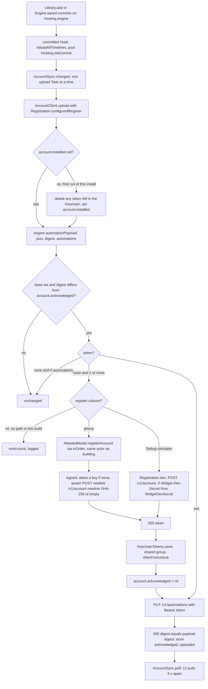
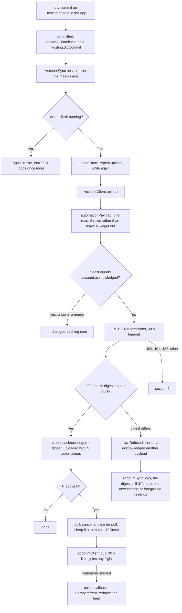
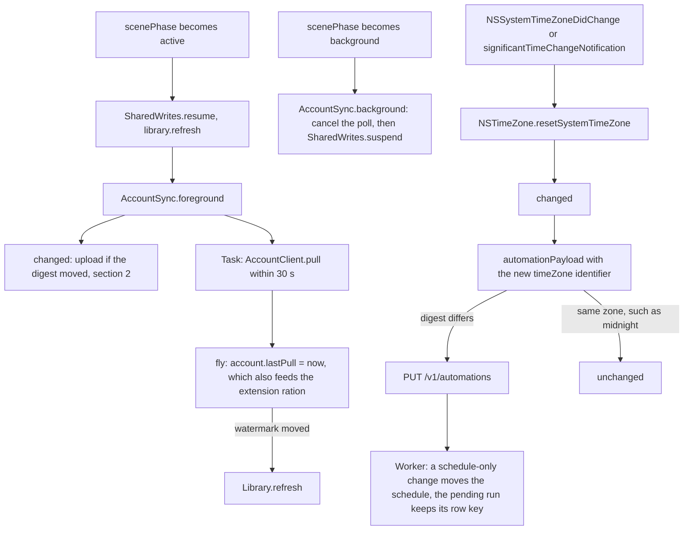
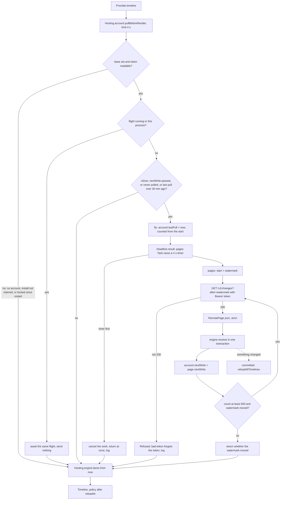
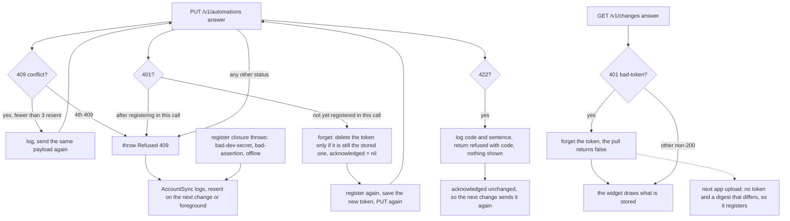

# PR 26: the phone registers, uploads its automations, and the widget pulls its rows

Branch `phase-3-p4-app` into `phase-3-p3-runner` (PR 25). This is P4 of [tasks/phase-3-ai-block.md](../../tasks/phase-3-ai-block.md) (see its "P4 results" note, line 170). P2 gave the Worker accounts, the upload, and the pull; P3 made it run automations and write rows. Until now the phone never asked: the app did not register, never told the server about its automations, and the widget never pulled. This PR is that phone half. Nothing is deployed: the simulator run against `dev` (the last P4 box, line 168) is the user's, after deploying.

Background reading: [WIRE.md](../engine/WIRE.md) "A page" (line 61, with the 500 limit now named at line 75 and `nextWrite` at line 76) and "The automation payload" (line 91), [USAGE.md](../engine/USAGE.md) from line 336 (`Hosting.account`), the plan's "Account and credential" (line 84), and [PR 24's guide](24-phase-3-p2-worker.md) on `origin/phase-3-p2-worker` for the server side of each route.

## Core changes

- **One account client both processes share.** [Account.swift](../../Engine/Sources/WidgetHosting/Account.swift) adds `AccountClient` in `WidgetHosting`, reached as `Hosting.account`: the token, the pull, the upload, and `HTTPTransport` (which replaces the app's own `Transport` in `AttestedModel`). `WidgetHosting` may now import Security, Synchronization, and os ([MODULES.md:37](../engine/MODULES.md)). Registering stays in the app, which passes `upload` a closure, since only the app holds the App Attest key.
- **The token in a shared Keychain group.** `keychain-access-groups` holds `$(AppIdentifierPrefix)dev.krutikpatel.widgie.shared` (`WIDGIE_KEYCHAIN_GROUP`) in both app entitlement files and the extension's, and both Info.plist files name it as `WidgieKeychainGroup`. The item is `kSecAttrAccessibleAfterFirstUnlock`, so the extension can pull while the phone is locked. No portal or capability change was needed (the team profile allows `Z23KXVBB26.*`).
- **A fresh-install marker.** `account.installed` in the App Group's defaults. `token` reads nil until it is set, and only the app sets it (`claimInstall`, the first step of every upload), deleting a token an earlier install left in the Keychain.
- **Registration on first need.** The first upload whose payload names an automation registers: a phone with `AttestedModel.registerAccount()` (the B2 key, `POST /v1/account` with an empty body), a Debug simulator build with the `X-Widgie-Dev-Secret` header. [Registration.swift](../../App/Widgie/Account/Registration.swift) picks the path.
- **The Debug dev secret.** The simulator cannot attest, so a Debug build registers with the dev Worker's `DEV_REGISTRATION_SECRET`. The Debug build phase writes it into the built Info.plist as `WidgieDevSecret` from the build setting `WIDGIE_DEV_SECRET`, which comes from either of:

  ```sh
  # 1. A git-ignored file the tracked App/Debug.xcconfig includes with #include?
  #    (works from Xcode too; avoid "//" in the value, which an xcconfig reads as a comment)
  echo 'WIDGIE_DEV_SECRET = <the dev Worker DEV_REGISTRATION_SECRET>' > App/Secrets.xcconfig
  App/scripts/build            # runs xcodegen generate, which attaches Debug.xcconfig

  # 2. The environment of xcodebuild (command-line builds only)
  WIDGIE_DEV_SECRET=<secret> App/scripts/build
  ```

  Without either, the simulator has no way to register and the upload returns `.noAccount`. A Release build has no key even with the setting given (the script exits outside Debug, and `Registration.configured` reads nil outside `#if DEBUG`), and a phone never sends it.
- **An upload whenever the payload may have moved.** `Hosting.engine`'s commit hook now posts `Hosting.didCommit` beside the WidgetKit reload. The app's [AccountSync.swift](../../App/Widgie/Account/AccountSync.swift) uploads on every `didCommit`, on foreground, and on `NSSystemTimeZoneDidChange` and the significant time change. The client sends only when the digest differs from `account.acknowledged`, so a tap's commit costs one payload read.
- **Server answers.** A 409 is sent again up to three times; a 422 is logged and returned as `.refused(code)`, nothing shown; a 401 drops the token (only while it is still the stored one) and the acknowledged digest, and registers once; anything else throws, and the next change or foreground sends it again.
- **The pull before a render.** `Provider.timeline` awaits `Hosting.account.pullBeforeRender()` before `faces`: only with a token and when due (last pull started over 30 minutes ago, or `nextWrite` passed), one flight per process that a second render joins, with a hard 4 s deadline that cancels the requests and does not wait for them. Any failure renders what is stored.
- **The app pulls** on foreground (30 s limit), and every 5 s for 60 s after an upload that names an automation, so a refine's new row shows within the minute.
- **Paging.** `RemotePage.count` and `RemotePage.limit` (500) are added; the pull asks again while full pages arrive and the watermark moves. [WIRE.md:75](../engine/WIRE.md) names the limit.
- **Engine surface.** `AutomationPayload.automations` (how many automations the payload names) from `RowStore.automationPayload`'s new `count`.
- **The Worker URL moved** to the project-level `configs` so the extension's Info.plist names `WidgieModelService` too: dev in Debug, production in Release.
- **Tests.** 20 engine tests in [AccountTests.swift](../../Engine/Tests/EngineTests/AccountTests.swift) against a scripted Worker; 12 app test cases in [AccountSyncTests.swift](../../App/WidgieTests/AccountSyncTests.swift) (`AccountSyncTests` and `RegistrationTests`, including a round trip through the simulator's real Keychain) and two new ones in [AttestedModelTests.swift](../../App/WidgieTests/AttestedModelTests.swift).

## 1. The first automation saved: registering an account

The person adds a template or saves a widget with an automation. The commit reaches `AccountSync`, the upload finds no token and a payload that names an automation, and registers on this build's path before the first `PUT`.



Files:

- [Account.swift:181](../../Engine/Sources/WidgetHosting/Account.swift#L181): `upload`. `claimInstall` at line 182 (defined at line 93), the digest guard at line 184, no registration without an automation at line 186, registering and saving the token at lines 193 to 203. [Account.swift:87](../../Engine/Sources/WidgetHosting/Account.swift#L87): `token`, nil until the install is claimed.
- [Account.swift:258](../../Engine/Sources/WidgetHosting/Account.swift#L258): `KeychainTokens`, `kSecAttrAccessibleAfterFirstUnlock` at line 283. [Account.swift:306](../../Engine/Sources/WidgetHosting/Account.swift#L306): `AccountState`, the App Group keys at lines 313 to 331.
- [Registration.swift:15](../../App/Widgie/Account/Registration.swift#L15): `path` (simulator or phone). [Registration.swift:26](../../App/Widgie/Account/Registration.swift#L26): `configured`, the `#if DEBUG` read of `WidgieDevSecret`. [Registration.swift:48](../../App/Widgie/Account/Registration.swift#L48): `register`, the dev request at line 52.
- [AttestedModel.swift:73](../../App/Widgie/Describe/AttestedModel.swift#L73): `registerAccount`. [AttestedModel.swift:83](../../App/Widgie/Describe/AttestedModel.swift#L83): `inOrder`, now shared with `reply`. [AttestedModel.swift:99](../../App/Widgie/Describe/AttestedModel.swift#L99): `signed`, the route-generic body of the old `signedReply`. [AttestedModel.swift:228](../../App/Widgie/Describe/AttestedModel.swift#L228): `clientDataHash` with the path.
- [ModelService.swift:24](../../App/Widgie/Describe/ModelService.swift#L24): `attested`, the one `AttestedModel` building and registering share. [ModelService.swift:44](../../App/Widgie/Describe/ModelService.swift#L44): `service`, now internal.
- [Hosting.swift:23](../../Engine/Sources/WidgetHosting/Hosting.swift#L23): `Hosting.account` from `WidgieModelService`, `WidgieKeychainGroup`, and `EngineAppGroup`.
- [project.yml:19](../../App/project.yml#L19): `WIDGIE_KEYCHAIN_GROUP`. [project.yml:22](../../App/project.yml#L22): `WIDGIE_MODEL_SERVICE` per config. [project.yml:82](../../App/project.yml#L82): the Debug phase writing `WidgieDevSecret`. [project.yml:107](../../App/project.yml#L107): `configFiles` attaching [Debug.xcconfig](../../App/Debug.xcconfig) (its `#include?` at line 7). [project.yml:133](../../App/project.yml#L133): the extension's entitlement and Info.plist keys. [.gitignore](../../.gitignore): `App/Secrets.xcconfig`.
- Entitlements: [Widgie-Debug.entitlements:11](../../App/Widgie/Widgie-Debug.entitlements#L11), [Widgie-Release.entitlements:11](../../App/Widgie/Widgie-Release.entitlements#L11), [WidgieWidgets.entitlements:9](../../App/WidgieWidgets/WidgieWidgets.entitlements#L9).
- Tests: [AccountTests.swift:152](../../Engine/Tests/EngineTests/AccountTests.swift#L152) (no automation sends nothing), line 159 (the first automation registers and uploads), line 174 (a build that cannot register), line 238 (the first upload discards a token an earlier install left). [AccountSyncTests.swift:104](../../App/WidgieTests/AccountSyncTests.swift#L104) (phone and simulator path selection, the dev request, the real Keychain's group and accessibility at line 142). [AttestedModelTests.swift:145](../../App/WidgieTests/AttestedModelTests.swift#L145) (registering signs the account route with the same key, and replaces an unknown key at line 157).

Key decisions:

- **Register on first need, not on launch.** A person who never adds an automation never gets an account, and the server never holds an empty one. Removing the last automation still uploads (an account exists, so the empty payload is news).
- **The token, not App Attest, guards sync.** The extension has no attest key, so App Attest names the account once and the token does the rest (the plan's "Account and credential").
- **One `AttestedModel` for building and registering.** Both go through the same `inOrder`, so assertions reach the server in counter order and B2's rising-counter check never refuses a registration that raced a build.
- **The fresh-install marker lives in the App Group, and only the app claims it.** The Keychain outlives an uninstall while the App Group does not, so without the marker a reinstall would reuse a dead install's token. Because only the app claims, the extension never races the first registration, and a phone locked since its restart (whose App Group reads as unset) never loses its token.
- **Side effect worth knowing:** an item saved without a group goes to the first listed group, so a new App Attest key id from B2's `KeychainStore` now lands in the shared group. Its reads search every group, so nothing behaves differently.
- **The dev secret is two-way closed.** The server takes it only on `dev` (PR 24), and the phone carries it only in a Debug simulator build. The secret does sit in plain text in a Debug build's Info.plist; it only ever opens `dev`.
- **A reviewer might ask why the simulator does not fall back to App Attest or the bridge.** The simulator cannot attest, and the bridge has no accounts, so with no secret there is honestly no account (`.noAccount`, logged).

## 2. Any store commit: the upload

Every write `Hosting.engine` commits in the app may have moved the payload, whichever it was: a save, a refinement, a template added, a delete, a restore, a bind, a tap, or a pull's merge. `AccountSync` turns each into at most one `PUT`, and only when the digest moved.



Files:

- [Hosting.swift:15](../../Engine/Sources/WidgetHosting/Hosting.swift#L15): `engine` with `onCommit: committed`. [Hosting.swift:19](../../Engine/Sources/WidgetHosting/Hosting.swift#L19): `didCommit`. [Hosting.swift:69](../../Engine/Sources/WidgetHosting/Hosting.swift#L69): `committed`, the reload and the post.
- [AccountSync.swift:36](../../App/Widgie/Account/AccountSync.swift#L36): `init`, the observers from line 48. [AccountSync.swift:85](../../App/Widgie/Account/AccountSync.swift#L85): `changed`, the `again` loop at lines 87 to 94. [AccountSync.swift:104](../../App/Widgie/Account/AccountSync.swift#L104): `upload`, polling only after `.uploaded` with automations. [AccountSync.swift:114](../../App/Widgie/Account/AccountSync.swift#L114): `poll`, the `polls` counter so an ended poll never clears its replacement.
- [Account.swift:184](../../Engine/Sources/WidgetHosting/Account.swift#L184): the digest guard. [Account.swift:213](../../Engine/Sources/WidgetHosting/Account.swift#L213): the 200 case and the digest check.
- [WidgieApp.swift:12](../../App/Widgie/WidgieApp.swift#L12): `AccountSync` made with `pulled: { library.refresh() }`. [Library.swift:54](../../App/Widgie/Library.swift#L54): `refresh`.
- [RowStore.swift:345](../../Engine/Sources/Rows/RowStore.swift#L345): `automationPayload` now returns `count`. [Engine.swift:325](../../Engine/Sources/WidgetEngine/Engine.swift#L325) and [Public.swift:163](../../Engine/Sources/WidgetEngine/Public.swift#L163): `AutomationPayload.automations`.
- Tests: [AccountSyncTests.swift:16](../../App/WidgieTests/AccountSyncTests.swift#L16) (an upload after a template add, a refinement, a save, a restore, and a delete, none after a commit that moves nothing, and one registration), line 77 (12 pulls 5 s apart after an upload with an automation, none after one without). [AccountTests.swift:181](../../Engine/Tests/EngineTests/AccountTests.swift#L181) (removing the last automation is sent), line 215 (a failed upload is sent again next time).

Key decisions:

- **Upload on the commit hook, not at each call site.** Every write that can move the payload is covered, including ones the app gains later (restore and roll back have no UI on the shared store today, and `rollBack` runs only on scratch engines). The cost is one payload read per commit, a tap included, which is why the digest is compared before anything is sent.
- **Replace-all plus a digest means no outbox.** The phone keeps no queue of pending changes: the next upload sends the whole current payload, and `account.acknowledged` says whether the server has it. A failed upload is retried by the next change or foreground, never by a timer.
- **One upload at a time, coalesced.** A change during an upload sets `again`, so the latest payload always goes out last and two `PUT`s of one account never race from one phone.
- **The server's digest must equal ours,** or the upload throws. That is the server telling us it holds another payload, so the acknowledged digest is not moved.
- **"Names an automation" stands in for "a run started".** The upload's answer does not say whether the server scheduled a run now, but every upload that names an automation changed something the server runs (unchanged payloads are never sent), and a new schedule task is due at once. So 12 pulls over 60 s catch the row. A reviewer might question the cost: up to 12 cheap pulls after a refine, none after an upload with no automations, all stopped on background.
- **In the app, a pull's merge commits too,** so it posts `didCommit` and costs one payload read that finds the digest unchanged.

## 3. App foreground and a time zone change

Coming to the foreground sends what the server lacks and takes in what it wrote. A time zone or clock change re-reads the zone and uploads, since the payload names the phone's zone.



Files:

- [WidgieApp.swift:27](../../App/Widgie/WidgieApp.swift#L27): `account.background()` before `SharedWrites.suspend()`. [WidgieApp.swift:32](../../App/Widgie/WidgieApp.swift#L32): `account.foreground()` after `library.refresh()`.
- [AccountSync.swift:48](../../App/Widgie/Account/AccountSync.swift#L48): the three notifications, `resetSystemTimeZone` at line 56 for the two that are not `didCommit`. [AccountSync.swift:70](../../App/Widgie/Account/AccountSync.swift#L70): `foreground`. [AccountSync.swift:78](../../App/Widgie/Account/AccountSync.swift#L78): `background`.
- [Account.swift:121](../../Engine/Sources/WidgetHosting/Account.swift#L121): `pull` with `appLimit` (line 56), `lastPull` set at line 131.
- Server side: PR 24's guide, section 2 (the `schedule` kind of change).
- Tests: [AccountSyncTests.swift:46](../../App/WidgieTests/AccountSyncTests.swift#L46) (a time zone change and a clock change upload when the payload differs), line 58 (a failed upload sent on foreground, a second foreground sends nothing, each foreground pulls), line 89 (the background stops the pulls).

Key decisions:

- **Foreground both uploads and pulls,** in parallel. The upload covers an upload that failed while the app was open; the pull covers rows written while it was closed.
- **The zone is reset before the payload is read.** Foundation caches the system zone until told it moved, and the engine reads the current zone, so without `resetSystemTimeZone` the upload would send the old zone.
- **The significant time change is observed too.** It fires at midnight and on clock changes, and iOS delivers it on return to the foreground when it happened while suspended. Most of the time the digest is unchanged and nothing is sent.
- **The app's pull counts for the extension's ration,** since both write `account.lastPull` in the App Group, so a widget render right after opening the app does not pull again.
- **A reviewer might ask what happens if the phone changes zone and the app is never opened.** Only the app uploads (the extension never claims the install or registers), so the server keeps scheduling in the old zone until the next foreground or commit in the app. The extension still draws every row it receives at its own `at`.

## 4. The widget timeline render: the pull before `faces`

WidgetKit asks the extension for a timeline. When a pull is due, the extension takes in what the server wrote first, so this render draws it, and never waits more than 4 s.



Files:

- [Hosting.swift:178](../../Engine/Sources/WidgetHosting/Hosting.swift#L178): `timeline`, the pull at line 181. `snapshot` (line 172) does not pull.
- [Account.swift:104](../../Engine/Sources/WidgetHosting/Account.swift#L104): `pullBeforeRender`, the guard at line 106. [Account.swift:111](../../Engine/Sources/WidgetHosting/Account.swift#L111): `isDue`. [Account.swift:121](../../Engine/Sources/WidgetHosting/Account.swift#L121): `pull`, joining the flight. [Account.swift:128](../../Engine/Sources/WidgetHosting/Account.swift#L128): `fly`. [Account.swift:147](../../Engine/Sources/WidgetHosting/Account.swift#L147): `pages`, `receive` at line 165, the paging rule at line 168.
- [Account.swift:352](../../Engine/Sources/WidgetHosting/Account.swift#L352): `Deadline.result`, the timer and the `Once` continuation the first racer resumes. [Account.swift:54](../../Engine/Sources/WidgetHosting/Account.swift#L54): `renderLimit`, `appLimit`, `ration`.
- [Public.swift:150](../../Engine/Sources/WidgetEngine/Public.swift#L150): `RemotePage.count` and `limit` (line 153). [Engine.swift:296](../../Engine/Sources/WidgetEngine/Engine.swift#L296): `receive` (P1, unchanged).
- [WIRE.md:75](../engine/WIRE.md#L75): the 500 limit. [USAGE.md:336](../engine/USAGE.md#L336): `Hosting.account` and what it hides.
- Tests: [AccountTests.swift:11](../../Engine/Tests/EngineTests/AccountTests.swift#L11) (no token), line 19 (an unclaimed install pulls nothing and keeps the token), line 26 (a due pull merges and records the ration), line 40 (at most every 30 minutes), line 51 (`nextWrite` passed), line 63 (500, offline, a bad page, and 401 still render the stored face), line 87 (a request that ignores cancellation ends at the deadline), line 100 (two renders share one pull), line 118 (full pages are pulled until one is short).

Key decisions:

- **The deadline is hard, not an idle timeout.** `getTimeline` has no published limit, so the pull holds to its own: the result races a timer, and on time-out the requests are cancelled and the render goes on without waiting for them to notice. `URLRequest`'s timeout would only bound idleness, and the test at line 87 proves a request that ignores cancellation cannot hold the render.
- **Each attempt's start counts for the ration,** success or not, so a phone that cannot reach the server does not try at every render.
- **`nextWrite` can make a pull due early,** and the server never names a time sooner than 5 minutes after the pull (WIRE.md line 76), so a waiting task cannot make every render pull.
- **One flight per process, and a render arriving meanwhile joins it,** so it draws what the pull brings instead of racing it or sending a second request.
- **Paging stops on a short page or a watermark that did not move,** so a page held back for a far-future stamp (P1's rule) cannot loop.
- **Nothing a pull does can fail the render.** No token before the first unlock, no network, a 5xx, a page that does not decode, or a 401 all fall through to `faces` on what is stored.
- **A pull that merged rows reloads every timeline** through the existing commit hook, so other placed widgets redraw too. Those renders find the ration just reset and do not pull again; while the flight is still running they join it.
- **Only `timeline` pulls.** `snapshot`, which WidgetKit asks for the gallery and quick previews, draws what is stored, as before.

## 5. A 401, 409, or 422 from the server

The routes answer with the Worker's `{error, code}` body ([index.ts:55](../../Backend/src/index.ts#L55)): 401 `bad-token`, 409 `conflict`, and 422 with `too-many-on-widget`, `prompt-too-long`, or `too-many-fields`. A refused registration surfaces through the closure.



Files:

- [Account.swift:221](../../Engine/Sources/WidgetHosting/Account.swift#L221): the 409 case, `conflictRetries` at line 60. [Account.swift:224](../../Engine/Sources/WidgetHosting/Account.swift#L224): the 401 case. [Account.swift:227](../../Engine/Sources/WidgetHosting/Account.swift#L227): the 422 case. [Account.swift:239](../../Engine/Sources/WidgetHosting/Account.swift#L239): `forget`, the stored-token check. [Account.swift:161](../../Engine/Sources/WidgetHosting/Account.swift#L161): the pull's `bad-token`. [Account.swift:32](../../Engine/Sources/WidgetHosting/Account.swift#L32): `Refused`, read from the Worker's body.
- [Registration.swift:52](../../App/Widgie/Account/Registration.swift#L52): the dev path throws `Refused` on a non-200. [AttestedModel.swift:99](../../App/Widgie/Describe/AttestedModel.swift#L99): `signed` replaces an `unknown-key` once before failing (B2's rule, now shared by registration).
- [AccountSync.swift:104](../../App/Widgie/Account/AccountSync.swift#L104): where every thrown upload is logged.
- Tests: [AccountTests.swift:190](../../Engine/Tests/EngineTests/AccountTests.swift#L190) (409 three times, then refused), line 206 (422 returned and sent again next time), line 224 (401 registers once, and a new account the server refuses is not registered again), line 137 (a pull's 401 drops the token unless a newer one was saved meanwhile). [AccountSyncTests.swift:126](../../App/WidgieTests/AccountSyncTests.swift#L126) (`bad-dev-secret` comes back as the code).

Key decisions:

- **A 401 means the account is gone,** such as deleted after 90 idle days (PR 24's upkeep) or a reset database. The phone forgets the token and the acknowledged digest and registers a fresh account; the upload then recreates every automation there, and the server runs each at once. Rows already on the phone stay.
- **Forget only the token that was refused.** The app may have registered a new token while the extension's request with the old one was in flight; deleting unconditionally would throw the new account away. Both the pull and the upload use the same check.
- **Register at most once per upload.** A second 401 right after registering is not a dead account but something broken, so it throws instead of making accounts in a loop.
- **409 is resent at once, three times, with no backoff.** A conflict means another upload of this account landed between the server's read and its batch. With one upload at a time per phone, that is rare, and the replace-all payload is the latest one, so resending is always right.
- **422 is logged, not shown.** The engine enforces the same three limits before a widget is saved, so a 422 means the phone and the server disagree (version skew), which the person cannot fix. A reviewer might question showing nothing: the widget keeps its stored rows and the server keeps its previous automations, and the upload is sent again on the next change, so an app update that fixes the skew heals it.
- **The pull treats every failure the same for the render,** and only `bad-token` changes state. A 401 from the pull does not register, since only the app can; the next app upload does, because forgetting also cleared the acknowledged digest.
