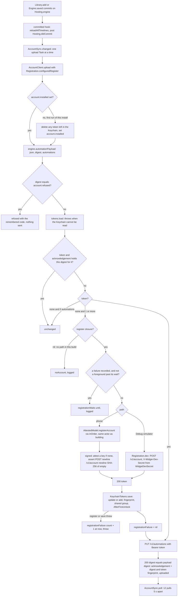
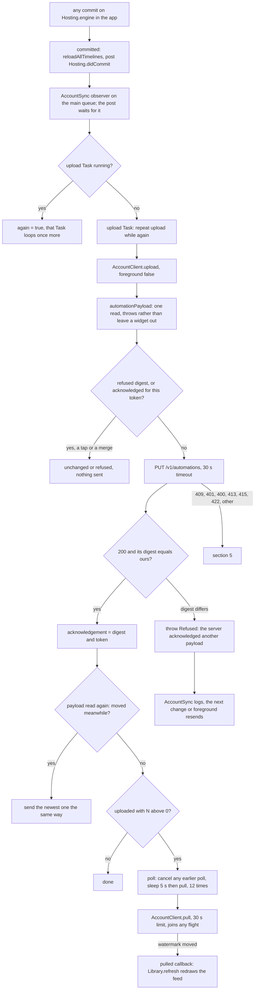
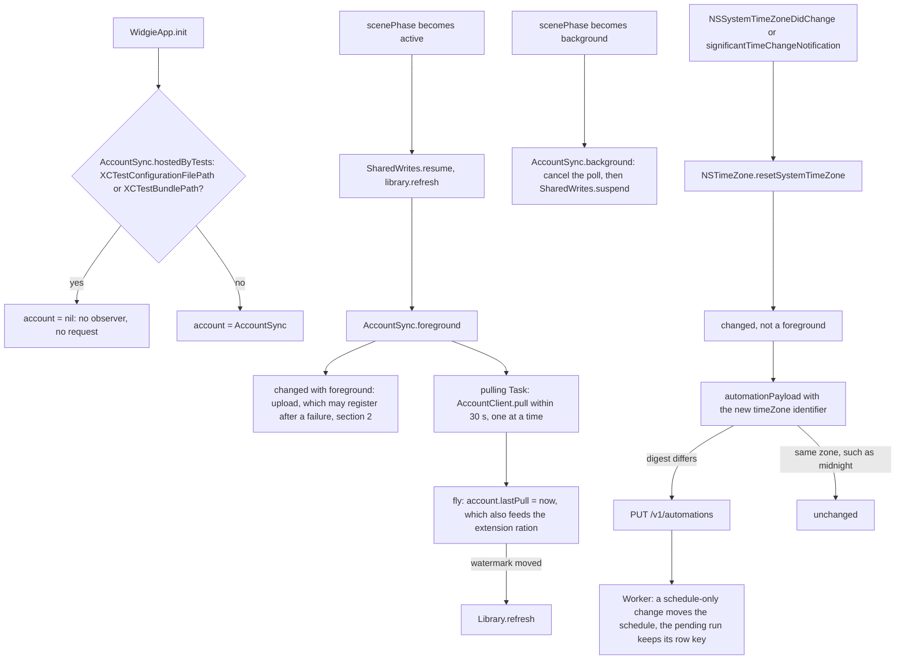
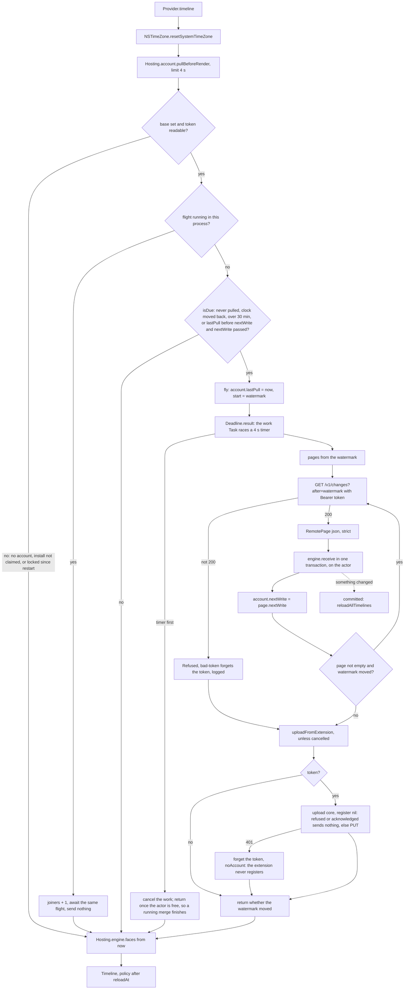
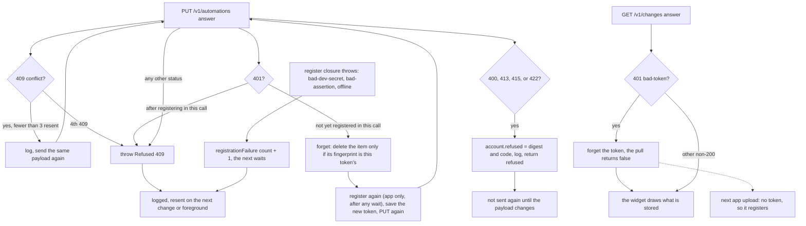

# PR 26: the phone registers, uploads its automations, and the widget pulls its rows

Branch `phase-3-p4-app` into `phase-3-p3-runner` (PR 25). This is P4 of [tasks/phase-3-ai-block.md](../../tasks/phase-3-ai-block.md) (see its "P4 results" note, line 170). P2 gave the Worker accounts, the upload, and the pull; P3 made it run automations and write rows. Until now the phone never asked: the app did not register, never told the server about its automations, and the widget never pulled. This PR is that phone half. Nothing is deployed: the simulator run against `dev` (the last P4 box, line 168) is the user's, after deploying.

Background reading: [WIRE.md](../engine/WIRE.md) "A page" (line 61, the paging rule at line 75 and `nextWrite` at line 76) and "The automation payload" (line 91), [USAGE.md](../engine/USAGE.md) from line 336 (`Hosting.account`), the plan's "Account and credential" (line 84), and [PR 24's guide](24-phase-3-p2-worker.md) on `origin/phase-3-p2-worker` for the server side of each route.

## Core changes

- **One account client both processes share.** [Account.swift](../../Engine/Sources/WidgetHosting/Account.swift) adds `AccountClient` in `WidgetHosting`, reached as `Hosting.account`: the token, the pull, the upload, and `HTTPTransport` (which replaces the app's own `Transport` in `AttestedModel`). `WidgetHosting` may now import Security, CryptoKit, Synchronization, and os, and its public column lists the account types ([MODULES.md:38](../engine/MODULES.md)). Registering stays in the app, which passes `upload` a closure, since only the app holds the App Attest key.
- **The token in a shared Keychain group.** `keychain-access-groups` holds `$(AppIdentifierPrefix)dev.krutikpatel.widgie.shared` (`WIDGIE_KEYCHAIN_GROUP`) in both app entitlement files and the extension's, and both Info.plist files name it as `WidgieKeychainGroup`. The item is `kSecAttrAccessibleAfterFirstUnlock`, so the extension can pull while the phone is locked, and keeps the token's SHA-256 in `kSecAttrGeneric`, so a forgotten token is deleted only while it is still the stored one, in one Keychain call. A save updates the item, or adds it when there is none. No portal or capability change was needed (the team profile allows `Z23KXVBB26.*`).
- **A fresh-install marker.** `account.installed` in the App Group's defaults. `token` reads nil until it is set, and only the app sets it (`claimInstall`, the first step of every app upload), deleting a token an earlier install left in the Keychain.
- **Registration on first need, with a wait after a failure.** The first upload whose payload names an automation registers: a phone with `AttestedModel.registerAccount()` (the B2 key, `POST /v1/account` with an empty body), a Debug simulator build with the `X-Widgie-Dev-Secret` header. [Registration.swift](../../App/Widgie/Account/Registration.swift) picks the path. After a failure, including a token that could not be saved, only a foreground registers, once a wait of a minute, doubling with each failure in a row up to six hours, has passed.
- **The Debug dev secret.** The simulator cannot attest, so a Debug simulator build registers with the dev Worker's `DEV_REGISTRATION_SECRET`. The Debug build phase writes it into the built Info.plist as `WidgieDevSecret` from the build setting `WIDGIE_DEV_SECRET`, only when `PLATFORM_NAME` is `iphonesimulator`, quoted, and with the script's environment kept out of the build log. The setting comes from either of:

  ```sh
  # 1. A git-ignored file the tracked App/Debug.xcconfig includes with #include?
  #    (works from Xcode too; "//" in an xcconfig value starts a comment, so use a hex secret)
  echo 'WIDGIE_DEV_SECRET = <the dev Worker DEV_REGISTRATION_SECRET>' > App/Secrets.xcconfig
  App/scripts/build            # runs xcodegen generate, which attaches Debug.xcconfig

  # 2. The environment of xcodebuild (command-line builds only)
  WIDGIE_DEV_SECRET=<secret> App/scripts/build
  ```

  Without either, the simulator has no way to register and the upload returns `.noAccount`. A Release build has no key even with the setting given (the script exits outside Debug, and `Registration.configured` reads nil outside `#if DEBUG`), a build for a phone has none either (checked with the setting given), and a phone never sends it.
- **An upload whenever the payload may have moved.** `Hosting.engine`'s commit hook now posts `Hosting.didCommit` beside the WidgetKit reload. The app's [AccountSync.swift](../../App/Widgie/Account/AccountSync.swift) uploads on every `didCommit`, on foreground, and on `NSSystemTimeZoneDidChange` and the significant time change. The client sends unless the server acknowledged this digest for this token (`account.acknowledgement`), so a tap's commit costs one payload read and a lost token is replaced. After a 200 it reads the payload again and sends that too when a commit moved it meanwhile, so the newest payload lands last whichever process sent the older one.
- **Server answers.** A 409 is sent again up to three times; a payload refused for what it holds (400, 413, 415, 422) is remembered with its digest and not sent again until it changes; a 401 drops the token (only while it is still the stored one) and registers once; anything else throws, and the next change or foreground sends it again.
- **The flight before a render.** `Provider.timeline` resets Foundation's cached zone and awaits `Hosting.account.pullBeforeRender()` before `faces`: only with a token and when due (last pull started over 30 minutes ago, `nextWrite` passed since it started, or the clock moved back), one flight per process that a second render joins. The flight pulls, then uploads the payload when the server lacks it, never registering, so a zone the phone moved to with the app closed reaches the server. The 4 s deadline is hard for the network and lets a merge already running finish. Any failure renders what is stored.
- **The app pulls** on foreground (30 s limit), and every 5 s for 60 s after an upload that names an automation, so a refine's new row shows within the minute.
- **Paging.** `RemotePage.count` is added; the pull asks again from the new watermark until a page comes back empty or leaves the watermark where it was. The phone never assumes the server's page size ([WIRE.md:75](../engine/WIRE.md)).
- **Engine surface.** `AutomationPayload.automations` (how many automations the payload names) from `RowStore.automationPayload`'s new `count`.
- **The Worker URL moved** to the project-level `configs` so the extension's Info.plist names `WidgieModelService` too: dev in Debug, production in Release.
- **Hosted tests make no sync.** The app starts no `AccountSync` when it hosts its unit tests (`AccountSync.hostedByTests`), so a test run never reaches the dev Worker.
- **Tests.** 32 engine tests in [AccountTests.swift](../../Engine/Tests/EngineTests/AccountTests.swift) against a scripted Worker; 15 app test cases in [AccountSyncTests.swift](../../App/WidgieTests/AccountSyncTests.swift) (`AccountSyncTests` and `RegistrationTests`, including round trips through the simulator's real Keychain) and two new ones in [AttestedModelTests.swift](../../App/WidgieTests/AttestedModelTests.swift). The tests wait on conditions, never on a fixed sleep.

## 1. The first automation saved: registering an account

The person adds a template or saves a widget with an automation. The commit reaches `AccountSync`, the upload finds no token and a payload that names an automation, and registers on this build's path before the first `PUT`.



Files:

- [Account.swift:244](../../Engine/Sources/WidgetHosting/Account.swift#L244): the app's `upload`, `claimInstall` first (defined at line 119). [Account.swift:249](../../Engine/Sources/WidgetHosting/Account.swift#L249): the shared core: the refused digest at line 251, the Keychain read that throws at line 253, the acknowledgement for this token at line 254, no registration without an automation at line 255, the wait at line 267, registering and saving the token inside one failure count at line 276. [Account.swift:329](../../Engine/Sources/WidgetHosting/Account.swift#L329): `registrationWait`, the doubling and the cap (`registrationWait` and `registrationWaitMost` at line 80). [Account.swift:110](../../Engine/Sources/WidgetHosting/Account.swift#L110): `token`, nil until the install is claimed.
- [Account.swift:349](../../Engine/Sources/WidgetHosting/Account.swift#L349): `Acknowledgement` and `tokenFingerprint` (line 366). [Account.swift:389](../../Engine/Sources/WidgetHosting/Account.swift#L389): `KeychainTokens`, `load` throwing at line 404, `save` updating or adding at line 418. [Account.swift:463](../../Engine/Sources/WidgetHosting/Account.swift#L463): `AccountState`, the acknowledgement as one dictionary at line 486, `refused` at line 501, `registrationFailure` at line 514.
- [Registration.swift:15](../../App/Widgie/Account/Registration.swift#L15): `path` (simulator or phone). [Registration.swift:26](../../App/Widgie/Account/Registration.swift#L26): `configured`, the `#if DEBUG` read of `WidgieDevSecret`. [Registration.swift:48](../../App/Widgie/Account/Registration.swift#L48): `register`, the dev request at line 52.
- [AttestedModel.swift:73](../../App/Widgie/Describe/AttestedModel.swift#L73): `registerAccount`. [AttestedModel.swift:83](../../App/Widgie/Describe/AttestedModel.swift#L83): `inOrder`, now shared with `reply`. [AttestedModel.swift:99](../../App/Widgie/Describe/AttestedModel.swift#L99): `signed`, the route-generic body of the old `signedReply`. [AttestedModel.swift:228](../../App/Widgie/Describe/AttestedModel.swift#L228): `clientDataHash` with the path.
- [ModelService.swift:24](../../App/Widgie/Describe/ModelService.swift#L24): `attested`, the one `AttestedModel` building and registering share.
- [Hosting.swift:23](../../Engine/Sources/WidgetHosting/Hosting.swift#L23): `Hosting.account` from `WidgieModelService`, `WidgieKeychainGroup`, and `EngineAppGroup`.
- [project.yml:19](../../App/project.yml#L19): `WIDGIE_KEYCHAIN_GROUP`. [project.yml:22](../../App/project.yml#L22): `WIDGIE_MODEL_SERVICE` per config. [project.yml:75](../../App/project.yml#L75): the Debug phase, `showEnvVars: false` at line 78 and the simulator-only, quoted `WidgieDevSecret` at line 90. [project.yml:109](../../App/project.yml#L109): `configFiles` attaching [Debug.xcconfig](../../App/Debug.xcconfig) (the `//` note at line 6, `#include?` at line 9). [project.yml:135](../../App/project.yml#L135): the extension's entitlement. [.gitignore](../../.gitignore): `App/Secrets.xcconfig`.
- Entitlements: [Widgie-Debug.entitlements:11](../../App/Widgie/Widgie-Debug.entitlements#L11), [Widgie-Release.entitlements:11](../../App/Widgie/Widgie-Release.entitlements#L11), [WidgieWidgets.entitlements:9](../../App/WidgieWidgets/WidgieWidgets.entitlements#L9).
- Tests: [AccountTests.swift:241](../../Engine/Tests/EngineTests/AccountTests.swift#L241) (no automation sends nothing), line 248 (the first automation registers and uploads), line 265 (a lost token is replaced though the digest was acknowledged), line 277 (an unreadable token fails without registering), line 285 (a token that cannot be saved fails before the `PUT` and counts as a failure), line 312 (a build that cannot register), line 384 (the doubling wait, a change never registering, a foreground before the wait), line 411 (the six-hour cap), line 421 (the first upload discards a token an earlier install left). [AccountSyncTests.swift:79](../../App/WidgieTests/AccountSyncTests.swift#L79) (through `AccountSync`: only a foreground after the wait registers again). [AccountSyncTests.swift:136](../../App/WidgieTests/AccountSyncTests.swift#L136) (phone and simulator path selection, the dev request, the real Keychain at line 174, a token saved without a fingerprint at line 211). [AttestedModelTests.swift:145](../../App/WidgieTests/AttestedModelTests.swift#L145) (registering signs the account route with the same key, and replaces an unknown key at line 157).

Key decisions:

- **Register on first need, not on launch.** A person who never adds an automation never gets an account, and the server never holds an empty one. Removing the last automation still uploads (an account exists, so the empty payload is news).
- **The token, not App Attest, guards sync.** The extension has no attest key, so App Attest names the account once and the token does the rest (the plan's "Account and credential").
- **One `AttestedModel` for building and registering.** Both go through the same `inOrder`, so assertions reach the server in counter order and B2's rising-counter check never refuses a registration that raced a build.
- **A failed registration waits for a foreground and a doubling delay.** `AttestedModel` discards a key whose attestation failed for any reason but Apple's service being down, so a failing `/v1/account` retried on every commit would make a new App Attest key each time. A foreground is a person opening the app; the delay keeps repeated opens from doing the same. A token that could not be saved counts as a failure too: otherwise every change would register an account nobody can reach.
- **The acknowledgement names its token.** It is the digest plus the token's SHA-256, in one defaults entry so the other process never reads a mixed pair. A token lost from the Keychain is replaced whatever the server held, and a new token always sends the payload to its account. A token that is there but cannot be read fails the upload instead, so a readable-later token is never orphaned by a second registration.
- **The fresh-install marker lives in the App Group, and only the app claims it.** The Keychain outlives an uninstall while the App Group does not, so without the marker a reinstall would reuse a dead install's token. Because only the app claims, the extension never races the first registration, and a phone locked since its restart (whose App Group reads as unset) never loses its token.
- **Side effect worth knowing:** an item saved without a group goes to the first listed group, so a new App Attest key id from B2's `KeychainStore` now lands in the shared group. Its reads search every group, so nothing behaves differently.
- **The dev secret is two-way closed.** The server takes it only on `dev` (PR 24), and the phone carries it only in a Debug build for the simulator. The secret sits in plain text in that build's Info.plist; it only ever opens `dev`, and it never reaches the build log.
- **A reviewer might ask why the simulator does not fall back to App Attest or the bridge.** The simulator cannot attest, and the bridge has no accounts, so with no secret there is honestly no account (`.noAccount`, logged).

## 2. Any store commit: the upload

Every write `Hosting.engine` commits in the app may have moved the payload, whichever it was: a save, a refinement, a template added, a delete, a restore, a bind, a tap, or a pull's merge. `AccountSync` turns each into at most one `PUT`, and only when the server lacks the payload.



Files:

- [Hosting.swift:15](../../Engine/Sources/WidgetHosting/Hosting.swift#L15): `engine` with `onCommit: committed`. [Hosting.swift:19](../../Engine/Sources/WidgetHosting/Hosting.swift#L19): `didCommit`. [Hosting.swift:69](../../Engine/Sources/WidgetHosting/Hosting.swift#L69): `committed`, the reload and the post.
- [AccountSync.swift:49](../../App/Widgie/Account/AccountSync.swift#L49): `init`, the observers at line 66. [AccountSync.swift:104](../../App/Widgie/Account/AccountSync.swift#L104): `changed`, the `again` loop carrying a pending foreground. [AccountSync.swift:122](../../App/Widgie/Account/AccountSync.swift#L122): `settled`, which tests wait on. [AccountSync.swift:126](../../App/Widgie/Account/AccountSync.swift#L126): `upload`, polling only after `.uploaded` with automations. [AccountSync.swift:141](../../App/Widgie/Account/AccountSync.swift#L141): `poll`, the `polls` counter so an ended poll never clears its replacement.
- [Account.swift:254](../../Engine/Sources/WidgetHosting/Account.swift#L254): the acknowledgement check. [Account.swift:295](../../Engine/Sources/WidgetHosting/Account.swift#L295): the 200 case, the digest check, and the second read at line 305.
- [WidgieApp.swift:17](../../App/Widgie/WidgieApp.swift#L17): `AccountSync` made with `pulled: { library.refresh() }`, unless hosting tests.
- [RowStore.swift:345](../../Engine/Sources/Rows/RowStore.swift#L345): `automationPayload` now returns `count`. [Engine.swift:325](../../Engine/Sources/WidgetEngine/Engine.swift#L325) and [Public.swift:161](../../Engine/Sources/WidgetEngine/Public.swift#L161): `AutomationPayload.automations`.
- Tests: [AccountSyncTests.swift:16](../../App/WidgieTests/AccountSyncTests.swift#L16) (an upload after a template add, a refinement, a save, a restore, and a delete, none after a commit that moves nothing, and one registration), line 102 (12 pulls 5 s apart after an upload with an automation, none after one without). [AccountTests.swift:298](../../Engine/Tests/EngineTests/AccountTests.swift#L298) (an upload overtaken by a commit sends the newest payload too), line 319 (removing the last automation is sent), line 360 (a failed upload is sent again next time).

Key decisions:

- **Upload on the commit hook, not at each call site.** Every write that can move the payload is covered, including ones the app gains later (restore and roll back have no UI on the shared store today, and `rollBack` runs only on scratch engines). The cost is one payload read per commit, a tap included, which is why the acknowledgement is checked before anything is sent.
- **Replace-all plus a digest means no outbox.** The phone keeps no queue of pending changes: the next upload sends the whole current payload, and the acknowledgement says whether the server has it. A failed upload is retried by the next change or foreground, never by a timer.
- **One upload at a time in the app, coalesced.** A change during an upload sets `again`, so the latest payload goes out last from the app.
- **The newest payload lands last, whichever process sent the other.** The server keeps the last upload it took, and the extension may read a payload before a commit the app then uploads. Reading the payload again after each 200, and sending it when it moved, means whichever upload lands last is followed by the newest payload.
- **The server's digest must equal ours,** or the upload throws. That is the server telling us it holds another payload, so the acknowledgement is not moved.
- **"Names an automation" stands in for "a run started".** The upload's answer does not say whether the server scheduled a run now, but every upload that names an automation changed something the server runs (unchanged payloads are never sent), and a new schedule task is due at once. So 12 pulls over 60 s catch the row. A reviewer might question the cost: up to 12 cheap pulls after a refine, none after an upload with no automations, all stopped on background.
- **In the app, a pull's merge commits too,** so it posts `didCommit` and costs one payload read that finds the payload acknowledged.

## 3. App foreground and a time zone change

Coming to the foreground sends what the server lacks, registers again if the last attempt failed and its wait has passed, and takes in what the server wrote. A time zone or clock change re-reads the zone and uploads, since the payload names the phone's zone. When the app hosts its unit tests, none of this runs.



Files:

- [WidgieApp.swift:11](../../App/Widgie/WidgieApp.swift#L11): `account`, nil when hosting tests (line 17). [WidgieApp.swift:29](../../App/Widgie/WidgieApp.swift#L29): `account?.background()` before `SharedWrites.suspend()`. [WidgieApp.swift:34](../../App/Widgie/WidgieApp.swift#L34): `account?.foreground()` after `library.refresh()`.
- [AccountSync.swift:28](../../App/Widgie/Account/AccountSync.swift#L28): `hostedByTests`. [AccountSync.swift:66](../../App/Widgie/Account/AccountSync.swift#L66): the three notifications, `resetSystemTimeZone` for the two that are not `didCommit`. [AccountSync.swift:86](../../App/Widgie/Account/AccountSync.swift#L86): `foreground`. [AccountSync.swift:96](../../App/Widgie/Account/AccountSync.swift#L96): `background`.
- [Account.swift:155](../../Engine/Sources/WidgetHosting/Account.swift#L155): `pull` with `appLimit`, `lastPull` set at line 174.
- Server side: PR 24's guide, section 2 (the `schedule` kind of change).
- Tests: [AccountSyncTests.swift:46](../../App/WidgieTests/AccountSyncTests.swift#L46) (a time zone change and a clock change upload when the payload differs), line 58 (a failed upload sent on foreground, a second foreground sends nothing, each foreground pulls), line 79 (a failed registration tried again only on a foreground after its wait), line 114 (the background stops the pulls), line 126 (the test host knows it hosts tests).

Key decisions:

- **Foreground both uploads and pulls,** in parallel. The upload covers an upload that failed while the app was open; the pull covers rows written while it was closed.
- **The zone is reset before the payload is read.** Foundation caches the system zone until told it moved, and the engine reads the current zone, so without `resetSystemTimeZone` the upload would send the old zone.
- **The significant time change is observed too.** It fires at midnight and on clock changes, and iOS delivers it on return to the foreground when it happened while suspended. Most of the time the digest is unchanged and nothing is sent.
- **The app's pull counts for the extension's ration,** since both write `account.lastPull` in the App Group, so a widget render right after opening the app does not pull again.
- **Hosted tests are detected from the environment Xcode gives the host.** Each test builds its own `AccountSync` on a scripted Worker; the host's own would have registered the simulator against the dev Worker on every test run. A test asserts the detection holds inside the real host.
- **A phone that changes zone with the app closed** no longer waits for the app: the extension's next due render uploads the new zone (section 4).

## 4. The widget timeline render: the flight before `faces`

WidgetKit asks the extension for a timeline. When a pull is due, the extension takes in what the server wrote, then sends the payload if the server lacks it, so this render draws the rows and the server learns a moved zone, and waits at most 4 s for the network.



Files:

- [Hosting.swift:178](../../Engine/Sources/WidgetHosting/Hosting.swift#L178): `timeline`, the zone reset at line 181 and the flight at line 186. `snapshot` (line 172) does not pull.
- [Account.swift:131](../../Engine/Sources/WidgetHosting/Account.swift#L131): `pullBeforeRender`. [Account.swift:139](../../Engine/Sources/WidgetHosting/Account.swift#L139): `isDue`. [Account.swift:159](../../Engine/Sources/WidgetHosting/Account.swift#L159): `join`, counting `joiners`. [Account.swift:170](../../Engine/Sources/WidgetHosting/Account.swift#L170): `fly`. [Account.swift:193](../../Engine/Sources/WidgetHosting/Account.swift#L193): `pages`, the paging rule at line 214. [Account.swift:221](../../Engine/Sources/WidgetHosting/Account.swift#L221): `uploadFromExtension`.
- [Account.swift:546](../../Engine/Sources/WidgetHosting/Account.swift#L546): `Deadline.result`, the timer and the `Once` continuation the first racer resumes. [Account.swift:67](../../Engine/Sources/WidgetHosting/Account.swift#L67): `renderLimit` and what is hard about it, `appLimit`, `ration` at line 72.
- [Public.swift:151](../../Engine/Sources/WidgetEngine/Public.swift#L151): `RemotePage.count`. [Engine.swift:296](../../Engine/Sources/WidgetEngine/Engine.swift#L296): `receive` (P1, unchanged).
- [WIRE.md:75](../engine/WIRE.md#L75): the paging rule. [WIRE.md:76](../engine/WIRE.md#L76): `nextWrite` and a failed pull. [USAGE.md:336](../engine/USAGE.md#L336): `Hosting.account` and what it hides.
- Tests: [AccountTests.swift:11](../../Engine/Tests/EngineTests/AccountTests.swift#L11) (no token), line 19 (an unclaimed install pulls nothing and keeps the token), line 26 (a due pull merges, records the ration, and pages until an empty page), line 40 (at most every 30 minutes), line 51 (`nextWrite` passed), line 65 (a failing pull after `nextWrite` waits for the ration), line 85 (a clock moved back), line 95 (500, offline, a bad page, and 401 still render the stored face), line 116 (a request that ignores cancellation ends at the deadline), line 129 (two renders share one flight), line 147 (pages until one is empty), line 167 (a held change ends the pull), line 194 (the extension uploads the zone it moved to), line 212 (acknowledged: it only pulls), line 221 (it never registers), line 230 (it does not send a refused payload).

Key decisions:

- **The deadline is hard for the network, not for a merge already running.** `getTimeline` has no published limit, so the flight holds to its own: the work races a timer, and on time-out the requests are cancelled and the render goes on without waiting for them to notice. `URLRequest`'s timeout would only bound idleness, and the test at line 116 proves a request that ignores cancellation cannot hold the render. A merge in progress at the deadline does finish first: `engine.receive` runs on the client's actor, which `fly` must enter again to return. That is kept on purpose: a merge is one short transaction, and returning in the middle of it could let iOS suspend the extension while it holds the shared database's write lock (0xdead10cc).
- **The ration counts each attempt's start, and `nextWrite` only once.** A pull that succeeds moves `nextWrite` past its own start (the server keeps it at least 5 minutes ahead, WIRE.md line 76) and one that fails does not, so `lastPull < nextWrite` stops a failing pull after `nextWrite` from running at every render; it waits for the 30 minute ration. A last pull later than now means the clock moved back, which makes a pull due instead of holding every pull until the clock catches up.
- **The extension uploads after its pull, never registering.** With the app closed nothing else tells the server a moved zone. It shares the flight, so it is single-flight and inside the 4 s, and it runs only when a pull is due, so a failing upload is retried at the pull's pace, not at every render. App Attest is the app's, so a 401 here drops the token and stops; the app's next upload registers.
- **One flight per process, and a render arriving meanwhile joins it,** so it draws what the pull brings instead of racing it or sending a second request. The app never calls `pullBeforeRender`, so a render never joins an app pull without the upload.
- **Paging ends at an empty page or a watermark that did not move,** so the phone never assumes the server's page size, and a page held back for a far-future stamp (P1's rule) cannot loop. The cost is one more request after a pull that brought something.
- **Nothing the flight does can fail the render.** No token before the first unlock, no network, a 5xx, a page that does not decode, or a 401 all fall through to `faces` on what is stored.
- **A pull that merged rows reloads every timeline** through the existing commit hook, so other placed widgets redraw too. Those renders find the ration just reset and do not pull again; while the flight is still running they join it.
- **Only `timeline` pulls.** `snapshot`, which WidgetKit asks for the gallery and quick previews, draws what is stored, as before.

## 5. A 401, 409, or refusal from the server

The routes answer with the Worker's `{error, code}` body ([index.ts:55](../../Backend/src/index.ts#L55)): 401 `bad-token`, 409 `conflict`, 422 with `too-many-on-widget`, `prompt-too-long`, or `too-many-fields`, and 400, 413, or 415 for a body the Worker cannot take. A refused registration surfaces through the closure.



Files:

- [Account.swift:309](../../Engine/Sources/WidgetHosting/Account.swift#L309): the 409 case. [Account.swift:312](../../Engine/Sources/WidgetHosting/Account.swift#L312): the 401 case. [Account.swift:315](../../Engine/Sources/WidgetHosting/Account.swift#L315): the payload refusals, `payloadRefusals` at line 76. [Account.swift:341](../../Engine/Sources/WidgetHosting/Account.swift#L341): `forget`. [Account.swift:440](../../Engine/Sources/WidgetHosting/Account.swift#L440): `KeychainTokens.delete(_:)`, the fingerprint match, then compare and delete for an item saved without one. [Account.swift:207](../../Engine/Sources/WidgetHosting/Account.swift#L207): the pull's `bad-token`. [Account.swift:41](../../Engine/Sources/WidgetHosting/Account.swift#L41): `Refused`, read from the Worker's body.
- [Registration.swift:52](../../App/Widgie/Account/Registration.swift#L52): the dev path throws `Refused` on a non-200. [AttestedModel.swift:99](../../App/Widgie/Describe/AttestedModel.swift#L99): `signed` replaces an `unknown-key` once before failing (B2's rule, now shared by registration).
- [AccountSync.swift:126](../../App/Widgie/Account/AccountSync.swift#L126): where every thrown upload is logged.
- Tests: [AccountTests.swift:328](../../Engine/Tests/EngineTests/AccountTests.swift#L328) (409 three times, then refused), line 346 (400, 413, 415, and 422 not sent again until the payload changes), line 369 (401 registers once, and a new account the server refuses is not registered again), line 178 (a pull's 401 drops the token unless a newer one was saved meanwhile). [AccountSyncTests.swift:158](../../App/WidgieTests/AccountSyncTests.swift#L158) (`bad-dev-secret` comes back as the code), line 174 and line 211 (the real Keychain's narrow delete).

Key decisions:

- **A 401 means the account is gone,** such as deleted after 90 idle days (PR 24's upkeep) or a reset database. The phone forgets the token and registers a fresh account; the upload then recreates every automation there, since the acknowledgement named the old token, and the server runs each at once. Rows already on the phone stay.
- **Forget only the token that was refused, in one Keychain call.** The app may have registered a new token while a request with the old one was in flight; deleting unconditionally would throw the new account away. The Keychain cannot match an item by its data, so the item keeps the token's SHA-256 in `kSecAttrGeneric` and `SecItemDelete` matches on it. An item an earlier build saved without one is compared, then deleted, the narrowest the Keychain allows.
- **Register at most once per upload.** A second 401 right after registering is not a dead account but something broken, so it throws instead of making accounts in a loop.
- **409 is resent at once, three times, with no backoff.** A conflict means another upload of this account landed between the server's read and its batch. That is rare, and the replace-all payload is the latest one, so resending is right.
- **A refused payload is remembered, not retried.** The engine enforces the same limits before a widget is saved, so a refusal means the phone and the server disagree (version skew, or a body the Worker cannot take), which sending the same bytes again cannot change. It is logged, not shown: the widget keeps its stored rows and the server its previous automations, and the next change that moves the payload, a zone change included, sends it. A known limit: a 400 that was the server's own fault stays unsent until the payload changes.
- **The pull treats every failure the same for the render,** and only `bad-token` changes state. A 401 from the pull does not register, since only the app can; the next app upload does, because it finds no token.
- **A known limit of the ration:** `nextWrite` is the server's clock and `lastPull` the phone's, so a phone more than five minutes fast never sees a `nextWrite` after its last pull and falls back to the 30 minute ration. That costs freshness, never a pull at every render.
