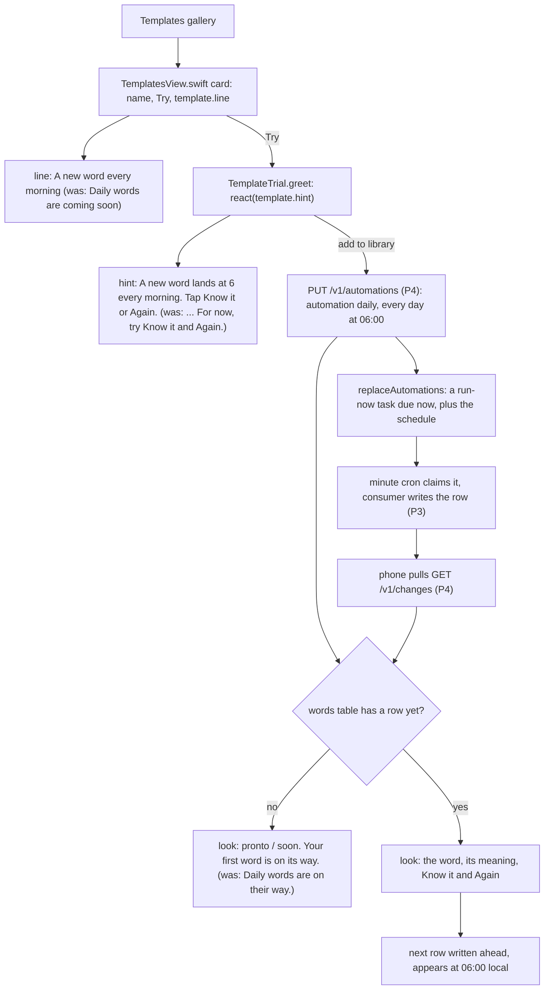
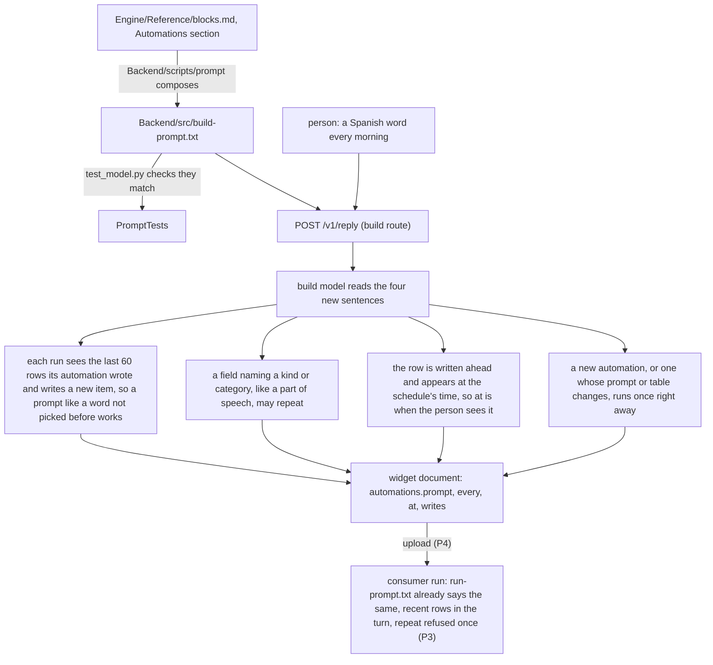
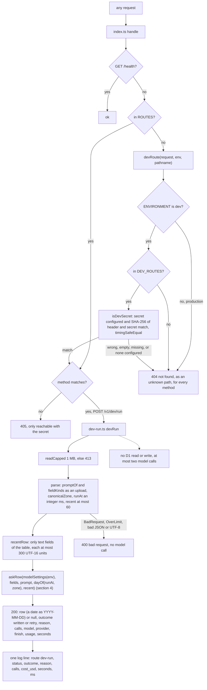
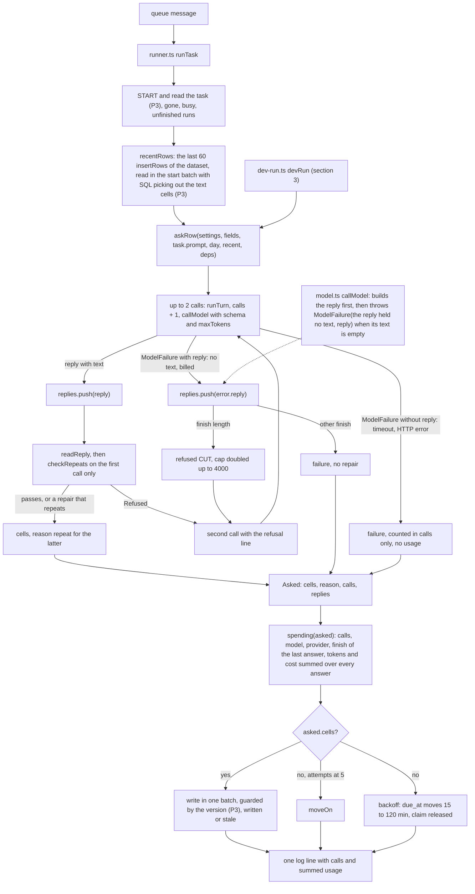
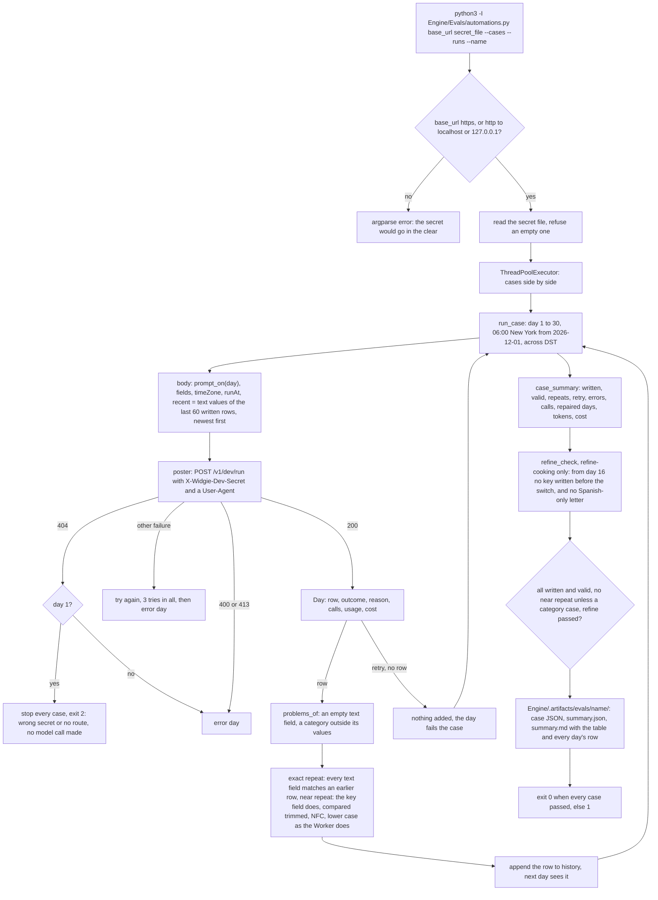
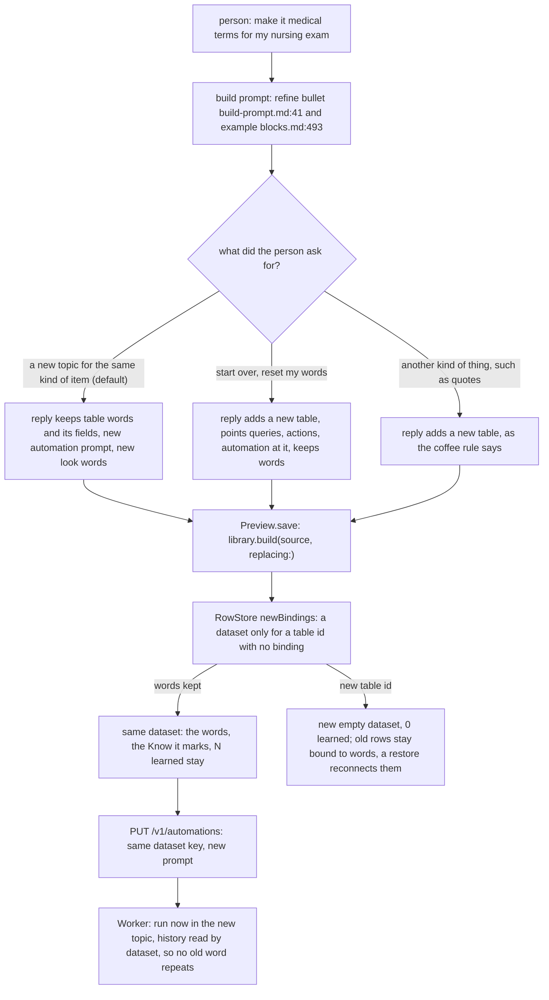

# PR 27: Word of the day becomes real, and the build prompt knows runs see their history

Branch `phase-3-p5-content` into `phase-3-p4-app` (PR 26). This is P5 of [tasks/phase-3-ai-block.md](../../tasks/phase-3-ai-block.md) (the P5 checklist at line 210 and its "P5 results" note at line 221). P3 made the Worker run automations and P4 made the app upload them and pull their rows. Here the content catches up: Word of the day stops promising words "soon", the build prompt teaches what a run actually sees and when its row shows, and a dev-only route plus a Python eval run each automation for 30 simulated days on the real run prompt, schema, and model. Nothing is deployed. The 30-day eval run against `dev` (the one unchecked P5 item) is the user's, after deploying `dev` with this branch.

Background reading: the plan's "How it works (decided)", especially "Each run sees its recent rows" and "The reply is checked, not trusted", the repeat rule note at line 153 (why a category field may repeat), and PR 25's guide (`docs/pr/25-phase-3-p3-runner.md`, section 2) for the consumer's turn, checks, repair, and log, which this PR moves into `askRow` without changing.

**No usage limits for now** (removed by the user on 2026-11-27). The dev route has no quota of its own: it is gated by the dev secret and lives only on `dev`.

## Core changes

- **Copy for sign-off (the review gate).** Implemented in place so it can be seen in the app, but each line waits for the user's yes before merge:

  | Where | Old line | New line |
  |---|---|---|
  | Word of the day, line ([template.json:3](../../App/Templates/word-of-the-day/template.json#L3), under the card in the gallery) | Daily words are coming soon | A new word every morning |
  | Word of the day, hint ([template.json:7](../../App/Templates/word-of-the-day/template.json#L7), what Widgie says when the template opens) | Daily words are on their way. For now, try Know it and Again. | A new word lands at 6 every morning. Tap Know it or Again. |
  | Word of the day, empty face ([widget.json:89](../../App/Templates/word-of-the-day/widget.json#L89), the look's text under "pronto" before the first row) | soon. Daily words are on their way. | soon. Your first word is on its way. |
  | Today's question | (unchanged) | (unchanged) |

  Today's question needs nothing: its line ("A new question every day") and its fallback list for the hours before the day's row were already true, and its hint's "For now it stays on this phone" is about the answer tap, which syncs in phase 4.
- **The build prompt teaches what a run sees.** [blocks.md:212](../../Engine/Reference/blocks.md#L212) gains four sentences in the Automations section, composed into [build-prompt.txt:209](../../Backend/src/build-prompt.txt#L209): a run sees the last 60 rows its automation wrote and writes a new item (so "a word not picked before" works), a field naming a kind or category may repeat, the row is written ahead and appears at the schedule's time (so `at` is when the person sees it), and a new or changed automation also runs once right away. The composed prompt grows from 56,412 to 56,870 bytes. The open question "should an automation see its table's recent rows" is marked decided in [RATIONALE.md:166](../engine/RATIONALE.md#L166) and [SYNTHESIS.md:64](../engine/SYNTHESIS.md#L64). The run prompt ([run-prompt.txt](../../Backend/src/run-prompt.txt)) already said the first three and is unchanged.
- **`POST /v1/dev/run`, dev only.** [dev-run.ts](../../Backend/src/dev-run.ts), listed in `DEV_ROUTES` ([index.ts:80](../../Backend/src/index.ts#L80)) and looked up only by `devRoute` ([index.ts:96](../../Backend/src/index.ts#L96)): only where `ENVIRONMENT` is `dev` and `X-Widgie-Dev-Secret` matches `DEV_REGISTRATION_SECRET` (SHA-256 of both, `timingSafeEqual`), with the secret checked before the method. So production never routes the path, and anyone without the secret gets the plain 404 of an unknown path for every method. The body `{prompt, fields, timeZone, runAt, recent}` passes the upload's own prompt and field checks (`promptOf` and `fieldKinds`, now exported from [automations.ts:167](../../Backend/src/automations.ts#L167)), and each recent row maps text fields of the table to at most 300 UTF-16 units. It runs the consumer's `askRow`, writes nothing, touches no D1, and answers `{row, outcome, reason, calls, model, provider, finish, usage, seconds}`.
- **`askRow`: the consumer's model calls, shared.** The two-call loop of `runTask` (turn, call, reply check, repeat rule, one repair, cut-reply cap doubling) moves verbatim into [runner.ts:215](../../Backend/src/runner.ts#L215) `askRow`, which reads and writes nothing and returns `Asked` `{cells, reason, calls, replies}`. `runTask` calls it and keeps the write, the backoff, and the move-on. The dev route calls the same function, so the eval measures the code that runs in production, not a copy.
- **Every call is counted, and every billed answer summed.** `calls` was `replies.length`, so a timeout, an HTTP error, or a reply cut off with no text was not counted, and the cut one's usage (it is billed) was lost. Now `askRow` counts `calls` itself, [model.ts:48](../../Backend/src/model.ts#L48) `ModelFailure` carries the `reply` of an answer that came back with no text (its `finish` and usage, `finish` is now a getter on it), and `askRow` keeps that reply with the others. [runner.ts:272](../../Backend/src/runner.ts#L272) `spending` takes `{calls, replies}`. The run log and the dev route both report it.
- **The entry module exports only what the runtime starts.** workerd 4.166 (under `wrangler dev`) takes every export of the entry module as an entrypoint and refused to start on `MAX_ATTEST_BODY`, a constant, on the P4 base too. The three body caps move to [body.ts:8](../../Backend/src/body.ts#L8), `isDevSecret` moves to [dev-run.ts:33](../../Backend/src/dev-run.ts#L33) (it was `devRegistration` in `index.ts`, and `/v1/account` still uses it at [index.ts:236](../../Backend/src/index.ts#L236)), and [entry.test.ts](../../Backend/test/entry.test.ts) checks that `index.ts` exports only functions, classes, and the default handler. A local `wrangler dev --env dev` now starts and answers.
- **The eval: [Engine/Evals/automations.py](../../Engine/Evals/automations.py).** Six cases (`nursing-terms`, `spanish-cooking`, `stoic-quote`, `couple-question`, `workout-focus` as a category-only table, and `refine-cooking`, Spanish for days 1 to 15 then Italian on the same history). Each case calls the route 30 times in order, one simulated day at 06:00 New York from 2026-12-01, feeding every written row back as the newest recent row. It counts invalid rows, exact repeats, near repeats (the key field), retries, errors, calls, repaired days, tokens, and cost, checks that the refine left Spanish behind, and writes JSON and `summary.md` to `Engine/.artifacts/evals/<name>/` (git-ignored). Exit code 1 when a case fails, 2 when the first day gets 404 (wrong secret or no route), before any model call. Tests in [test_automations.py](../../Engine/Evals/test_automations.py) (19), run by `Engine/scripts/check`.
- **How to run the eval**, once `dev` is deployed with this branch. Put the dev secret (`DEV_REGISTRATION_SECRET` of `widgie-dev`, the same value as `WIDGIE_DEV_SECRET` in `App/Secrets.xcconfig`) alone in a file outside the repo, then from the repo root:

  ```sh
  python3 -I Engine/Evals/automations.py https://widgie-dev.krutikpatel-patel.workers.dev <secret file>
  # options: --cases nursing-terms,stoic-quote  --runs 30  --name p5-automations
  ```

  Cases run side by side, days in order, 180 requests in all. Read `Engine/.artifacts/evals/p5-automations/summary.md` for the table and every day's row.
- **A topic change keeps the history (user decision, 2026-11-28).** In the P4 simulator run, "make it medical terms for my nursing exam" reset Word of the day to "0 learned": Sonnet moved the words to a new table `terms`, which the engine rightly bound to a new dataset. The build prompt now says a new topic for the same kind of item keeps the table and its fields ([build-prompt.md:41](../../Engine/Reference/build-prompt.md#L41), with a checked example at [blocks.md:493](../../Engine/Reference/blocks.md#L493)), and only a fresh start or another kind of thing gets a new table. No code change: the engine already keeps every surviving table id's binding. See section 6.
- **Tests.** New: [dev-run.test.ts](../../Backend/test/dev-run.test.ts) (11 tests, among them 18 malformed bodies), [entry.test.ts](../../Backend/test/entry.test.ts) (1), [test_automations.py](../../Engine/Evals/test_automations.py) (19). Changed: [runner.test.ts:587](../../Backend/test/runner.test.ts#L587) now checks the log counts a cut call with no text and its usage; `attest`, `automations`, and `reply` tests import the body caps from `body.ts`.

## 1. Opening Word of the day, and its widget before the first row (copy)

The person sees the template's line under its card in the gallery, taps Try, and Widgie greets them with the hint. Once it is in the library the app uploads its automation, the Worker writes a run-now row within a minute, and until that row is pulled the look draws its empty face.



Files:

- [template.json:3](../../App/Templates/word-of-the-day/template.json#L3): `line`. [template.json:7](../../App/Templates/word-of-the-day/template.json#L7): `hint`.
- [widget.json:89](../../App/Templates/word-of-the-day/widget.json#L89): the look, a single JSON string. The only change is the empty face's text, `'soon. Your first word is on its way.'`, shown when `d.word` is null. [widget.json:42](../../App/Templates/word-of-the-day/widget.json#L42): the automation's `"at": "06:00"`, which the hint's "at 6" names.
- [TemplatesView.swift:313](../../App/Widgie/Templates/TemplatesView.swift#L313): where the card shows `template.line`. [TemplateTrial.swift:44](../../App/Widgie/Templates/TemplateTrial.swift#L44): `greet`, which speaks `template.hint`.
- [automations.ts:469](../../Backend/src/automations.ts#L469): the run-now task (`once: 1, runAt: now, dueAt: now`) that makes the empty face short-lived.
- [phase-3-ai-block.md:223](../../tasks/phase-3-ai-block.md#L223): the copy for sign-off, as recorded in the plan.

Key decisions:

- **The copy is implemented, not just proposed, and still waits for a yes.** Seeing it in the app is the review. The table above is the whole of what the user signs off on, and the PR should not merge with a line the user has not approved.
- **The hint names the time.** "At 6 every morning" matches the template's own `"at": "06:00"`. The row is written ahead and appears at 06:00 local, so the promise is exact for the template as shipped. A person who changes the time later never sees the hint again (it is the trial's greeting).
- **The empty face says "your first word", not "daily words soon".** Since P2 and P3 a new automation runs once right away, so the face shows only for the minute or so until the first row arrives. "Soon" stays because it completes the sentence the made-up word "pronto" starts.
- **Today's question is left alone.** Its copy was already true, and its fallback list keeps covering the hours before the day's row. Its "stays on this phone" hint is about phase 4's answer sync, which other shared templates say the same way.

## 2. Building a widget with an automation (the build prompt)

When the person describes a widget that needs fresh content, the build model writes an `automations` block with a `prompt`. Before this PR the build prompt never said a run sees its earlier rows, so models wrote "do not repeat" prompts on faith, and it did not say `at` is when the row appears or that a new automation runs once right away.



Files:

- [blocks.md:212](../../Engine/Reference/blocks.md#L212): the four sentences, the source of truth.
- [build-prompt.txt:209](../../Backend/src/build-prompt.txt#L209): the composed copy the Worker sends. [test_model.py:58](../../Engine/Evals/test_model.py#L58): `test_the_worker_sends_the_composed_build_prompt`, which fails if the two drift.
- [run-prompt.txt:11](../../Backend/src/run-prompt.txt#L11): the run side, which already says never to repeat a listed row and that a category may repeat. Unchanged.
- [RATIONALE.md:166](../engine/RATIONALE.md#L166) and [SYNTHESIS.md:64](../engine/SYNTHESIS.md#L64): the open question marked decided. The "new one now" button stays open.
- [run.ts:12](../../Backend/src/run.ts#L12): `RECENT_ROWS = 60`, the number the prompt now states.

Key decisions:

- **"Rows its automation wrote", not "the table's last 60 rows".** Rows a person adds by tapping do not reach the server in phase 3, so the run cannot see them. The narrower wording is what is true.
- **Teach the category exception in the build prompt too.** Without it a build model may write "never repeat anything", which the run model would then try to apply to a part of speech or a Push/Pull/Legs focus. The repeat rule (plan line 153) already allows it, so the two prompts now say the same thing.
- **Say that a new automation runs once right away.** The build model otherwise has no way to know the widget fills within a minute of the upload, and no reason not to work around an empty first day. A "new one now" button, which earlier evals saw models try, still cannot exist, and RATIONALE keeps that question open.
- **The run prompt is not touched.** It already said the first three things, so this PR changes nothing the consumer sends, and the eval measures the run prompt as it was reviewed in P3.

## 3. A request to `/v1/dev/run` in dev and in production (the gate)

The eval needs the real run prompt, schema, and model, but the model key stays on the server. So `dev` gets one route that runs a run's model calls on a body the caller sends. It must not exist in production, and on `dev` it must not even reveal itself to a caller without the secret.



Files:

- [index.ts:80](../../Backend/src/index.ts#L80): `DEV_ROUTES`. [index.ts:84](../../Backend/src/index.ts#L84): `handle`, which falls through to `devRoute` only when `ROUTES` has no entry (line 87). [index.ts:96](../../Backend/src/index.ts#L96): `devRoute`, the environment check, then the path, then the secret.
- [dev-run.ts:33](../../Backend/src/dev-run.ts#L33): `isDevSecret`, shared with `/v1/account`'s dev registration ([index.ts:236](../../Backend/src/index.ts#L236)). [dev-run.ts:47](../../Backend/src/dev-run.ts#L47): `devRun`: the capped read at 55, the `askRow` call at 69, `spending` at 77. [dev-run.ts:99](../../Backend/src/dev-run.ts#L99): `parse`. [dev-run.ts:116](../../Backend/src/dev-run.ts#L116): `recentRow`. [dev-run.ts:129](../../Backend/src/dev-run.ts#L129): `plain`, a date cell as its day.
- [automations.ts:167](../../Backend/src/automations.ts#L167): `promptOf`, split out of `automation()` (which calls it at line 127). [automations.ts:183](../../Backend/src/automations.ts#L183): `fieldKinds`, now exported.
- [wrangler.jsonc:2](../../Backend/wrangler.jsonc#L2): `DEV_REGISTRATION_SECRET` is a dev-only secret, and `ENVIRONMENT` is `production` (line 32) or `dev` (line 69). [vitest.config.ts:17](../../Backend/vitest.config.ts#L17): the test config sets the secret even in the production env, which the production test relies on.
- Tests: [dev-run.test.ts:67](../../Backend/test/dev-run.test.ts#L67) (production answers every method exactly as an unknown path, with the secret or without, and calls no model), [dev-run.test.ts:81](../../Backend/test/dev-run.test.ts#L81) (dev with a wrong, empty, or missing secret, or with no secret configured, does the same), [dev-run.test.ts:102](../../Backend/test/dev-run.test.ts#L102) (405 only with the right secret), [dev-run.test.ts:110](../../Backend/test/dev-run.test.ts#L110) (the happy path: the day in the zone, the recent rows in the turn, the schema sent, nothing stored), [dev-run.test.ts:189](../../Backend/test/dev-run.test.ts#L189) (18 malformed bodies get 400 and no model call), [dev-run.test.ts:220](../../Backend/test/dev-run.test.ts#L220) (what an upload takes at its limits: 2,000 emoji of prompt, 16 fields, 300-unit recent text), [dev-run.test.ts:230](../../Backend/test/dev-run.test.ts#L230) (fields reach the model in id order).

Key decisions:

- **Production never routes the path.** `devRoute` returns nothing when `ENVIRONMENT` is not `dev`, before the path or the secret is looked at, so even a secret set on production by mistake opens nothing. This is the same rule `/v1/account`'s dev registration already followed, now in one function.
- **The secret is checked before the method.** A 405 for `GET /v1/dev/run` would tell a stranger the route exists. With the secret checked first, every method without it gets the byte-identical 404 of an unknown path, and the tests compare against an unknown path rather than a hard-coded body.
- **Constant-time comparison over hashes.** SHA-256 of both sides makes the lengths equal, so `timingSafeEqual` never throws on a length mismatch and leaks nothing about the secret's length.
- **The body passes the upload's own checks.** `promptOf` and `fieldKinds` are the functions `PUT /v1/automations` uses, so the eval cannot run a prompt or table the app could never upload, and a reviewer can trust the eval's results to transfer.
- **Recent rows are shaped as the consumer reads them.** Only text fields of the table, each within `TEXT_LIMIT`, newest first, at most `RECENT_ROWS`. A caller cannot feed the model history that a real run would never see.
- **No D1, at most two model calls.** A request stays far inside Workers Free's 10 ms CPU and 50 subrequests, consistent with the plan's decision to stay on Workers Free.

## 4. A consumer run through `askRow` (the refactor and the call counting)

The consumer's run is unchanged in behavior: same turn, same checks, same repair, same write. What moved is the loop that asks the model, so the dev route can share it, and what changed is how calls and usage are counted.



Files:

- [runner.ts:124](../../Backend/src/runner.ts#L124): `runTask`, now calling `askRow` at line 178 and branching on `asked.cells` from line 186. The write, the move-on at 190, and the backoff are unchanged.
- [runner.ts:205](../../Backend/src/runner.ts#L205): `Asked`. [runner.ts:215](../../Backend/src/runner.ts#L215): `askRow`: `calls++` at 234, the no-text answer kept at 254, the result at the end of the loop. `deps` is narrowed to `fetch` and `deadlineMs`, so it needs no database or clock.
- [runner.ts:272](../../Backend/src/runner.ts#L272): `spending`, exported, taking `{calls, replies}`.
- [model.ts:48](../../Backend/src/model.ts#L48): `ModelFailure(reason, reply)` with `finish` as a getter (line 56). [model.ts:168](../../Backend/src/model.ts#L168): the empty-text throw, which now carries the whole reply with its usage.
- [index.ts:132](../../Backend/src/index.ts#L132): the build route's `reply`, which uses `callModel` but not `finish` or the reply on a failure, so it is unaffected.
- Tests: [runner.test.ts:587](../../Backend/test/runner.test.ts#L587) (a reply cut off with no text, then a good repair: the log says `calls: 2` and sums both answers' tokens and cost, and a single cut call logs `calls: 1` with its output tokens), [dev-run.test.ts:135](../../Backend/test/dev-run.test.ts#L135) (a repeat repaired, as the consumer does), [dev-run.test.ts:142](../../Backend/test/dev-run.test.ts#L142) (a refused repair is `retry` with the reason), [dev-run.test.ts:153](../../Backend/test/dev-run.test.ts#L153) (a model service failure is one call, no repair), [dev-run.test.ts:167](../../Backend/test/dev-run.test.ts#L167) (a cut call with no text is counted with its usage).

Key decisions:

- **Move the loop, do not copy it.** The dev route exists to measure the consumer. A copy would drift, and the eval would then measure something production does not run. `askRow` reads and writes nothing, so it fits both callers without a database seam.
- **The loop moved verbatim.** Only `task.prompt` became the `ownerPrompt` parameter and the return replaced the tail of `runTask`. A restack onto other runner work (the CPU work the plan mentions) conflicts at most in that loop.
- **A call is a call, an answer is billed.** `calls` counts every attempt to reach the model, so a timeout or an HTTP error shows in the log. Usage sums every answer that came back, including one with no text, since OpenRouter bills it. Before, a reply cut off with no text was both uncounted and unbilled in the log, which would have hidden the cost of thinking-heavy runs.
- **`ModelFailure` carries the reply rather than a bare `finish`.** One field gives both the stop reason and the usage, and `finish` stays readable through the getter, so existing callers did not change.

## 5. An eval run (30 days, repeats, the refine check)

The eval simulates 30 consecutive mornings of one widget per case, against the deployed `dev` Worker, and decides per case whether the automation is good enough: every day written, every row valid, no repeat of the item itself, and a refine that actually changes topic.



Files:

- [automations.py:92](../../Engine/Evals/automations.py#L92): `CASES`, the six cases, with `SPANISH` and `ITALIAN` at line 85 and the refine at line 124 (`switch_at=16`, `refined_avoids="ñüáíóú¿¡"`).
- [automations.py:146](../../Engine/Evals/automations.py#L146): `run_times`. [automations.py:156](../../Engine/Evals/automations.py#L156): `recent_row`, text values only. [automations.py:161](../../Engine/Evals/automations.py#L161): `comparable`, the Python twin of [run.ts:179](../../Backend/src/run.ts#L179). [automations.py:166](../../Engine/Evals/automations.py#L166): `problems_of`.
- [automations.py:179](../../Engine/Evals/automations.py#L179): `run_case`, the day loop, the 404 rule at 191, the repeat marks at 206. [automations.py:222](../../Engine/Evals/automations.py#L222): `refine_check`. [automations.py:236](../../Engine/Evals/automations.py#L236): `case_summary` and the pass rule at 262. [automations.py:268](../../Engine/Evals/automations.py#L268): `summary_table`. [automations.py:292](../../Engine/Evals/automations.py#L292): `rows_section`.
- [automations.py:314](../../Engine/Evals/automations.py#L314): `poster`, tries and the no-retry statuses. [automations.py:351](../../Engine/Evals/automations.py#L351): `base_url`. [automations.py:361](../../Engine/Evals/automations.py#L361): `main`, the stop with exit code 2 at 389.
- [Engine/scripts/check](../../Engine/scripts/check): its "eval harness tests" step runs `test_*.py` in `Engine/Evals`, which now includes the new tests.
- Tests: [test_automations.py:33](../../Engine/Evals/test_automations.py#L33) (each row becomes the next day's newest recent row, text only), [:43](../../Engine/Evals/test_automations.py#L43) (recent rows stop at 60), [:50](../../Engine/Evals/test_automations.py#L50) (a day with no row fails the case), [:72](../../Engine/Evals/test_automations.py#L72) and [:85](../../Engine/Evals/test_automations.py#L85) (repeats ignore case, space, and Unicode form, a shared category is neither), [:92](../../Engine/Evals/test_automations.py#L92) (calls and usage add up, `repaired` counts days with more than one call), [:108](../../Engine/Evals/test_automations.py#L108) (404 on day 1 stops, later is an error day), [:134](../../Engine/Evals/test_automations.py#L134) (the category case), [:146](../../Engine/Evals/test_automations.py#L146) and [:155](../../Engine/Evals/test_automations.py#L155) (the refine switches prompt on the same history and passes only when it left Spanish), [:209](../../Engine/Evals/test_automations.py#L209) (the secret is sent and never printed), [:246](../../Engine/Evals/test_automations.py#L246) (a refused request is not retried), [:277](../../Engine/Evals/test_automations.py#L277) (exit code 2), [:295](../../Engine/Evals/test_automations.py#L295) (https or local http only).

Key decisions:

- **Run through the Worker, not a local copy.** The model key stays on the server, and the eval exercises the deployed run prompt, schema, structured output, reply checks, repeat rule, and repair. That is what the dev route is for.
- **History is fed back as the consumer reads it.** Only text values, the last 60, newest first. A day that gets `retry` adds no row, as the consumer would write nothing on that attempt, and the case fails because a real widget would have shown no new word that morning.
- **Repeats are compared as the Worker compares them.** Trimmed, NFC, lower case, so the eval never flags a repeat the Worker would have let through for a different reason, or misses one it refused.
- **Near repeat on the key field is the bar.** The Worker's repeat rule misses a two-text-field table where only the key repeats with a reworded definition (plan line 153). The eval measures exactly that gap, and a near repeat fails the case, except in `workout-focus`, where the key is a category and repeats are expected.
- **The refine check is automatic, not read by eye.** From day 16 no key written in the Spanish days may come back, and no key may hold ñ, ü, á, í, ó, ú, ¿, or ¡ (Spanish writes them, Italian never does). The result is in `summary.json` (`refine`), the table's `new topic` column, and the marks in `summary.md`.
- **Fail fast and loudly on a misconfigured run.** A 404 on day 1 means the secret is wrong or the Worker predates this route. Every case would get it, so the run stops with exit code 2 and one line naming both causes, before any model call is spent. 400 and 413 are not retried, since the same body would fail the same way.
- **The secret never travels in the clear or appears in output.** The base URL must be https, except plain http to `localhost` or `127.0.0.1` for a local `wrangler dev`. A smoke run against a local `wrangler dev --env dev` with a fake model key went end to end (OpenRouter's 401 came back as `retry`, a wrong secret got a 404 that was not retried, and the secret appeared in no output).

## 6. A refine that changes the topic (history and counts carry over)

The person opens Change it on Word of the day and asks for another topic. Whether the words already learned survive depends only on the table id in the model's reply: the engine binds each table id to a dataset, keeps the binding of every id that survives, and mints a dataset for a new id. The app's save goes through the same build, and the upload names the dataset, so the Worker's history and repeat check follow the binding too.



Files:

- [build-prompt.md:41](../../Engine/Reference/build-prompt.md#L41): the refine bullet. [blocks.md:493](../../Engine/Reference/blocks.md#L493): the before and after example, checked as a refinement by `ReferenceTests`, and the fresh-start sentence after it. Composed into [build-prompt.txt:488](../../Backend/src/build-prompt.txt#L488) and [:1107](../../Backend/src/build-prompt.txt#L1107).
- [RowStore.swift:864](../../Engine/Sources/Rows/RowStore.swift#L864): `newBindings`, unchanged. [Preview.swift:127](../../App/Widgie/Preview.swift#L127): `save`, unchanged.
- [Engine/Fixtures/learn/widget.json](../../Engine/Fixtures/learn/widget.json): a copy of the Word of the day template (with `verdict` and the `learned` count), so the evals refine what people actually get. Added to the fixture lists in [EngineTests/Support.swift:26](../../Engine/Tests/EngineTests/Support.swift#L26) and [SpecTests/Support.swift:8](../../Engine/Tests/SpecTests/Support.swift#L8).
- [cases.json:199](../../Engine/Evals/cases.json#L199): `refine-nursing` and `refine-italian` (no new table, every table the base read still read) and `refine-fresh` ("start over with new words": a new table that replaces `words`).
- [RemoteTests.swift:391](../../Engine/Tests/EngineTests/RemoteTests.swift#L391): `TopicChangeTests`. Two automation rows arrive by a pull, the newest is marked Know it, then a new prompt on the same table keeps the payload's dataset and draws the same face (the same word, mark, and count); a fresh start on a new table draws the empty face, with the old dataset still bound to `words`.

Eval results (`run.py`, local Claude Code stand-in, `Engine/.artifacts/evals/`):

| Run | Prompt | Haiku table checks | Sonnet table checks |
|---|---|---|---|
| `p5-history-before`, the 3 new cases | before | 3 of 3 | 1 of 3 (nursing to `terms`, Italian to `cucina`) |
| `p5-history-1`, the whole refine group | after | 16 of 16 (15 first try, 1 repaired once) | 16 of 16 (15 first try, 1 repaired once) |
| `p5-history-2`, the 3 new cases plus coffee, yoga, quote | after | 6 of 6 | 6 of 6 |

Key decisions:

- **The fix is the prompt, not the engine.** Nothing in code dropped a binding. Carrying rows across a renamed table with the same fields would be a guess the coffee case proves wrong (a `cups` table must not inherit glasses of water), and the table id is how the model says which one it means.
- **A default, not a lock.** "Start over" still gets a new table, and the old rows stay bound to the old id, so a restore brings them back. The model is free to add a field when the new topic needs a detail the table lacks.
- **"Change it to a daily quote" still makes a new table.** Quotes are another kind of item, not a new topic for words, and the existing `refine-quote` case keeps expecting it; it passed in both trials.
- **The fixture is a copy, not a link to the template.** Eval runs are compared across prompt changes, so the base must not move when the template's copy does.

