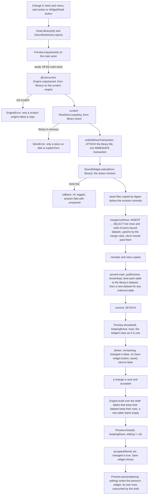
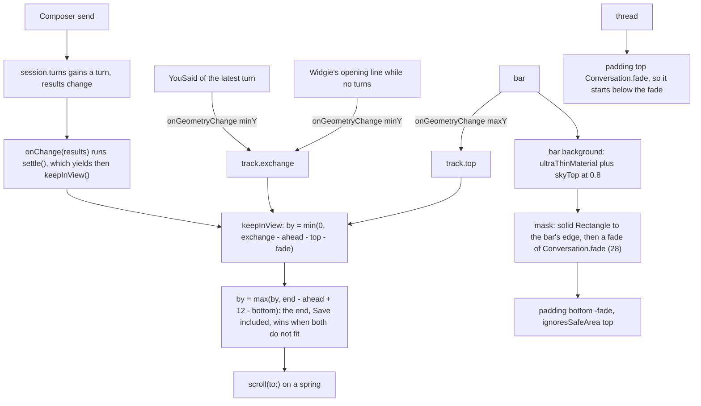
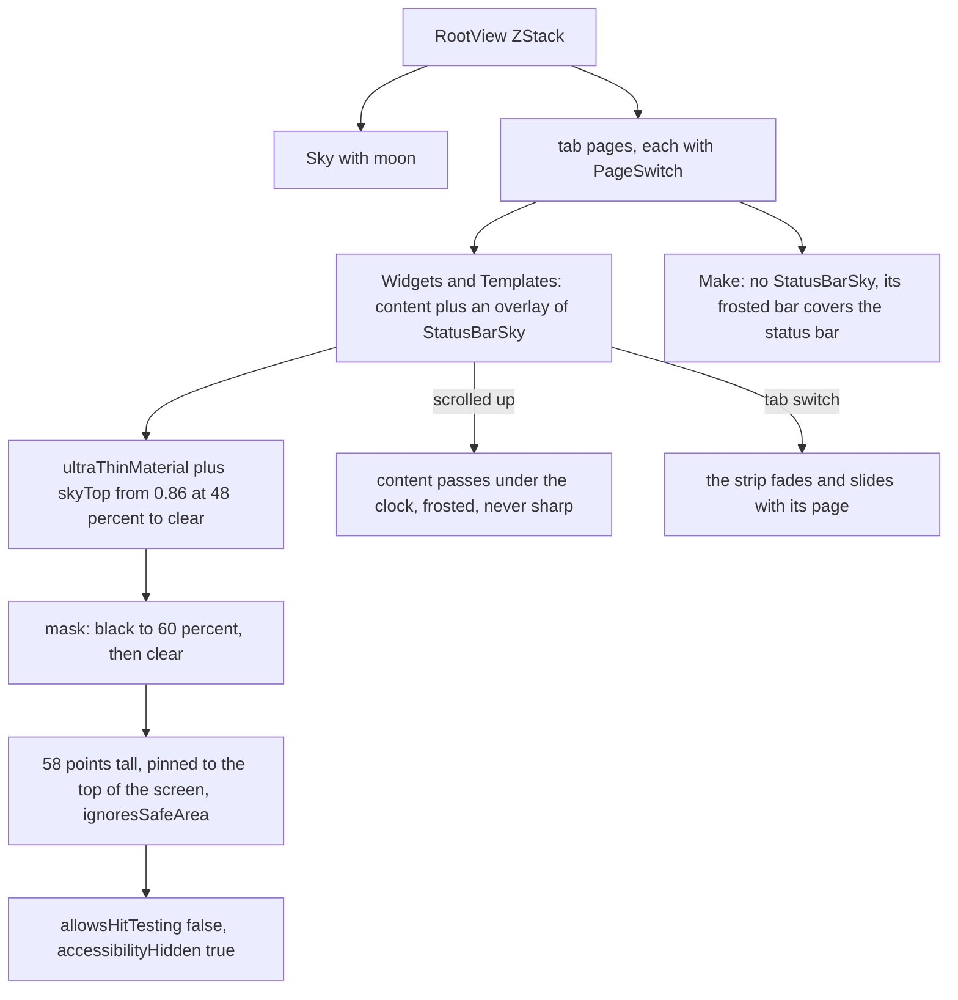
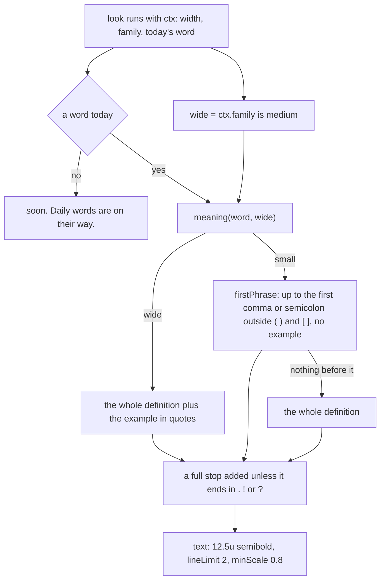
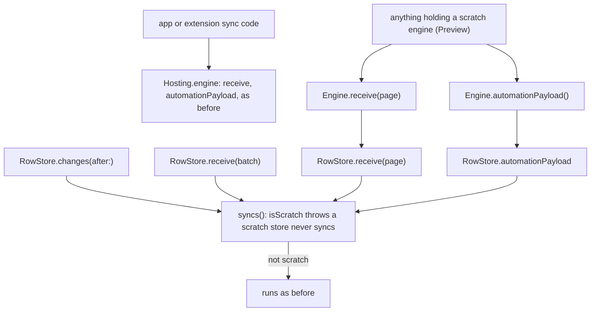

# PR 28: four fixes from the phase 3 simulator run

Branch `app-e2e-fixes` into `main`. The phase 3 end-to-end run on the simulator (before shots in `Engine/.artifacts/app-flow/p4-e2e/`) found four app shell issues: Change it showed a library widget's empty sample instead of the widget, chat messages sat half under Make's title, Templates cards sat sharp behind the clock, and the small Word of the day cut its example mid-word. Each is fixed in its own commit, and [tasks/app-shell.md](../../tasks/app-shell.md#L289-L299) records them under "Fixes from the phase 3 simulator run". A review round then made a scratch engine refuse to sync, moved the copy off the main actor into one SQL transaction, put Make's bar over the top fade, and tightened the small Word of the day. After shots are in `Engine/.artifacts/app-flow/e2e-fixes/` (the review round's carry an `r2-` prefix). Both folders are git-ignored, so the shots are named here and not committed.

## Core changes

- **Change it starts from the widget as it is (engine).** New public `Engine.copy(_:from:)` in [Samples.swift](../../Engine/Sources/WidgetBuilder/Samples.swift#L30-L51), async and `@concurrent`, so it never runs on the caller's actor. Under it, `RowStore.copy(_:from:)` in [RowStore.swift](../../Engine/Sources/Rows/RowStore.swift#L572-L646) copies, in one transaction over one snapshot of the library, the revision the widget draws with its asset files, the dataset each of its tables is bound to (a table a restore dropped included), and every live row of those datasets with its cells, stamped as their writers stamped them. The rows go from file to file in SQL across an attached database (`mergeLiveRows` in [Merge.swift](../../Engine/Sources/Rows/Merge.swift#L352-L383)), never through Swift: a 30,000-row widget copies in 0.15 s on a Mac, against 1.0 s on the main actor before.
- **A scratch engine never syncs (engine).** `RowStore.changes(after:)`, both `RowStore.receive` paths and `RowStore.automationPayload` throw on a scratch store (`syncs()` at [RowStore.swift#L740-L745](../../Engine/Sources/Rows/RowStore.swift#L740-L745)), so `Engine.receive` and `Engine.automationPayload()` throw on a scratch engine. Its rows carry the person's dataset keys now, so neither direction may run there. A new `RowStore.inMemory(isScratch:onCommit:)` gives the tests an in-memory replica that syncs and that no suspension reaches.
- **The preview draws the copy and keeps its rows.** `Preview.copy(_:)` awaits `engine.copy` and shows the draft with `keepingRows: true` once it is whole, so the face never shows empty first. An accepted change to a library widget is shown with `keepingRows: true` too, so a change no longer draws the widget empty again. New widgets and templates still start empty after every change.
- **Save waits for a change.** `DescribeSession.changed` becomes internal and gates both the Save widget button and `save()`, so a library widget is never saved unchanged. A new widget or a template offers Save as soon as there is a draft, as before.
- **Make's bar is frosted to its edge (look).** The bar's sky is solid down to the bar's edge, then fades over `Conversation.fade` (28 points), replacing a gradient that started fading at 70 percent of its height. The scroll keeps the latest exchange (the person's words, or Widgie's opening line) clear of that fade instead of only Widgie's answer.
- **`StatusBarSky` on Widgets and Templates (look).** The prototype's top fade: a frosted strip of `Palette.skyTop` 58 points tall over those two pages, so a page scrolled up never shows sharp behind the status bar. Make draws none, since its own bar covers the status bar, as the prototype's bar (z 16) sits over its top fade (z 15).
- **Word of the day, small (template look).** The small face keeps the meaning only, up to its first comma or semicolon outside brackets, or all of it when nothing comes before the first. The wide face keeps the meaning and example.
- **Docs and tests.** [USAGE.md](../../docs/engine/USAGE.md#L211-L215), [MODULES.md](../../docs/engine/MODULES.md#L36) and [RATIONALE.md](../../docs/engine/RATIONALE.md#L27-L29) list `copy(_:from:)` (thirteen builder methods become fourteen), and USAGE says a scratch engine never syncs. Ten engine tests cover the copy and the sync refusal, three store tests cover the store side, and app tests cover opening on the widget's rows, the Save gate on a library widget and on a template, and the small Word of the day's cut.

## 1. Opening Change it on a library widget

Files:

- [Samples.swift#L30-L51](../../Engine/Sources/WidgetBuilder/Samples.swift#L30-L51): `Engine.copy(_:from:)`. [Samples.swift#L23-L28](../../Engine/Sources/WidgetBuilder/Samples.swift#L23-L28) `stageProved`, which keeps its private `stage(_:)`.
- [RowStore.swift#L572-L646](../../Engine/Sources/Rows/RowStore.swift#L572-L646): `RowStore.copy(_:from:)`, refused on a non-scratch store and from an in-memory one. [RowStore.swift#L1024-L1046](../../Engine/Sources/Rows/RowStore.swift#L1024-L1046): `StoredWidget.select(from:)` and `drawn(in:)`, the drawn-revision query for any attached database.
- [Merge.swift#L352-L383](../../Engine/Sources/Rows/Merge.swift#L352-L383): `mergeLiveRows`, the `insertRow` and `setCell` rules as `INSERT ... SELECT ... ON CONFLICT`, and the clock's receive rule.
- [Preview.swift#L88-L106](../../App/Widgie/Preview.swift#L88-L106): `Preview.copy(_:)`, which logs the copy's time, and [Preview.swift#L50-L78](../../App/Widgie/Preview.swift#L50-L78) `show(_:keepingRows:)` it calls with `true`.
- [DescribeSession.swift#L203-L208](../../App/Widgie/Describe/DescribeSession.swift#L203-L208) `open()`, [DescribeSession.swift#L177-L181](../../App/Widgie/Describe/DescribeSession.swift#L177-L181) `changed`, [DescribeSession.swift#L244-L248](../../App/Widgie/Describe/DescribeSession.swift#L244-L248) `save()`, [DescribeSession.swift#L403-L405](../../App/Widgie/Describe/DescribeSession.swift#L403-L405) the accepted change shown with `keepingRows: editing != nil`.
- [ChatView.swift#L337-L341](../../App/Widgie/Describe/ChatView.swift#L337-L341): `after` shows Save widget on `session.changed` instead of `session.draft != nil`.
- Engine tests, [PreviewTests.swift#L263-L426](../../Engine/Tests/EngineTests/PreviewTests.swift#L263-L426): the copy draws the widget's rows in every family and its taps stay in the copy; rows written ahead still reveal at their time and the automation's rows count as the person's; a refinement keeps the rows of the tables it keeps; rows another widget wrote into the shared dataset are copied; a row deleted in the library stays out; the binding of a table a restore dropped is copied with its rows, so a refinement that brings the table back reads them; a scratch engine refuses to sync; nil for a missing widget; refused on a non-scratch engine.
- Store tests, [RemoteRowsTests.swift#L125-L172](../../Engine/Tests/RowsTests/RemoteRowsTests.swift#L125-L172): a copy counts the automation's row as the person's (`mine`) and Sam's as Sam's (`member`), takes the drawn revision and the bindings; only a scratch store copies, only from a store on disk, nil for a missing or deleted widget.
- App tests: [DescribeSessionTests.swift#L39-L60](../../App/WidgieTests/DescribeSessionTests.swift#L39-L60) opens a tally on its own three rows and checks the Save gate. [DescribeSessionTests.swift#L17-L37](../../App/WidgieTests/DescribeSessionTests.swift#L17-L37) now sends one change before saving, since Save needs one. [DescribeSessionTests.swift#L87-L102](../../App/WidgieTests/DescribeSessionTests.swift#L87-L102): a template session offers Save before any turn and saves with no model request.
- Docs: [USAGE.md#L211-L215](../../docs/engine/USAGE.md#L211-L215), [MODULES.md#L36](../../docs/engine/MODULES.md#L36), [RATIONALE.md#L27-L29](../../docs/engine/RATIONALE.md#L27-L29).

Before, `Preview.copy` read the widget's `source(of:)` and called `adopt`, which built it into the scratch engine and loaded empty rows. Word of the day opened on its "pronto" placeholder instead of today's word, Save widget was offered on a widget nobody had changed, and every accepted change loaded fresh rows, so the face went empty again (the "Soon" face in 14). Now the draft opens on the person's real rows, a change keeps them, and Save appears only once a change landed.

Key decisions:

- **Copy the rows, not a snapshot of the face.** The copy carries every live row as its writer stamped it, so the draft runs the real look over the real data: rows written ahead (an automation's future word) still reveal at their time, and the person's rows still count as the person's because `mine` and `member` come along. A picture of the current face would freeze the draft and break taps.
- **One transaction, one snapshot.** The revision, its assets, the bindings, the rows, `member` and `mine` are all read inside the one transaction on the scratch connection, so the draft can never pair a revision with rows or bindings from a later moment. That replaces two reads (`source(of:)`, then the rows) and the JSON round trip through `stage`.
- **SQL across files, not Swift.** `ATTACH` the library's file to the scratch connection and `INSERT ... SELECT` with the merge's own upsert rules. Measured on a Mac with a debug build, a widget of 30,000 rows with two cells each: 1.0 s before (Swift read, parse, then one statement per change, on the main actor), 0.15 s now (0.14 s of it the SQL), off the main actor. Ordering the inserts by primary key gained nothing, so it stays out. The attachment lives only inside the call: SQLite attaches outside a transaction, and the call detaches before the connection serves anything else.
- **Every binding, not only the drawn revision's tables.** The review suggested copying only what the drawn revision's tables read. A table a restore dropped keeps its binding in the library, and `reveals(of:)` and `storedKinds(of:)` read every bound dataset, so the library's timeline and refusals count those rows; a refinement that brings the table back reconnects them on Save. Copying them too keeps the draft's timeline, refusals and refinements the same as the library's. Rows other widgets wrote into a shared dataset come along for the same reason, and deleted rows never do.
- **Off the main actor, nothing on show until whole.** `Engine.copy` is `@concurrent`, so it runs on the global executor whatever the caller's isolation, and `Preview.copy` shows nothing until it returns. A small widget looks as before: the card fades in once, on its real rows.
- **Only a scratch store takes a copy, at both layers.** `Engine.copy` and `RowStore.copy` each refuse a non-scratch target. A copy is not a write any replica made, so sync must never push it (section 5).
- **No second proof.** The library already proved the revision it draws, so the copy marks it proved here and does not prove it again.
- **A change keeps rows by the table's dataset.** Showing an accepted change with `keepingRows` for a library widget gives the same rows saving it over the widget would: a table that keeps its id keeps its rows, and a table the change adds starts empty. New widgets and templates keep loading afresh (`editing == nil`), as before.
- **`changed` is the one Save gate.** The button and `save()` read the same property, so the gate cannot drift between the view and the session. The existing repair test sends a change first for that reason, and the scripted model gains a first answer.

Screenshots: before `p4-e2e/08-chat-open.png` ("pronto" placeholder with Save widget offered), `p4-e2e/14-chat-hourly.png` (the change drawn empty as "Soon"). After `e2e-fixes/after-1-chat-open-word.png` (today's word, Again chosen, no Save), `e2e-fixes/after-1-chat-open-light.png` (Japan fund at $150 with its own progress), `e2e-fixes/after-1-new-widget-light.png` (a new widget still offers Save on its first draft). Review round, on U1b with 30,000 deposits written into Japan fund's dataset: `e2e-fixes/r2-1-chat-cover-rising-30k.png` (the card is already on its real rows, $30,150, while the cover still rises, so no empty face shows first), `e2e-fixes/r2-1-chat-open-30k.png` (open, no Save widget; the app logged `copy: copied in 0.18 sec`), `e2e-fixes/r2-6-template-save.png` (Days together from Templates offers Save widget before any turn).

## 2. Sending a message in chat

Files:

- [ChatView.swift#L103](../../App/Widgie/Describe/ChatView.swift#L103): `Conversation.fade`, the one 28 point constant for the fade, the thread's top inset and the scroll target.
- [ChatView.swift#L208-L224](../../App/Widgie/Describe/ChatView.swift#L208-L224): the bar's background and its new mask.
- [ChatView.swift#L89](../../App/Widgie/Describe/ChatView.swift#L89) `track.exchange` (was `reply`), measured at [ChatView.swift#L236](../../App/Widgie/Describe/ChatView.swift#L236) on the opening line and [ChatView.swift#L245](../../App/Widgie/Describe/ChatView.swift#L245) on the latest `YouSaid`.
- [ChatView.swift#L266](../../App/Widgie/Describe/ChatView.swift#L266): the thread's top padding.
- [ChatView.swift#L421-L438](../../App/Widgie/Describe/ChatView.swift#L421-L438): `settle()` and `keepInView()`.

Before, the bar's frosted sky faded out from 70 percent of its height, so a message scrolled under the title showed through it half sharp (10 and 14), and the scroll only aimed to show Widgie's answer 8 points below the bar, so the person's own words could settle under the title. Now the bar is solid frosted sky to its edge, then fades over 28 points as the prototype's bar does, and the scroll brings the whole latest exchange below that fade whenever the end of the thread still fits.

Key decisions:

- **Track the person's words, not Widgie's answer.** The geometry reader moves from `answer(turn)` to `YouSaid(turn:)`, so the top of the exchange is what the person just typed. `arriving()` now wraps each of the two views on its own, since the reader no longer sits on the answer.
- **One constant for three jobs.** The mask's fade height, the thread's top inset and the scroll target all read `Self.fade`, so the thread starts and settles exactly where the fade ends. The old code used 28 for the inset but 8 for the scroll.
- **The end still wins.** `keepInView` keeps its second clamp, so when the exchange and the end of the thread (Save included) do not both fit, Save stays in view.
- **The mask is a stack, not stops.** A solid `Rectangle` over a fixed-height `LinearGradient` keeps the fade 28 points tall whatever the bar's height, which a percentage stop could not.

Screenshots: before `p4-e2e/10-chat-refined.png`, `p4-e2e/14-chat-hourly.png` (the person's message half under "Change it"), and `e2e-fixes/before-2-chat-refined-light.png`. After `e2e-fixes/after-2-chat-sent-light.png`, `e2e-fixes/after-2-chat-sent-dark-ax5.png`, `e2e-fixes/after-2-chat-refined-light.png`, `e2e-fixes/after-2-chat-refined-dark.png`, `e2e-fixes/after-2-chat-refined-dark-ax5.png`.

## 3. Scrolling Widgets or Templates

Files:

- [Sky.swift#L91-L116](../../App/Widgie/Design/Sky.swift#L91-L116): `StatusBarSky`.
- [RootView.swift#L24-L31](../../App/Widgie/RootView.swift#L24-L31): each page but Make takes it as an overlay, inside its `PageSwitch`.

Before, a Templates card (and any feed card) scrolled up under the clock showed sharp behind it (02, and the Templates page behind the sheet in 03). Now Widgets and Templates scroll under the prototype's top fade: frosted sky that fades out just below the clock.

Key decisions:

- **Make's bar stays on top.** In the prototype `.topfade` (z 15) sits under `.make-bar` (z 16). SwiftUI cannot slot a root-level view between a page and that page's own bar, and Make's bar already covers the status bar with the same frosted `skyTop`, so Make simply draws no strip: nothing lies over its title in light or dark.
- **Per page, inside the page switch.** The overlay sits on the page before `PageSwitch`, so it fades and slides with its page instead of staying put while pages swap.
- **The prototype's height.** 58 points, the prototype's `.topfade` (its 54 point status bar plus 4), instead of `safeAreaInsets.top + 4` (66 points on an iPhone 18 Pro). The clock stays inside the solid part.
- **It never takes a touch or a VoiceOver stop.** `allowsHitTesting(false)` and `accessibilityHidden(true)`, so it is pure decoration over the pages.

Screenshots: before `p4-e2e/02-templates-goals.png`, `p4-e2e/03-template-detail.png`, and `e2e-fixes/before-3-templates-light.png`. After `e2e-fixes/after-3-templates-light.png`, `e2e-fixes/after-3-templates-dark.png`, `e2e-fixes/after-3-templates-dark-ax5.png`. Review round: `e2e-fixes/r2-3-make-title-light.png`, `e2e-fixes/r2-3-make-title-dark.png` (Make's empty page, nothing over the stars), `e2e-fixes/r2-3-make-bar-light.png`, `e2e-fixes/r2-3-make-bar-dark.png` (Make's bar with a thread, nothing over it), `e2e-fixes/r2-1-chat-open-30k.png` (Change it's bar), `e2e-fixes/r2-3-templates-scrolled-light.png`, `e2e-fixes/r2-3-templates-scrolled-dark.png` (a card frosted under the clock, sharp below the strip), `e2e-fixes/r2-3-widgets-top-light.png` (the feed at rest).

## 4. The Word of the day small face

Files:

- [word-of-the-day/widget.json#L89](../../App/Templates/word-of-the-day/widget.json#L89): the `look` string. In it, `meaning(word, wide)` gains the `wide` parameter, and `firstPhrase(text)` does the cut.
- [TemplateTests.swift#L278-L296](../../App/WidgieTests/TemplateTests.swift#L278-L296): the small proof of a meaning with a comma inside brackets matches the one cut after the brackets, and a meaning that starts with a comma draws more than a full stop.

Before, the small face ran the whole definition and example into two lines, so it ended on a cut word ("measured b..." in 13, the quoted example cut at "Cr..." in 06). Now the small face keeps the meaning up to its first comma or semicolon outside brackets, so its two lines end on a whole phrase, and the medium face keeps the prototype tile's meaning and example. `render-tool proof` on the template passes every state (`e2e-fixes/r2-wotd-proof/`).

Key decisions:

- **Cut at punctuation, not at a length.** A definition's first clause is a whole phrase ("a shorter or quicker way to get somewhere"), so the face never needs an ellipsis. Semicolons count too, since dictionary senses are often split that way.
- **Not inside brackets.** "(of a song, a poem) short" is one phrase; a cut at its comma would leave an open bracket. Round and square brackets count, and a stray closing bracket never drives the depth below zero.
- **Never only a full stop.** A meaning that starts with a comma has nothing before it, so the face keeps the whole meaning instead of drawing ".".
- **The example goes, not the meaning.** On a small face the meaning is what teaches the word. The example stays on the medium face, where it fits.
- **A template change only.** The look is template data in `widget.json`, so no Swift changes. `wide` is the look's existing `ctx.family === 'medium'`, already used for the learned count.

Screenshots: before `p4-e2e/06-home-widgets-first-word.png`, `p4-e2e/13-home-new-topic.png`. After `e2e-fixes/after-4-home-light.png`, `e2e-fixes/after-4-home-dark.png`, and the review round's proof renders in `e2e-fixes/r2-wotd-proof/`.

## 5. Sync on a scratch engine

Files:

- [RowStore.swift#L740-L745](../../Engine/Sources/Rows/RowStore.swift#L740-L745): `syncs()`, called first by [changes(after:)](../../Engine/Sources/Rows/RowStore.swift#L654), [receive(_:now:) for a batch](../../Engine/Sources/Rows/RowStore.swift#L675), [receive(_:now:) for a page](../../Engine/Sources/Rows/RowStore.swift#L700) and [automationPayload](../../Engine/Sources/Rows/RowStore.swift#L360).
- [RowStore.swift#L104-L121](../../Engine/Sources/Rows/RowStore.swift#L104-L121): `scratch()` and the new `inMemory(isScratch:onCommit:)`. `removesDirectory` ([RowStore.swift#L30](../../Engine/Sources/Rows/RowStore.swift#L30)) now says which stores delete their folder, since an in-memory replica is not scratch but still owns its temporary asset folder.
- Tests: [SyncTests.swift#L37-L58](../../Engine/Tests/RowsTests/SyncTests.swift#L37-L58) (all four refuse on a scratch store on disk and in memory, and the refused row never lands), [PreviewTests.swift#L401-L415](../../Engine/Tests/EngineTests/PreviewTests.swift#L401-L415) (a scratch engine holding a copy refuses the payload and a pull). `Bench` and the other replica tests run on `inMemory(isScratch: false)`.

Before, nothing but convention kept a scratch engine from syncing. That was harmless while a scratch store held only samples, but a copy puts the person's real dataset keys there, so a push would send rows nobody wrote, a pull would land in the copy, and an upload of the draft's automations would replace the person's.

Key decisions:

- **At the store, like `copy` and `rollBack`.** The guard sits in `RowStore`, where `copy` and `rollBack` already enforce their side, so every path to sync, the Engine's and any future one, meets it.
- **Tests run replicas in memory, not on disk.** Moving the replica tests to file stores put them inside the window where the suspension test suspends every non-scratch store in the process, and one merge test failed with "database is suspended". An in-memory replica observes no suspension, keeps the suite as fast as before, and needs only the small `inMemory(isScratch:onCommit:)` factory. Only the copy test's library stays on disk, since `ATTACH` needs a file.
- **One test removed.** `theDigestFollowsARollBack` read the automation payload of a scratch engine after a roll back. A roll back only exists on a scratch engine, which now never uploads, so the payload's doc and USAGE no longer list a roll back among what moves it, and the roll back itself stays covered by the preview tests.
