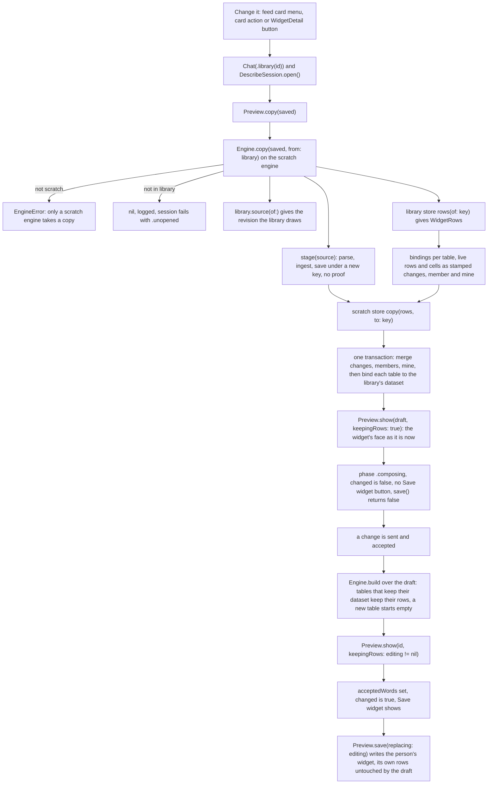
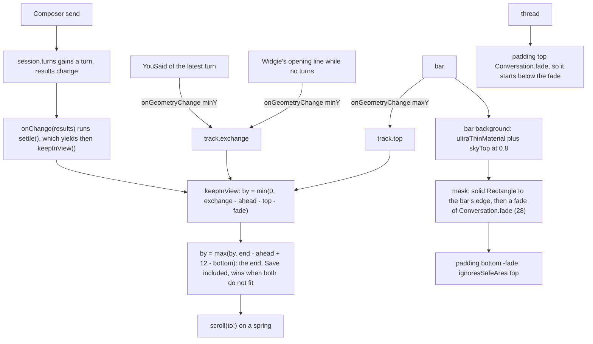
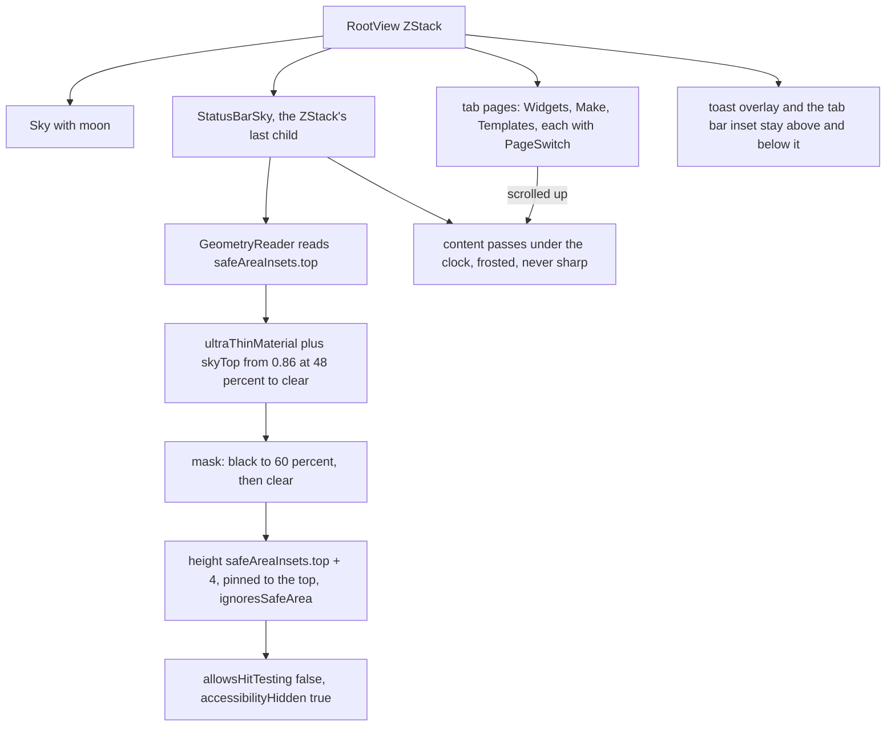
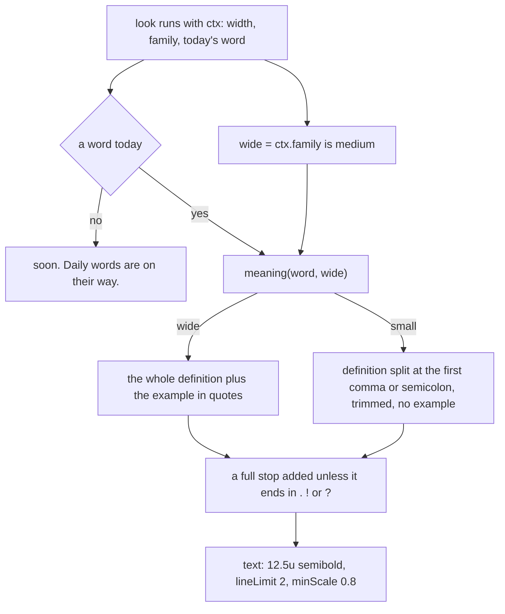

# PR 28: four fixes from the phase 3 simulator run

Branch `app-e2e-fixes` into `main`. The phase 3 end-to-end run on the simulator (before shots in `Engine/.artifacts/app-flow/p4-e2e/`) found four app shell issues: Change it showed a library widget's empty sample instead of the widget, chat messages sat half under Make's title, Templates cards sat sharp behind the clock, and the small Word of the day cut its example mid-word. Each is fixed in its own commit, and [tasks/app-shell.md](../../tasks/app-shell.md#L289-L297) records them under "Fixes from the phase 3 simulator run". After shots are in `Engine/.artifacts/app-flow/e2e-fixes/`. Both folders are git-ignored, so the shots are named here and not committed.

## Core changes

- **Change it starts from the widget as it is (engine).** New public `Engine.copy(_:from:)` in [Samples.swift](../../Engine/Sources/WidgetBuilder/Samples.swift#L30-L51) copies a library widget into the scratch engine: the revision the library draws, saved without a second proof, and a copy of every live row its tables read, stamped as their writers stamped them. Under it, `RowStore.rows(of:)` and `RowStore.copy(_:to:)` with a new `WidgetRows` value in [RowStore.swift](../../Engine/Sources/Rows/RowStore.swift#L556-L623). `stageProved` and `copy` now share a private `stage(_:)`.
- **The preview draws the copy and keeps its rows.** `Preview.copy(_:)` calls `engine.copy` and shows the draft with `keepingRows: true` instead of rebuilding the widget's source over empty rows. An accepted change to a library widget is shown with `keepingRows: true` too, so a change no longer draws the widget empty again. New widgets and templates still start empty after every change.
- **Save waits for a change.** `DescribeSession.changed` becomes internal and gates both the Save widget button and `save()`, so a library widget is never saved unchanged. A new widget or a template offers Save as soon as there is a draft, as before.
- **Make's bar is frosted to its edge (look).** The bar's sky is solid down to the bar's edge, then fades over `Conversation.fade` (28 points), replacing a gradient that started fading at 70 percent of its height. The scroll keeps the latest exchange (the person's words, or Widgie's opening line) clear of that fade instead of only Widgie's answer.
- **`StatusBarSky` on every tab (look).** A frosted strip of `Palette.skyTop` fading out just below the clock, added once in `RootView` over all tab pages, so a page scrolled up never shows sharp behind the status bar.
- **Word of the day, small (template look).** The small face keeps the meaning only, up to its first comma or semicolon, with no example. The wide face keeps the meaning and example.
- **Docs and tests.** [USAGE.md](../../docs/engine/USAGE.md#L211-L215), [MODULES.md](../../docs/engine/MODULES.md#L36) and [RATIONALE.md](../../docs/engine/RATIONALE.md#L27-L29) list `copy(_:from:)` (thirteen builder methods become fourteen). Five engine tests cover the copy, and one app test covers opening on the widget's rows and the Save gate.

## 1. Opening Change it on a library widget

Files:

- [Samples.swift#L30-L51](../../Engine/Sources/WidgetBuilder/Samples.swift#L30-L51): `Engine.copy(_:from:)`. [Samples.swift#L23-L28](../../Engine/Sources/WidgetBuilder/Samples.swift#L23-L28) `stageProved` and [Samples.swift#L53-L67](../../Engine/Sources/WidgetBuilder/Samples.swift#L53-L67) the shared private `stage(_:)`.
- [RowStore.swift#L556-L601](../../Engine/Sources/Rows/RowStore.swift#L556-L601): `rows(of:)` reads the widget's bindings, every live row of the bound datasets (`deleted IS NULL AND day NOTNULL`, which skips deleted rows and a tombstone that arrived before its insert) and their cells, plus the local `member` and `mine` tables.
- [RowStore.swift#L603-L623](../../Engine/Sources/Rows/RowStore.swift#L603-L623): `copy(_:to:)`, refused on a non-scratch store. [RowStore.swift#L1058-L1067](../../Engine/Sources/Rows/RowStore.swift#L1058-L1067): `WidgetRows`.
- [Preview.swift#L88-L101](../../App/Widgie/Preview.swift#L88-L101): `Preview.copy(_:)`, and [Preview.swift#L50-L78](../../App/Widgie/Preview.swift#L50-L78) `show(_:keepingRows:)` it now calls with `true`.
- [DescribeSession.swift#L203-L208](../../App/Widgie/Describe/DescribeSession.swift#L203-L208) `open()`, [DescribeSession.swift#L177-L181](../../App/Widgie/Describe/DescribeSession.swift#L177-L181) `changed`, [DescribeSession.swift#L244-L248](../../App/Widgie/Describe/DescribeSession.swift#L244-L248) `save()`, [DescribeSession.swift#L403-L405](../../App/Widgie/Describe/DescribeSession.swift#L403-L405) the accepted change shown with `keepingRows: editing != nil`.
- [ChatView.swift#L337-L341](../../App/Widgie/Describe/ChatView.swift#L337-L341): `after` shows Save widget on `session.changed` instead of `session.draft != nil`.
- Tests: [PreviewTests.swift#L263-L338](../../Engine/Tests/EngineTests/PreviewTests.swift#L263-L338) (the copy draws the widget's rows in every family and its taps stay in the copy, rows written ahead still reveal at their time and the automation's rows count as the person's, a refinement keeps the rows of the tables it keeps, nil for a missing widget, refused on a non-scratch engine). [DescribeSessionTests.swift#L39-L60](../../App/WidgieTests/DescribeSessionTests.swift#L39-L60) opens a tally on its own three rows and checks the Save gate. [DescribeSessionTests.swift#L17-L37](../../App/WidgieTests/DescribeSessionTests.swift#L17-L37) now sends one change before saving, since Save needs one.
- Docs: [USAGE.md#L211-L215](../../docs/engine/USAGE.md#L211-L215), [MODULES.md#L36](../../docs/engine/MODULES.md#L36), [RATIONALE.md#L27-L29](../../docs/engine/RATIONALE.md#L27-L29).

Before, `Preview.copy` read the widget's `source(of:)` and called `adopt`, which built it into the scratch engine and loaded empty rows. Word of the day opened on its "pronto" placeholder instead of today's word, Save widget was offered on a widget nobody had changed, and every accepted change loaded fresh rows, so the face went empty again (the "Soon" face in 14). Now the draft opens on the person's real rows, a change keeps them, and Save appears only once a change landed.

Key decisions:

- **Copy the rows, not a snapshot of the face.** The copy carries every live row as the stamped changes that wrote it, so the draft runs the real look over the real data: rows written ahead (an automation's future word) still reveal at their time, and the person's rows still count as the person's because `mine` and `member` come along. A picture of the current face would freeze the draft and break taps.
- **The binds are stamped last.** `copy(_:to:)` merges the rows first and then binds each table to the library's dataset in the same write, so these binds win over the fresh ones `stage` made when it saved the widget. A widget that reads no tables is a no-op (`.ignored`).
- **Only a scratch store takes a copy, at both layers.** `Engine.copy` and `RowStore.copy` each refuse a non-scratch target. A copy is not a write any replica made, so sync must never push it, and the guard makes that a fact rather than a convention.
- **No second proof.** The library already proved the revision it draws, so `stage` saves it as is. `stageProved` and `copy` share `stage(_:)`, and only `stageProved` loads a first sample over it.
- **A change keeps rows by the table's dataset.** Showing an accepted change with `keepingRows` for a library widget gives the same rows saving it over the widget would: a table that keeps its id keeps its rows, and a table the change adds starts empty. New widgets and templates keep loading afresh (`editing == nil`), as before.
- **`changed` is the one Save gate.** The button and `save()` read the same property, so the gate cannot drift between the view and the session. The existing repair test sends a change first for that reason, and the scripted model gains a first answer.

Screenshots: before `p4-e2e/08-chat-open.png` ("pronto" placeholder with Save widget offered), `p4-e2e/14-chat-hourly.png` (the change drawn empty as "Soon"). After `e2e-fixes/after-1-chat-open-word.png` (today's word, Again chosen, no Save), `e2e-fixes/after-1-chat-open-light.png` (Japan fund at $150 with its own progress), `e2e-fixes/after-1-new-widget-light.png` (a new widget still offers Save on its first draft).

## 2. Sending a message in chat

Files:

- [ChatView.swift#L103](../../App/Widgie/Describe/ChatView.swift#L103): `Conversation.fade`, the one 28 point constant for the fade, the thread's top inset and the scroll target.
- [ChatView.swift#L208-L224](../../App/Widgie/Describe/ChatView.swift#L208-L224): the bar's background and its new mask.
- [ChatView.swift#L89](../../App/Widgie/Describe/ChatView.swift#L89) `track.exchange` (was `reply`), measured at [ChatView.swift#L236](../../App/Widgie/Describe/ChatView.swift#L236) on the opening line and [ChatView.swift#L245](../../App/Widgie/Describe/ChatView.swift#L245) on the latest `YouSaid`.
- [ChatView.swift#L266](../../App/Widgie/Describe/ChatView.swift#L266): the thread's top padding.
- [ChatView.swift#L421-L438](../../App/Widgie/Describe/ChatView.swift#L421-L438): `settle()` and `keepInView()`.

Before, the bar's frosted sky faded out from 70 percent of its height, so a message scrolled under the title showed through it half sharp (10 and 14), and the scroll only aimed to show Widgie's answer 8 points below the bar, so the person's own words could settle under the title. Now the bar is solid frosted sky to its edge, then fades over 28 points as the prototype's bar does, and the scroll brings the whole latest exchange below that fade whenever the end of the thread still fits.

Key decisions:

- **Track the person's words, not Widgie's answer.** The geometry reader moves from `answer(turn)` to `YouSaid(turn:)`, so the top of the exchange is what the person just typed. `arriving()` now wraps each of the two views on its own, since the reader no longer sits on the answer.
- **One constant for three jobs.** The mask's fade height, the thread's top inset and the scroll target all read `Self.fade`, so the thread starts and settles exactly where the fade ends. The old code used 28 for the inset but 8 for the scroll.
- **The end still wins.** `keepInView` keeps its second clamp, so when the exchange and the end of the thread (Save included) do not both fit, Save stays in view.
- **The mask is a stack, not stops.** A solid `Rectangle` over a fixed-height `LinearGradient` keeps the fade 28 points tall whatever the bar's height, which a percentage stop could not.

Screenshots: before `p4-e2e/10-chat-refined.png`, `p4-e2e/14-chat-hourly.png` (the person's message half under "Change it"), and `e2e-fixes/before-2-chat-refined-light.png`. After `e2e-fixes/after-2-chat-sent-light.png`, `e2e-fixes/after-2-chat-sent-dark-ax5.png`, `e2e-fixes/after-2-chat-refined-light.png`, `e2e-fixes/after-2-chat-refined-dark.png`, `e2e-fixes/after-2-chat-refined-dark-ax5.png`.

## 3. Scrolling any tab

Files:

- [Sky.swift#L91-L116](../../App/Widgie/Design/Sky.swift#L91-L116): `StatusBarSky`.
- [RootView.swift#L30](../../App/Widgie/RootView.swift#L30): added once after the pages.

Before, a Templates card (and any feed card) scrolled up under the clock showed sharp behind it (02, and the Templates page behind the sheet in 03). Now every tab page scrolls under the prototype's top fade: frosted sky that fades out just below the clock.

Key decisions:

- **Once in `RootView`, not per page.** One view covers Widgets, Make and Templates, so no page can forget it and the pages keep their own scroll code.
- **Sized from the safe area.** The strip is `safeAreaInsets.top + 4` tall, so it fits the Dynamic Island, a notch or no notch without a constant, and stops just below the clock.
- **It never takes a touch or a VoiceOver stop.** `allowsHitTesting(false)` and `accessibilityHidden(true)`, so it is pure decoration over the pages.
- **On Make it lies over the bar's own sky.** In z-order it is drawn above every page, Make included. Over Make's bar it covers only the status bar area, which the bar already fills with the same frosted `skyTop`, so the two read as one. Its doc comment says "under Make's own bar" in that visual sense. A reviewer may want to confirm Make's title area in dark mode (`after-2-chat-refined-dark.png`).

Screenshots: before `p4-e2e/02-templates-goals.png`, `p4-e2e/03-template-detail.png`, and `e2e-fixes/before-3-templates-light.png`. After `e2e-fixes/after-3-templates-light.png`, `e2e-fixes/after-3-templates-dark.png`, `e2e-fixes/after-3-templates-dark-ax5.png`, `e2e-fixes/after-make-hello-light.png`.

## 4. The Word of the day small face

Files:

- [word-of-the-day/widget.json#L89](../../App/Templates/word-of-the-day/widget.json#L89): the `look` string. In it, `meaning(word, wide)` gains the `wide` parameter and its comment, and the text node passes `wide` through.

Before, the small face ran the whole definition and example into two lines, so it ended on a cut word ("measured b..." in 13, the quoted example cut at "Cr..." in 06). Now the small face keeps the meaning up to its first comma or semicolon, so its two lines end on a whole phrase, and the medium face keeps the prototype tile's meaning and example. The tasks note records that every proof state passes.

Key decisions:

- **Cut at punctuation, not at a length.** A definition's first clause is a whole phrase ("a shorter or quicker way to get somewhere"), so the face never needs an ellipsis. Semicolons count too, since dictionary senses are often split that way.
- **The example goes, not the meaning.** On a small face the meaning is what teaches the word. The example stays on the medium face, where it fits.
- **A template change only.** The look is template data in `widget.json`, so no Swift changes. `wide` is the look's existing `ctx.family === 'medium'`, already used for the learned count.

Screenshots: before `p4-e2e/06-home-widgets-first-word.png`, `p4-e2e/13-home-new-topic.png`. After `e2e-fixes/after-4-home-light.png`, `e2e-fixes/after-4-home-dark.png`.
