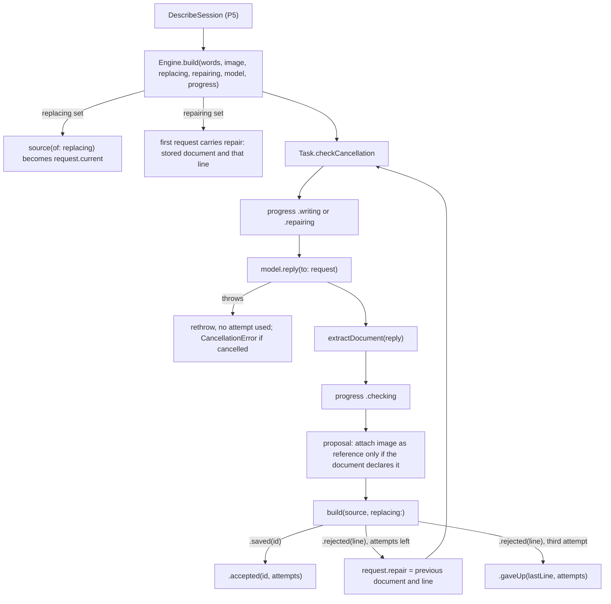
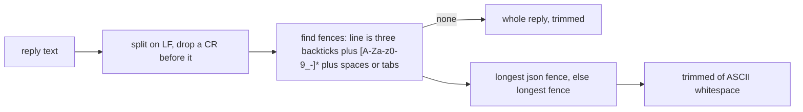

# PR 3: the build loop in WidgetBuilder

Branch `phase-2-p3-build-loop` into `phase-2-p1-model-bridge` (#2). This is P3 of [tasks/phase-2-app-flow.md](../../tasks/phase-2-app-flow.md).

Background reading: the plan's "The data shape" and P3 sections, and [USAGE.md](../engine/USAGE.md) section 3, which now shows the real API.

## Core changes

- **The loop.** [Loop.swift](../../Engine/Sources/WidgetBuilder/Loop.swift) adds `Engine.build(_ words:image:replacing:repairing:model:progress:) -> LoopOutcome`. It asks the model, extracts the document, calls the existing `build(_ source:replacing:)`, and sends each rejection back as a repair, at most three attempts.
- **The wire types.** [Model.swift](../../Engine/Sources/WidgetBuilder/Model.swift) holds `ModelRequest`, `Attachment`, `Repair`, `WidgetModel`, `BuildStep`, and `LoopOutcome`. `ModelRequest` encodes to the body the dev bridge reads. `Attachment` holds raw bytes and travels as `base64`.
- **One extraction rule on both sides.** `extractDocument` in Swift and `extract` in [model.py](../../Engine/Evals/model.py) take the longest `json` fence, else the longest fence, else the whole reply, trimmed of ASCII whitespace. Lines end only at LF. [extract.json](../../Engine/Evals/testdata/extract.json) holds 25 cases that both test suites read.
- **`render-tool loop`.** [RenderTool.swift](../../Engine/Sources/RenderTool/RenderTool.swift) runs the loop against the bridge into a temporary engine, prints each step with its time, and writes the saved widget.

## 1. The app builds a widget from words

The app (P5) calls the loop on the preview's scratch engine (P4) with a `WidgetModel` that posts to the bridge. Each step reports progress so the screen can say "Writing your widget" or "Fixing a layout problem (2 of 3)".

Files:

- [Loop.swift](../../Engine/Sources/WidgetBuilder/Loop.swift): the loop, `proposal`, `extractDocument`.
- [Model.swift](../../Engine/Sources/WidgetBuilder/Model.swift): the wire types.
- [LoopTests.swift](../../Engine/Tests/EngineTests/LoopTests.swift): one test per plan case, with a scripted model.

Key decisions:

- **An overload of `build`, not `loop`.** `engine.build("make it blue", replacing: id, model: bridge)` names the result, and `build` is already the verb for turning input into a saved widget.
- **No flags in the loop.** Its whole state is the next `ModelRequest` and the attempt number. The progress step comes from whether the request carries a repair.
- **Only a rejected document uses an attempt.** A transport error is thrown, so the screen can show "Couldn't reach the widget builder" instead of burning repairs.
- **Cancellation is checked around the model call.** A cancelled `URLSession` throws `URLError`, so the loop throws `CancellationError` in its place. A `build` already under way finishes and returns its outcome.
- **The picture goes in only when the document declares `reference`.** `ingest` refuses an image the document has no asset for. A refine that sends no picture keeps the stored one.

## 2. Extraction, shared with the eval harness

Files:

- [model.py](../../Engine/Evals/model.py): `extract` and `WHITESPACE`.
- [extract.json](../../Engine/Evals/testdata/extract.json): the shared cases. The Swift test and `test_model.py` both read it.

Key decisions:

- **End lines only at LF.** The first port copied Python's `str.splitlines`, which also ends lines at U+2028, U+0085, and the information separators. JSON allows those inside a string, so a reply holding one broke apart, failed to parse, and cost a repair. The Swift side needed an 80-line emulation to match. Both sides now use the simple rule, and six cases that pinned the quirk changed with it.
- **Lengths count Unicode scalars,** as Python's `len` does, so both sides pick the same fence when two have similar lengths.

## Verification

- `scripts/check` passes at the head, including `LoopTests` (10 tests) and the Python tests on the shared cases.
- Live, `render-tool loop` against the bridge on Haiku: water, to-do, and word of the day accepted in 2 attempts, habit in 1 (`Engine/.artifacts/p3-live/`).
- `build` per attempt, apart from the model: 0.06 to 0.21 s live, and 0.09 to 0.23 s against an instant stand-in bridge. Rendering the 14 proof cells dominates. The plan's limit is 1.5 s.
