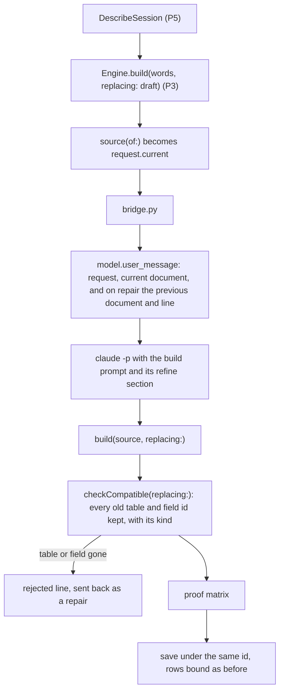
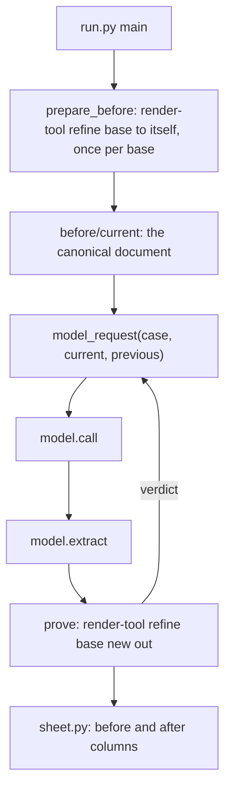

# PR 4: a refine mode for the build prompt, proved with evals

Branch `phase-2-p2-refine` into `phase-2-p1-model-bridge` (#2). This is P2 of [tasks/phase-2-app-flow.md](../../tasks/phase-2-app-flow.md).

Background reading: the plan's "Facts this plan rests on" (the renamed-table fact) and P2 sections, and [USAGE.md](../engine/USAGE.md) section 3.

## Core changes

- **Rows always carry over.** `checkCompatible(replacing:)` in [Document.swift](../../Engine/Sources/Spec/Document.swift) rejects a refine that drops a table id, with `table "glasses" is gone; keep every table id so the stored rows carry over`, or a field id, with `field "items.title" is gone; keep every field id so the stored values carry over`. Before, a table rename silently bound the table to a new, empty dataset, and a field rename blanked every stored value of that field.
- **The refine message.** `user_message` in [model.py](../../Engine/Evals/model.py) labels the person's words and adds the current document in a `json` fence. A repair during a refine keeps the current document. [refine.jsonl](../../Engine/Evals/testdata/refine.jsonl) and [refine-repair.jsonl](../../Engine/Evals/testdata/refine-repair.jsonl) pin the bytes.
- **The prompt.** [build-prompt.md](../../Engine/Reference/build-prompt.md) gains "A change to a widget". [blocks.md](../../Engine/Reference/blocks.md) gains a renamed-table mistake example, which the reference tests parse.
- **`render-tool refine <old> <new> <out>`** in [RenderTool.swift](../../Engine/Sources/RenderTool/RenderTool.swift) builds the old widget into a scratch engine, writes what the app would send as `current`, then builds the new one with `replacing:`.
- **Evals.** Nine refine cases in [cases.json](../../Engine/Evals/cases.json). [run.py](../../Engine/Evals/run.py) prepares each base once, and [sheet.py](../../Engine/Evals/sheet.py) shows before and after side by side.
- **The bridge names the writer.** `model.writer` takes the model with the most output tokens, so Claude Code's small side call no longer shows up in the response.

## 1. The app refines a widget

Key decisions:

- **The rule reads only the two documents.** The scratch preview engine and the real store reach the same verdict, so a refine accepted in the preview is not then rejected on Save for this reason.
- **A table or field nothing reads is legal.** "Remove the coffee count" hides data in the look, and a later refine can show it again with its rows.
- **`current` is what `source(of:)` returns.** The eval sends the canonical stored bytes, compact with sorted keys and filled-in time zones, exactly as the app will.

## 2. The eval harness runs a refine case

Key decisions:

- **Bases are prepared before the parallel builds.** Two models never write the same folder.
- **`build` gained a `package` overload that takes the proof time,** so `render-tool refine --date` gives repeatable verdicts like `proof`. The public `build` is unchanged.

## Verification

- `scripts/check` passes.
- Refine, `p2-refine-1` and `p2-refine-2`: Sonnet accepted 9 of 9 both times (7 and 8 on the first try), and Haiku 9 of 9 both times (8 on the first try).
- Create re-run on Sonnet, `p2-create`: 16 first try, 3 repaired, none failed, against phase-1d's 18 and 1.
- A Sonnet refine takes 13 s median against 45 s for a create, at 22,300 input tokens against 20,750.
- Misses seen on the contact sheets are listed under Phase 2 in [todo.md](../../tasks/todo.md). The biggest is "track coffee instead of water": both models relabel the water table instead of adding a coffee table, so past water counts as coffee.
