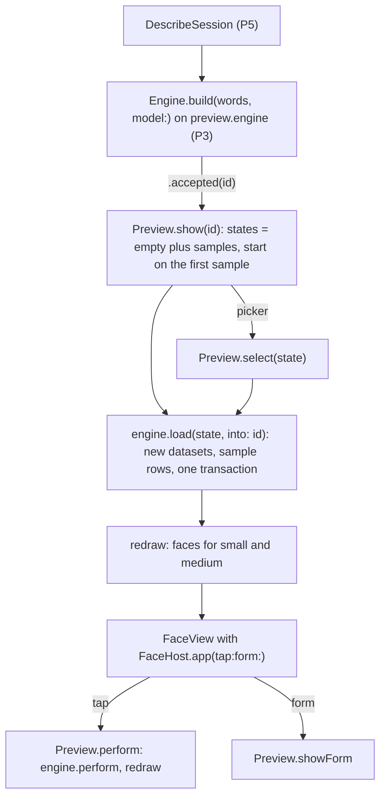
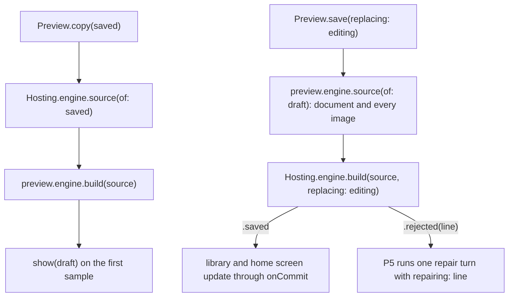

# PR 5: a tappable preview for a draft that is not saved

Branch `phase-2-p4-preview` into `phase-2-p3-build-loop` (#3). This is P4 of [tasks/phase-2-app-flow.md](../../tasks/phase-2-app-flow.md).

Background reading: the plan's "The data shape" (a draft lives only in the scratch engine) and P4 sections, and [USAGE.md](../engine/USAGE.md) section 2c.

## Core changes

- **Scratch engines.** `Engine.scratch()` in [Engine.swift](../../Engine/Sources/WidgetEngine/Engine.swift) makes an engine in a new folder at `tmp/scratch-engines/<run>/<engine>`, with no commit hook, so nothing it saves reloads WidgetKit. Its store owns the folder: `RowStore.deinit` in [RowStore.swift](../../Engine/Sources/Rows/RowStore.swift) closes the database, then deletes it. A store that owns its folder ignores `Engine.suspend()`, so a build keeps saving in the background. `Engine.removeLeftoverScratch()` deletes every earlier run's folder, and the app calls it at launch.
- **Samples into a draft.** `Engine.load(_:into:)` and `Engine.samples(of:)` in [Samples.swift](../../Engine/Sources/WidgetBuilder/Samples.swift). `load` moves each table to a new dataset and seeds the state's rows, in one transaction. `.empty` shows no rows. It throws on any engine that is not a scratch engine.
- **`Preview`** in [Preview.swift](../../App/Widgie/Preview.swift) owns one scratch engine and draws both families. It has `show`, `select`, `perform`, `showForm`, `copy` for a refine, and `save(replacing:)`. `show` changes nothing until the state has loaded, and a redraw that a later one overtook is dropped.
- **A Debug-only lab** in [PreviewLab.swift](../../App/Widgie/PreviewLab.swift) opens the water fixture as a draft.

## 1. The person tries a draft

Key decisions:

- **Loading replaces rows instead of adding them.** Switching samples never mixes rows, and the empty state needs no separate `clear`.
- **`load` refuses the shared store.** On the shared store it would hide the person's rows behind new datasets.
- **The store deletes the folder, not `Preview.deinit`.** The engine's database stays open until the engine is released, after `deinit`'s body runs. A test confirmed 5 open file handles before release and 0 after.
- **The engine names and owns the scratch folder.** No caller passes a folder that release would delete, so `Engine.scratch()` cannot be pointed at the App Group. The run folder lets the launch sweep tell leftovers from this run's live drafts without tracking them.
- **Scratch stores do not suspend.** iOS ends a suspended app that holds a lock on a file in a shared container (0xdead10cc). A scratch database sits in the app's private `tmp`, which no other process opens, and P5 keeps a build running in the background with `beginBackgroundTask`. Suspended, every accepted attempt would fail at save with "Database is suspended".
- **The redraw started last wins.** Taps and sample loads write on the main actor before their redraw starts, so the newest redraw reads the newest rows. A counter drops an older redraw that finishes after it.

## 2. The person saves, or refines a library widget

Key decisions:

- **A refine preview shows the first sample.** No public call copies rows, and the person's real rows stay untouched until Save.
- **Save reads the scratch engine's source,** so an image attached in an earlier turn and reused since still reaches the shared store.
- **`save` returns the build outcome,** so P5 gets the rejection line to repair with.

## Verification

- `scripts/check` passes, with 14 new `PreviewTests`. They compare each face against `Engine.proof` of the same sample, and check that switching replaces rows, that two other engines list nothing, that the shared store refuses `load`, that the folder is gone after release while an `Engine(directory:)` folder stays, that the launch sweep keeps this run's folders, that a saved draft draws like the empty proof, so no sample row travels, and that samples load into a widget with no tables and into a refined draft. The `FileStores` suspend test also checks that a store that owns its folder keeps writing while suspended.
- On the iPhone 18 Pro simulator with `axe`: the water draft opened at 9/8, two plus taps made 11/8, and "morning" and "empty" redrew at 2/8 and 0/8. With the draft open, the edit sheet listed only the 9 library widgets. A copied library widget showed the sample while the library kept 3/8 (`Engine/.artifacts/app-flow/p4/`).
- Memory with `vmmap --summary`: 52.0 to 52.4 MB for the library alone, and 53.3 to 53.6 MB with a preview open, over 22 rounds. That is about 1.3 MB per preview, with no growth after closing.
- Unverified: SwiftUI once held one dismissed preview until the next launch, rooted in its animation manager. Its folder was swept at launch.
