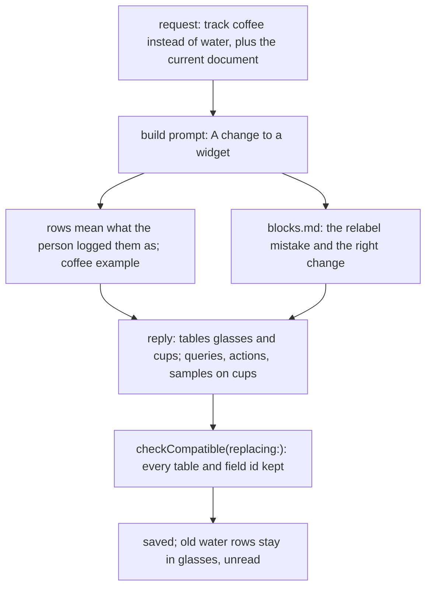
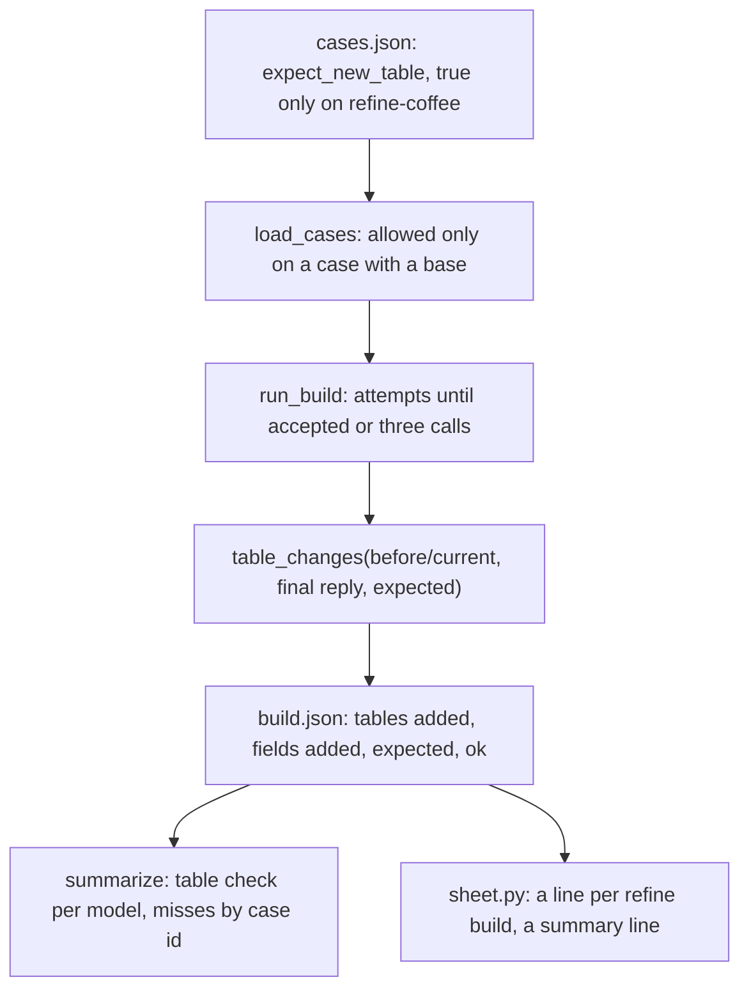

# PR draft: a refine adds a table for new data instead of relabelling one

Branch `phase-2-refine-new-table` into `main`. It closes the first refine miss listed under Phase 2 in [tasks/todo.md](../../tasks/todo.md).

Background reading: [docs/pr/4-phase-2-p2-refine.md](4-phase-2-p2-refine.md) (the refine mode and its evals) and [USAGE.md](../engine/USAGE.md) section 3.

## Core changes

- **The refine rule now carries a worked example.** "A change to a widget" in [build-prompt.md](../../Engine/Reference/build-prompt.md) says a table's rows mean what the person logged them as. For "track coffee instead of water", the model adds `cups`, points the queries, actions, and samples at it, and keeps `glasses` with its rows. Before, both models relabelled `glasses` as Coffee in every run, so every glass of water already logged read as a cup of coffee. The engine cannot catch this, because every id is kept.
- **[blocks.md](../../Engine/Reference/blocks.md) gains the relabel mistake.** It is prose plus a before block and the right change, which the reference tests check as a refinement.
- **The harness measures it.** Each refine build in [run.py](../../Engine/Evals/run.py) records the tables and fields the reply added, and a pass or fail against the case's new `expect_new_table` in [cases.json](../../Engine/Evals/cases.json). The summary, `results.json`, and the [contact sheet](../../Engine/Evals/sheet.py) show it. [test_run.py](../../Engine/Evals/test_run.py) covers the check.

## 1. The model refines a widget

Key decisions:

- **Keep `glasses` and leave it unread.** The engine already requires every table id to survive, and an unread table is legal. So the old rows stay intact for a later refine or a restore. This agrees with the existing "to stop showing something" bullet.
- **Point the existing queries at `cups` instead of adding new ones.** The query ids stay the same, so the look keeps working with only its words changed.
- **The `blocks.md` example is two blocks, not three.** The first version also showed the relabelled document as a third block. With that version, Haiku's "use a handwriting font" missed the first try in 6 of 6 trials, because it changed only the font and the wider font overflowed small. With the two-block version it passed the first try in 5 of 5, and with no `blocks.md` example at all in 4 of 4. Coffee passed in every variant, so the refine bullet carries the fix.

## 2. The eval harness checks a refine

Key decisions:

- **A new table counts only when a query reads it and something adds rows to it.** Rows come from an `insert`, `insertOn`, or `form` action, or an automation's `writes`. A `cups` table that nothing reads, or that only a delete touches, fails. A relabel adds no table, so it fails too.
- **A refine without the flag must add no table.** "Make it blue" that splits data into a new table is a miss of the same kind. The check runs both ways, so the eight other refine cases guard against over-applying the new rule.
- **No heuristic for a kept table's meaning.** A changed name with the same tables might be a relabel or a harmless rename of the widget. The case flag says what the request needs, which is exact.
- **The check reads the final reply, accepted or not.** A failed build still shows what the model tried.

## Verification

- `scripts/check` passes. The reference tests parse the new `blocks.md` example, and `test_run.py` adds 7 tests.
- Replayed over the `p2-refine-2` replies, the check reads 8 of 9 on both models, missing only coffee, as the contact sheet showed.

| Run | Prompt | Sonnet accepted, first try | Haiku accepted, first try | Coffee adds a table |
|---|---|---|---|---|
| `p2-refine-2` | before | 9, 8 | 9, 8 | no, no |
| `p2-refine-3` | three-block example | 9, 9 | 9, 8 | yes, yes |
| `p2-refine-4` | two-block example (this PR) | 9, 8 | 9, 8 | yes, yes |

- Coffee trials outside the full runs: two per model on the two-block prompt and one per model with no `blocks.md` example all add `cups`. One Sonnet trial needed a repair for a dropped plus button.
- `p2-refine-2` ran an older prompt than main. Main since changed "Keep its table" to "Keep its table and fields". The font and "nicer" A/B trials ran main's prompt against this branch's prompt in the same session.
- Every render in `p2-refine-3` and `p2-refine-4` was checked by eye. The chart, font, and bigger-number misses already listed are unchanged in kind. Two notes went to [todo.md](../../tasks/todo.md). Haiku's "make it nicer" needs fit repairs on both prompts (4 of 4 here, 2 of 3 on main). Haiku's brown coffee plus button reads as disabled.
