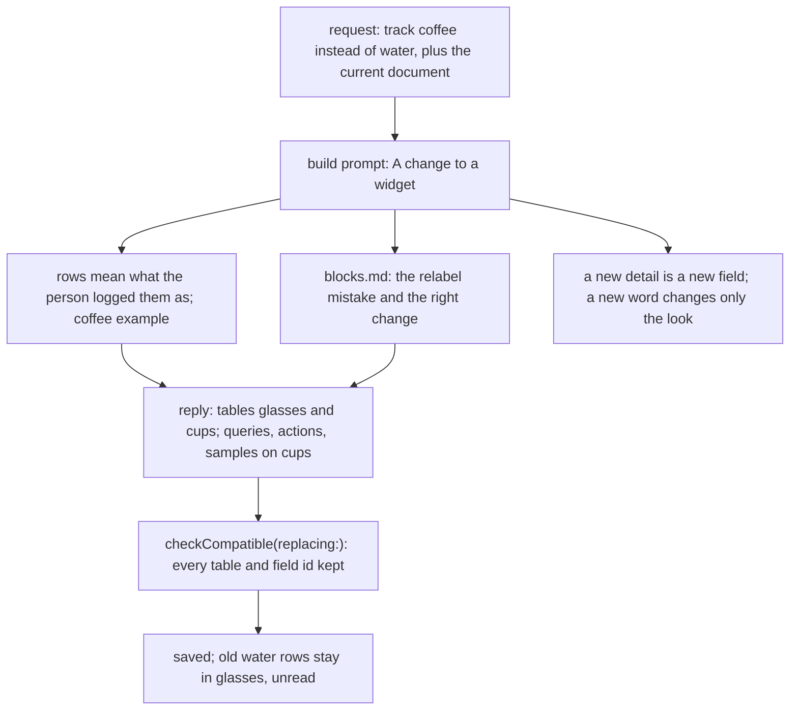
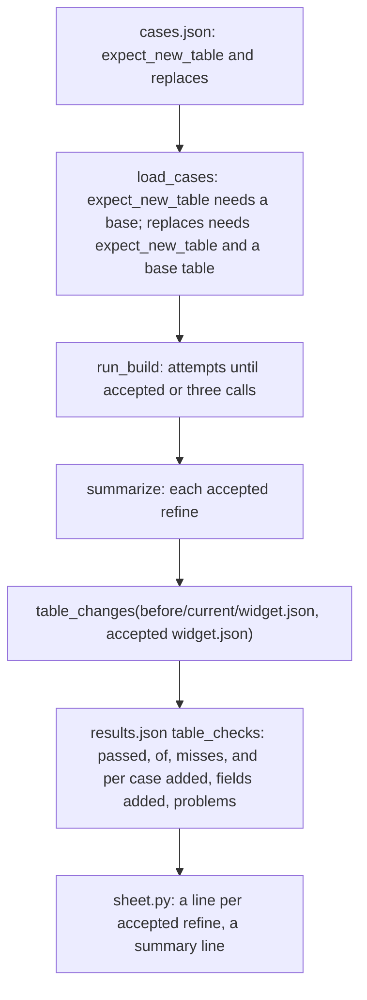

# PR 6: a refine adds a table for new data instead of relabelling one

Branch `phase-2-refine-new-table` into `main`. It closes the first refine miss listed under Phase 2 in [tasks/todo.md](../../tasks/todo.md).

Background reading: [docs/pr/4-phase-2-p2-refine.md](4-phase-2-p2-refine.md) (the refine mode and its evals) and [USAGE.md](../engine/USAGE.md) section 3.

## Core changes

- **The refine rule now carries a worked example.** "A change to a widget" in [build-prompt.md](../../Engine/Reference/build-prompt.md) says a table's rows mean what the person logged them as. For "track coffee instead of water", the model adds `cups`, points the queries, actions, and samples at it, and keeps `glasses` with its rows. Before, both models relabelled `glasses` as Coffee in every run, so every glass of water already logged read as a cup of coffee. The engine cannot catch this, because every id is kept.
- **[blocks.md](../../Engine/Reference/blocks.md) gains the relabel mistake.** It is prose plus a before block and the right change, which the reference tests check as a refinement.
- **The rule has limits.** One more refine bullet says a new detail about each row, such as a due date on a to-do, is a new field, and a new word for the same thing, such as calling to-dos tasks, changes only the look. Without the second sentence, Haiku moved the count to a new `cups` table for "say cups instead of glasses", so the water already logged today dropped out. The examples avoid every eval request, so the cases stay held out.
- **The harness measures it.** The summary in [run.py](../../Engine/Evals/run.py) checks each accepted refine's tables against two case fields in [cases.json](../../Engine/Evals/cases.json). `expect_new_table` asks for a new table that a query reads and something fills. `replaces` names the base table that must then go unread and unfilled. Every other table the base read must stay read. `results.json` and the [contact sheet](../../Engine/Evals/sheet.py) show it. [test_run.py](../../Engine/Evals/test_run.py) covers the check, `load_cases`, and the engine's query and action kinds.
- **Held-out cases.** Besides coffee, `refine-yoga` ("track yoga instead of meditation" on habit) and `refine-quote` ("change it to a daily quote" on word of the day) must add a table and drop the old one. `refine-cups` ("say cups instead of glasses") and `refine-size` ("log the size of each glass") must add none and keep reading `glasses`.

## 1. The model refines a widget

Key decisions:

- **Keep `glasses` and leave it unread.** The engine already requires every table id to survive, and an unread table is legal. So the old rows stay intact for a later refine or a restore. This agrees with the existing "to stop showing something" bullet.
- **Point the existing queries at `cups` instead of adding new ones.** The query ids stay the same, so the look keeps working with only its words changed.
- **The `blocks.md` example is two blocks, not three.** The first version also showed the relabelled document as a third block. With that version, Haiku's "use a handwriting font" missed the first try in 6 of 6 trials, because it changed only the font and the wider font overflowed small. With the two-block version it passed the first try in 5 of 5, and with no `blocks.md` example at all in 4 of 4. Coffee passed in every variant, so the refine bullet carries the fix.

## 2. The eval harness checks a refine

Key decisions:

- **The check runs in `summarize`, not `run_build`.** It reads the widgets on disk each time, so a resumed or re-summarized run follows the current cases instead of a result frozen in `build.json`.
- **A failed build is left out.** It has no saved widget to judge, so the sheet shows no pass or fail beside it and the count is "of the accepted refines".
- **A new table counts only when a query reads it and something adds rows to it.** Rows come from an `insert`, `insertOn`, or `form` action, or an automation's `writes`. A `cups` table that nothing reads, or that only a delete touches, fails. A relabel adds no table, so it fails too.
- **A replaced table must go unread and unfilled.** A reply that adds `cups` but keeps `today` counting `glasses` and `drink` inserting into it is a relabel plus an add, and fails. A delete may still touch it.
- **Every other table the base read stays read.** This one rule covers the wording-only and new-field cases ("keeps reading `glasses`") and an "also track" request that drops the old data by mistake, with no extra case field.
- **A refine without the flag must add no table.** "Make it blue" that splits data into a new table is a miss of the same kind. The check runs both ways, so the other refine cases guard against over-applying the new rule.
- **The engine's vocabulary is tested, not restated.** A test reads the `Kind` enums in `Queries.swift` and `Actions.swift`, so a new query shape or action fails until the harness says whether it reads or adds rows.
- **No heuristic for a kept table's meaning.** A changed name with the same tables might be a relabel or a harmless rename of the widget. The case flag says what the request needs, which is exact.

## Verification

- `Engine/scripts/check` and `scripts/check` pass. `test_run.py` has 17 tests: the table check, `summarize`, `load_cases`, and the engine's query and action kinds.
- The new check, replayed over the `p2-refine-3` and `p2-refine-4` replies, passes every refine on both models, coffee included. Those coffee replies stop reading and filling `glasses`.

| Run | Prompt | Sonnet accepted, first try | Haiku accepted, first try | Coffee, yoga, quote add a table and drop the old one | Cups and size add no table |
|---|---|---|---|---|---|
| `p2-refine-2` | before | 9, 8 of 9 | 9, 8 of 9 | coffee no, no | not run |
| `p2-refine-3` | three-block example | 9, 9 of 9 | 9, 8 of 9 | coffee yes, yes | not run |
| `p2-refine-4` | two-block example | 9, 8 of 9 | 9, 8 of 9 | coffee yes, yes | not run |
| `p2-refine-5` | plus the new-field sentence | 13, 12 of 13 | 12, 10 of 13 | yes on both | Haiku's cups adds `cups` |
| `p2-refine-6` | plus the new-word sentence (this PR) | 12, 11 of 13 | 13, 11 of 13 | yes on both | yes on both |

- On the 9 cases shared with `p2-refine-4`, `p2-refine-6` reads Sonnet 8 accepted and 7 first try, Haiku 9 and 7. The misses are Sonnet's "make it nicer", which failed on fit, and Haiku's "use a handwriting font", which took two repairs. Both are fit lines on long text. In trials in the same session, the `p2-refine-4` prompt did no better. Sonnet's nicer passed 3 of 3 (2 first try) on it and 3 of 3 (2 first try) on this PR's prompt. Haiku's font needed a repair in 4 of 4 on it and passed 3 of 3 (1 first try) on this PR's. Haiku's font change passed first try in 5 of 5 in an earlier session, so its first try moves from session to session.
- Both "log the size of each glass" replies add an `ml` field to `glasses`. Sonnet adds 150, 250, and 500 ml buttons, and Haiku adds a form for the size.
- Every render of the new cases in `p2-refine-6` was checked by eye. Two notes went to [todo.md](../../tasks/todo.md). Sonnet's size chart sums `ml`, so past days with no size read as zero, and its medium floats the minus button. Both quote widgets cut a long quote while the space above the author stays empty.
- Every render in `p2-refine-3` and `p2-refine-4` was checked by eye too. The chart, font, and bigger-number misses already listed are unchanged in kind. Haiku's "make it nicer" needs fit repairs on both the PR prompt and main's, and Haiku's brown coffee plus button reads as disabled. Both are in todo.md.
- Coffee trials outside the full runs: two per model on the two-block prompt and one per model with no `blocks.md` example all add `cups`.
- `p2-refine-2` ran an older prompt than main. Main since changed "Keep its table" to "Keep its table and fields".
