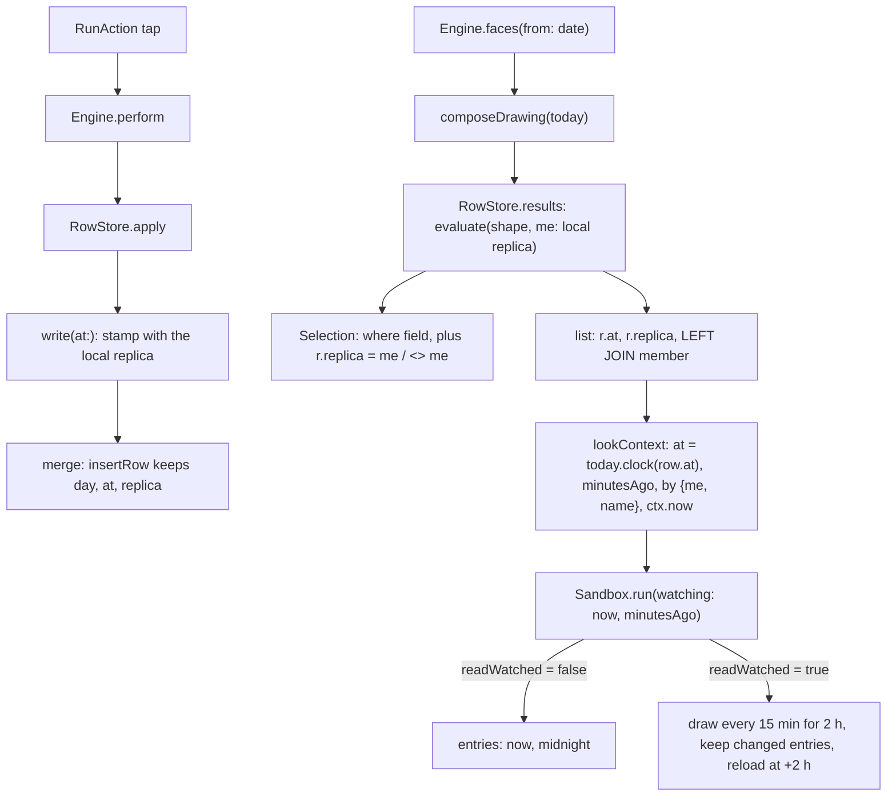
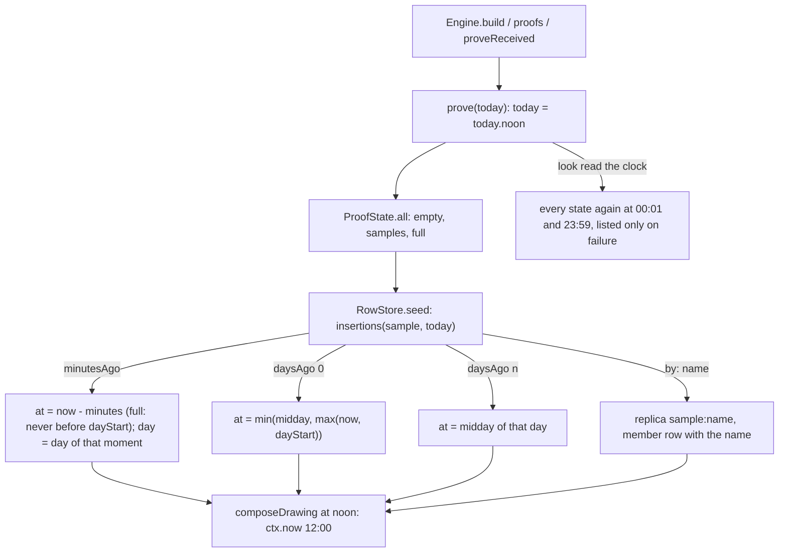
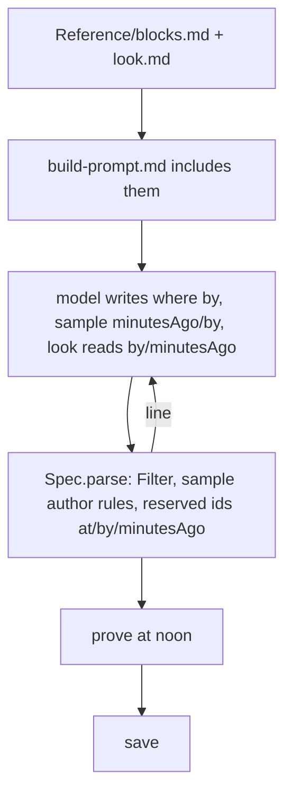

# PR 7: who wrote each row, and when

Branch `phase-1e-row-author` into `main`. This is phase 1e of [tasks/todo.md](../../tasks/todo.md), which came out of the ICP research in [docs/research/icp-and-widgets.md](../research/icp-and-widgets.md).

Background reading: phase 1e in the plan, the `where` and samples sections of [blocks.md](../../Engine/Reference/blocks.md), the ctx section of [look.md](../../Engine/Reference/look.md), and the rows and `ctx` paragraphs of [RATIONALE.md](../engine/RATIONALE.md).

## Core changes

- **Research and spec.** Six target ICPs, with ICP 5 dropped. Two new v1 reference widgets, dog fed and thinking of you, added to the goal and the definition of done.
- **Author and time on every row.** `RowValue` gains `at` and `by: RowAuthor { me, name }` ([RowStore.swift](../../Engine/Sources/Rows/RowStore.swift)), read from the existing `row.at` and `row.replica` columns, with `me` meaning this store's replica ([Queries.swift](../../Engine/Sources/Rows/Queries.swift)). A local `member` table (migration 2 in [Merge.swift](../../Engine/Sources/Rows/Merge.swift)) holds names.
- **`where by`.** `Spec.Filter { field, by }` replaces `FieldValue?` on every query shape ([Spec/Queries.swift](../../Engine/Sources/Spec/Queries.swift)). It encodes canonically, so a field-only `where` keeps its old bytes.
- **Samples.** `minutesAgo` and `by` on sample rows ([Samples.swift](../../Engine/Sources/Spec/Samples.swift)). Seeding stamps another member's rows with a `sample:<name>` replica and records the name. `full` writes today's rows 719 minutes old, by a 30-unit name, except for rows meant for `by: me` queries.
- **The look's clock.** `ctx.now`, plus `at` and `minutesAgo` on each row ([LookContract.swift](../../Engine/Sources/WidgetEngine/LookContract.swift)). `Today` gains `instant`, `time`, `clock(_:)`, `minutes(since:)`, `dayStart`, and `noon` ([Day.swift](../../Engine/Sources/Spec/Day.swift)).
- **Read tracking in the sandbox.** `Sandbox.run(_:context:watching:budget:)` returns `Output { tree, readWatched }`. The prelude turns watched keys into recording getters ([Sandbox.swift](../../Engine/Sources/Sandbox/Sandbox.swift)).
- **Timeline.** `Engine.faces` adds quarter-hour entries for two hours when the look read the clock ([Engine.swift](../../Engine/Sources/WidgetEngine/Engine.swift)).
- **Proofs at noon.** `prove` and the single-cell proof use `today.noon` ([Proof.swift](../../Engine/Sources/WidgetBuilder/Proof.swift)).
- **Fixtures and evals.** [Fixtures/dogfed](../../Engine/Fixtures/dogfed/widget.json), [Fixtures/hearts](../../Engine/Fixtures/hearts/widget.json) with a drawn stand-in photo, and two cases in [cases.json](../../Engine/Evals/cases.json).

## 1. A tap writes a row, and the widget shows who and when

Key decisions:

- **No new columns.** The insert instant and the inserting replica were already stored and synced with every row. A row's author cannot be forged by the spec, and sync carries it for free.
- **`me` is relative to the store, but the promise is "the person".** Two stores agree on who wrote a row, and each calls its own rows `me`. The docs teach `me` as the person. Phase 3 writes automation rows under the owner, and phase 4 maps an account's replicas to `me`. Until then a second device or a reinstall sees its own old rows as another member's.
- **Read tracking, not sampling.** The first version rendered once more, 15 minutes ahead, and kept quarter-hour entries only if that render differed. The review showed this misses looks that change hourly or at a threshold: dog fed at "10 h ago" stayed amber past 12 h. The sandbox now reports whether the look read `now` or `minutesAgo`, which is exact and costs no probe render. Getters fire on spreads and `JSON.stringify` too, so the check errs toward more entries.
- **Only changed entries are kept.** A clock look draws up to 8 quarters, and identical neighbours are dropped. That kept entry count low (dog fed past 10 h keeps one entry per hour).
- **`HH:MM` in the reader's zone.** A look gets the time as text plus `minutesAgo`, so it never parses dates. A row written in another zone reads in the viewer's. `minutesAgo` clamps at 0 for a peer whose clock runs ahead.

## 2. A proof seeds samples and renders every state

Key decisions:

- **Proofs render at noon.** Seeding by minutes and `ctx.now` made the verdict depend on the hour: hearts proved at 03:00 lost its 5-hour-old hearts to yesterday. A revision built at 09:00 could have been rejected by `proveReceived` on a partner's phone at 21:00. At noon, every `minutesAgo` up to 719 stays on today. A test compares proofs run at 03:00 and 21:30.
- **Clock-reading looks are also proved at 00:01 and 23:59.** Noon alone would never draw a "Good morning" branch. Those extra renders appear in the matrix only when they fail, so a passing proof keeps the same files.
- **`full` never goes before the day began.** On a 23-hour day noon is only 660 minutes after midnight, so a fixed 719 would put today's rows on yesterday. `full`'s rows carry `staysToday`, while a document's `minutesAgo` keeps its exact meaning. A test seeds New York's 2026-03-08.
- **`full` stresses the new widths.** Today's rows are 719 minutes old ("11 h 59 min ago"), and other members' rows carry "Maximiliana Montgomery-Okonkwo", 30 UTF-16 units, the limit. Names are counted in UTF-16 like text values, so combining marks cannot inflate one.
- **Sample authors use fake replicas only in scratch stores.** `seed` and `replaceRows` run only on proof and preview stores. `changes(after:)` sends only the local replica's rows, so `sample:*` rows never sync.
- **No sample row lands in the future or on yesterday's clock.** Today rows clamp between the day's start and the render instant.

## 3. The model writes a shared or "how long ago" widget

Key decisions:

- **Teach, then verify with evals.** Both new cases were accepted on Haiku and Sonnet. In the full set, Sonnet accepted 30 of 30 and Haiku 28 of 30. Haiku's two failures were text fit and button coverage, the same kinds earlier runs had. One Sonnet repair came from writing `daysAgo` and `minutesAgo` on one row, and the line fixed it.
- **The grammar grew inside format 1.** No build has shipped, so no stored revision holds a field named `at`, `by`, or `minutesAgo`, and no older peer reads the new keys. The first grammar change after TestFlight bumps `format`.
- **Strict sample placement.** A row takes `daysAgo` or `minutesAgo`, never both, so a row has one meaning.
