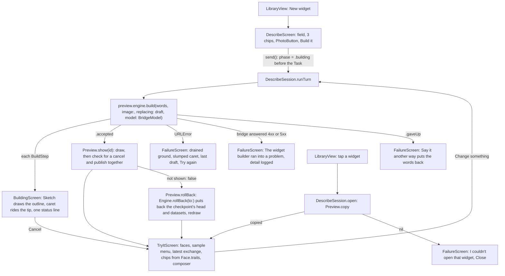
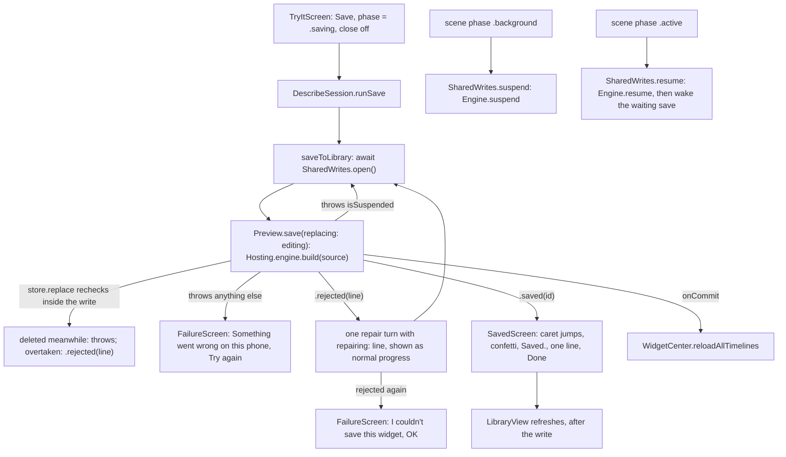
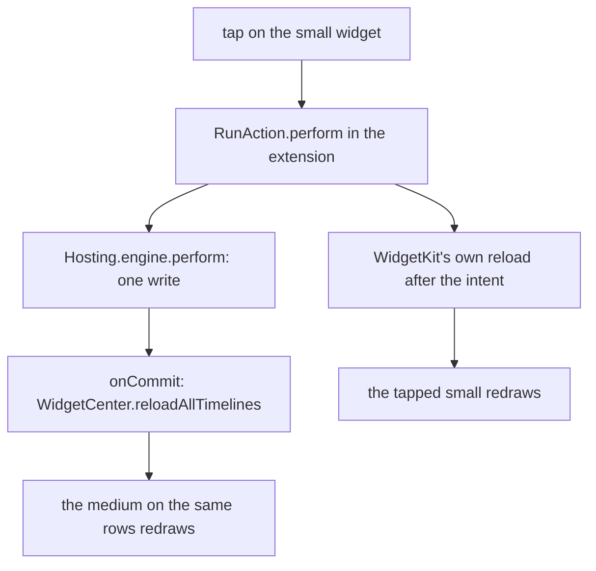
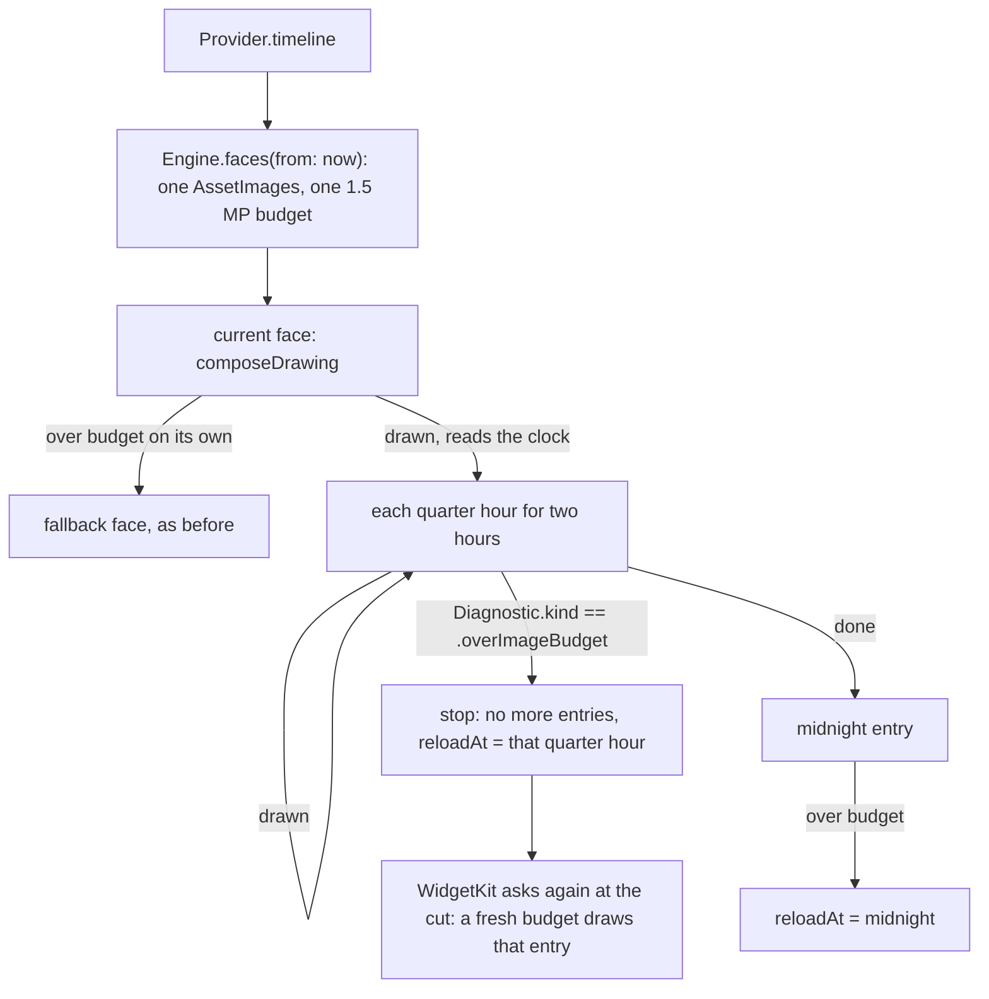

# PR 8: describe a widget, watch it build, try it, refine it, save it

Branch `phase-2-p5-describe` into `main`. This is P5 of [tasks/phase-2-app-flow.md](../../tasks/phase-2-app-flow.md). The look is The Caret in Sky, decided in [docs/design/app-feel/README.md](../design/app-feel/README.md), with the tokens in [directions.md](../design/app-feel/directions.md) round 4.

Background reading: the plan's P5 section, and [PR 5](5-phase-2-p4-preview.md) for the scratch engine the flow builds on.

## Core changes

- **The describe flow.** [DescribeSession.swift](../../App/Widgie/Describe/DescribeSession.swift) runs the build loop on the preview's scratch engine, maps each `BuildStep` to `phase`, keeps the build loop alive with `beginBackgroundTask`, turns a Save rejection into one repair turn, and never replaces the draft on a failed or cancelled turn. `start()` leaves `composing` before it returns, so a double tap cannot start two jobs. The session holds only the latest exchange and the words of the last accepted turn, not every turn.
- **One cancel boundary for showing a draft.** [Preview.show](../../App/Widgie/Preview.swift) draws the new draft's faces, then checks for a cancel and publishes in the same main actor step. It returns true only once the draft is on show, and false when cancelled, overtaken by another drawing, or when the sample did not load. The engine's loop never reports `.gaveUp` after a cancel ([Loop.swift](../../Engine/Sources/WidgetBuilder/Loop.swift)).
- **Cancel means nothing changed, rows included.** Before a refinement the session takes `Engine.checkpoint(of:)` of the draft: its head and the dataset each table reads ([Samples.swift](../../Engine/Sources/WidgetBuilder/Samples.swift)). When the new draft never went on show, `Preview.rollBack(to:)` calls `Engine.rollBack(to:)`, which puts both back in one transaction, and redraws, so rows from the person's earlier taps stay on show. The draft's bindings become exactly the checkpoint's, so a table the cancelled refinement added loses its dataset and a later refinement may add it again with other field kinds. Before, the rollback reloaded the sample and dropped them. A turn that was not cancelled is never reported as cancelled: the session checks `Task.isCancelled` itself and fails the turn as `.broken` otherwise. A checkpoint or rollback that fails also fails the turn as `.broken`, instead of "Stopped. Nothing changed." over a changed draft.
- **A refinement never moves a head it no longer fits.** [RowStore.replace](../../Engine/Sources/Rows/RowStore.swift) runs the compatibility check again inside the write that moves the head. A widget deleted while its refinement was proved throws with its own wording ("was deleted while its refinement was proved"), and a refinement that another one overtook is checked against the new head. Both checks read the actual head document, not the newest revision proved here, so a head received from another device whose proof is still pending keeps the fields it added. The same holds for every widget sharing the draft's data: the field kinds must agree with its head and with the revision it still draws, whose taps write the shared rows. A head this device cannot read declines the replacement. Before, Save reported `.saved` on a deleted widget.
- **A Save never meets a locked store.** [SharedWrites.swift](../../App/Widgie/SharedWrites.swift) owns `Engine.suspend` and `resume` on scene phase changes. When GRDB refuses a write as suspended, the store says so (`StoreError.suspended`, then `EngineError.isSuspended`), and only that error makes a Save wait for the app to return and save again. Every other error goes to the failure screen. Close is off while saving. GRDB's notification reaches only pools already open, so `RowStore` keeps the suspended state itself, under one lock with `suspend` and `resume`, and a shared store refuses its first open while suspended with the same suspended error. Scratch stores are exempt.
- **Suggestions that fit the draft.** [Traits.swift](../../Engine/Sources/WidgetEngine/Traits.swift) adds `Face.traits`: whether a face shows a number of 20 pt or more, and the hue it paints most. The try-it screen offers a color across the wheel from that hue, and "Bigger number" only when the face shows one. `BridgeModel` in [Model.swift](../../Engine/Sources/WidgetBuilder/Model.swift) is the one dev bridge client, used by the app and `render-tool loop`. The app's [BridgeModel.swift](../../App/Widgie/Describe/BridgeModel.swift) only reads the Debug-only bridge URL.
- **One action per screen.** [DescribeView.swift](../../App/Widgie/Describe/DescribeView.swift) holds Describe, Building, and Failure. [TryItView.swift](../../App/Widgie/Describe/TryItView.swift) is the preview with the latest exchange right under the faces. [SavedView.swift](../../App/Widgie/Describe/SavedView.swift) is the jump, the confetti, and Done. [LibraryView.swift](../../App/Widgie/LibraryView.swift) shows the widgets at home screen sizes, or the big caret and "Tell me a widget."
- **The caret.** [Caret.swift](../../App/Widgie/Design/Caret.swift) is one view whose poses (idle, lean, draw, jump, slump) are cubic curves that morph on a spring. It blinks, scribbles while drawing, grows its cheeks when happy, and loses them when slumped. The same view ends the wordmark, sits in the fields, and speaks the reply.
- **Tokens in an asset catalog.** [WidgieColors.xcassets](../../App/Widgie/Design/WidgieColors.xcassets) holds the 29 Sky colors with light and dark values. [Theme.swift](../../App/Widgie/Design/Theme.swift) reads them through Xcode's generated symbols, and holds the button, chip, and outline styles. Pip, the step bar, the tangerine, and the lipped buttons are gone.
- **App unit tests.** [WidgieTests](../../App/WidgieTests) is a hosted unit test target that [App/scripts/build](../../App/scripts/build) runs on the simulator, so `scripts/check` runs it. It drives `DescribeSession`, `Preview`, and `Library` with a scripted model and temporary engines. `Preview` and `Library` take the shared engine, and the session takes its preview and the `SharedWrites.open` gate, each defaulting to the real one.
- **Engine tidying.** One `attempt` turns a `StoreError` into an `EngineError` ([Engine.swift](../../Engine/Sources/WidgetEngine/Engine.swift)). `prove` records every render through one helper and encodes PNGs only for `Engine.proofs` and `Engine.proof`, so a build or a Save encodes none ([Proof.swift](../../Engine/Sources/WidgetBuilder/Proof.swift)). `Engine.maxBuildAttempts` gives the app its "(2 of 3)".
- **Every widget reloads after a home screen tap.** [Hosting.swift](../../Engine/Sources/WidgetHosting/Hosting.swift) now passes the WidgetKit reload to the extension's engine too.
- **Form input is never dropped or saved on the wrong day.** [FormSheet.swift](../../App/Widgie/FormSheet.swift) adds `FormFormat`, one `NumberFormatter` in the person's locale that shows and reads numbers, so "12,5" in France saves 12.5. Text that is not wholly a number keeps the form open and marks the field. Dates convert through a Gregorian calendar in the device time zone, the days the engine counts, whatever calendar the picker shows. `FormDraft` holds what the form shows: a new form starts its toggles off and its dates on today and sends what it shows, and an edit form sends only the fields the person changed. An emptied stored text or number, or text over the engine's limit (`InputField.textLimit`, new), keeps the form open with a plain hint. Each form link shows the sheet as a new `ShownForm` with its own id, so a second link never inherits the first form's values. `InputField` gains a public init so the app tests can build a form.
- **An accepted photo widget never falls back for running out of image budget across its timeline.** The proof gives each render a fresh 1.5 megapixel budget, but one `faces` call shares one across every entry. The picture's over-budget error now carries `Diagnostic.Kind.overImageBudget` through `composeDrawing`, and `faces` ends the timeline at the first later entry that would pass the budget, with `reloadAt` at its date ([Engine.swift](../../Engine/Sources/WidgetEngine/Engine.swift)). A current face that passes it on its own still falls back.
- **Only the latest photo selection attaches, and Send waits for it.** `PhotoButton` in [DescribeView.swift](../../App/Widgie/Describe/DescribeView.swift) loads in `.task(id: item)`, so a newer selection cancels a slow earlier load before it can set the picture or the "didn't load" alert. The pending selection is `DescribeSession.pendingPhoto`, so `canSend` and `send()` refuse the composer's words while a photo loads, the button shows a spinner, and a load publishes only while its item is still the pending one.
- **A cached crop holds only its own pixels.** `CGImage.cropping(to:)` shares the whole thumbnail's buffer, so [AssetImages.swift](../../Engine/Sources/WidgetEngine/AssetImages.swift) draws each crop into a bitmap of the crop's size and caches that copy, the allocation the budget already charges.
- **The store refuses a number that is not finite.** A form value and a synced cell are checked in [Tables.swift](../../Engine/Sources/Spec/Tables.swift), so NaN or infinity never reaches SQLite, where a NaN cell failed a NOT NULL constraint and threw away the whole sync batch.
- **A received design finds its images under a path with a space.** [Received.swift](../../Engine/Sources/WidgetBuilder/Received.swift) checks the asset file at its plain path, not the percent-encoded one.
- **An interrupted snapshot copy leaves nothing a resume trusts.** [run.py](../../Engine/Evals/run.py) copies a missing picture snapshot to a temporary sibling, then `os.replace`s it into place.

## 1. The person describes a widget and tries it

Key decisions:

- **The latest exchange sits right under the faces.** The mock left an empty band between the widgets and the exchange. The exchange and the chips now follow the faces, and the composer stays pinned at the bottom.
- **Failure is its own screen, not a banner.** The ground drains to the Failure tokens and the caret slumps at a broken bridge. "Check that the bridge is running." shows only in Debug.
- **The outline draws from the bottom of the left edge, clockwise.** The caret then spends most of a build on the top edge, above the parts it reveals, instead of covering them.
- **Return builds.** The describe field and the composer wrap long text, so the return key sends instead of starting a new line.
- **The sample picker is a menu.** The mock's compact control, which also keeps the faces and the exchange on one screen.
- **The chips are read off the face, not asked of the model.** The look is JavaScript, so the document cannot say what a face shows. The rendered `Drawing` can, and `Face.traits` reads it without making `Face` any less opaque. A face with only greys and no number gets no chips, because none beat irrelevant ones.
- **The building screen fills the screen.** The root view takes the full frame before `.ground`, so the ground runs edge to edge whatever the status text's width. Cancel sits where Build it was, so it ignores taps for 0.6 s. Before that, a double tap on Build it cancelled the build.
- **The repair line is neutral.** "Fixing a problem (2 of 3)", because a repair also fixes data, assets, and actions, and the repair on Save is about shared data.
- **A cancel after the engine accepted a reply is the app's to honor.** The engine keeps its rule that a `build` under way finishes and `.accepted` returns. The app then decides, and it checks for the cancel with no await between the check and the publish, so a Cancel that lands while the faces draw never shows the new draft.
- **The rollback brings back datasets, not rows.** `load` moves each table to a new dataset and leaves the old one in place, so pointing the tables back at the checkpoint's datasets brings back every row the person saw, taps included, without copying anything. The rollback drops the bindings the checkpoint did not have, which only a scratch store may do, since sync carries no unbind. The checkpoint is a public scratch-only engine call because the app links only the public products (USAGE 2c).
- **A failed copy never falls into create mode.** With `editing` still set, a create-mode Save would have replaced the library widget with a new one.
- **The photo load is keyed by the selection.** `.task(id:)` cancels the earlier load when the selection changes, and the load publishes only if it was not cancelled and its item is still the pending one. A selection token would do the same with more state.
- **The pending photo lives in the session.** Words sent while a photo loaded used to go without it, and leaving the composer cancelled the load, so the photo was dropped. With the selection in the session, Send stays off until the photo lands, and a composer drawn again resumes the load from the same selection.

## 2. The person saves and places it

Key decisions:

- **Saved says how to place it in one line.** "Press and hold your home screen, then tap Edit to add it." A refine of a saved widget says the home screen already shows the change.
- **The final write waits for the foreground instead of a background task.** The shared store refuses writes in the background so iOS never kills the app for holding its lock (0xdead10cc). Keeping that rule and waiting is simpler than any way around it, and the accepted draft stays in the scratch engine meanwhile. The background task covers only the build loop, the work worth finishing while away.
- **The store says why a write failed, instead of the app guessing.** The old Save read `SharedWrites.suspended` in the catch, so a resume that landed before the catch turned a retryable refusal into the failure screen. GRDB refuses a suspended write with `SQLITE_ABORT` or `SQLITE_INTERRUPT`, and the store never aborts or interrupts a statement itself, so `guarded` in RowStore marks exactly those as suspended.
- **The refinement is checked twice, against the head.** Once before the proof, so a mismatch costs no rendering, and again inside the write. The drawn revision is a rendering fallback only: a received head that is not proved yet is still what a refinement replaces, and a sharer's received head is still what its rows will be written as. The check lives in `Rows`, which owns every rule that makes two writers safe. A whole-compatibility recheck, not a revision compare, so a competing refinement that still fits does not force a repair.
- **Close is off while saving, rather than cancelling the save.** A cancel could land after the write commits, so a discard could still leave the widget in the library.
- **The confetti is caret-shaped bars in the Pop colors.** It bursts once after the caret lands. With Reduce Motion the caret does not jump and the confetti is simply there.

## 3. The person taps the widget on the home screen

Key decisions:

- **The extension reloads every widget after a write.** WidgetKit's reload after an intent covers only the tapped widget's timeline. The chronod log showed `getTimelines(1)` for the small family alone, so the medium beside it kept its old count until its timeline ran out. The premise "WidgetKit reloads after an intent on its own" was true only for the tapped widget. [Engine.swift](../../Engine/Sources/WidgetEngine/Engine.swift), [USAGE.md](../engine/USAGE.md), and [RATIONALE.md](../engine/RATIONALE.md) say so now.

- **A number that does not parse keeps the form open.** The old form parsed with `Double.init`, so a French "12,5" was dropped and the form closed as if it saved. `NumberFormatter` was picked over `FloatingPointFormatStyle` because the format style parses a prefix: "12.5" in French reads as 12 and "12abc" as 12. The field says "Enter a number, like 12,5" in the person's locale.
- **A new form sends what it shows.** The date picker showed today and the toggle showed off, but the form sent a value only once the control changed, so a date-only form saved an empty payload and closed with nothing written. `FormDraft` fills those defaults when the form opens. An empty text or number field still stays absent.
- **An edit form sends only what the person changed.** Each untouched field became a newer `setCell`, so a toggle tapped on the home screen while the form was open was undone by Save. `FormDraft` keeps what each field read when the form opened and leaves out any field that still reads the same. This also covers the stored number, which the form shows to 15 significant digits: its unedited text reads back the same, so 0.12345678901234566 is never rewritten as 0.123456789012346. An untouched Save sends nothing, which the store ignores. A date the row lacks stays unset until the person picks one, so editing another field never fills it with today, and picking today does set it.
- **Emptying a stored text or number keeps the form open.** `InputValue` has no null, so leaving the field out kept the old value while the form showed it empty. The field says "Can't be empty" instead. A field that was empty when the form opened may stay empty.
- **Text over the engine's limit keeps the form open.** It used to close the sheet and fail in the engine with a model-facing line, losing the text. The draft checks the engine's own count, UTF-16 units, against `InputField.textLimit`, which reads `Spec.Limits.textLength`, so the app holds no copy of 300.
- **Each form link shows a fresh sheet.** `.sheet(isPresented:)` kept `FormSheet`'s `@State` when a second link replaced the form, so the new title showed over the old values. `Library.form` and `Preview.form` are a `ShownForm` with an id per showing, and `.sheet(item:)` starts over whenever the id changes, the same form again included.
- **Dates are Gregorian days in the device time zone.** The engine's `.date(year:month:day:)` is Gregorian. The old form took components from `Calendar.current`, so on a Buddhist calendar 22 November 2026 was saved as year 2569.

## 4. WidgetKit asks for a photo widget's timeline

[Engine.swift](../../Engine/Sources/WidgetEngine/Engine.swift), [Diagnostic.swift](../../Engine/Sources/Spec/Diagnostic.swift), [Vocabulary.swift](../../Engine/Sources/WidgetEngine/Vocabulary.swift), [USAGE.md](../engine/USAGE.md) section 1.

Key decisions:

- **The cap stays, and the timeline gets shorter.** Each crop counts again, so a look that picks a crop by the hour spends the shared budget entry by entry. Ending the timeline at the first entry that does not fit costs one extra timeline request, and keeps memory under the same cap the proof checks.
- **A crop is copied before it is cached.** A crop from `cropping(to:)` keeps its source thumbnail alive, so 16 narrow crops grew the footprint by about 81 MB in a reviewer's Core Graphics probe while the budget counted a fraction of that. The copy is 8-bit RGBA in the crop's color space when that is RGB, else sRGB, with rows exactly four bytes per pixel.
- **The failure is typed, not matched by its text.** `Diagnostic` gets a `kind`, which `within` keeps as the error climbs the tree, so the line stays the same for the model while `faces` can tell a budget failure from a mistake. Every other later failure still becomes a fallback entry, because a fresh call would fail the same way.

## Verification

- `scripts/check` passes: the engine gate, the app build, and the app tests.
- New engine tests, each shown to fail with its fix disabled: a widget deleted while its refinement is proved (`BuildTests`, holds the main actor so the delete lands during the proof, and asserts the in-write wording so the early check cannot pass it), a refinement overtaken by another and one of a deleted widget (`Documents` in RowsTests), a refinement of a received head not proved here that dropped the field it added (`Documents`), a refinement whose field kind clashes with a sharer's received head not proved here (`Documents`), a cancel from the `.checking` callback (`LoopTests`), a suspended write marked as suspended while an ordinary failure is not (`FileStores`, `Documents`), a first open while suspended refused and then allowed after resume (`FileStores`, inside the one suspension window the Rows tests open), a checkpoint that brings back the head and the tapped rows after a refinement and a sample load (`PreviewTests` in EngineTests), and a rollback to a checkpoint after which a refinement adds the cancelled refinement's table with another field kind (`PreviewTests`).
- App tests, in `WidgieTests`: a Save the shared store rejects runs one repair turn and saves; a cancel after the reply was accepted restores the previous draft; a cancel while a refinement is checked keeps the row tapped before, on show and stored; a draft whose sample does not load fails the turn as `.broken` instead of "Done." with no draft; a give-up puts the words back; a Save refused as suspended waits for the app and saves, and also saves on the retry when the app is already back; a cancelled `Preview.show` publishes nothing; a reload overtaken by a later one never brings back a deleted widget. With the old suspension guess, the old `show` and rollback, or no reload guard, the matching tests fail.
- Cancel during checking, live on the iPhone 18 Pro simulator with sonnet: two taps moved the counter from 142 to 144, then "Make it blue" was cancelled while the new draft was being shown, and the preview kept 144 under "Stopped. Nothing changed." (`review-3/repro-*.png`, `repro-log.txt`). The proof runs in about 0.3 s and the simulator handles a tap only after it, so a throwaway build (not committed) held `Preview.show` for 4 s after the sample load to land the Cancel in that window.
- Build time with PNGs only where kept, the median of six builds per fixture on the Mac with CPU rendering: water 333 to 273 ms, todo 332 to 305 ms, hearts 987 to 765 ms. Not iPhone numbers.
- Live after these fixes on the iPhone 18 Pro simulator with sonnet: a cold launch loads the library from the scene phase reload alone, then a create, a refine, and Save landed (`Engine/.artifacts/app-flow/p5/review-2/`).
- All ten live lanes passed on the iPhone 18 Pro simulator with `axe`, sonnet for all but lane 5 on haiku. Screenshots are in `Engine/.artifacts/app-flow/p5/` in light mode, with `dark-library.png`, `dark-describe.png`, `dark-preview.png`, `dark-saved.png`, and `dark-failure.png`. A Release build shows "Building widgets is not available in this build." (`release-unavailable.png`).
- The recording of lanes 2, 4, and 8 is `lanes-2-4-8.mp4`, 54 s. Lanes 2 and 4 and the Save are a fresh take after the fixes (`lanes-2-4-save-raw.mp4`), with the waits sped up. The home screen placement of lane 8 is the tail of the earlier cut (`lanes-2-4-8-before-fixes.mp4`), which these fixes do not touch, so its widget is the earlier blue one.
- After the fixes, reshot: `building.png` (ground edge to edge), `repair.png` (mid-repair on haiku, the neutral line), `refine-1.png` (the orange chip), `create-image-describe.png` and `create-image.png` (ImageIO thumbnail), `dark-preview.png`, and `dark-building.png`.
- Background Save, live: with a 4 s pause held under a background task between the gate and the write (a throwaway build, not committed), the shared store refused the write in the background, the save logged that it was waiting, and it saved once the app returned, with no error (`background-save-log.txt`, `background-save.png`). Without the pause, the app suspends before the write and saves on return.
- Double taps, live: a double tap on Build it ran one build, a double tap on a chip sent one refine, and a double tap on Save added one widget (6 tiles to 7).
- VoiceOver: each library tile's focusable children carry the "Change it" action (`axe describe-ui`), so it was already reachable.
- `Face.traits` is tested on the six reference widgets in `TraitsTests`.
- Perf, one run per reference prompt on sonnet (`perf.txt`): Build it to the first live preview took 25.5 to 37.8 s, median 33.4 s, against the 36.8 s `run.py` median. App seconds, the total minus the model's, were 0.48 to 1.20, median 0.55, under the 3 s rule.
- The staleness fix: after the fix, two taps on the small moved the medium from 4 to 5 to 6 with the store, without opening the app (`fixed-after-tap.png`, `fixed-after-second-tap.png`). Before it, the medium stayed behind (`stale-after-page-swipe.png`).
- Round 5 fixes, each test shown to fail with its fix disabled: `FormFormatTests` in WidgieTests (fr_FR numbers both ways, partial numbers refused, and a Buddhist-calendar date round trip as the same Gregorian day) fail with the old `Double.init` parse and `Calendar.current`. `aClockPhotoWhoseEntriesOutgrowTheImageBudgetEndsItsTimelineEarly` in EngineTests (five crops of 474 by 632 pixels fit and the sixth does not, so the timeline ends at 10:15 with no fallback, and a call from 10:15 draws) fails on the old engine with fallback entries from 10:15 to midnight. `test_a_missing_snapshot_whose_copy_is_cut_short_is_copied_whole_on_resume` fails on the old copy with a 100-byte snapshot kept.
- The form on the iPhone 18 Pro simulator with the region set to France (`AppleLocale fr_FR`, restored after): a throwaway fixture with one number field (not committed), "12.5" kept the form open with "Enter a number, like 12,5" under the field, and "12,5" saved, after which the widget showed "kg 12.5".
- The photo picker race has no test: it lives in a SwiftUI view, and the fix is the standard `.task(id:)` cancellation.
- Round 6 fixes, each test shown to fail with its fix disabled: `aCachedCropHoldsOnlyItsOwnPixels` in LookTests (a 30 by 100 crop of a 300 by 200 decode holds no more than 30 by 100 by 4 bytes) fails on the old cache, whose crop keeps the source's rows. `aNewFormSavesTheDateAndToggleItShows` in `FormFormatTests` fails when the draft leaves new toggles and dates unset, and `anUntouchedStoredNumberIsLeftOutAndAnEditedOneIsRead` fails when Save parses the untouched text. `wordsWaitForAPhotoThatIsStillLoading` in `DescribeSessionTests` fails when `canSend` and `send()` ignore the pending photo. The view's item check after the load has no test, for the same reason as the race above.
- The date-only form on the iPhone 18 Pro simulator: a throwaway fixture with one date field (not committed), Save with today showing and nothing touched wrote the row, after which the widget showed "Trips 1" and "2026-11-22".
- Round 7 fixes, each test shown to fail with its fix disabled: `anEditFormSendsOnlyTheFieldsThePersonChanged` in `FormFormatTests` fails when only an untouched number is left out, as before. `emptyingAStoredTextOrNumberHoldsSaveBack` fails when an emptied field is skipped. `textOverTheEngineLimitHoldsSaveBack` fails without the length check. `aFormRefusesANumberThatIsNotFinite` in EngineTests fails on the old parse, which accepted both infinities. `aNumberThatIsNotFiniteIsRefused` in RowsTests fails on the old limit check, where the NaN cell made the whole `receive` throw on SQLite's NOT NULL constraint. `aReceivedDesignFindsItsImagesInAFolderWithASpace` in EngineTests fails with the percent-encoded path, leaving the design hidden. `everyFormLinkShowsTheFormAfresh` in `LibraryTests` checks that two opens of the same link give two ids. It has no failing run before the fix because the old form had no identity to compare, and the sheet's reset on a new id is SwiftUI's documented `.sheet(item:)` behavior, not tested here.
- Dynamic Type checked at XXL on the library, describe, and preview screens. Nothing truncated or overlapped.
- Open: on the simulator, the tapped widget shows its new count one redraw late. Its timeline holds the count, which shows after a page swipe (`stale-after-tap.png`, `stale-after-page-swipe.png`). Check on a device.
- Unverified live: a build that outlives the app going to the background, a Save rejected by the shared store, which runs the repair turn, a photo that fails to load, and a library widget that fails to copy. These paths are in code only. Reduce Motion and the VoiceOver step announcements were checked in code only.
