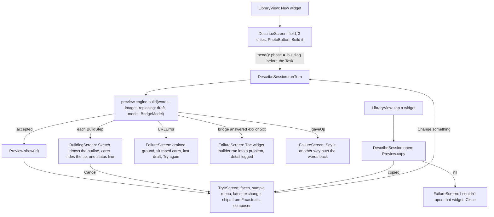
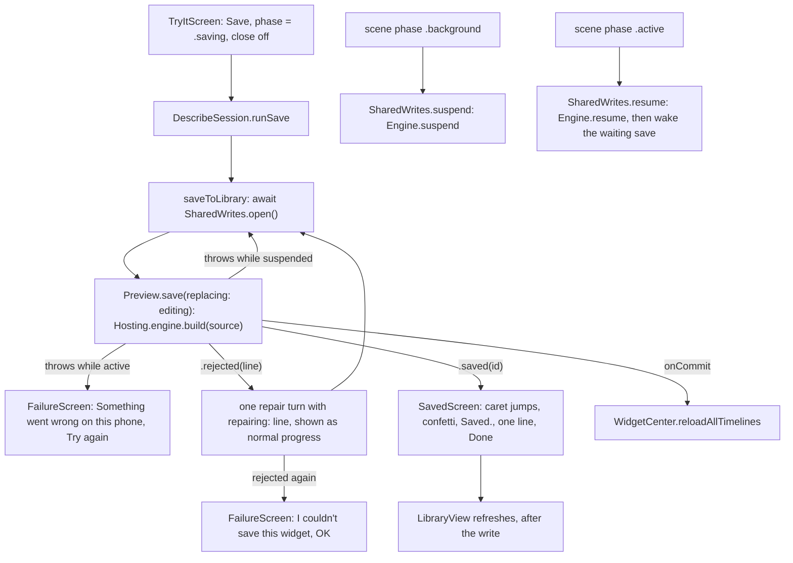
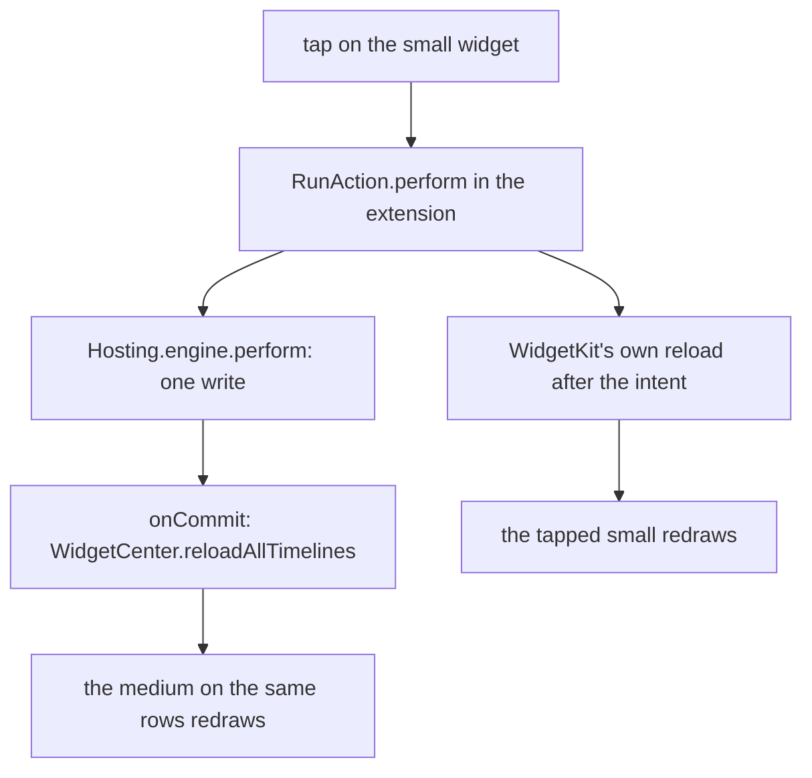

# PR 8: describe a widget, watch it build, try it, refine it, save it

Branch `phase-2-p5-describe` into `main`. This is P5 of [tasks/phase-2-app-flow.md](../../tasks/phase-2-app-flow.md). The look is The Caret in Sky, decided in [docs/design/app-feel/README.md](../design/app-feel/README.md), with the tokens in [directions.md](../design/app-feel/directions.md) round 4.

Background reading: the plan's P5 section, and [PR 5](5-phase-2-p4-preview.md) for the scratch engine the flow builds on.

## Core changes

- **The describe flow.** [DescribeSession.swift](../../App/Widgie/Describe/DescribeSession.swift) runs the build loop on the preview's scratch engine, maps each `BuildStep` to `phase`, keeps the build loop alive with `beginBackgroundTask`, turns a Save rejection into one repair turn, and never replaces the draft on a failed or cancelled turn. `start()` leaves `composing` before it returns, so a double tap cannot start two jobs.
- **A Save never meets a locked store.** [SharedWrites.swift](../../App/Widgie/SharedWrites.swift) owns `Engine.suspend` and `resume` on scene phase changes. A Save that meets the background waits there for the app to return, then saves. Close is off while saving.
- **Suggestions that fit the draft.** [Traits.swift](../../Engine/Sources/WidgetEngine/Traits.swift) adds `Face.traits`: whether a face shows a number of 20 pt or more, and the hue it paints most. The try-it screen offers a color across the wheel from that hue, and "Bigger number" only when the face shows one. [BridgeModel.swift](../../App/Widgie/Describe/BridgeModel.swift) posts to the dev bridge, named only in Debug builds.
- **One action per screen.** [DescribeView.swift](../../App/Widgie/Describe/DescribeView.swift) holds Describe, Building, and Failure. [TryItView.swift](../../App/Widgie/Describe/TryItView.swift) is the preview with the latest exchange right under the faces. [SavedView.swift](../../App/Widgie/Describe/SavedView.swift) is the jump, the confetti, and Done. [LibraryView.swift](../../App/Widgie/LibraryView.swift) shows the widgets at home screen sizes, or the big caret and "Tell me a widget."
- **The caret.** [Caret.swift](../../App/Widgie/Design/Caret.swift) is one view whose poses (idle, lean, draw, jump, slump) are cubic curves that morph on a spring. It blinks, scribbles while drawing, grows its cheeks when happy, and loses them when slumped. The same view ends the wordmark, sits in the fields, and speaks the reply.
- **Tokens in an asset catalog.** [WidgieColors.xcassets](../../App/Widgie/Design/WidgieColors.xcassets) holds the 29 Sky colors with light and dark values. [Theme.swift](../../App/Widgie/Design/Theme.swift) reads them through Xcode's generated symbols, and holds the button, chip, and outline styles. Pip, the step bar, the tangerine, and the lipped buttons are gone.
- **Every widget reloads after a home screen tap.** [Hosting.swift](../../Engine/Sources/WidgetHosting/Hosting.swift) now passes the WidgetKit reload to the extension's engine too.

## 1. The person describes a widget and tries it

Key decisions:

- **The latest exchange sits right under the faces.** The mock left an empty band between the widgets and the exchange. The exchange and the chips now follow the faces, and the composer stays pinned at the bottom.
- **Failure is its own screen, not a banner.** The ground drains to the Failure tokens and the caret slumps at a broken bridge. "Check that the bridge is running." shows only in Debug.
- **The outline draws from the bottom of the left edge, clockwise.** The caret then spends most of a build on the top edge, above the parts it reveals, instead of covering them.
- **Return builds.** The describe field and the composer wrap long text, so the return key sends instead of starting a new line.
- **The sample picker is a menu.** The mock's compact control, which also keeps the faces and the exchange on one screen.
- **The chips are read off the face, not asked of the model.** The look is JavaScript, so the document cannot say what a face shows. The rendered `Drawing` can, and `Face.traits` reads it without making `Face` any less opaque. A face with only greys and no number gets no chips, because none beat irrelevant ones.
- **The building screen fills the screen.** The root view takes the full frame before `.ground`, so the ground runs edge to edge whatever the status text's width. Cancel sits where Build it was, so it ignores taps for 0.6 s. Before that, a double tap on Build it cancelled the build.
- **The repair line is neutral.** "Fixing a problem (2 of 3)", because a repair also fixes data, assets, and actions, and the repair on Save is about shared data.
- **A failed copy never falls into create mode.** With `editing` still set, a create-mode Save would have replaced the library widget with a new one.

## 2. The person saves and places it

Key decisions:

- **Saved says how to place it in one line.** "Press and hold your home screen, then tap Edit to add it." A refine of a saved widget says the home screen already shows the change.
- **The final write waits for the foreground instead of a background task.** The shared store refuses writes in the background so iOS never kills the app for holding its lock (0xdead10cc). Keeping that rule and waiting is simpler than any way around it, and the accepted draft stays in the scratch engine meanwhile. The background task covers only the build loop, the work worth finishing while away.
- **Close is off while saving, rather than cancelling the save.** A cancel could land after the write commits, so a discard could still leave the widget in the library.
- **The confetti is caret-shaped bars in the Pop colors.** It bursts once after the caret lands. With Reduce Motion the caret does not jump and the confetti is simply there.

## 3. The person taps the widget on the home screen

Key decisions:

- **The extension reloads every widget after a write.** WidgetKit's reload after an intent covers only the tapped widget's timeline. The chronod log showed `getTimelines(1)` for the small family alone, so the medium beside it kept its old count until its timeline ran out. The premise "WidgetKit reloads after an intent on its own" was true only for the tapped widget. [Engine.swift](../../Engine/Sources/WidgetEngine/Engine.swift), [USAGE.md](../engine/USAGE.md), and [RATIONALE.md](../engine/RATIONALE.md) say so now.

## Verification

- `scripts/check` passes: the engine gate and the app build.
- No app test target. The branching worth testing is the engine's loop, covered in P3. What remains in the app is view state that only the live lanes show truthfully, and every P5 box ends in a live lane.
- All ten live lanes passed on the iPhone 18 Pro simulator with `axe`, sonnet for all but lane 5 on haiku. Screenshots are in `Engine/.artifacts/app-flow/p5/` in light mode, with `dark-library.png`, `dark-describe.png`, `dark-preview.png`, `dark-saved.png`, and `dark-failure.png`. A Release build shows "Building widgets is not available in this build." (`release-unavailable.png`).
- The recording of lanes 2, 4, and 8 is `lanes-2-4-8.mp4`, 54 s. Lanes 2 and 4 and the Save are a fresh take after the fixes (`lanes-2-4-save-raw.mp4`), with the waits sped up. The home screen placement of lane 8 is the tail of the earlier cut (`lanes-2-4-8-before-fixes.mp4`), which these fixes do not touch, so its widget is the earlier blue one.
- After the fixes, reshot: `building.png` (ground edge to edge), `repair.png` (mid-repair on haiku, the neutral line), `refine-1.png` (the orange chip), `create-image-describe.png` and `create-image.png` (ImageIO thumbnail), `dark-preview.png`, and `dark-building.png`.
- Background Save, live: with a 4 s pause held under a background task between the gate and the write (a throwaway build, not committed), the shared store refused the write in the background, the save logged that it was waiting, and it saved once the app returned, with no error (`background-save-log.txt`, `background-save.png`). Without the pause, the app suspends before the write and saves on return.
- Double taps, live: a double tap on Build it ran one build, a double tap on a chip sent one refine, and a double tap on Save added one widget (6 tiles to 7).
- VoiceOver: each library tile's focusable children carry the "Change it" action (`axe describe-ui`), so it was already reachable.
- `Face.traits` is tested on the six reference widgets in `TraitsTests`.
- Perf, one run per reference prompt on sonnet (`perf.txt`): Build it to the first live preview took 25.5 to 37.8 s, median 33.4 s, against the 36.8 s `run.py` median. App seconds, the total minus the model's, were 0.48 to 1.20, median 0.55, under the 3 s rule.
- The staleness fix: after the fix, two taps on the small moved the medium from 4 to 5 to 6 with the store, without opening the app (`fixed-after-tap.png`, `fixed-after-second-tap.png`). Before it, the medium stayed behind (`stale-after-page-swipe.png`).
- Dynamic Type checked at XXL on the library, describe, and preview screens. Nothing truncated or overlapped.
- Open: on the simulator, the tapped widget shows its new count one redraw late. Its timeline holds the count, which shows after a page swipe (`stale-after-tap.png`, `stale-after-page-swipe.png`). Check on a device.
- Unverified live: a build that outlives the app going to the background, a Save rejected by the shared store, which runs the repair turn, a photo that fails to load, and a library widget that fails to copy. These paths are in code only. Reduce Motion and the VoiceOver step announcements were checked in code only.
