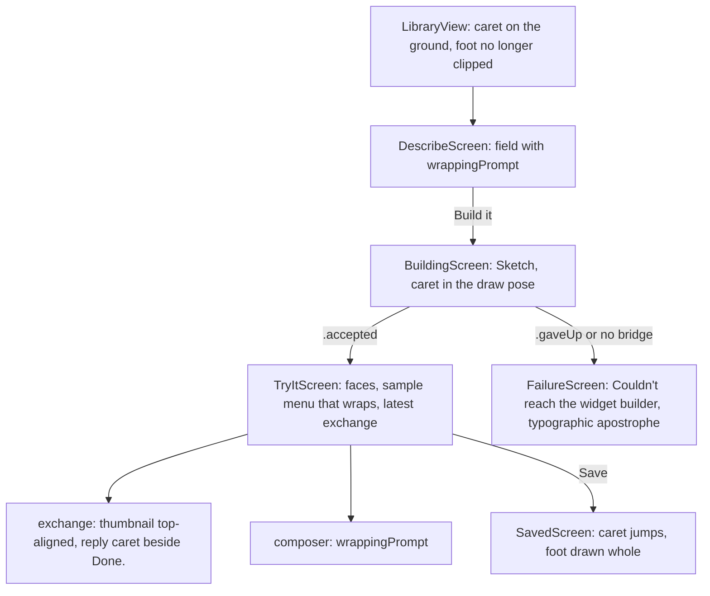
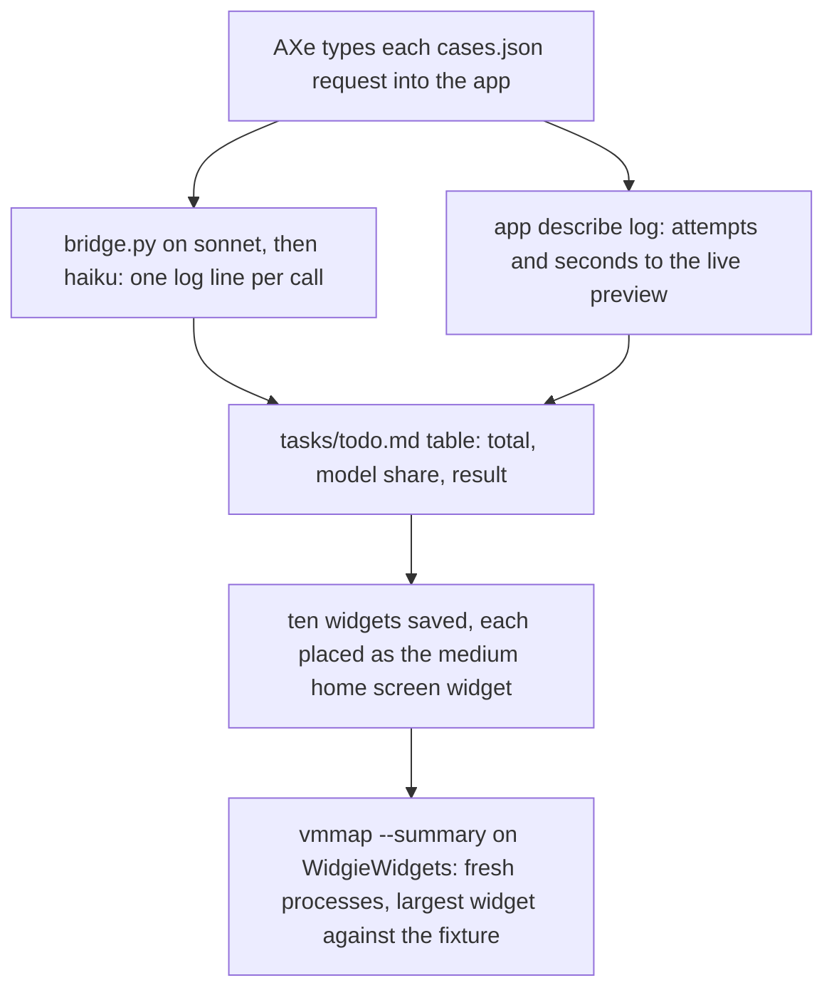

# PR 9: run the app flow end to end, record the numbers, and fix what it showed

Branch `phase-2-p6-end-to-end` into `main`. This is P6 of [tasks/phase-2-app-flow.md](../../tasks/phase-2-app-flow.md), the last unit of the phase 2 app flow plan. It runs the whole loop through the real app on the simulator, records each build in a table, measures the widget extension's memory, and fixes the visual flaws the run turned up. The look is The Caret in Sky ([docs/design/app-feel/README.md](../design/app-feel/README.md)).

Background reading: the plan's P6 section, and [PR 8](8-phase-2-p5-describe.md) for the describe flow this run drives.

## Core changes

- **The results.** [tasks/todo.md](../../tasks/todo.md) checks the app-flow item and adds "App flow review (P6)": a 24-row table of every request on `sonnet` and `haiku` with its attempts, total seconds, the model's share, and the result, then the summary. Sonnet accepted 11 of 11 on the first attempt, with a median of 38.6 s for a new widget and 13.7 s for a refine. Haiku accepted 9 of 11 and gave up on two look prompts. The app's own share stayed at 0.27 to 0.79 s per build. Screenshots, logs, and `memory.txt` are in `Engine/.artifacts/app-flow/p6/`, not in git.
- **Memory.** The largest saved AI-built widget peaks at 17.8 MB in the widget extension, against 16.1 to 16.6 MB for the water fixture in the same slot, under the plan's 20 MB rule. A process that drew all ten saved widgets in turn peaked at 21.0 MB, and memory grows about 0.3 MB per distinct widget drawn. That is listed for a heap diff before the device step.
- **Findings listed, not fixed.** Model-output problems are eval findings under the app-flow item in `tasks/todo.md`. The biggest is that both models build a water tracker from the LCD watch picture when asked for a habit tracker. App changes too large for P6 (an app icon, the widget's edit sheet title, autocorrect in the describe field) are listed there too.
- **The caret's foot.** [Caret.swift](../../App/Widgie/Design/Caret.swift) let its canvas overhang the caret's frame. The round foot cap reaches below the square, and the canvas clipped it, so the caret stood on a flat stump on every screen.
- **Prompts that wrap.** [DescribeView.swift](../../App/Widgie/Describe/DescribeView.swift) adds `wrappingPrompt`, which draws a field's prompt behind the empty field. A text field's own prompt stays on one line, so at the largest text sizes the fields read "Describe a..." and "Change so...". The sample menu in [TryItView.swift](../../App/Widgie/Describe/TryItView.swift) takes a second line instead of cutting to "Goal...".
- **The latest exchange.** The caret before "Done." now sits beside it, as in the mock, and a picture's thumbnail starts with its request instead of centering on two lines.
- **Typography and warnings.** User-facing messages use typographic apostrophes. Two build warnings are gone: the photo button read main actor state in the picker's nonisolated label closure, and a form test wrapped a non-optional date in `#require`.

## 1. The person describes a widget, tries it, and saves it

Files: [Caret.swift](../../App/Widgie/Design/Caret.swift), [DescribeView.swift](../../App/Widgie/Describe/DescribeView.swift), [TryItView.swift](../../App/Widgie/Describe/TryItView.swift), [DescribeSession.swift](../../App/Widgie/Describe/DescribeSession.swift), [FormSheet.swift](../../App/Widgie/FormSheet.swift).

Key decisions:

- **The canvas overhangs instead of the curves moving.** Each pose's control points were measured from the mock, so the foot stays where the mock puts it and only the canvas grows, by a quarter of the caret's size on each side, with negative padding so layout still sees the square.
- **The prompt is a sibling view, not the field's prompt.** SwiftUI gives no way to wrap a `TextField` prompt. The field keeps its title as the accessibility label, its prompt is empty, and the drawn prompt is hidden from VoiceOver. The font is applied after `wrappingPrompt`, so both share it.
- **The menu label wraps rather than shrinks.** Two lines keep the person's text size, and the column beside the small face has the height.
- **No app test for these.** They are layout, and the before and after screenshots are the check (`fix-caret-foot-before-after.png`, `dt-describe.png` against `after-dt-describe.png`, `dt-tryit.png` against `after-dt-tryit.png`).

## 2. The end-to-end run and its numbers

Key decisions:

- **The table counts what a person waits for.** Total is send to live preview from the app's own log. The model's share is the sum of the bridge's model seconds for that build's calls, so a repair's extra calls show in both.
- **The look prompts are water-glass, habit-graph, and todo-sticky**, one per reference kind, and the picture is R1 with the habit request, the one P5 had not run. The refines are the three `cases.json` refines whose bases are reference widgets built in the same session.
- **Memory is compared on the same build, not against the phase 0 number alone.** The fixture in the same slot gives the baseline (16.1 to 16.6 MB), so the 1.2 to 1.7 MB the AI-built widget adds is its own cost, not a change in the simulator or the build.
- **The 21.0 MB reading is reported, not explained away.** It came from a process that drew many widgets, which is the normal life of a widget extension, so the growth per widget is listed as open for the device step.
- **Haiku's give-ups were reproduced on the Mac** with `run.py p6-haiku-gaveup` to get the verdict lines the app does not log.

## Not done here

- Keyboard overlap is unchecked. The headless simulator never shows the soft keyboard, and the build has no Simulator.app to switch the hardware keyboard off.
- A build that iOS cuts off in the background is still unproven, as after P5.
