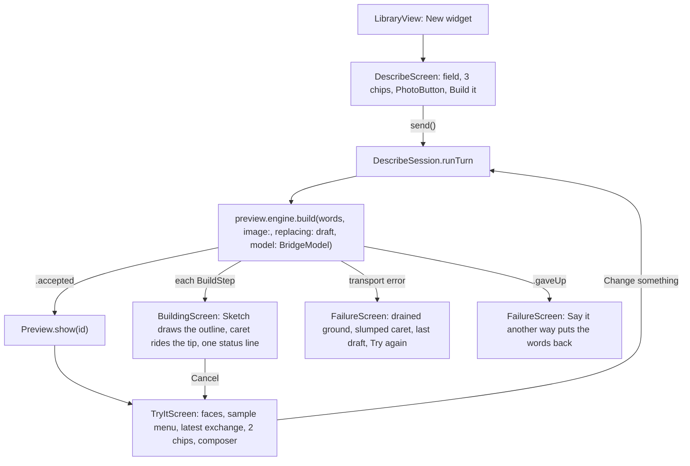
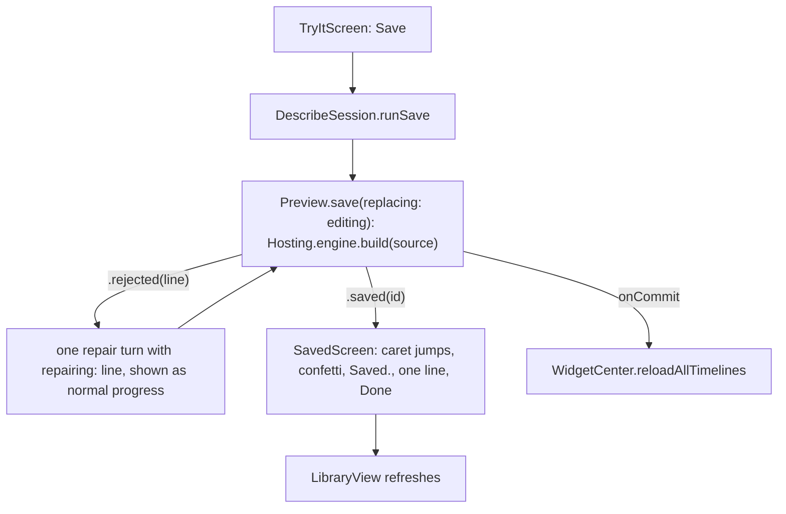
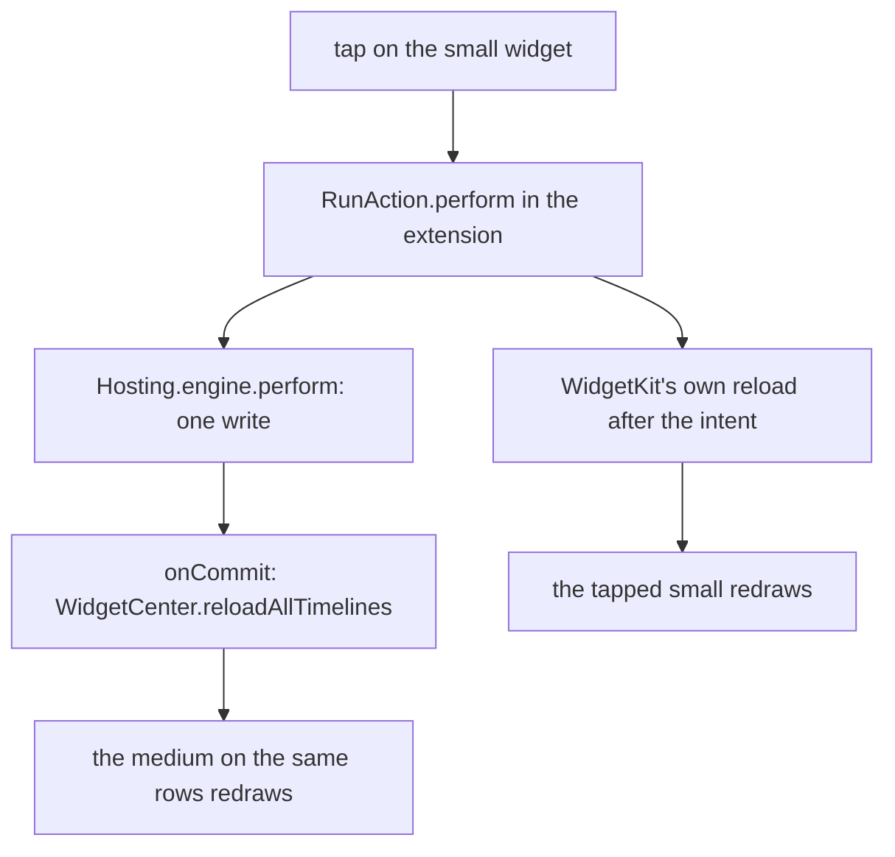

# PR draft: describe a widget, watch it build, try it, refine it, save it

Branch `phase-2-p5-describe` into `main`. This is P5 of [tasks/phase-2-app-flow.md](../../tasks/phase-2-app-flow.md). The look is The Caret in Sky, decided in [docs/design/app-feel/README.md](../design/app-feel/README.md), with the tokens in [directions.md](../design/app-feel/directions.md) round 4.

Background reading: the plan's P5 section, and [PR 5](5-phase-2-p4-preview.md) for the scratch engine the flow builds on.

## Core changes

- **The describe flow.** [DescribeSession.swift](../../App/Widgie/Describe/DescribeSession.swift) runs the build loop on the preview's scratch engine, maps each `BuildStep` to `phase`, keeps the build alive with `beginBackgroundTask`, turns a Save rejection into one repair turn, and never replaces the draft on a failed or cancelled turn. [BridgeModel.swift](../../App/Widgie/Describe/BridgeModel.swift) posts to the dev bridge, named only in Debug builds.
- **One action per screen.** [DescribeView.swift](../../App/Widgie/Describe/DescribeView.swift) holds Describe, Building, and Failure. [TryItView.swift](../../App/Widgie/Describe/TryItView.swift) is the preview with the latest exchange right under the faces. [SavedView.swift](../../App/Widgie/Describe/SavedView.swift) is the jump, the confetti, and Done. [LibraryView.swift](../../App/Widgie/LibraryView.swift) shows the widgets at home screen sizes, or the big caret and "Tell me a widget."
- **The caret.** [Caret.swift](../../App/Widgie/Design/Caret.swift) is one view whose poses (idle, lean, draw, jump, slump) are cubic curves that morph on a spring. It blinks, scribbles while drawing, grows its cheeks when happy, and loses them when slumped. The same view ends the wordmark, sits in the fields, and speaks the reply.
- **Tokens in an asset catalog.** [WidgieColors.xcassets](../../App/Widgie/Design/WidgieColors.xcassets) holds the 29 Sky colors with light and dark values. [Theme.swift](../../App/Widgie/Design/Theme.swift) reads them through Xcode's generated symbols, and holds the button, chip, and outline styles. Pip, the step bar, the tangerine, and the lipped buttons are gone.
- **Every widget reloads after a home screen tap.** [Hosting.swift](../../Engine/Sources/WidgetHosting/Hosting.swift) now passes the WidgetKit reload to the extension's engine too.

## 1. The person describes a widget and tries it

Key decisions:

- **The latest exchange sits right under the faces.** The mock left an empty band between the widgets and the exchange. The exchange and the chips now follow the faces, and the composer stays pinned at the bottom.
- **Failure is its own screen, not a banner.** The ground drains to the Failure tokens and the caret slumps at a broken bridge. "Check that the bridge is running." shows only in Debug.
- **The outline draws from the bottom of the left edge, clockwise.** The caret then spends most of a build on the top edge, above the parts it reveals, instead of covering them.
- **Return builds.** The describe field and the composer wrap long text, so the return key sends instead of starting a new line.
- **The sample picker is a menu.** The mock's compact control, which also keeps the faces and the exchange on one screen.

## 2. The person saves and places it

Key decisions:

- **Saved says how to place it in one line.** "Press and hold your home screen, then tap Edit to add it." A refine of a saved widget says the home screen already shows the change.
- **The confetti is caret-shaped bars in the Pop colors.** It bursts once after the caret lands. With Reduce Motion the caret does not jump and the confetti is simply there.

## 3. The person taps the widget on the home screen

Key decisions:

- **The extension reloads every widget after a write.** WidgetKit's reload after an intent covers only the tapped widget's timeline. The chronod log showed `getTimelines(1)` for the small family alone, so the medium beside it kept its old count until its timeline ran out. The premise "WidgetKit reloads after an intent on its own" was true only for the tapped widget. [Engine.swift](../../Engine/Sources/WidgetEngine/Engine.swift), [USAGE.md](../engine/USAGE.md), and [RATIONALE.md](../engine/RATIONALE.md) say so now.

## Verification

- `scripts/check` passes: the engine gate and the app build.
- No app test target. The branching worth testing is the engine's loop, covered in P3. What remains in the app is view state that only the live lanes show truthfully, and every P5 box ends in a live lane.
- All ten live lanes passed on the iPhone 18 Pro simulator with `axe`, sonnet for all but lane 5 on haiku. Screenshots are in `Engine/.artifacts/app-flow/p5/` in light mode, with `dark-library.png`, `dark-describe.png`, `dark-preview.png`, `dark-saved.png`, and `dark-failure.png`. A Release build shows "Building widgets is not available in this build." (`release-unavailable.png`).
- The recording of lanes 2, 4, and 8 is `lanes-2-4-8.mp4`, 64 s, cut from the three raw recordings beside it with the waits sped up.
- Perf, one run per reference prompt on sonnet (`perf.txt`): Build it to the first live preview took 25.5 to 37.8 s, median 33.4 s, against the 36.8 s `run.py` median. App seconds, the total minus the model's, were 0.48 to 1.20, median 0.55, under the 3 s rule.
- The staleness fix: after the fix, two taps on the small moved the medium from 4 to 5 to 6 with the store, without opening the app (`fixed-after-tap.png`, `fixed-after-second-tap.png`). Before it, the medium stayed behind (`stale-after-page-swipe.png`).
- Dynamic Type checked at XXL on the library, describe, and preview screens. Nothing truncated or overlapped.
- Open: on the simulator, the tapped widget shows its new count one redraw late. Its timeline holds the count, which shows after a page swipe (`stale-after-tap.png`, `stale-after-page-swipe.png`). Check on a device.
- Unverified live: a build that outlives the app going to the background, and a Save rejected by the shared store, which runs the repair turn. Both paths are in code only. Reduce Motion was checked in code only.
