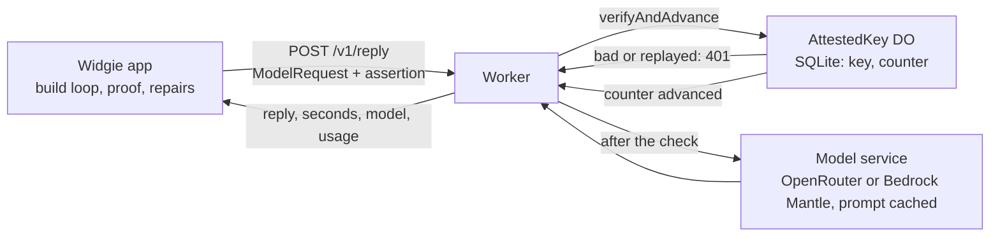

# Phase 2b backend plan: the build endpoint on Cloudflare

Written 2026-11-23, revised the same day after three council rounds. Covers the phase 2 items "Backend endpoint that forwards the request and image to our own model" and "App Attest and per-device quotas on the endpoint", plus the device step. Phase 3 (scheduled AI runs and widget push) and phase 4 (sync) get their own plans once this ships.

## Direction from the user (2026-11-22 and 2026-11-23)

- The backend lives on Cloudflare and runs every AI activity: builds now, scheduled automations in phase 3.
- Until our own model exists, the backend reaches models through **OpenRouter**. Local Claude Code stays the stand-in for evals on the Mac.
- Every automation is personal (phase 3 in `tasks/todo.md`). Nothing here computes content once for everyone.
- The user has a paid Apple Developer account (team `Z23KXVBB26`) and a Cloudflare account.

## Facts this plan rests on

- The app talks to a model service through one call: `POST /v1/reply` with a `ModelRequest` (`words`, optional `image {mime, base64}`, optional `current`, optional `repair {document, line}`), answered with `{reply, seconds, model}` (`Engine/Sources/WidgetBuilder/Model.swift`, `Engine/Evals/bridge.py`). The build loop, proof, and repairs stay in the app.
- The system prompt is `compose_prompt()` in `Engine/Evals/model.py`: 54,499 characters, about 14,000 tokens.
- `DescribeSession` takes `BridgeModel.configured` by default (`App/Widgie/Describe/DescribeSession.swift:108`), read from the Debug-only `WidgieModelBridge` key. Every non-`URLError` failure shows as `.refused`. The Debug failure screen says "Check that the bridge is running." (`DescribeView.swift:464`).
- `WidgetBuilder` may not import DeviceCheck, CryptoKit, or Security (`docs/engine/MODULES.md`, enforced by `Engine/scripts/check`). App Attest code lives in the app target.
- `render-tool loop --bridge <url>` already runs the app's build loop on the Mac against any `/v1/reply`.
- The widget supports small and medium only (`Hosting.swift:176`) and taps through `Button(intent:)`, never `Toggle`.
- `Picture.swift` sends a JPEG at most 1080 px on its long side, well under 1 MB.
- OpenRouter takes images as `image_url` data URLs. Anthropic `cache_control` works only on an array-form system message. Cost and cached-token counts come back only with `usage: {include: true}`. Unless the provider is pinned with fallbacks off, consecutive calls can land on Anthropic, Bedrock, or Vertex, each with its own cache. OpenRouter bills a generation even after the caller stops waiting. OpenRouter charges a 5.5 percent fee on credit purchases.
- Workers Free allows 10 ms CPU per request and 100,000 requests a day, and includes SQLite-backed Durable Objects. Waiting on a fetch costs no CPU, so a build spends its CPU only on parsing and re-encoding its body (under 1 MB with a picture), one signature check, and the log line. Attestation, once per install, adds CBOR and X.509 work. Decided 2026-11-23: start on **Free** and measure. Workers observability records each request's CPU time beside its log line, and the picture's base64 is checked with the native `atob` (see B1 results for why not a regex). Move to Workers Paid ($5 a month) only if a route's CPU time measured in B1 or B2 comes within 2 ms of the limit.
- A Durable Object class created with key-value storage can never become SQLite-backed. Phases 3 and 4 will want SQL.
- An App Attest key is per install. It is gone after a reinstall or a restore, while a Keychain item can survive, and `generateAssertion` then fails on the phone with `DCError.invalidKey`. A widget extension cannot use App Attest.
- A development-signed build attests in the development environment unless the `com.apple.developer.devicecheck.appattest-environment` entitlement says `production`.

## Shape

- `Backend/` at the repo root: one TypeScript Worker, `wrangler.jsonc` with a `dev` and a `production` environment (each declares its own vars, secrets, and bindings, since environments do not inherit them), Vitest with the Workers pool.
- `AttestedKey`, a SQLite-backed Durable Object, one per App Attest key. It holds only the public key and the assertion counter (and held the day's build quota until the user removed it on 2026-11-27). Accounts, push tokens, and sync state are not here: they get their own objects in phases 3 and 4, because a key changes on reinstall and the widget extension has none.
- The Worker calls the DO once per request, a short RPC that answers before any model call. The Worker, not the DO, waits on OpenRouter.
- The model call is a module (`model.ts`) that takes a system prompt and content, so phase 3's scheduler can call it without going through `/v1/reply`.
- Each environment has its own OpenRouter key with a credit limit set at OpenRouter. The limit is the backstop if every other guard fails.

## Units

### D0. The app on the iPhone, and the device checks that need no backend

Runs alongside B1. It needs only signing.

- [x] `App/project.yml`: `DEVELOPMENT_TEAM: Z23KXVBB26`. Both targets provisioned with the App Group (2026-11-27: Xcode signed in, the group registered from Signing & Capabilities, since command-line automatic signing turns the capability on but never creates a group; a signed `generic/platform=iOS` Debug build carries the group in both targets and `appattest-environment` `development` in the app).
- [ ] Pair the phone over a cable once (the team already lists its UDID `00008140-000A10983684801C`), then Developer Mode on the phone. Wi-Fi works only after the first cable pairing.
- [ ] Install the six fixtures from the Debug app and add the 19 templates from the Templates tab, and place them in small and medium.
- [ ] Widget extension memory with Instruments, for the largest fixture, in a fresh process and in one that has drawn every widget. Rules: the system cap is 30 MB, and the project rule from the simulator is 20 MB. Run the heap diff owed from P6 on the long-lived process (`tasks/todo.md`, 19.5 MB at rest).
- [ ] Tinted and Clear modes for every fixture, with screenshots.
- [ ] `Button` taps on a locked and an unlocked phone: what the widget shows when an unlock is cancelled.
- [ ] A long press on a widget's button never runs its action.
- [ ] Whether a tapped widget redraws one step late, as on the simulator.
- [ ] Taps, the picker, and form links on the home screen, as in the phase 0 simulator check.
- [ ] Keyboard overlap on Make's composer and on a template sheet's blanks.
- [ ] Record every result in a device review in `tasks/todo.md`, with screenshots in `Engine/.artifacts/device/`.

### B1. Worker that answers `/v1/reply` through a model service, gated from the first deploy

- [x] `Backend/` scaffold: Worker, `wrangler.jsonc`, `npm test`, lint and typecheck (Biome, `tsc`), wired into the top-level `scripts/check` through `Backend/scripts/check`. `observability.enabled` on. Tests run inside workerd with `@cloudflare/vitest-plugin` (the renamed `vitest-pool-workers`).
- [x] Prompt: `Backend/scripts/prompt` runs `compose_prompt()` and writes `Backend/src/build-prompt.txt`, imported as a Text module. The file is checked in. `PromptTests` in `test_model.py` fails when it differs from `compose_prompt()`.
- [x] Request validation ported from `user_message`, with the same error lines. The malformed cases moved to `Engine/Evals/testdata/invalid-requests.json` with their lines; both suites read it and `requests.json`, and the Python test asserts the exact line. Length caps are tested in Vitest only. Vitest checks the wire shape on its own expectations.
- [x] Order of work in `/v1/reply`: the gate answers 401 before any body is read; then 415 for a body that is not JSON; then the body is streamed and refused at 8 MB with 413, with or without `Content-Length`; then the `ModelRequest` is validated; then the model call. B2 adds `verifyAndReserve` after the body.
- [x] Model call: `max_tokens` 16,000, default temperature, array-form system with `cache_control`, one try, a 95 s deadline that covers the body, a 200 carrying an error is a 502, and the app gets the fixed line "the model gave no answer". Changed during B1 (below): the service, model, pinned provider, and reasoning are settings.
- [x] The reply adds an optional `usage` object (input, cached, and output tokens, cost).
- [x] One JSON log line per request: kind, status, ms, model, provider, seconds, tokens, cached tokens, cost, and the failure reason on a 502. Workers observability adds CPU time. Never the words, the document, or the image.
- [x] Gate: `Authorization: Bearer <OPERATOR_TOKEN>`, compared in constant time over SHA-256 digests. Unset means every request is refused. Tests prove an unauthenticated request makes no upstream call, even with an oversized body.
- [x] `render-tool loop` sends `WIDGIE_BRIDGE_TOKEN` as the bearer header. Changed: `BridgeModel` got an optional `token` instead of a copied POST in `RenderTool`, because `BridgeModel.Refused` cannot be built outside its module and the copy would have needed its own error type. B2 removes the property with the gate.
- [x] Settings in `wrangler.jsonc`: `MODEL_URL`, `MODEL`, `PROVIDER`, `REASONING`; secret `MODEL_API_KEY` per environment.

Verify.
- [x] Unit: `scripts/check` passes: 26 Worker tests, prompt parity, the pinned user turns, the shared valid and invalid requests, the shared extraction cases, limits, the order of work, and the gate.
- [x] Live on DeepSeek V4.1 Flash, reasoning low (`Engine/.artifacts/backend/b1-deepseek-low/`): water, to-do, habit, word of the day, dog fed, and the R1 picture accepted within two attempts. Thinking of you got one 502 (most likely the 95 s deadline) and was accepted in one attempt on its rerun. `refine` and `refine-repair` answered 200 in 7.7 and 8.0 s, and `render-tool refine` accepted both against their `current` documents (`b1-deepseek-refine/`). A request with no token is 401.
- [x] Perf: a second build within five minutes read 16,384 to 17,024 cached prompt tokens from Together. CPU per request: about 1 ms for a text build, 3 to 7 ms for a picture build, under the Free plan's 10 ms, so the plan stays on Free.

**B1 results (2026-11-23).**

| Model (service) | Reasoning | Accepted of 7 | Seconds per attempt | Cost per call |
| --- | --- | --- | --- | --- |
| Kimi K2.5 (Bedrock Mantle) | none | 3 | 6 to 39 | not reported |
| DeepSeek V4.1 Flash (OpenRouter, Together) | off | 4 | 4 to 8 | about $0.003 |
| DeepSeek V4.1 Flash (OpenRouter, Together) | low | 6, and 7 with the rerun | 10 to 64 | $0.003 to $0.02 |
| Sonnet 5.5 (Mac bridge, P6, for comparison) | none | 11 of 11 | 23 to 54 | |

Decisions and findings:

- **Model: DeepSeek V4.1 Flash on Together, reasoning low, chosen by the user.** Together serves it at full precision and does not train on requests. DeepSeek's own endpoint is excluded by the OpenRouter account's training setting, which stays on.
- **The service is a setting.** Claude was planned through OpenRouter pinned to Anthropic, then Bedrock. The user's AWS account refuses the classic `bedrock-runtime` path for every model ("Operation not allowed"), and Claude and GPT are not available to it on Mantle. Kimi K2.5 works on Mantle (`https://bedrock-mantle.us-east-1.api.aws/v1/chat/completions`, Bedrock API key, no project header) and reads the R1 picture, but failed four of seven builds on fit. Any OpenAI-compatible endpoint now works by changing `MODEL_URL`, `MODEL`, `PROVIDER`, and `REASONING`.
- **The reply parser accepted only a fence at the start of a line.** Kimi starts every reply with a space before its fence, so both copies (`extractDocument` in `Loop.swift`, `extract` in `model.py`) took the closing fence for an empty block. They now allow up to three spaces, as Markdown does, with cases in `testdata/extract.json`.
- **A regex base64 check cost about 5 ms of CPU** on a 170 KB picture, because V8 first runs a regex in its interpreter on a fresh isolate. `atob` after a length and whitespace check does the same job in 0.03 ms, as strictly as Python's decoder.
- **Open:** reasoning low sometimes passes 60 s per attempt, and one call likely hit the 95 s deadline. Watch the deadline's 502s in the log before raising it toward the app's 120 s.

### B2. App Attest (and per-key quotas, removed by the user 2026-11-27)

Depends on D0 (signing) and B1.

- [x] Entitlements: the app's single `entitlements:` block in `App/project.yml` becomes two checked-in files, `Widgie-Debug.entitlements` (`appattest-environment` `development`) and `Widgie-Release.entitlements` (`production`), both keeping the App Group, set per configuration with `CODE_SIGN_ENTITLEMENTS`.
- [x] Both attest routes refuse bodies over 32 KB. ~~They sit behind a Workers rate-limit binding per IP.~~ The rate limit was removed by the user on 2026-11-27, with every other usage limit; limits come back later. The Worker refuses a malformed `keyId`, `X-Widgie-Key`, or `X-Widgie-Assertion` before it touches a DO.
- [x] `AttestedKey` writes nothing in its constructor or on a rejection. Its table is created only right before a write (a new challenge, a stored key). A lookup in an object with no table is a 401 with no write, so random key ids never leave objects behind, and a store after the alarm cleared the object still works.
- [x] `POST /v1/attest/challenge {keyId}` returns a one-use challenge stored in that key's `AttestedKey` for five minutes, with an alarm that deletes the object only if no public key is stored. An attested key gets 409.
- [x] `POST /v1/attest {keyId, challenge, attestation}`: the Worker calls the DO's `takeChallenge`, which with no `await` takes the challenge (401 if missing or expired, 409 if the key is attested) and deletes it. Then the Worker verifies, between `takeChallenge` and `storeKey`, each check with its own failing test (built as a targeted fixture where mutating the capture would trip an earlier check):
  1. `fmt` is `apple-appattest` and `x5c` holds two certificates.
  2. The chain leads to Apple's App Attest root, checked at an injected time.
  3. The nonce extension (OID `1.2.840.113635.100.8.2`) equals `SHA256(authData ‖ SHA256(challenge))`.
  4. `SHA256` of the leaf's public key, as the X9.62 uncompressed point, equals `keyId`.
  5. `rpIdHash` equals `SHA256("Z23KXVBB26.dev.krutikpatel.widgie")`.
  6. The counter is 0.
  7. The AAGUID is the development value on `dev` (confirmed from the captured attestation) and `appattest` followed by seven zero bytes on `production`.
  8. `credentialId` equals `keyId`.
  Then `storeKey` in the DO, with no `await` before its write: require the key still unattested, store the public key with counter 0, and delete the alarm.
- [x] `/v1/reply` requires `X-Widgie-Key` and `X-Widgie-Assertion`. The signed client data is `METHOD \n PATH \n SHA256(body)`, so an assertion for one route never works on another. `verifyAndAdvance` in the DO: a key it does not hold is 401 `unknown-key`. Otherwise verify the DER signature (converted to raw `r‖s` for WebCrypto) and `rpIdHash` as Apple's validation steps say, confirmed against the captured fixtures, then with no `await` read the counter, require the new one to be larger, and store it. A bad or replayed assertion is 401 `bad-assertion` and changes nothing. (It was `verifyAndReserve` and also took one unit of a daily quota, answering 429 `daily-quota` when spent, until the user removed the quota on 2026-11-27.) Only the hash and the assertion go to the DO, never the body. The Worker calls OpenRouter after the DO answers.
- [x] ~~Quota: 40 dispatched model calls per key per UTC day, a var, never refunded, because OpenRouter bills a call the Worker stopped waiting for. It is per key, so a reinstall starts a new quota; the attest rate limit and the OpenRouter credit limit bound that.~~ Removed by the user on 2026-11-27, with the attest rate limit: no usage limits for now (no `QUOTA_PER_DAY`, no `daily-quota`, no `ATTEST_LIMIT`); they come back later. Until then the OpenRouter credit limit per environment is the only bound on spend.
- [x] Production: deploy `production` with no `OPERATOR_TOKEN`, delete it from `dev`, and delete the `render-tool` wrapper. A post-deploy `curl` to each environment's `/v1/reply` with no assertion gets 401.
- [x] App, in `App/Widgie/Describe/`: `AttestedModel`, an actor conforming to `WidgetModel`, with a 120 s request timeout. It creates a key once per environment, attests, and keeps the key id in the Keychain under an account named for the environment, with `kSecAttrAccessibleAfterFirstUnlockThisDeviceOnly`. It signs each request. On `DCError.invalidKey` (from an assertion or an attestation) or a 401 `unknown-key` it discards the key and attests again, once per request; a 401 `bad-assertion` fails the build without touching the key. The first attestation is single-flight, and signing and sending run one call at a time, so two calls never attest twice or reach the server out of counter order. `DCError.serverUnavailable` during attestation fails the build as unreachable and keeps the pending key for the next build; as Apple's guidance says, any other attestation error, or an attestation the server does not take (such as `bad-attestation`), discards the key, and the next build makes a new one. The key store, attestor, and transport are injected. It logs each reply's `seconds`, `model`, and `usage`.
- [x] App, which model a build uses: `project.yml` sets a `WidgieModelService` Info key per configuration, the `dev` URL in Debug and the `production` URL in Release, and the comment above `postBuildScripts` is updated. `#if targetEnvironment(simulator)` picks at compile time: the simulator in Debug keeps the local bridge; a phone uses `AttestedModel` against `WidgieModelService`. Where `DCAppAttestService.isSupported` is false, the build shows the existing failure instead of attesting.
- [x] App, failures: ~~a 429 `daily-quota` becomes its own failure with its own message, and any other 429 stays a refusal (the one new piece of copy, through the review gate).~~ The daily-limit failure and its copy were removed by the user on 2026-11-27 with the quota, so every refusal is `.refused` and B2 adds no copy. The Debug hint names the endpoint the build is using instead of always saying "the bridge".
- [x] Debug-only fixture capture: a hidden action in the Debug build runs the real `AttestedModel` against `dev` and writes the key id, challenge, attestation, capture time, and two signed requests with their exact bytes to the app's Documents, copied off with `xcrun devicectl device copy from`. The app id and environment it writes come from the build (`WidgieAppAttestAppId`, `WidgieAppAttestEnvironment` in the Info.plist), and its Keychain item is deleted when it ends.

**B2 wire protocol (2026-11-23).** Both sides build exactly these bytes.

- **Key id.** The base64 string `DCAppAttestService.generateKey()` returns: standard base64 of `SHA256` of the key's X9.62 uncompressed public point, 44 characters. It names the key's `AttestedKey` object, and the Worker refuses any other shape.
- **Challenge.** `POST /v1/attest/challenge` with `{"keyId": "<key id>"}` answers `{"challenge": "<43 base64url characters of 32 random bytes>"}`. The app attests with `clientDataHash = SHA256(UTF-8 of the challenge string)`.
- **Attestation.** `POST /v1/attest` with `{"keyId", "challenge", "attestation": "<standard base64 of the attestation object>"}` answers 204. The object is Apple's CBOR map: `fmt`, `attStmt` with `x5c` and `receipt`, and `authData`. The receipt is not checked.
- **Signed request.** Each `/v1/reply` carries `X-Widgie-Key: <key id>` and `X-Widgie-Assertion: <standard base64 of the assertion>`. The client data is the UTF-8 of `METHOD + "\n" + PATH + "\n" + lowercase hex SHA256(body bytes)`, for example `POST\n/v1/reply\n9f86...`. The app asks for an assertion over `SHA256(client data)`. The assertion is Apple's CBOR map of `signature` (DER ECDSA) and `authenticatorData`.
- **Verifying an assertion.** `nonce = SHA256(authenticatorData ‖ SHA256(client data))`, and the signature is ECDSA P-256 with SHA-256 over `nonce` as the message, so WebCrypto's `verify` gets `nonce` as its data. The captured fixtures confirm this before B2 merges.
- **Errors.** `{"error": "<line>", "code": "<code>"}`. Codes: `unknown-key` (401, the app attests again), `bad-assertion` (401, the build fails, the key stays), `bad-attestation` (401), `attested` (409). `daily-quota` (429) and `rate-limited` (429) were removed with the limits on 2026-11-27.

**B2 progress (2026-11-23).** Done before the phone: everything except the device fixtures and the live checks. (The review gate on the daily-limit copy went with the copy on 2026-11-27.)

- Worker: `attestation.ts` (the eight checks, with `now`, root, app id, and environment passed in), `cbor.ts` and `der.ts` (minimal readers, no dependencies), `attested-key.ts` (the SQLite Durable Object), 78 tests. Seven real App Attest captures published by the open-source `devicecheck-appattest` project (another app, iOS 14) pass against the pinned Apple root at their capture time, and their assertions confirm that WebCrypto verifies with the nonce as its data. They were first run locally only; after the PR 23 review they are committed (below).
- Attestation is verified in the Worker between the DO's `takeChallenge` and `storeKey`, not inside the DO, so tests can pass the root and clock in like `fetch`. The guarantees hold: the challenge is gone before any check runs, and `storeKey` re-checks that the key is unattested.
- The chain check also requires issuer and subject names to chain, the intermediate to be a CA, and the root to be in its validity.
- Missing or malformed signature headers answer 401 `bad-assertion`, so the app fails the build and keeps its key. A signed request that is not a valid `ModelRequest` still advances the counter, because the signature comes before the body is parsed: an unsigned caller never costs a parse, and the app never sends a malformed body.
- `render-tool loop --bridge` can no longer reach a deployed Worker, since every request needs an assertion; the Mac evals use the local bridge.
- Deployed: `widgie-dev` and `widgie` (production) with the Durable Object, the attest rate limit (10 per 60 s per IP), and their own OpenRouter keys. `OPERATOR_TOKEN` is deleted. An unsigned `/v1/reply` is 401 on both. The deployed Workers still have the rate limit and the quota until the next deploy of this branch.
- App: `AttestedModel`, `ModelService`, two entitlement files, the team id, `WidgieModelService` per configuration, the `dailyLimit` failure (removed 2026-11-27), and the Debug capture writing `Documents/attest-capture.json` in the shape `Backend/test/fixtures.test.ts` reads. 28 app tests pass on the simulator.
- Rebased onto main after the app shell (2026-11-27), as `phase-2b-b2`. Make is now a chat, so the app pieces moved: `DescribeSession` takes `ModelService.configured`. It mapped a 429 `daily-quota` to `.dailyLimit` ("That’s all I can build today.") until the limits were removed. The Debug hint naming the endpoint sits under the failure title in `WidgieFailed` (`ChatMessages.swift`), and the capture action is a "Backend" section in the Debug long press on the Widgets title (`WidgetsFeed.swift`), since the Library screen and its ladybug menu are gone.

**Usage limits removed (2026-11-27).** The user removed every usage limit for now; they come back later. Gone: the attest rate limit (`ATTEST_LIMIT` in both environments, its check in `attestBody`, `rate-limited`), the daily quota (`QUOTA_PER_DAY`, the quota columns' use and `daily-quota` in `AttestedKey`, whose `verifyAndReserve` is now `verifyAndAdvance`), and in the app the `dailyLimit` failure, its copy, and its 429 mapping. Kept: the body caps (8 MB and 32 KB), input validation, App Attest verification, and the counter, which stops replay. Objects made before keep their unused quota columns, which have defaults, so the new statements work on them.

**Merged as PR 23 on 2026-11-28**, before its phone checks (user's decision): its verifier passes on seven real Apple attestations, and it is the code `dev` runs. The device capture and the live checks stay open for when the phone is connected.

**PR 23 review fixes (2026-11-27).**

- Real Apple attestations in the tests: the seven captures from `devicecheck-appattest` (Apache License 2.0) are in `Backend/test/published/` with the licence text and a note of the source, licence, and changes. `published.test.ts` runs the verifier on each at its capture time with its own app id, environment, and client data hash, checks that Widgie's app id, the other environment, other client data, and a later time each fail, and verifies each assertion. The Widgie device capture stays the final gate.
- The concurrency test holds both requests inside the signature check until both are there (the DO's `verify` field), so reading the counter before the check's await now fails it.
- Each remaining chain and parse check has a failing test, each shown to fail when its check is removed: issuer and subject names at both links, the root's validity, the leaf's curve, the nonce extension's tag and single element, assertion authenticator data of at least 37 bytes, a 32-byte client data hash, and a certificate's inner and outer signature algorithms matching.
- The leaf's notBefore allows five minutes of clock skew (`LEAF_CLOCK_SKEW_MS`); the intermediate and root do not.
- The app discards a key on any attestation failure but `serverUnavailable`, and replaces a key App Attest refuses (`invalidKey` from `attestKey`) once within the call.
- The Debug capture reads its app id and environment from the Info.plist and deletes its Keychain item when it ends.

Verify.
- [ ] Unit, Worker: the verifier passes on the captured fixtures at their capture time and fails on an expired chain and on each numbered check. DO tests: two concurrent requests with the same counter, one passes; ~~with the quota var at 2, the third call is 429~~ (removed with the quota); an alarm that fires after attestation leaves the key and its counter; a second attestation of an attested key is 409. All but the Widgie device capture pass; the published captures stand in until it exists.
- [x] Unit, app (`WidgieTests`, key store, attestor, and transport injected, so no test touches the real Keychain): `invalidKey` attests again and succeeds, from an assertion or an attestation; `unknown-key` attests again once and stops; `bad-assertion` keeps the key; `serverUnavailable` keeps the pending key; any other attestation failure, or an attestation the server does not take, discards it; ~~429 `daily-quota` becomes the new failure and another 429 does not~~ (removed with the quota; every refusal is `.refused`); two concurrent calls attest once.
- [ ] Live, on the phone in Debug against `dev`: a build passes; the captured signed request sent again with `curl` is 401 `bad-assertion`; ~~with a fresh key and the quota var at 2, the third HTTP request is 429 `daily-quota` and shows the new message, then the var goes back to 40~~ (removed with the quota). Delete and reinstall the app: the next build attests again and passes. Record the CPU time of `/v1/attest` and an attested `/v1/reply` against the Free plan's 10 ms.
- [ ] Live, production: the scheme's run configuration switched to Release, the app attests and builds once against `production`. Switched back afterwards.

### B3. The end-to-end loop on the phone

Depends on B2.

- [ ] The P6 loop on the phone over `dev`: the six reference prompts, one look prompt, the R1 picture, and one refine. Screenshots in `Engine/.artifacts/device/`.
- [ ] Per-attempt time on the phone, split into model seconds (from `AttestedModel`'s log) and app seconds, against P6's rule of under 3 s of app time per attempt. The first build's attestation is timed apart.
- [ ] P6's memory run on the phone: the extension drawing every saved AI-built widget in turn and the edit sheet's previews, against the 30 MB cap.
- [ ] A build whose model call outlasts the background time iOS gives (a Sonnet look build takes 40 to 54 s): the log shows the expiration handler ran, the build ends as interrupted, and the previous draft stays.
- [ ] Record results in the device review in `tasks/todo.md`.

## Review gate

D0 and B3 record results. B1 changes nothing a person sees. B2 added one message, the daily limit, until the user removed the limits on 2026-11-27; it now adds none.

## Merge

One PR per unit (D0's is the device review), each with a fresh subagent review, a review doc in `docs/pr/`, and checks passing.

## Needs from the user

- `npx wrangler login` (done 2026-11-23). Workers Free to start; Paid only if the CPU measurements call for it.
- Two OpenRouter keys, one for `dev` and one for `production`, each with a credit limit set at OpenRouter. Asked for through a secret prompt in B1 and B2, stored only as Worker secrets.
- The iPhone, plugged in and unlocked, with Developer Mode on, for D0.

## Notes for phases 3 and 4

- `AttestedKey` authorizes builds and nothing else. Phase 3's per-account state, push tokens, and the widget extension's timeline pull need an account and a session token of their own, shared through the App Group Keychain. Phase 3's P2 (PR 24) adds them: `POST /v1/account` is signed as `/v1/reply` is and checked by the same `verifyAndAdvance`, so a registration advances the key's one counter, and every other phase 3 route takes the account token instead (see "P2 results" in `tasks/phase-3-ai-block.md`).
- Phase 4 sync sends requests concurrently, which a strictly rising assertion counter would reject. Keep assertions on paid calls and use the session token for sync.
- APNs needs HTTP/2. Whether a Worker's outbound `fetch` can send a WidgetKit push to APNs is unverified. Spike it before writing the phase 3 plan.

## Alternatives rejected

- **Claude API directly.** The user chose OpenRouter. It also lets evals compare other providers' models without new code.
- **Tunnel to the Mac's bridge.** Builds would fail whenever the Mac sleeps, and phase 3 needs runs overnight.
- **A shared key or token in the app.** Anyone can pull it out of the binary. App Attest ties each call to a real install.
- **A dev token for the simulator.** The simulator keeps the local bridge, which already covers its work. A token in the app could leak into a device build.
- **A fresh server challenge for every assertion.** It costs a round trip per call. The rising counter plus the signed method, path, and body hash already stop replay.
- **Calling OpenRouter from inside the DO.** The DO would be billed for 40 to 70 s of waiting per build, and every call for one key would queue behind it.
- **D1 or KV for quotas.** KV is eventually consistent, so a counter can be raced. D1 adds a schema for state one Durable Object per key already holds in order.
- **Moving the build loop to the server.** Fit can only be measured where SwiftUI runs.
- **Extending `run.py` to call the Worker.** It reads Claude Code's usage fields and runs two models. `render-tool loop` already speaks `/v1/reply`, and the Worker logs carry the usage.

## Risks

- **App Attest verification is easy to get subtly wrong.** Real-device fixtures, one tampered case per check, and the review subagent focused on the verifier.
- **The cache can miss** if OpenRouter routes away from the pinned provider. The log line names the provider and the cached tokens, so a miss is visible on the first day.
- **A model slug changes or a model is retired.** The slug is one var, and the reply's `model` field shows what answered.
