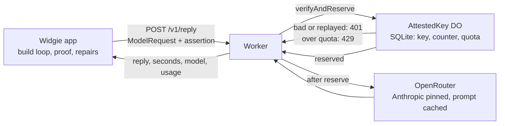

# Phase 2b backend plan: the build endpoint on Cloudflare

Written 2026-11-23, revised the same day after three council rounds. Covers the phase 2 items "Backend endpoint that forwards the request and image to our own model" and "App Attest and per-device quotas on the endpoint", plus the device step. Phase 3 (scheduled AI runs and widget push) and phase 4 (sync) get their own plans once this ships.

## Direction from the user (2026-11-22 and 2026-11-23)

- The backend lives on Cloudflare and runs every AI activity: builds now, scheduled automations in phase 3.
- Until our own model exists, the backend reaches models through **OpenRouter**. Local Claude Code stays the stand-in for evals on the Mac.
- Every automation is personal (phase 3 in `tasks/todo.md`). Nothing here computes content once for everyone.
- The user has a paid Apple Developer account (team `Z23KXVBB26`) and a Cloudflare account.

## Facts this plan rests on

- The app talks to a model service through one call: `POST /v1/reply` with a `ModelRequest` (`words`, optional `image {mime, base64}`, optional `current`, optional `repair {document, line}`), answered with `{reply, seconds, model}` (`Engine/Sources/WidgetBuilder/Model.swift`, `Engine/Evals/bridge.py`). The build loop, proof, and repairs stay in the app.
- The system prompt is `compose_prompt()` in `Engine/Evals/model.py`: 54,499 characters, about 14,000 tokens.
- `DescribeSession` takes `BridgeModel.configured` by default (`App/Widgie/Describe/DescribeSession.swift:108`), read from the Debug-only `WidgieModelBridge` key. Every non-`URLError` failure shows as `.refused`. The Debug failure screen says "Check that the bridge is running." (`DescribeView.swift:464`).
- `WidgetBuilder` may not import DeviceCheck, CryptoKit, or Security (`docs/engine/MODULES.md`, enforced by `Engine/scripts/check`). App Attest code lives in the app target.
- `render-tool loop --bridge <url>` already runs the app's build loop on the Mac against any `/v1/reply`.
- The widget supports small and medium only (`Hosting.swift:176`) and taps through `Button(intent:)`, never `Toggle`.
- `Picture.swift` sends a JPEG at most 1080 px on its long side, well under 1 MB.
- OpenRouter takes images as `image_url` data URLs. Anthropic `cache_control` works only on an array-form system message. Cost and cached-token counts come back only with `usage: {include: true}`. Unless the provider is pinned with fallbacks off, consecutive calls can land on Anthropic, Bedrock, or Vertex, each with its own cache. OpenRouter bills a generation even after the caller stops waiting. OpenRouter charges a 5.5 percent fee on credit purchases.
- Workers Free allows 10 ms CPU per request and 100,000 requests a day, and includes SQLite-backed Durable Objects. Waiting on a fetch costs no CPU, so a build spends its CPU only on parsing and re-encoding its body (under 1 MB with a picture), one signature check, and the log line. Attestation, once per install, adds CBOR and X.509 work. Decided 2026-11-23: start on **Free** and measure. Every log line carries the request's CPU time, and the Worker never fully decodes the picture's base64 (it checks the header and length only). Move to Workers Paid ($5 a month) only if a route's CPU time measured in B1 or B2 comes within 2 ms of the limit.
- A Durable Object class created with key-value storage can never become SQLite-backed. Phases 3 and 4 will want SQL.
- An App Attest key is per install. It is gone after a reinstall or a restore, while a Keychain item can survive, and `generateAssertion` then fails on the phone with `DCError.invalidKey`. A widget extension cannot use App Attest.
- A development-signed build attests in the development environment unless the `com.apple.developer.devicecheck.appattest-environment` entitlement says `production`.

## Shape

- `Backend/` at the repo root: one TypeScript Worker, `wrangler.jsonc` with a `dev` and a `production` environment (each declares its own vars, secrets, and bindings, since environments do not inherit them), Vitest with the Workers pool.
- `AttestedKey`, a SQLite-backed Durable Object, one per App Attest key. It holds only the public key, the assertion counter, and the day's build quota. Accounts, push tokens, and sync state are not here: they get their own objects in phases 3 and 4, because a key changes on reinstall and the widget extension has none.
- The Worker calls the DO once per request, a short RPC that answers before any model call. The Worker, not the DO, waits on OpenRouter.
- The model call is a module (`openrouter.ts`) that takes a system prompt and content, so phase 3's scheduler can call it without going through `/v1/reply`.
- Each environment has its own OpenRouter key with a credit limit set at OpenRouter. The limit is the backstop if every other guard fails.

## Units

### D0. The app on the iPhone, and the device checks that need no backend

Runs alongside B1. It needs only signing.

- [ ] `App/project.yml`: `DEVELOPMENT_TEAM: Z23KXVBB26`. Both targets provisioned with the App Group. Developer Mode on the phone.
- [ ] Install the six fixtures from the Debug app and place them in small and medium.
- [ ] Widget extension memory with Instruments, for the largest fixture, in a fresh process and in one that has drawn every widget. Rules: the system cap is 30 MB, and the project rule from the simulator is 20 MB. Run the heap diff owed from P6 on the long-lived process (`tasks/todo.md`, 19.5 MB at rest).
- [ ] Tinted and Clear modes for every fixture, with screenshots.
- [ ] `Button` taps on a locked and an unlocked phone: what the widget shows when an unlock is cancelled.
- [ ] A long press on a widget's button never runs its action.
- [ ] Whether a tapped widget redraws one step late, as on the simulator.
- [ ] Taps, the picker, and form links on the home screen, as in the phase 0 simulator check.
- [ ] Keyboard overlap on the describe and try-it screens.
- [ ] Record every result in a device review in `tasks/todo.md`, with screenshots in `Engine/.artifacts/device/`.

### B1. Worker that answers `/v1/reply` through OpenRouter, gated from the first deploy

- [ ] `Backend/` scaffold: Worker, `wrangler.jsonc`, `npm test`, lint and typecheck, wired into the top-level `scripts/check`. `observability.enabled` on.
- [ ] Prompt: `Backend/scripts/prompt` runs `compose_prompt()` and writes `Backend/src/build-prompt.txt`, imported as a Text module. The file is checked in. A Python test in `Engine/Evals` fails when it differs from `compose_prompt()`. No second implementation of the compose rules.
- [ ] Request validation ported from `user_message`, with the same error lines. The malformed cases now inline in `test_model.py` move to `Engine/Evals/testdata/invalid-requests.json` with their expected lines, both suites read it and `requests.json`, and the Python test asserts the exact line, not only the `ValueError`. The Worker's length caps are tested in Vitest only, since `user_message` has none. Vitest checks the OpenAI wire shape (array-form system with `cache_control`, `image_url` data URL) on its own expected outputs, since the existing `.jsonl` files are Claude Code's format.
- [ ] Order of work in `/v1/reply`: the gate (B1's bearer token, B2's key and assertion headers present) answers 401 before any body is read; then the body is read as a stream and refused at 8 MB with 413, with or without `Content-Length`; then (B2) `verifyAndReserve`; then the `ModelRequest` is validated; then OpenRouter. `words`, `current`, `repair.document`, and `repair.line` have length caps a real build never reaches.
- [ ] OpenRouter call: `max_tokens` 16,000, default temperature, reasoning at the lowest setting the model accepts (read from OpenRouter's page for the model, since some refuse it off), `provider: {order: ["Anthropic"], allow_fallbacks: false}`, `usage: {include: true}`, one try, and a 95 s deadline that also covers reading the response body. A 200 whose body carries an error is a 502. Upstream error text is never passed on; the app gets fixed lines.
- [ ] The reply adds an optional `usage` object (input, cached, and output tokens, cost). The app's decoder ignores unknown keys.
- [ ] One log line per request: kind, model, provider, seconds, tokens, cached tokens, cost, status, and CPU time from Workers observability. Never the words, the document, or the image.
- [ ] Gate: in B1, `/v1/reply` answers only `Authorization: Bearer <OPERATOR_TOKEN>`, compared in constant time. The token is a `dev` secret, used only by Mac tools from an environment variable, never in the app or the repo. A test proves an unauthenticated request makes no upstream call.
- [ ] `render-tool loop` sends `WIDGIE_BRIDGE_TOKEN` from the environment as the bearer header, through a short copy of `BridgeModel`'s POST inside `RenderTool` that adds the header and throws `BridgeModel.Refused`. `LoopRun.bridge` becomes `any WidgetModel`. `BridgeModel`'s public API does not change. B2 deletes the copy with the operator token.
- [ ] `MODEL` is a var defaulting to OpenRouter's Sonnet 5.5 slug, read from OpenRouter's model list. `OPENROUTER_API_KEY` is a secret per environment.

Verify.
- [ ] Unit: `scripts/check` passes, including prompt parity, the shared valid and invalid requests, limits, the order of work, and the gate test.
- [ ] Live: deploy `dev`. `render-tool loop --bridge <dev url>` on the six reference prompts and the R1 picture (`image-lcd-habit`), each accepted within three attempts. `curl` posts the `refine` and `refine-repair` bodies from `requests.json` with the bearer header; each answers 200 with a fenced document, and `render-tool refine` accepts both replies against the request's `current` document. A request with no token is 401.
- [ ] Perf: two different requests within five minutes, the second showing cached prompt tokens and the Anthropic provider in the log. Record seconds and cost per build next to the Mac numbers from P6, and CPU time per request for a text build and a picture build against the Free plan's 10 ms. If acceptance falls below the Mac baseline, compare the call settings before anything else.

### B2. App Attest and per-key quotas

Depends on D0 (signing) and B1.

- [ ] Entitlements: the app's single `entitlements:` block in `App/project.yml` becomes two checked-in files, `Widgie-Debug.entitlements` (`appattest-environment` `development`) and `Widgie-Release.entitlements` (`production`), both keeping the App Group, set per configuration with `CODE_SIGN_ENTITLEMENTS`.
- [ ] Both attest routes refuse bodies over 32 KB and sit behind a Workers rate-limit binding per IP. The Worker refuses a malformed `keyId`, `X-Widgie-Key`, or `X-Widgie-Assertion` before it touches a DO.
- [ ] `AttestedKey` writes nothing in its constructor or on a rejection. Its table is created only right before a write (a new challenge, a stored key). A lookup in an object with no table is a 401 with no write, so random key ids never leave objects behind, and a store after the alarm cleared the object still works.
- [ ] `POST /v1/attest/challenge {keyId}` returns a one-use challenge stored in that key's `AttestedKey` for five minutes, with an alarm that deletes the object only if no public key is stored. An attested key gets 409.
- [ ] `POST /v1/attest {keyId, attestation}`: in the DO, with no `await`, take the challenge (401 if missing or expired, 409 if the key is attested) and delete it. Then verify, each check with its own failing test (built as a targeted fixture where mutating the capture would trip an earlier check):
  1. `fmt` is `apple-appattest` and `x5c` holds two certificates.
  2. The chain leads to Apple's App Attest root, checked at an injected time.
  3. The nonce extension (OID `1.2.840.113635.100.8.2`) equals `SHA256(authData ‖ SHA256(challenge))`.
  4. `SHA256` of the leaf's public key, as the X9.62 uncompressed point, equals `keyId`.
  5. `rpIdHash` equals `SHA256("Z23KXVBB26.dev.krutikpatel.widgie")`.
  6. The counter is 0.
  7. The AAGUID is the development value on `dev` (confirmed from the captured attestation) and `appattest` followed by seven zero bytes on `production`.
  8. `credentialId` equals `keyId`.
  Then, with no `await`: require the key still unattested, store the public key with counter 0, and delete the alarm.
- [ ] `/v1/reply` requires `X-Widgie-Key` and `X-Widgie-Assertion`. The signed client data is `METHOD \n PATH \n SHA256(body)`, so an assertion for one route never works on another. `verifyAndReserve` in the DO: a key it does not hold is 401 `unknown-key`. Otherwise verify the DER signature (converted to raw `r‖s` for WebCrypto) and `rpIdHash` as Apple's validation steps say, confirmed against the captured fixtures, then with no `await` read the counter, require the new one to be larger, store it, and take one from today's quota. A bad or replayed assertion is 401 `bad-assertion` and changes nothing. Over quota is 429 `daily-quota`. Only the hash and the assertion go to the DO, never the body. The Worker calls OpenRouter after the DO answers.
- [ ] Quota: 40 dispatched model calls per key per UTC day, a var, never refunded, because OpenRouter bills a call the Worker stopped waiting for. It is per key, so a reinstall starts a new quota; the attest rate limit and the OpenRouter credit limit bound that.
- [ ] Production: deploy `production` with no `OPERATOR_TOKEN`, delete it from `dev`, and delete the `render-tool` wrapper. A post-deploy `curl` to each environment's `/v1/reply` with no assertion gets 401.
- [ ] App, in `App/Widgie/Describe/`: `AttestedModel`, an actor conforming to `WidgetModel`, with a 120 s request timeout. It creates a key once per environment, attests, and keeps the key id in the Keychain under an account named for the environment, with `kSecAttrAccessibleAfterFirstUnlockThisDeviceOnly`. It signs each request. On `DCError.invalidKey` or a 401 `unknown-key` it discards the key and attests again, once per request; a 401 `bad-assertion` fails the build without touching the key. The first attestation is single-flight, and signing and sending run one call at a time, so two calls never attest twice or reach the server out of counter order. `DCError.serverUnavailable` during attestation fails the build as unreachable and keeps the pending key for the next build. The key store, attestor, and transport are injected. It logs each reply's `seconds`, `model`, and `usage`.
- [ ] App, which model a build uses: `project.yml` sets a `WidgieModelService` Info key per configuration, the `dev` URL in Debug and the `production` URL in Release, and the comment above `postBuildScripts` is updated. `#if targetEnvironment(simulator)` picks at compile time: the simulator in Debug keeps the local bridge; a phone uses `AttestedModel` against `WidgieModelService`. Where `DCAppAttestService.isSupported` is false, the build shows the existing failure instead of attesting.
- [ ] App, failures: a 429 `daily-quota` becomes its own failure with its own message, and any other 429 stays a refusal (the one new piece of copy, through the review gate). The Debug hint names the endpoint the build is using instead of always saying "the bridge".
- [ ] Debug-only fixture capture: a hidden action in the Debug build runs the real `AttestedModel` against `dev` and writes the key id, challenge, attestation, capture time, and two signed requests with their exact bytes to the app's Documents, copied off with `xcrun devicectl device copy from`.

Verify.
- [ ] Unit, Worker: the verifier passes on the captured fixtures at their capture time and fails on an expired chain and on each numbered check. DO tests: two concurrent requests with the same counter, one passes; with the quota var at 2, the third call is 429; an alarm that fires after attestation leaves the key and its counter; a second attestation of an attested key is 409.
- [ ] Unit, app (`WidgieTests`, key store, attestor, and transport injected, so no test touches the real Keychain): `invalidKey` attests again and succeeds; `unknown-key` attests again once and stops; `bad-assertion` keeps the key; `serverUnavailable` keeps the pending key; 429 `daily-quota` becomes the new failure and another 429 does not; two concurrent calls attest once.
- [ ] Live, on the phone in Debug against `dev`: a build passes; the captured signed request sent again with `curl` is 401 `bad-assertion`; with a fresh key and the quota var at 2, the third HTTP request (counted in the Worker log, since one build can send several) is 429 `daily-quota` and shows the new message, then the var goes back to 40. Delete and reinstall the app: the next build attests again and passes. Record the CPU time of `/v1/attest` and an attested `/v1/reply` against the Free plan's 10 ms.
- [ ] Live, production: the scheme's run configuration switched to Release, the app attests and builds once against `production`. Switched back afterwards.

### B3. The end-to-end loop on the phone

Depends on B2.

- [ ] The P6 loop on the phone over `dev`: the six reference prompts, one look prompt, the R1 picture, and one refine. Screenshots in `Engine/.artifacts/device/`.
- [ ] Per-attempt time on the phone, split into model seconds (from `AttestedModel`'s log) and app seconds, against P6's rule of under 3 s of app time per attempt. The first build's attestation is timed apart.
- [ ] P6's memory run on the phone: the extension drawing every saved AI-built widget in turn and the edit sheet's previews, against the 30 MB cap.
- [ ] A build whose model call outlasts the background time iOS gives (a Sonnet look build takes 40 to 54 s): the log shows the expiration handler ran, the build ends as interrupted, and the previous draft stays.
- [ ] Record results in the device review in `tasks/todo.md`.

## Review gate

D0 and B3 record results. B1 changes nothing a person sees. B2 adds one message, the daily limit, which goes to the user before merge.

## Merge

One PR per unit (D0's is the device review), each with a fresh subagent review, a review doc in `docs/pr/`, and checks passing.

## Needs from the user

- `npx wrangler login` (done 2026-11-23). Workers Free to start; Paid only if the CPU measurements call for it.
- Two OpenRouter keys, one for `dev` and one for `production`, each with a credit limit set at OpenRouter. Asked for through a secret prompt in B1 and B2, stored only as Worker secrets.
- The iPhone, plugged in and unlocked, with Developer Mode on, for D0.

## Notes for phases 3 and 4

- `AttestedKey` authorizes builds and nothing else. Phase 3's per-account state, push tokens, and the widget extension's timeline pull need an account and a session token of their own, shared through the App Group Keychain.
- Phase 4 sync sends requests concurrently, which a strictly rising assertion counter would reject. Keep assertions on paid calls and use the session token for sync.
- APNs needs HTTP/2. Whether a Worker's outbound `fetch` can send a WidgetKit push to APNs is unverified. Spike it before writing the phase 3 plan.

## Alternatives rejected

- **Claude API directly.** The user chose OpenRouter. It also lets evals compare other providers' models without new code.
- **Tunnel to the Mac's bridge.** Builds would fail whenever the Mac sleeps, and phase 3 needs runs overnight.
- **A shared key or token in the app.** Anyone can pull it out of the binary. App Attest ties each call to a real install.
- **A dev token for the simulator.** The simulator keeps the local bridge, which already covers its work. A token in the app could leak into a device build.
- **A fresh server challenge for every assertion.** It costs a round trip per call. The rising counter plus the signed method, path, and body hash already stop replay.
- **Calling OpenRouter from inside the DO.** The DO would be billed for 40 to 70 s of waiting per build, and every call for one key would queue behind it.
- **D1 or KV for quotas.** KV is eventually consistent, so a counter can be raced. D1 adds a schema for state one Durable Object per key already holds in order.
- **Moving the build loop to the server.** Fit can only be measured where SwiftUI runs.
- **Extending `run.py` to call the Worker.** It reads Claude Code's usage fields and runs two models. `render-tool loop` already speaks `/v1/reply`, and the Worker logs carry the usage.

## Risks

- **App Attest verification is easy to get subtly wrong.** Real-device fixtures, one tampered case per check, and the review subagent focused on the verifier.
- **The cache can miss** if OpenRouter routes away from the pinned provider. The log line names the provider and the cached tokens, so a miss is visible on the first day.
- **A model slug changes or a model is retired.** The slug is one var, and the reply's `model` field shows what answered.
