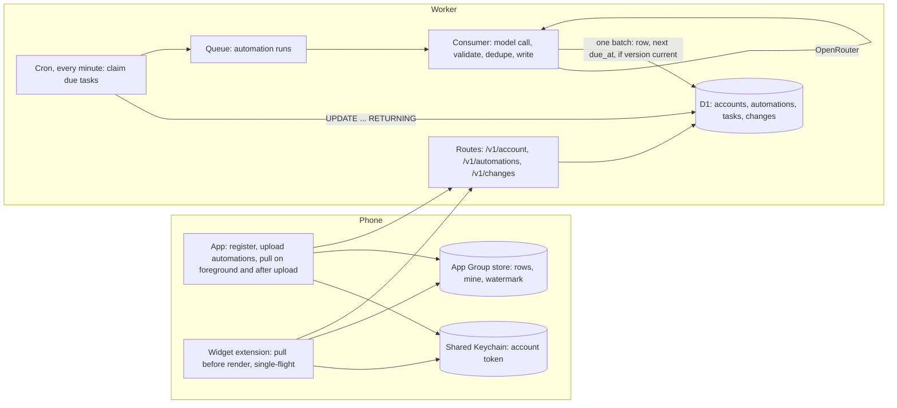

# Phase 3 plan: the AI block

Written 2026-11-27 from three research passes (our code on `main` and `phase-2b-b2`, Apple's widget push and network rules, Cloudflare scheduling), then revised the same day after a fresh Opus review (3 blockers, 10 should-fix, 5 nits, all taken) and the user's direction for a task table. Approved by the user on 2026-11-27. Covers phase 3 in `tasks/todo.md`: a server runs each widget's own automation on a schedule, writes the row, and the widget shows it without the app being opened.

## Goal

Word of the day (and every other automation) shows a new item at its time on the home screen, with the app closed, written for that person from that widget's own prompt ("medical terms for my nursing exam", "Spanish cooking words"). Nothing is computed once for everyone.

Done means, on a real iPhone:

- Word of the day changes at its time with the app closed and force-quit, including a night with Wi-Fi and cellular off from the evening before.
- A refine that changes the topic shows a word in the new topic within a minute, and tomorrow's word is in the new topic too.
- A word never repeats within 60 runs.

## Decisions (user, 2026-11-27)

1. **A task table, not per-account alarms.** One D1 database holds the tasks with their due times; a cron every minute claims the due ones and hands them to a Queue. The user asked for it, and it is simpler: one place to see, query, and fix every run. Writing rows a period ahead makes the cron's weak points (a skipped minute during a deploy, no built-in retry) harmless.
2. **Workers Paid ($5 a month).** Free's 10 ms CPU per cron run and 10,000 queue operations a day do not fit. The user upgrades in the Cloudflare dashboard before P3 deploys.
3. **Automations follow the phone's time zone.** Someone who moves from New York to Los Angeles keeps getting the word at 06:00 local. The upload sends the phone's current zone, the app re-uploads when it changes, and the engine reads the same zone.
4. **Push moves to phase 4.** Rows written a period ahead plus the app's pull after an upload meet every phase 3 done criterion. Phase 4 needs push for a partner's tap and carries the spike, the APNs key, the push handler, and the signer.

## Direction already recorded

- The server on Cloudflare runs every AI activity, and every automation is personal (`tasks/todo.md` phase 3, user 2026-11-22).
- Decision A (`tasks/todo.md` phase 1d): the widget makes one bounded pull of this account's changes before it renders, and the server writes rows ahead of their day.
- Phase 3 writes automation rows under the owner; phase 4 maps every replica of an account to `me` (`docs/engine/RATIONALE.md`).
- Sync state uses a session token, not App Attest assertions (`tasks/phase-2b-backend.md`).

## Facts this plan rests on

- **A future timeline entry changes the face with nothing else.** WidgetKit draws each entry when its date arrives, with no network, push, or reload. So a row that is on the phone before its time can appear exactly at its time.
- **The widget's next reload is predictable.** A timeline ends at `min(the midnight after next, the next automation run + 5 min)` (`Engine.swift:148-149,180`). The midnight face is drawn ahead, so nothing reloads at midnight. A row written more than one period ahead is therefore pulled at the previous run's reload, a full period early.
- **The pull lives in `getTimeline`**, which has no published time limit; the 4 s bound needs a task deadline, not `timeoutIntervalForRequest` (an idle timer). The extension can read a credential from a shared Keychain access group with `kSecAttrAccessibleAfterFirstUnlock`; before first unlock it cannot.
- **A pull's commit reloads every widget.** `Hosting.engine.onCommit` calls `reloadAllTimelines()` (`Hosting.swift:15,56`), and `RowStore.receive` fires it whenever anything was accepted, even a replay that changes nothing (`RowStore.swift:533-535`). Each placed widget runs its own timeline. Without care, a pull triggers reloads that pull again.
- **Cloudflare:** Cron Triggers run in UTC, at most every minute, and can be missed while a deploy propagates. A cron run can wait on only 6 connections at once, so it must not make the model calls itself. A Queue consumer is billed for CPU, not for waiting, and Queues give retries, a dead-letter queue, and `max_concurrency`. D1 is SQLite, transactional in a batch, supports `RETURNING`, holds up to 10 GB per database on Paid, and runs one write at a time.
- **Our code:** the automation format and validation (`Automations.swift`), `nextRun(after:)` (DST checked: a repeated 01:30 runs once, a skipped 02:30 runs at 03:00), the today cap, and the merge exist. Missing: a scheduler, a server copy of automations, a public way to take in remote changes, a stored watermark, network code in the extension, an account the extension can use. `me` is the local replica, so a server row reads as "others" today. `model.ts` has no structured output and pins Together with fallbacks off.

## Shape

- **One D1 database per environment** with four tables: `accounts` (token hash, attest key, automation replica, time zone, last pull), `automations` (account, widget, automation id, version, prompt, cadence, dataset, fields), `tasks` (automation, version, run time, `due_at`, `claimed_until`, attempts), and `changes` (an autoincrement id, account, and one wire-format change).
- **The cron claims.** Every minute, one statement claims the due tasks: `UPDATE tasks SET claimed_until = now + 15 min, attempts = attempts + 1 WHERE due_at <= now AND (claimed_until IS NULL OR claimed_until < now) RETURNING ...`, up to a page at a time, and sends them to the Queue with `sendBatch`. A task whose run failed is still due when its claim expires, so the next cron picks it up again with no separate retry machinery.
- **The consumer runs.** It calls the model, validates, and writes in one D1 batch: the row's changes into `changes`, the task's next run time and `due_at`, and the claim cleared, all guarded by the automation's current version, so a run of an old version writes nothing.
- **The phone pulls.** The extension pulls before render when a pull is due; the app pulls on foreground and for a minute after an upload that starts a run. A pull reads `changes WHERE account = ? AND id > ?`.

## How it works (decided)

- **A row appears at its time.** The today cap widens from day to instant: queries hide a row whose `at` is in the future, and the timeline adds an entry at the next hidden row's `at`. Rows written on the phone always have a past `at`, so taps are unchanged. Without this, a row written ahead would show at midnight and the schedule's time would mean nothing.
- **Run ahead by more than one period.** A task's `due_at` is its run time minus the lead: daily 26 to 38 hours, weekly 7 to 8 days, hourly 65 to 90 minutes, at a stable random offset per automation so one time zone's morning does not reach OpenRouter at once. So the row is on the phone a full period before its time, and its timeline entry makes the change offline.
- **New and changed automations.** An automation's version is a hash of its prompt, cadence, time zone, dataset, and fields. A new automation, or a changed prompt or table, gets a task for now (so a new widget is never empty and a refine shows at once) and one for its next run. A cadence or time zone change only replaces the next task. Any change or removal writes `deleteRow` tombstones under the automation replica for that automation's unrevealed rows (`at` after now), since tombstones win the merge (`Merge.swift:258-262`), and the version guard drops any run of the old version still in flight.
- **Who wrote the row.** The server writes under an automation replica that belongs to the account. The engine keeps a local `mine` set (the local replica plus the account's automation replica, delivered by the pull and stored in the same transaction as the first page), and `by me`, `by others`, and `RowAuthor.me` read it. This matches "a row an automation writes counts as the person's own" (`blocks.md`) and is the mechanism phase 4 needs for every replica of an account. Writing under the phone's own replica id would break the stamp's uniqueness.
- **The phone uploads the account's automations, not documents.** One payload for the whole account (at most 16 automations): per automation the widget key, automation id, prompt, cadence, the `writes` dataset key, and its field ids and kinds, plus the phone's time zone and a hash of the payload. Sent after any change that can move it (save, refine, template add, delete, restore, roll back, bind) and on foreground whenever the hash differs from the last one the server acknowledged. Replace-all is idempotent, has no orphans, and needs no outbox. Only the engine knows the bindings, so P1 adds a public accessor for the payload.
- **Pulls are rationed and single-flight.** One pull in flight per process. The extension pulls before render only when the last pull is more than 30 minutes old or the next expected write time the server returned has passed. `receive` fires `onCommit` only when rows actually changed, so a replay never reloads anything. The app pulls on foreground, and every 5 seconds for up to 60 seconds after an upload that starts a run.
- **The watermark is the last `changes.id` seen,** written as `max(old, new)` in the same transaction as the merge, so the app and the extension can never move it backwards. A page stops at its first held change (stamped more than 10 minutes ahead of the phone's clock), merges nothing past it, and logs the skew.
- **Wire format rules.** One canonical JSON for `Stamped` (`insertRow`, `setCell`, `deleteRow`), in `docs/engine/`, with shared vectors both the Swift engine and the TypeScript Worker check. A server row's stamp is the server's clock at write time; its `at` is the run time; its `day` is the day of `at` in the automation's time zone, in `Day`'s index. Row keys are UUIDv7 minted once per (widget, automation, run time) and kept on the task, so a replayed write reuses the key. Phase 3 sends server to phone only; phase 4 adds the other direction on the same format.
- **Each run sees its recent rows, and repeats are checked.** The rows an automation wrote are read back from `changes` by dataset, so a refine that renames the automation keeps its history. A run sends the last 60 to the model with "do not repeat any of these", and the consumer rejects a reply whose text matches any of them (case-insensitive) and asks again once.
- **The reply is checked, not trusted.** Structured output with a JSON schema built from the table's fields, if the provider supports it (P3 checks Together for the current model first; otherwise plain JSON). The consumer checks kinds, finite numbers, and the 300 UTF-16 unit cap, retries once with the error line, and otherwise leaves the task to be claimed again after its claim expires, with the attempt count growing the gap. After 5 attempts the task moves to the next run and the failure is logged. Automation runs use `max_tokens` around 1,500. The phone's `receive` still refuses anything over the limits.
- **Account and credential.** `POST /v1/account` with an App Attest assertion (the B2 key), verified without using build quota. One account per attest key: registering again returns the same account and a new token. The token (32 random bytes, stored hashed, compared in constant time) goes in a Keychain group shared by the app and the extension. A fresh-install marker in the App Group store discards a token left in the Keychain by an earlier install. Every other route takes the token.
- **Simulator path.** The simulator cannot attest. In `dev` only, `/v1/account` also accepts a `DEV_REGISTRATION_SECRET` that Debug simulator builds carry. `production` never has it, and a test checks that.
- **Limits, cost, and cleanup.** Per account: 16 automations and 60 runs a day, counting run-now. An upload whose schedules would exceed 60 runs a day is refused with a reason the app shows. A daily spend row per environment stops all claims if OpenRouter spend passes a set figure. An account with no pull for 30 days has its tasks parked (a pull re-arms them); after 90 days it is deleted with its rows. A daily cron deletes `changes` older than 120 days that every pull has passed, keeping the last 60 rows of each dataset for the repeat check.
- **No "new one now" action yet.** It needs a new action kind and cost rules; it stays in the known limits.

## Units (one PR each)

### P1. Engine: take in remote rows

Starts with the wire format doc and the vectors file, which P2 also builds on.

- [ ] The canonical JSON for `Stamped` and `docs/engine/` vectors, including stamp, `day`, and key cases; Swift tests decode every vector and merge it.
- [ ] A public `Engine.receive(_ page: RemotePage)` that merges through `RowStore.receive`, stores the automation replica in `mine` and the watermark (`max`) in the same transaction, stops at the first held change, and logs refused cells.
- [ ] `RowStore.receive` fires `onCommit` only when rows actually changed.
- [ ] A local `mine` table; `by me`, `by others`, and `RowAuthor.me` read it; the local replica is always in it.
- [ ] Rows reveal at their `at`: every query window hides a future `at`, `faces` adds an entry at the next hidden row's `at` within the image budget, and `face(for:at:)` caps its `reloadAt` there too.
- [ ] The engine reads the phone's current time zone for `nextRun` (decision 3), and a public accessor returns the account's automation payload with its hash.
- [ ] Tests: a row written ahead stays hidden until its `at` and shows in the entry dated then (counts, `latest`, streaks, and `minutesAgo` included); `by me` counts an automation row once its replica is in `mine`; a replayed page fires no commit and changes nothing; a held change stops the page and the watermark; the watermark never moves backwards; the payload hash changes on save, restore, roll back, and delete.
- [ ] `docs/engine/` updated: the wire format, the reveal rule, `mine`, the time zone rule.

### P2. Worker: accounts, automations, and the pull

- [ ] The D1 database per environment with migrations for the four tables and their indexes (`tasks(due_at)`, `changes(account, id)`).
- [ ] Routes: `POST /v1/account`, `PUT /v1/automations` (replace all, validated against the same limits as `Automations.swift`, refused over 60 runs a day), `GET /v1/changes?after=` (at most 500 changes a page, the automation replica id, and the next expected write time).
- [ ] TypeScript stamps and the wire format, checked against the P1 vectors.
- [ ] Versions, tasks for new and changed automations, tombstones for unrevealed rows on change or removal.
- [ ] Token, one account per attest key, idle parking and deletion, the spend row.
- [ ] Vitest: auth, replace-all, tasks and tombstones, paging and `after`, limits, registering twice, `production` refusing the dev secret.

### P3. Worker: the cron and the runner

- [ ] `nextRun` in TypeScript with `Intl` time zones, checked against vectors exported from `Automations.swift` across two DST changes in three zones.
- [ ] The cron every minute: claim due tasks with `UPDATE ... RETURNING` in pages, `sendBatch` to the Queue, skip claims when the spend row is over its figure. A daily cron for cleanup.
- [ ] The consumer: the automation system prompt, structured output where supported (`response_format` and `require_parameters` added to `model.ts` behind a setting), the last 60 rows, the repeat check, validation, one repair retry, then the version-guarded write batch. A dead-letter queue, `max_concurrency` to protect OpenRouter, `max_tokens` around 1,500.
- [ ] Logs model, seconds, usage, and cost per run, never the prompt text.
- [ ] Vitest: lead times and offsets stay in their windows, two crons never claim the same task, an expired claim is claimed again, a stale version writes nothing, a replayed message writes once, a repeat is rejected, five failures move the task on, the daily run limit.
- [ ] Deploy to `dev` (after the Paid upgrade) and run 20 hourly automations for a day; record failures, repeats, and cost.

### P4. App and extension: register, upload, pull

- [ ] Keychain Sharing on both targets; the token in the shared group with `kSecAttrAccessibleAfterFirstUnlock`; the fresh-install marker.
- [ ] Register on first need (the first automation saved), with the B2 attest key on a phone and the dev secret on the simulator in Debug.
- [ ] Upload the account payload after every change that moves it and on foreground when its hash differs; time zone changes re-upload.
- [ ] The extension's rationed, single-flight pull before `faces` with a 4 s task deadline; the app's pull on foreground and after an upload. Any failure renders what is stored.
- [ ] Tests with an injected transport: the deadline, a failed pull still renders, no token before first unlock renders without pulling, single-flight, the 30 minute ration, an upload retried on next foreground.
- [ ] Simulator end to end against `dev`: add word of the day and see a word at once; refine the topic and see a new-topic word within a minute; with the network off from the evening, the next word appears at its time with the app closed.

### P5. Content and evals

- [ ] Word of the day and Today's question become real: their copy drops "coming soon" (through the review gate); Today's question keeps its built-in fallback for before its first row.
- [ ] The build prompt teaches that a run sees its recent rows, so "do not repeat" works, and that the time is when the row appears.
- [ ] Eval cases: topic-specific daily content (nursing terms, Spanish cooking words, a Stoic quote), a refine that changes the topic, and 30 consecutive runs of each with no repeat and every reply valid.

### P6. Checks on the phone

- [ ] Word of the day changes at its time with the app closed and force-quit on three nights, one with Wi-Fi and cellular off from the evening before.
- [ ] A refine that changes the topic shows a new-topic word within a minute, and the next morning's word is in the new topic.
- [ ] Extension memory with several image-heavy widgets on one home screen (owed from phase 1d).
- [ ] Record results in a phase 3 review in `tasks/todo.md`.

## Order

P1 starts with the wire format and vectors; once those land, P2 runs alongside the rest of P1. P3 follows P2. P4 follows P1 to P3 on the simulator. P5 runs alongside P3 and P4. P6 needs the phone and comes last. P2 and later build on `phase-2b-b2` (the Worker and App Attest), so B2 merges first: its live checks need the phone, so P2 branches from `phase-2b-b2` and rebases once B2 merges.

## Risks

- **One D1 database is the ceiling.** 10 GB and one write at a time is comfortable for tens of thousands of people. Past that, `changes` moves out or splits across databases by account.
- **A pull before first unlock fails.** The widget renders from the store; rows written a period ahead are usually already there.
- **OpenRouter load at one time zone's morning.** Spread by the 12 hour offset window and capped by `max_concurrency`.
- **Model repeats or bad replies.** Checked in the consumer, retried once, and measured in P3 and P5.
- **Cost from abandoned installs and leaks.** Idle accounts are parked after 30 days, and the spend row caps a bad day.
- **Privacy.** Prompts, time zones, and generated rows now live on the server. Phase 5's AI consent screen and privacy label must cover them, and a stored time zone is treated as coarse location to be safe.
