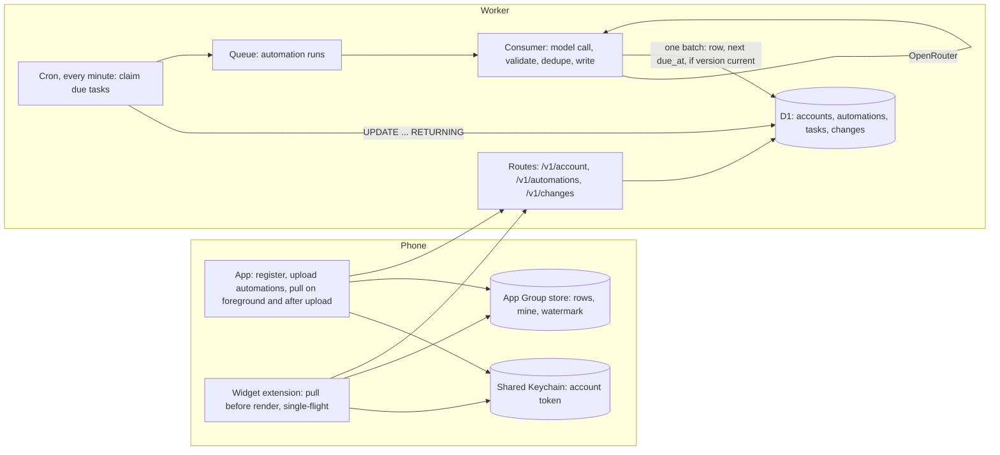

# Phase 3 plan: the AI block

Written 2026-11-27 from three research passes (our code on `main` and `phase-2b-b2`, Apple's widget push and network rules, Cloudflare scheduling), then revised the same day after a fresh Opus review (3 blockers, 10 should-fix, 5 nits, all taken) and the user's direction for a task table. Approved by the user on 2026-11-27. Covers phase 3 in `tasks/todo.md`: a server runs each widget's own automation on a schedule, writes the row, and the widget shows it without the app being opened.

## Goal

Word of the day (and every other automation) shows a new item at its time on the home screen, with the app closed, written for that person from that widget's own prompt ("medical terms for my nursing exam", "Spanish cooking words"). Nothing is computed once for everyone.

Done means, on a real iPhone:

- Word of the day changes at its time with the app closed and force-quit, including a night with Wi-Fi and cellular off from the evening before.
- A refine that changes the topic shows a word in the new topic within a minute, and tomorrow's word is in the new topic too.
- A word never repeats within 60 runs.

## Decisions (user, 2026-11-27)

1. **A task table, not per-account alarms.** One D1 database holds the tasks with their due times; a cron every minute claims the due ones and hands them to a Queue. The user asked for it, and it is simpler: one place to see, query, and fix every run. Writing rows a period ahead makes the cron's weak points (a skipped minute during a deploy, no built-in retry) harmless.
2. **Stay on Workers Free.** Approved as an upgrade, then corrected the same day: the design runs on Free. The first `dev` run (2026-11-28) measured CPU per invocation at a median of 3 ms and a max of 11 ms for a queue run, 3 ms for the cron, and 15 ms for a 20-automation upload. The user wants to avoid the upgrade, so the answer is cutting CPU (cached time zone formatters and schema, cheaper text checks, narrower reads), not Paid. Paid ($5 a month) comes back only if a measured run cannot be brought under the limit with margin. Free's daily ceilings, for reference: 10,000 queue operations (about 3,000 runs), 100,000 Worker requests (pulls from about 2,000 widgets), 100,000 D1 rows written, and queue messages kept 24 hours.
3. **Automations follow the phone's time zone.** Someone who moves from New York to Los Angeles keeps getting the word at 06:00 local. The upload sends the phone's current zone, the app re-uploads when it changes, and the engine reads the same zone.
4. **Push moves to phase 4.** Rows written a period ahead plus the app's pull after an upload meet every phase 3 done criterion. Phase 4 needs push for a partner's tap and carries the spike, the APNs key, the push handler, and the signer.

## Direction already recorded

- The server on Cloudflare runs every AI activity, and every automation is personal (`tasks/todo.md` phase 3, user 2026-11-22).
- Decision A (`tasks/todo.md` phase 1d): the widget makes one bounded pull of this account's changes before it renders, and the server writes rows ahead of their day.
- Phase 3 writes automation rows under the owner; phase 4 maps every replica of an account to `me` (`docs/engine/RATIONALE.md`).
- Sync state uses a session token, not App Attest assertions (`tasks/phase-2b-backend.md`).

## Facts this plan rests on

- **A future timeline entry changes the face with nothing else.** WidgetKit draws each entry when its date arrives, with no network, push, or reload. So a row that is on the phone before its time can appear exactly at its time.
- **The widget's next reload is predictable.** A timeline ends at `min(the midnight after next, the next automation run + 5 min)` (`Engine.swift:148-149,180`). The midnight face is drawn ahead, so nothing reloads at midnight. A row written more than one period ahead is therefore pulled at the previous run's reload, a full period early.
- **The pull lives in `getTimeline`**, which has no published time limit; the 4 s bound needs a task deadline, not `timeoutIntervalForRequest` (an idle timer). The extension can read a credential from a shared Keychain access group with `kSecAttrAccessibleAfterFirstUnlock`; before first unlock it cannot.
- **A pull's commit reloads every widget.** `Hosting.engine.onCommit` calls `reloadAllTimelines()` (`Hosting.swift:15,56`), and `RowStore.receive` fires it whenever anything was accepted, even a replay that changes nothing (`RowStore.swift:533-535`). Each placed widget runs its own timeline. Without care, a pull triggers reloads that pull again.
- **Cloudflare:** Cron Triggers run in UTC, at most every minute, and can be missed while a deploy propagates. A cron run can wait on only 6 connections at once, so it must not make the model calls itself. A Queue consumer is billed for CPU, not for waiting, and Queues give retries, a dead-letter queue, and `max_concurrency`. D1 is SQLite, transactional in a batch, supports `RETURNING`, holds up to 10 GB per database on Paid, and runs one write at a time.
- **Our code:** the automation format and validation (`Automations.swift`), `nextRun(after:)` (DST checked: a repeated 01:30 runs once, a skipped 02:30 runs at 03:00), the today cap, and the merge exist. Missing: a scheduler, a server copy of automations, a public way to take in remote changes, a stored watermark, network code in the extension, an account the extension can use. `me` is the local replica, so a server row reads as "others" today. `model.ts` has no structured output and pins Together with fallbacks off.

## Shape

- **One D1 database per environment** with four tables: `accounts` (token hash, attest key, automation replica, time zone, last pull), `automations` (account, widget, automation id, version, prompt, cadence, dataset, fields), `tasks` (automation, version, run time, `due_at`, `claimed_until`, attempts), and `changes` (an autoincrement id, account, and one wire-format change).
- **The cron claims.** Every minute, one statement claims the due tasks: `UPDATE tasks SET claimed_until = now + 15 min WHERE due_at <= now AND (claimed_until IS NULL OR claimed_until < now) ... RETURNING ...`, up to a page at a time, and sends them to the Queue with `sendBatch`. A task whose run failed is due again after its backoff, so a later cron picks it up again with no separate retry machinery; the run, not the claim, counts the attempt (P3 results).
- **The consumer runs.** It calls the model, validates, and writes in one D1 batch: the row's changes into `changes`, the task's next run time and `due_at`, and the claim cleared, all guarded by the automation's current version, so a run of an old version writes nothing.
- **The phone pulls.** The extension pulls before render when a pull is due; the app pulls on foreground and for a minute after an upload that starts a run. A pull reads `changes WHERE account = ? AND id > ?`.

## How it works (decided)

- **A row appears at its time.** The today cap widens from day to instant: queries hide a row whose `at` is in the future, and the timeline adds an entry at the next hidden row's `at`. A tap's `at` is the phone's clock when it was written, which later renders pass, so taps are unchanged, except after the clock is corrected backwards, when a tap written ahead stays hidden until its `at`. Without this, a row written ahead would show at midnight and the schedule's time would mean nothing.
- **Run ahead by more than one period.** A task's `due_at` is its run time minus the lead: daily 26 to 38 hours, weekly 7 to 8 days, hourly 65 to 90 minutes, at a stable random offset per automation so one time zone's morning does not reach OpenRouter at once. So the row is on the phone a full period before its time, and its timeline entry makes the change offline.
- **New and changed automations.** An automation's version is a hash of its prompt, cadence, time zone, dataset, and fields. A new automation, or a changed prompt or table, gets a task for now (so a new widget is never empty and a refine shows at once) and one for its next run. A cadence or time zone change only replaces the next task. Any change or removal writes `deleteRow` tombstones under the automation replica for that automation's unrevealed rows (`at` after now), since tombstones win the merge (`Merge.swift:258-262`), and the version guard drops any run of the old version still in flight.
- **Who wrote the row.** The server writes under an automation replica that belongs to the account. The engine keeps a local `mine` set (the local replica plus the account's automation replica, delivered by the pull and stored in the same transaction as the first page), and `by me`, `by others`, and `RowAuthor.me` read it. This matches "a row an automation writes counts as the person's own" (`blocks.md`) and is the mechanism phase 4 needs for every replica of an account. Writing under the phone's own replica id would break the stamp's uniqueness.
- **The phone uploads the account's automations, not documents.** One payload for the whole account: per automation the widget key, automation id, prompt, cadence, the `writes` dataset key, and its field ids and kinds, plus the phone's time zone and a hash of the payload. Sent after any change that can move it (save, refine, template add, delete, restore, roll back, bind) and on foreground whenever the hash differs from the last one the server acknowledged. Replace-all is idempotent, has no orphans, and needs no outbox. Only the engine knows the bindings, so P1 adds a public accessor for the payload.
- **Pulls are rationed and single-flight.** One pull in flight per process. The extension pulls before render only when the last pull is more than 30 minutes old or the next expected write time the server returned has passed. `receive` fires `onCommit` only when rows actually changed, so a replay never reloads anything. The app pulls on foreground, and every 5 seconds for up to 60 seconds after an upload that starts a run.
- **The watermark is the last `changes.id` seen,** written as `max(old, new)` in the same transaction as the merge, so the app and the extension can never move it backwards. A page stops at its first held change (stamped more than 10 minutes ahead of the phone's clock), merges nothing past it, and logs the skew.
- **Wire format rules.** One canonical JSON for `Stamped` (`insertRow`, `setCell`, `deleteRow`), in `docs/engine/`, with shared vectors both the Swift engine and the TypeScript Worker check. A server row's stamp is the server's clock at write time; its `at` is the run time; its `day` is the day of `at` in the automation's time zone, in `Day`'s index. Row keys are UUIDv7 minted once per (widget, automation, run time) and kept on the task, so a replayed write reuses the key. Phase 3 sends server to phone only; phase 4 adds the other direction on the same format.
- **Each run sees its recent rows, and repeats are checked.** The rows an automation wrote are read back from `changes` by dataset, so a refine that renames the automation keeps its history. A run sends the last 60 to the model with "do not repeat any of these", and the consumer rejects a reply whose text matches any of them (case-insensitive) and asks again once. A table whose only text is a category (its recent values already repeat a lot: at most three distinct, or a quarter of them) is not checked, since the P5 eval showed that refusing a repeat there makes the model stall or invent a value outside the category (2026-11-28).
- **The reply is checked, not trusted.** Structured output with a JSON schema built from the table's fields, if the provider supports it (P3 checks Together for the current model first; otherwise plain JSON). The consumer checks kinds, finite numbers, and the 300 UTF-16 unit cap, retries once with the error line, and otherwise gives the claim back and pushes the task back, with the attempt count (runs started, not claims) growing the gap. After 5 attempts the task moves to the next run and the failure is logged. Automation runs use `max_tokens` around 1,500, scaled by the table's text fields (P3 results). The phone's `receive` still refuses anything over the limits.
- **Account and credential.** `POST /v1/account` with an App Attest assertion (the B2 key), checked by the same `verifyAndAdvance` as `/v1/reply`, which stores the counter (there is no build quota since the limits were removed). One account per attest key: registering again returns the same account and a new token. The token (32 random bytes, stored hashed, compared in constant time) goes in a Keychain group shared by the app and the extension. A fresh-install marker in the App Group store discards a token left in the Keychain by an earlier install. Every other route takes the token.
- **Simulator path.** The simulator cannot attest. In `dev` only, `/v1/account` also accepts a `DEV_REGISTRATION_SECRET` that Debug simulator builds carry. `production` never has it, and a test checks that.
- **No usage limits for now; cleanup stays.** The usage limits (runs per day, automations per account, the spend cap, and rate limits on the sync routes) were removed by the user on 2026-11-27 for simplicity and come back later. The OpenRouter key's credit limit is the backstop. The document's own rules, which the engine also enforces (4 automations per widget, prompt length, 16 fields, ids, cadence, an IANA zone), are still checked on upload. Cleanup stays: an account with no pull or upload for 30 days has its tasks parked (a pull or an upload re-arms them); after 90 days it is deleted with its rows. A daily cron deletes `changes` older than 120 days that every pull has passed (the account's last pull watermark), keeping the last 60 rows of each dataset for the repeat check.
- **No "new one now" action yet.** It needs a new action kind and cost rules; it stays in the known limits.

## Units (one PR each)

### P1. Engine: take in remote rows

Starts with the wire format doc and the vectors file, which P2 also builds on.

- [x] The canonical JSON for `Stamped` and `docs/engine/` vectors, including stamp, `day`, and key cases; Swift tests decode every vector and merge it.
- [x] A public `Engine.receive(_ page: RemotePage)` that merges through `RowStore.receive`, stores the automation replica in `mine` and the watermark (`max`) in the same transaction, stops at the first held change, and logs refused cells.
- [x] `RowStore.receive` fires `onCommit` only when rows actually changed.
- [x] A local `mine` table; `by me`, `by others`, and `RowAuthor.me` read it; the local replica is always in it.
- [x] Rows reveal at their `at`: every query window hides a future `at`, `faces` adds an entry at the next hidden row's `at` within the image budget, and `face(for:at:)` caps its `reloadAt` there too.
- [x] The engine reads the phone's current time zone for `nextRun` (decision 3), and a public accessor returns the account's automation payload with its hash.
- [x] Tests: a row written ahead stays hidden until its `at` and shows in the entry dated then (counts, `latest`, streaks, and `minutesAgo` included); `by me` counts an automation row once its replica is in `mine`; a replayed page fires no commit and changes nothing; a held change stops the page and the watermark; the watermark never moves backwards; the payload hash changes on save, restore, roll back, and delete.
- [x] `docs/engine/` updated: the wire format, the reveal rule, `mine`, the time zone rule.

**P1 results (2026-11-27, branch `phase-3-p1-engine`).** Reviewed by a fresh Opus review (no blockers; three should-fix and four nits, all fixed: the payload throws instead of leaving out an unreadable widget, a migration test on a store with taps, the reader rules for repeated keys and overflowing numbers in `WIRE.md` and the vectors, no clock entries after `reloadAt`, the reveal query bounded by day, and the missing tests). Merged as PR 22 on 2026-11-27.

- **Wire format** in `docs/engine/WIRE.md`, vectors in `Engine/Vectors/wire.json` (the path P2's tests read). A stamp travels as a decimal string, since `ms << 16` passes 2^53. `at` is milliseconds, `day` and date cells are `Day` indexes, ids are lowercase (row keys UUIDv7), and every object has exactly its keys. A page is `{ replica, changes: [{ id, change }], nextWrite }`; it decodes whole or not at all, so one bad change from the server stops the pull until it is fixed rather than losing it. The vectors also hold receive scenarios (watermark, commit, held, refused, rows and whether each is the person's), which only the phone runs. Each bad case carries a fragment of the Swift reader's error, and two raw-text pages (a number past a 64-bit float, a key twice in one object) cover what `JSON.parse` lets through, for the server reader phase 4 adds.
- **Public API**: `Engine.receive(_:at:)` with `RemotePage(json:)` (and `nextWrite`), `Engine.watermark()`, and `Engine.automationPayload()` returning `AutomationPayload { json, digest }`. The engine parses the page bytes and writes the upload bytes, so P4's transport only moves bytes. The payload format is in WIRE.md: one canonical JSON object (strings only, keys sorted) whose SHA-256 is the digest, so the server can hash the body it receives the same way.
- **The document's `timeZone` is gone.** With decision 3 nothing reads it, so the builder no longer fills it and the encoder never writes it. Older stored revisions keep parsing (the key is read past), which matters for the widgets already on the dev phone. New revisions no longer hash differently by the zone they were built in. The zone lives once in the payload, so a move changes the digest and triggers the re-upload.
- **Reveal**: queries keep the day cap and add `at <= now`, so a row needs both its day and its instant. `faces` draws one entry at the next hidden row's `at` (inside the call's image budget, or the timeline is cut there) and ends by the second hidden `at`, so two automations a few minutes apart both land on time. A peer clock running ahead now delays its rows by the skew instead of showing them with 0 minutes ago.
- **`onCommit`** for both `receive`s runs only when `merge` changed something (counted with `totalChangesCount`, before the clock update) or `mine` gained a replica, so the first pull reloads once even when empty and every replay reloads nothing.
- **Not done here**: the 16 automations per account limit is left to the server, which refuses an over-limit upload with a reason (P2). There is no phone-to-server encoder yet; phase 4 adds it against the same vectors.

### P2. Worker: accounts, automations, and the pull

- [x] The D1 database per environment with migrations for the four tables and their indexes (`tasks(due_at)`, `changes(account, id)`).
- [x] Routes: `POST /v1/account`, `PUT /v1/automations` (replace all, validated against the same rules as `Automations.swift`), `GET /v1/changes?after=` (at most 500 changes a page, the automation replica id, and the next expected write time).
- [x] TypeScript stamps and the wire format, checked against the P1 vectors.
- [x] Versions, tasks for new and changed automations, tombstones for unrevealed rows on change or removal.
- [x] Token, one account per attest key, idle parking and deletion.
- [x] Vitest: auth, replace-all, tasks and tombstones, paging and `after`, the document's rules, registering twice, `production` refusing the dev secret.

**P2 results (2026-11-27).** Branch `phase-3-p2-worker`, from `phase-2b-b2`. It first merged the wire format commit of P1; once P1 merged to main and B2 was rebased onto it, P2's own commits were replayed onto the rebased B2 without that merge, so the wire format, the vectors, and the Swift reader are main's reviewed ones. Nothing is deployed and no real D1 database exists yet.

- **Schema** (`Backend/migrations/0001_automations.sql`): `accounts`, `automations`, `tasks`, and `changes`. An account carries a `revision` that every upload checks and raises, `pulled_at` (the last pull or upload), and `pulled_after` (its last pull's watermark, for the cleanup). A task carries `version`, `once` (1 for a run now, deleted after it runs; 0 for the schedule, which moves to its next run), `run_at` (the row's `at`), `row_key` (the UUIDv7, minted with the task), `due_at`, `claimed_until`, and `attempts`, with at most one of each kind per automation. `changes` uses `AUTOINCREMENT`, so an id is never reused after cleanup, and repeats `op`, `dataset`, `row_key`, `widget`, `automation`, and `at` beside the wire JSON so tombstones and P3's repeat check can find an automation's rows. Foreign keys cascade, so deleting an account deletes the rest. Indexes: `tasks (due_at)`, `changes (account, id)` for the pull, the partial `changes (account, widget, automation, at) WHERE op = 'insertRow'` and `changes (account, row_key) WHERE op = 'deleteRow'` for the tombstones, and `changes (account, dataset, id)` for P3's read-back. A test asserts the query plans use them; `EXPLAIN QUERY PLAN` of the tombstone statement reads `SEARCH inserted USING INDEX changes_inserted (account=? AND widget=? AND automation=? AND at>?)`, `SEARCH changes USING COVERING INDEX changes_deleted (account=? AND row_key=?)`, `SEARCH accounts USING INDEX sqlite_autoindex_accounts_1 (id=?)`, and `USE TEMP B-TREE FOR ORDER BY` (over one automation's rows ahead), and the read-back (`WHERE account = ? AND dataset = ? ORDER BY id DESC LIMIT 60`) reads `SEARCH changes USING INDEX changes_dataset (account=? AND dataset=?)`.
- **Token**: `<account id>.<secret>`, the secret 32 random bytes as base64url. The id finds the row, and the stored SHA-256 is compared with `crypto.subtle.timingSafeEqual`, which is the only way the comparison can be constant time. A refusal is 401 `bad-token`.
- **Registration**: the request has an empty body, signed as `/v1/reply` is (`POST\n/v1/account\n<hex SHA-256 of nothing>`). `AttestedKey.verifyAndAdvance`, the check `/v1/reply` uses, verifies the assertion and stores its counter. P2 first added a separate `verify` that skipped the build quota; with the quota removed the two did the same thing, so the restack made them one method. One `INSERT ... ON CONFLICT (attest_key)` statement, so two registrations of one key never make two accounts. The dev path is an `X-Widgie-Dev-Secret` header, accepted only when `ENVIRONMENT` is `dev` and `DEV_REGISTRATION_SECRET` is set; the test configuration is production's with the secret set, and it is refused. A dev registration makes a new account each time, since the simulator has no key to name one by.
- **Replace-all** is one D1 batch. Its first statement is `UPDATE accounts SET revision = CASE WHEN revision = ? THEN revision + 1 END ...`: when another upload committed after this one read, revision would become NULL, the NOT NULL constraint fails, and D1 rolls the whole batch back (a test checks that nothing of the failed batch is stored). The upload then reads and plans again, up to 3 times, and otherwise answers 409 `conflict`. So an upload never acknowledges a digest the server does not hold. The same statement clears `parked_at` and sets `pulled_at`, so an upload re-arms a parked account and the next parking cannot take the run now it just made; an unchanged automation gets its schedule back with `INSERT OR IGNORE`. Tombstones are an `INSERT ... SELECT` inside it, under a stamp the same batch takes with `max(last_stamp + 1, ms * 65536)` in SQL, so a runner's write lands either before them (and is deleted) or after (and finds its version gone). `PUT` answers `{digest}`, the SHA-256 of the bytes received.
- **Validation** follows Spec.swift: 4 automations per widget, prompts of 1 to 2,000 grapheme clusters (Swift's `count`), ids, 16 fields, reserved field ids, and an IANA zone. The cadence takes only the canonical spellings the engine writes (`"06:00"`, `":15"`); Swift's reader also takes `"+6:00"`, which no payload carries. Going over one of the three limits is 422 with a stable code and a sentence the app can show: `too-many-on-widget` (`A widget has 5 automations, and the limit is 4 a widget.`), `prompt-too-long` (`The prompt of "daily" is 2001 characters, and the limit is 2000.`), and `too-many-fields` (`"daily" writes 17 fields, and the limit is 16.`). Other malformed payloads are 400 with the first problem. There are no usage limits (see "How it works"). The time zone is stored by its canonical name: Intl reads any case and resolves links, so "america/new_york" is stored as "America/New_York", and with this runtime's tz data "Asia/Kolkata" as "Asia/Calcutta". Requiring the phone's spelling to be canonical is not possible, since `TimeZone.current.identifier` sends "Asia/Kolkata", which this Intl resolves to "Asia/Calcutta". The formatter cache is keyed by the canonical name.
- **`nextWrite`** is the earliest `due_at` of the account's tasks, the time the server expects to write, as WIRE.md defines it, not the earliest `run_at`, but never sooner than 5 minutes after the pull, so a task waiting for the cron does not make the extension pull at every render. A pull records its `after` in `pulled_after` when it changed.
- **`nextRun`** (`Backend/src/schedule.ts`) matches Foundation on every case printed from `Calendar.nextDate(... .nextTime)` across DST in New York, London, Santiago, Havana, Kolkata, and Lord Howe, except three. Two where Foundation skips a run: a weekly time the clocks skip (Foundation moves to the next week) and a time inside Lord Howe's half-hour gap (Foundation moves to the next day); the Worker runs at the moment the clocks change in both, the plan's rule. And a time that happens twice on the fall-back night: Foundation answers the second instant when asked from between the two, so a daily run could happen twice; the server's rule is that a repeated time runs once, at the first, and a day whose first instant is at or before `after` has had its run. P3 aligns the engine to these rules and its exported vectors include all three; the phone only uses its `nextRun` for its reload time, so the server's answer is what decides when a row shows.
- **Idle parking and deletion** are plain functions in `Backend/src/upkeep.ts` for P3's daily cron. A pull or an upload re-arms a parked account. The spend row and the 60 runs a day and 16 automations per account limits were built, then removed with the other usage limits on 2026-11-27.
- **Before the first deploy**: `npx wrangler d1 create widgie` and `npx wrangler d1 create widgie-dev`, the printed ids in `wrangler.jsonc` in place of the placeholders, `npx wrangler d1 migrations apply widgie-dev --env dev --remote` and `npx wrangler d1 migrations apply widgie --remote`, and `npx wrangler secret put DEV_REGISTRATION_SECRET --env dev`.
- **The Worker writes the wire format and reads none of it** (`Backend/src/wire.ts`): in phase 3 it only writes changes and pages, so the strict reader stays the phone's, and the refusal vectors (`badChanges`, `badPages`) wait for phase 4's TypeScript reader. The payload `PUT /v1/automations` takes is read strictly: unknown, missing, or wrongly typed keys are refused (a duplicate key is not, since `JSON.parse` keeps the last). An automation missing from the payload is a removal, and its rows ahead are deleted.
- 262 Worker tests (154 new). Every good vector in `Engine/Vectors/wire.json`, read through a relative import, is written byte for byte from what it means, and the stamp, day, and key vectors pass.

### P3. Worker: the cron and the runner

- [x] `nextRun` in TypeScript with `Intl` time zones, checked against vectors exported from `Automations.swift` across two DST changes in three zones.
- [x] The cron every minute: claim due tasks with `UPDATE ... RETURNING` in pages, `sendBatch` to the Queue. A daily cron for cleanup.
- [x] The consumer: the automation system prompt, structured output where supported (`response_format` and `require_parameters` added to `model.ts` behind a setting), the last 60 rows, the repeat check, validation, one repair retry, then the version-guarded write batch. A dead-letter queue, `max_concurrency` to protect OpenRouter, `max_tokens` around 1,500.
- [x] Logs model, seconds, usage, and cost per run, never the prompt text.
- [x] Vitest: lead times and offsets stay in their windows, two crons never claim the same task, an expired claim is claimed again, a stale version writes nothing, a replayed message writes once, a repeat is rejected, five failures move the task on.
- [ ] Deploy to `dev` and run 20 hourly automations for a day; record failures, repeats, cost, and CPU per cron and consumer run against Free's 10 ms (decision 2).

**P3 results (2026-11-27, branch `phase-3-p3-runner`, stacked on `phase-3-p2-worker` at 043bee4).** Nothing is deployed, and no queue, database, or secret exists yet; the live `dev` run above is the user's.

- **The crons** (`Backend/src/cron.ts`, `triggers.crons` in both environments of `wrangler.jsonc`, two of the account's five): `* * * * *` claims and `17 3 * * *` runs the upkeep; any other cron string throws. A claim is one statement, `CLAIM`: `UPDATE tasks SET claimed_until = now + 15 min WHERE id IN (SELECT ... WHERE due_at <= now AND (claimed_until IS NULL OR claimed_until < now) AND <no other task of the automation holds a live claim> AND <not a schedule whose automation's run now is due> ORDER BY due_at LIMIT 100) RETURNING id, row_key, attempts`, read through `tasks_due`, the other tasks through the tasks' unique key. A claim is not an attempt: it only keeps the task out of other claims while its message waits or runs. Pages of 100 (the most one `sendBatch` takes), at most 20 a minute; a page `sendBatch` refuses is released at once (`claimed_until = NULL` for those ids) and the error thrown, so the next minute claims it again. Each message is `{task, rowKey, attempts}`. A new schedule task is always due at once, since every lead is longer than its period: the next row is written now, and the run after it is due a period later. So a new or refined automation has its run now and its schedule due together; the claim hands out the run now first and the schedule only once the run now has written (or gave its claim back after a failure), so the schedule reads the run now's row among its recent rows instead of running beside it with the same ones.
- **The queue**: `widgie-runs` and `widgie-dev-runs`, consumed by the same Worker one message per batch (`max_batch_size` 1), so each run has its own invocation and its own 10 ms of CPU on Workers Free, with `max_concurrency` 20, so at most 20 model calls at once. A run that throws (D1 failing, a bug) is retried twice by the queue, 60 s apart (`message.retry({delaySeconds: 60})`), and then kept in `widgie-runs-dead` / `widgie-dev-runs-dead`, which nothing consumes: a retry of a run that had started is a no-op and its claim expires either way, so the task is claimed again, and a dead letter is only a signal.
- **The run** (`Backend/src/runner.ts`, `Backend/src/run.ts`, `Backend/src/run-prompt.txt`): it starts with `START`, one statement batched with the task's read: `attempts = attempts + 1, claimed_until = now + 15 min` only while the task holds the message's row key and attempt count and no other task of its automation holds a live claim. So of two deliveries of one message, or the messages of two claims (one waited past its claim and the cron claimed the task again), one runs and the others log `skipped` with reason `busy` without calling the model, and a run now and a schedule never run side by side. A message is skipped with reason `gone` when no task holds both its id and row key: a replay (the task moved on or a run now was deleted) or a task an upload replaced or removed. SQLite can give a replaced task the same id, never the same row key, so there is one outcome for both. The system prompt is a small fixed file (cached like the build prompt), and the user turn carries the table's fields and kinds, the owner's prompt, the weekday and date the row appears, and the dataset's last 60 rows' text values newest first, read by dataset.
- **Structured output: supported.** OpenRouter's endpoints for `deepseek/deepseek-v4.1-flash-1017` list `response_format` and `structured_outputs` for all three Together endpoints (`together`, `together/us`, `together/fast`), checked on 2026-11-27 at `/api/v1/models/deepseek/deepseek-v4.1-flash-1017/endpoints`. So `STRUCTURED_OUTPUT` is `"on"` in both environments: a run sends `response_format: {type: "json_schema", json_schema: {name: "row", strict: true, schema}}`, the schema an object with exactly the table's fields (text and date as strings, number, boolean), all required, no others, and `provider.require_parameters: true`, so a provider that would ignore it refuses instead. Off, the schema is left out and the reply is checked the same way. The build route sends no schema and is unchanged. `max_tokens` is 1,000 plus 250 for each text field, at most 4,000 (`runMaxTokens`, so 1,500 for a two-text word table). A reply cut off at its cap (`finish: "length"` with text that does not read, or with no text at all because thinking took the cap) is refused as `cut` and repaired with twice the cap, at most 4,000; with no larger cap to give (twelve text fields or more), the repair would be cut too, so it is not asked. The log carries `finish`, so cut replies show in the dev run.
- **The check**: one JSON object (a code fence is read past), every field present and of its kind, finite numbers (a number past a 64-bit float parses as Infinity and is refused), text trimmed, well-formed UTF-16 (`isWellFormed`: the reply's `\ud83d` parses to a lone surrogate, which `JSON.stringify` would write back as an escape the phone's reader refuses with the whole page, stalling the account's sync), and at most 300 UTF-16 units, dates `YYYY-MM-DD` of a real day; keys the table lacks are left out. Then the repeat check, and one repair call whose turn ends with `Your last reply was refused: <line>. Reply again with one new row.` A model failure (HTTP error, timeout) gets no repair call. `encodeChange` refuses any change with a string that is not well-formed (row, dataset, stamp, replica, field, text value), the one place that invariant holds for every change the Worker stores; the other strings come from validated ids and minted keys, and WIRE.md and a new bad page vector pin the reader's refusal.
- **The repeat rule differs from "any text value matches"**, deliberately. A reply repeats a recent row when it has that row's text, ignoring case and surrounding space, in two of its non-empty text fields, or in its only one. Matching any one field would refuse every Word of the Day after the first whose `kind` is "noun" (the template's part of speech), and once every part of speech had been used, every reply, so the widget would stop getting words; its `verdict` is left empty in every row. With the rule, the same word with its part of speech, the same question, or the same quote with its author is refused, and a new noun is not. What it misses: a table with exactly two text fields where only the key one repeats (a word with a reworded definition). The prompt lists the recent rows and says not to repeat them, and that a field naming a category may repeat, so this is a backstop. P5's evals measure it. The rule is checked on the first reply only: a repair that repeats is written and logged with reason `repeat`, since a table whose only non-empty text is a category (a mood of the day, or a word table whose other text is always empty) would otherwise be refused forever, and a repeated row beats a widget that stops getting rows.
- **The write** is one batch whose first statement takes the account's stamp only while the task still holds the version and row key it was read with: `last_stamp = CASE WHEN EXISTS (...) THEN max(last_stamp + 1, now * 65536) END`, and a NULL fails the NOT NULL constraint, so D1 rolls the whole batch back (the trick P2's upload uses for its revision). The insertRow (with `day` the day of the run time in the account's zone, `at` the run time, and the task's row key) and one setCell per field follow, each written as `head || (SELECT CAST(last_stamp AS TEXT) ...) || tail`, where `encodeAroundStamp` splits the wire bytes around the stamp, so the stored change is `encodeChange`'s byte for byte. Last, the task: a run now is deleted, and the schedule moves to the first run after `max(run_at, now)` (a late task skips the runs it missed) with a new row key, attempts 0, and no claim. The clock is read when the batch is written, after the model has answered.
- **Failures**: a failed run gives its claim back and moves `due_at` to 15, 30, 60, then 120 minutes after it (the retry statement is guarded by the attempt count, so it never touches a run started since). The fifth failed attempt moves the task on (a run now is deleted) and logs `moved on`; so does a run that starts after five runs that never finished (each threw), without calling the model. The attempt check comes before the time zone check, and a schedule whose account has no zone is deleted instead of moved (the next upload makes it again), so even that impossible case ends instead of looping.
- **The log**: one line a run, `{run: "automation", task, outcome, attempts, calls, model, provider, finish, input_tokens, cached_tokens, output_tokens, cost_usd, seconds, reason, ms}`, where `reason` is a refusal code (`json`, `missing`, `kind`, `long`, `unicode`, `date`, `repeat`, `cut`; `repeat` also on a written repair that repeats), `gone` or `busy` for a skipped message, or the model service's one-line failure, never the prompt or the row. Each cron run logs `{cron, claimed or parked/deleted/pruned, ms}`.
- **The upkeep** (`Backend/src/upkeep.ts`): parking, deleting, and `pruneChanges`. A change goes when it was written more than 120 days ago, its account's `pulled_after` has passed it, and its id is below the insertRow of its dataset's 60th newest row. A row's changes only grow from its insertRow's id, so a kept row keeps every change, and a tombstone either goes with its row or outlives it, never the other way round. The prune is set-based and bounded: `SLICES` reads, from the upkeep's place (`upkeep.prune_from`, a one-row table), every 10,000th change of the next 200,000 with its write time, and each slice is one `PRUNE_SLICE` statement: a `WITH ... MATERIALIZED` list of the slice's datasets, each dataset's limit worked out once (its account's `pulled_after + 1` and its 60th newest insertRow, by correlated subqueries), and a `DELETE` of the slice's old changes below their dataset's limit. At most 20 slices a run, then the place moves past them; a slice that would start at a change newer than 120 days, or the end of the table, ends the pass, and the next run starts from the first change again, so changes kept for now are looked at again. The upkeep is at most 25 queries a day (Workers Free allows 50), each reading a bounded number of rows however large `changes` grows, and its CPU is awaiting D1. Plans (`test/plans.test.ts`): `SEARCH changes USING INTEGER PRIMARY KEY (rowid>?)` and the upkeep row by key for the slices; for a slice, `SEARCH changes USING INTEGER PRIMARY KEY (rowid>? AND rowid<?)` for its datasets, `sqlite_autoindex_accounts_1 (id=?)` and `changes_dataset (account=? AND dataset=?)` for the limits, `SEARCH c USING INDEX changes_account (account=? AND id>? AND id<?)` for the deletes, and scans only of the two materialized lists. The test also asserts the claim's (`tasks_due` and the tasks' unique key), the run start's, and the read-back's.
- **`nextRun` parity.** The engine's `Schedule.nextRun(after:in:)` no longer calls `Calendar.nextDate`: it is a port of `schedule.ts` over `TimeZone.secondsFromGMT(for:)` (`ZoneClock` in `Automations.swift`), so it now runs a weekly time the clocks skip at the change (Foundation moved a week), a time in Lord Howe's half-hour gap at the change (Foundation moved a day), and never takes a repeated time's second instant when asked from between the two (Foundation did). `Engine/Tests/SpecTests/ScheduleTests.swift` exports 59 cases to `Engine/Vectors/schedule.json` (`WIDGIE_WRITE_VECTORS=1 swift test --filter ScheduleTests` rewrites it, and the test fails while the file differs from the engine): New York, St. John's (a negative half-hour offset), Santiago, Lord Howe, and Chatham (a 45-minute offset) across both of their 2026 changes, London's two, Kolkata, and UTC, daily, weekly, and hourly, with single steps from just before, at, between, and at the second of a repeated time. The Worker's `schedule.test.ts` checks every case, and both pass unchanged on the server side. The hourly rule the P2 review fix might have broken is intact on both sides: on the fall-back night an hourly run runs in each real hour (New York 05:15Z and 06:15Z, both 01:15; Santiago 02:30Z and 03:30Z, both 23:30; Lord Howe's half-hour repeat at :45 runs at 14:45Z and 15:15Z), and only daily and weekly times that happen twice run once, at the first. The vectors cover all of these. The file depends on the tz database as well as the rule: the Swift test, the file's `about`, and the Worker's test say so, and a Worker case that fails names its zone (`$name ($zone)` and the message `<zone> diverges from the engine's tz data`).
- **Before the first deploy** (beyond P2's database steps): `npx wrangler queues create widgie-runs`, `widgie-runs-dead`, `widgie-dev-runs`, and `widgie-dev-runs-dead`, and `npx wrangler secret put MODEL_API_KEY` for each environment if not set yet.
- 367 Worker tests (105 new: the claim, the crons, the runner, the reply and its repeat rule, the request's structured output, the plans, the upkeep's pruning, the wire bytes around a stamp, and the 49 schedule vectors); the engine's `ScheduleTests` (5 tests) replace no existing test, and every `DocumentTests` case still passes. The PR 25 review fixes bring the Worker to 391 tests: one task of an automation runs at a time, a claim is not an attempt (a released page, a late message, and a duplicate delivery cost nothing), a lone surrogate is refused and never encoded, a repair that repeats is written, the token cap scales with text fields and grows for a cut reply, the prune goes in slices from a stored place, and the St. John's and Chatham vectors.
- **CPU on Workers Free** (2026-11-28, measured on `widgie-dev` with `wrangler tail` `cpuTime`, which Cloudflare reports in whole ms). Cloudflare's limits page (https://developers.cloudflare.com/workers/platform/limits/, "CPU time") gives Free 10 ms per HTTP request and per Cron Trigger, and the pricing page gives 10 ms per invocation, which covers a queue consumer. It is not a strict cut at every invocation: "Each isolate has some built-in flexibility to allow for cases where your Worker infrequently runs over the configured limit. If your Worker starts hitting the limit consistently, its execution will be terminated", as Error 1102 and the outcome `exceededCpu`. No size of that flexibility is published. Waiting on `fetch`, D1, and the queue is not CPU time, and the global scope runs under its own 1 s startup limit.
  - **Where the CPU went.** Not `Intl`: a new `Intl.DateTimeFormat` costs under 1 ms even in a new isolate, since the process has ICU warm. The cost was the work the Worker does around D1 (about 0.45 ms a call, about 30 µs a statement, and the rows it turns into objects), the run's read back of up to 360 stored changes parsed one by one, and a pull's 500 rows turned into objects and joined again. The changes: a run reads its recent rows in the batch that starts it (two trips to D1, not three), with SQL picking out each text cell's field and value, so no stored change is parsed (`LATEST_ROWS`, `LATEST_CELLS` in `runner.ts`), and writes its changes with one statement (`INSERT_CHANGES`); a pull has SQL join the page's entries into one string (`PAGE_ENTRIES_SQL` in `wire.ts`); an upload writes one statement of each kind over a JSON list (`json_each`) instead of four or five an automation (`automations.ts`), so an upload takes at most 8 statements (20 new automations take 4, not 81); `wall()` in `schedule.ts` keeps the wall clocks it read (an upload's automations share the upload time, a run's day starts its next run's search), and hex is looked up, not formatted. Behaviour is the same: the old runner and replace-all pass every new test (task id order, tombstone order, every kind of cell, text through SQL byte for byte), and the query plans stay on their indexes.
  - **The numbers**, median / max ms per invocation. A/B is both builds deployed at 50% each at once, so both met the same machines and the same load; fresh deploy is each build right after its own deploy, so most of its first invocations ran on new isolates.

    | Invocation | Before, A/B | After, A/B | Before, fresh deploy | After, fresh deploy |
    |---|---|---|---|---|
    | Queue run (one automation) | 3 / 8 (n=20) | 2 / 7 (n=28) | 4 / 10 (n=40) | 2 / 11 (n=44) |
    | Pull, 500 changes | 4 / 9 (n=18) | 3 / 7 (n=22) | 5 / 15 (n=25) | 3 / 16 (n=15) |
    | Upload, 20 automations | 5 / 11 (n=24) | 4 / 7 (n=18) | 5 / 19 (n=26) | 6 / 14 (n=16) |
    | Upload, 4 automations | 3 / 6 (n=20) | 3 / 6 (n=20) | 4 / 14 (n=25) | 4 / 9 (n=15) |
    | Minute cron | 1 / 1 | 0 to 2 | 2 / 2 | 1 / 3 |
    | Account registration | 2 to 4 (code not changed) | | | |

  - **What is left is the cold isolate.** Warm, every kind stays well inside 10 ms (a run's median is 2, its warm max 4 to 5). The maxima are the first invocation in a new isolate, which costs 4 to 10 ms more than the same work warm, and at this traffic most uploads and many runs land on a new isolate. Part of it is V8 compiling each function on its first call: a 90 KB function cost 2 to 4 ms on its first call and nothing once compiled, and the same function in parentheses, which V8 compiles at startup, cost 0 ms, so startup does not count toward an invocation. The rest is the runtime's own first use (its D1 client, `fetch`, crypto, the queue) and code that has not been optimized yet, which the Worker's code does not control. Those cold overruns are the "infrequent" case the per isolate flexibility is for; if they ever were refused, the next step is compiling the hot paths at startup (parenthesized function expressions, which `esbuild` keeps), measured above but not adopted.

### P4. App and extension: register, upload, pull

- [x] Keychain Sharing on both targets; the token in the shared group with `kSecAttrAccessibleAfterFirstUnlock`; the fresh-install marker.
- [x] Register on first need (the first automation saved), with the B2 attest key on a phone and the dev secret on the simulator in Debug.
- [x] Upload the account payload after every change that moves it and on foreground when its hash differs; time zone changes re-upload.
- [x] The extension's rationed, single-flight pull before `faces` with a 4 s task deadline; the app's pull on foreground and after an upload. Any failure renders what is stored.
- [x] Tests with an injected transport: the deadline, a failed pull still renders, no token before first unlock renders without pulling, single-flight, the 30 minute ration, an upload retried on next foreground.
- [ ] Simulator end to end against `dev`: add word of the day and see a word at once; refine the topic and see a new-topic word within a minute; with the network off from the evening, the next word appears at its time with the app closed.

**P4 results (2026-11-27, branch `phase-3-p4-app`, stacked on `phase-3-p3-runner`).** Nothing is deployed; the live simulator run against `dev` above is the user's, after deploying.

- **Where it lives.** The account both processes share is `AccountClient` in `WidgetHosting` (`Engine/Sources/WidgetHosting/Account.swift`), reached as `Hosting.account`: the token, the pull, the upload, and `HTTPTransport`, which `AttestedModel` now uses in place of the app's own copy. `WidgetHosting` may now import Security, CryptoKit (a token's fingerprint), Synchronization, and os (MODULES.md), and its public column lists the account types; `WidgetBuilder` imports none of them. Registering stays in the app (`App/Widgie/Account/Registration.swift`), which hands `upload` a closure, since only the app holds the App Attest key. The app's `AccountSync` (`App/Widgie/Account/AccountSync.swift`) decides when to upload and pull.
- **Keychain Sharing**: `keychain-access-groups` holds `$(AppIdentifierPrefix)dev.krutikpatel.widgie.shared` (the `WIDGIE_KEYCHAIN_GROUP` setting) in both app entitlement files and the extension's, and both Info.plist files name it as `WidgieKeychainGroup` for the queries. The team profile already allows `Z23KXVBB26.*`, so no capability or portal change was needed: the signed generic device build succeeds with the group in both signatures. A hosted app test round-trips a token through the simulator's real Keychain and checks its group, `kSecAttrAccessibleAfterFirstUnlock`, that a second save updates the one item and keeps the token's fingerprint, that forgetting a token another save replaced leaves the newer one, and that an item an earlier build saved without a fingerprint is forgotten by comparing. One side effect: an item saved without a group goes to the first listed group, so a new App Attest key id from B2's `KeychainStore` now lands in the shared group. Its reads search every group, so nothing behaves differently.
- **Fresh-install marker**: `account.installed` in the App Group's defaults. `token` reads nil until it is set, and only the app sets it (`claimInstall`, the first step of every upload), deleting a token an earlier install left in the Keychain. So the extension never races the first registration, and a phone locked since its restart, whose App Group reads as unset, never loses its token.
- **Registration on first need**: `upload` registers only when it has no token and the payload names an automation (`AutomationPayload.automations`, added). A phone uses `AttestedModel.registerAccount()`: `POST /v1/account` with an empty body, signed `POST\n/v1/account\n<SHA-256 of nothing>` with the B2 key, through the same serialized signing as `/v1/reply` and one shared `AttestedModel` (`ModelService.attested`), so assertions reach the server in counter order. The simulator in Debug sends `X-Widgie-Dev-Secret` from the `WidgieDevSecret` Info.plist key, which the Debug build phase writes from `WIDGIE_DEV_SECRET`: the environment of xcodebuild, or `App/Secrets.xcconfig`, which git ignores and the tracked `App/Debug.xcconfig` includes with `#include?`. Only a Debug build for the simulator carries the key (the phase also checks `PLATFORM_NAME`, quotes the value, and keeps its environment out of the build log); a Release build has none, even with the setting given (checked), and a phone never sends the secret. An xcconfig value ends at `//`, so `Debug.xcconfig` asks for a hex secret. A 401 `bad-token` (an account deleted when idle, a reset database) drops the token, only while it is still the stored one, so the next upload registers again. After a failed registration the next one waits for a foreground and a delay that starts at a minute and doubles with each failure in a row, up to six hours (`account.registrationFailure`), so a failing `/v1/account` cannot make a new App Attest key at every commit.
- **Upload**: on every `Hosting.didCommit`, which `Hosting.engine`'s commit hook now posts beside the WidgetKit reload, so every write that can move the payload is covered, including ones the app gains later (restore and roll back have no UI on the shared store today, and `rollBack` runs only on scratch engines); on foreground; and on `NSSystemTimeZoneDidChange` and the significant time change, after `NSTimeZone.resetSystemTimeZone()`. The client sends unless `account.acknowledgement` holds this digest for this token (the token's SHA-256), so a tap's commit costs one payload read, and a token lost from the Keychain is replaced and the payload sent to the new account though the digest has not moved. A token that is there but cannot be read fails the upload rather than being replaced, and a token that cannot be saved fails it before the `PUT` and counts as a failed registration, so the next one waits. After a 200 the client reads the payload again and sends it too when a commit moved it meanwhile: the server keeps the last upload it took, so whichever process lands last sends the newest payload, and an older one the extension read never stays on the server. A 409 is sent again up to three times; a payload refused for what it holds (400, 413, 415, or 422) is logged, returned as `.refused(code)`, and remembered with its digest (`account.refused`), so it is not sent again until it changes; anything else throws and is logged, and the next change or foreground sends it. The extension uploads too, after its pull, in the same 4 s flight: with a token and a payload the server has not acknowledged, and never registering, so a zone the phone moved to while the app stayed closed reaches the server at the next due render. `Provider.timeline` resets Foundation's cached zone first, for the faces and the payload alike.
- **Pull**: pages from the new watermark until a page comes back empty or leaves the watermark where it was (`RemotePage.count` added): the phone never assumes the server's page size, which WIRE.md now says. The extension pulls in `Provider.timeline` before `faces`, only with a token and when due (the last pull started over 30 minutes ago, or `nextWrite` passed since the last pull started, or the clock moved back before the last pull; both kept in the App Group's defaults), as one flight per process that a render arriving meanwhile joins, so it draws what the pull brings. The 4 s deadline is hard for the network: the flight races a timer, and on time-out the requests are cancelled and the render goes on without waiting for them to notice. It is not hard for a merge already running: `Engine.receive` runs on the client's actor, which the flight must enter again to return, so a merge in progress at the deadline finishes first. That is kept on purpose: a merge is one short transaction, and returning in the middle of it could let iOS suspend the extension while it holds the database's write lock. Each attempt's start counts for the ration, and a pull that succeeds moves `nextWrite` past its own start while one that fails does not, so a phone that cannot reach the server tries once after each `nextWrite` and then every 30 minutes, never at every render. The app pulls on foreground, and every 5 s for 60 s after an upload that names an automation: every such upload changed something the server runs, and a new schedule task is due at once, so its row lands within the minute. The server's answer does not say whether a run started, so "names an automation" stands in for it.
- **Worker URL**: `WIDGIE_MODEL_SERVICE` moved to the project's configs so the extension's Info.plist names it too: dev in Debug, production in Release.
- **Known limits, left as they are.** `nextWrite` is the server's clock and `account.lastPull` the phone's, so a phone more than five minutes fast never sees a `nextWrite` after its last pull and falls back to the 30 minute ration: later rows, never a pull at every render. A payload refused with 400 stays unsent until it changes, even if the refusal was the server's fault.
- **Hosted tests**: the app makes no `AccountSync` when it hosts its unit tests (`AccountSync.hostedByTests`, from `XCTestConfigurationFilePath` or `XCTestBundlePath` in its environment), so a test run never reaches the dev Worker with the simulator's account.
- **Tests**: 32 engine tests in `Engine/Tests/EngineTests/AccountTests.swift` against a scripted Worker (no token, an unclaimed install, a due pull and its ration state, the 30 minute ration, `nextWrite`, a failing pull after `nextWrite` waiting for the ration, a clock moved back, a failed pull for 500, offline, a bad page, and 401 still rendering the stored face, a request that ignores cancellation ended at the deadline, two renders sharing one flight, paging until an empty page, a held change ending the pull, a forgotten token; the extension uploading the zone it moved to, only pulling when acknowledged, never registering, and not sending a refused payload; registering on first need, no registration without an automation, a lost token replaced though the digest was acknowledged, an unreadable token, a token that cannot be saved counting as a failed registration, an upload overtaken by a commit sending the newest payload too, a build that cannot register, removing the last automation, 409 three times and then refused, 400, 413, 415, and 422 not sent again until the payload changes, a failed upload sent again, 401 registering once, the registration wait and its six-hour cap, and the fresh-install marker). 15 app test cases: `AccountSyncTests` (an upload after a template add, a refinement, a save, a restore, and a delete, and none after a commit that moves nothing; a time zone change and a clock change; a failed upload sent on foreground; a failed registration tried again only on a foreground after its wait; 12 pulls 5 s apart after an upload with an automation and none after one without; the background stopping them; the hosted-tests check), `RegistrationTests` (phone and simulator path selection, the dev request, the real Keychain, a token saved without a fingerprint), and two in `AttestedModelTests` (registering signs the account route with the same key, and replaces an unknown key). The tests wait on conditions, never on a fixed sleep.

### P5. Content and evals

- [x] Word of the day and Today's question become real: their copy drops "coming soon" (through the review gate); Today's question keeps its built-in fallback for before its first row.
- [x] The build prompt teaches that a run sees its recent rows, so "do not repeat" works, and that the time is when the row appears.
- [x] Eval cases: topic-specific daily content (nursing terms, Spanish cooking words, a Stoic quote), a refine that changes the topic, a couple's question, and a category-only table, run through a dev-only route on the real run prompt, schema, and model.
- [x] 30 consecutive runs of each case against the deployed `dev` Worker, with no repeat and every reply valid.

**P5 eval results (2026-11-28, `widgie-dev` at the top of the stack).** 180 simulated days, $0.08 in model calls. Nursing terms, Spanish cooking words, Stoic quotes, and couple questions: 30 of 30 valid each, no repeat, every reply right on its first call. The refine case switched from Spanish to Italian on day 16 with no Spanish word after it. The category-only workout focus failed the first run: once Push, Pull, and Legs were used, the repeat check refused every first reply, so each day took two calls, three days ran out of tokens while the model looked for an unused value, and one day invented "Core". The repeat check now skips a table whose only text is a category (P3), and the rerun passed: 30 of 30 valid, no retries, 31 calls instead of 57. Results in `Engine/.artifacts/evals/p5-automations/` and `p5-workout-recheck/`.

**P5 results (2026-11-27, branch `phase-3-p5-content`, stacked on `phase-3-p4-app`).** Nothing is deployed; the eval run above is the user's, after deploying `dev`.

- **Copy for sign-off.** Implemented in place so it can be reviewed in the app; each line waits for the user's yes (the review gate):
  - Word of the day, line (`App/Templates/word-of-the-day/template.json`): "Daily words are coming soon" becomes "A new word every morning".
  - Word of the day, hint (what Widgie says when the template opens): "Daily words are on their way. For now, try Know it and Again." becomes "A new word lands at 6 every morning. Tap Know it or Again."
  - Word of the day, empty face (`widget.json`'s look, under the made-up word "pronto"): "soon. Daily words are on their way." becomes "soon. Your first word is on its way." The face shows only until the first row, which the run now writes within a minute of the upload.
  - Today's question: no change. Its line ("A new question every day") and its fallback list for the hours before the day's row were already true; its hint's "For now it stays on this phone" is about the answer tap, which syncs in phase 4, as the other shared templates say.
- **Build prompt.** `blocks.md`'s Automations section gains four sentences: each run sees the last 60 rows its automation wrote and writes a new item, so "a word not picked before" works (rows a person adds by tapping do not reach the server in phase 3, so "the table's last 60 rows" would overstate it); a field naming a kind or category, like a part of speech, may repeat; the row is written ahead and appears at the schedule's time, so `at` is when the person sees it; and a new automation, or one whose prompt or table changes, also runs once right away, so the widget does not wait for the first `at`. Nothing in `Engine/Reference` said a run cannot see earlier rows; the open question in `docs/engine/RATIONALE.md` and `SYNTHESIS.md` that did is marked decided. The composed prompt grew from 56,412 to 56,870 bytes. The run prompt (`run-prompt.txt`) already said the first three and is unchanged.
- **`POST /v1/dev/run`** (`Backend/src/dev-run.ts`, in `DEV_ROUTES` in `index.ts`). `handle` looks the path up only where `ENVIRONMENT` is `dev` and `X-Widgie-Dev-Secret` matches `DEV_REGISTRATION_SECRET` (`devRoute`: SHA-256 of both, `timingSafeEqual`; the check `/v1/account` used moved to `dev-run.ts` as `isDevSecret`), and checks the secret before the method. So production never routes the path, and anyone without the secret gets the plain 404 of an unknown path for every method (a 405 for GET would reveal the route), and the model is not called. Body `{prompt, fields: {id: kind}, timeZone, runAt, recent}` (`runAt` in milliseconds, `recent` at most 60 rows, newest first); the prompt and fields go through the upload's own checks (`promptOf` and `fieldKinds`, now exported from `automations.ts`: 2,000 characters, 16 fields, no reserved id), the fields come back in id order as the runner reads a task's, and each recent row maps text fields of the table to at most 300 UTF-16 units, as the consumer's rows do. It answers `{row, outcome, reason, calls, model, provider, finish, usage, seconds}`, where `row` is what the consumer would write (a date as `YYYY-MM-DD`) or null, `outcome` is `written` or `retry`, and `reason` is the refusal code, the model failure, or `repeat` for a written repair that repeats. `calls` counts every call made and `usage` sums every answer, a call cut off with no text included, as the run log now does too: `ModelFailure` carries the answer of a call that came back with no text (its finish and billed usage), `askRow` keeps it with the other answers, and a call that got no answer (a timeout, an HTTP error) counts in `calls` with no usage. To run the consumer's code rather than a copy, the model-call loop of `runTask` moved into `askRow` in `runner.ts` (it reads and writes nothing); `runTask` calls it, so a restack onto the CPU work conflicts at most in that loop. No D1, at most two model calls, so a request is far inside Workers Free's 10 ms CPU and 50 subrequests. Vitest (`test/dev-run.test.ts`): production answers every method on the path exactly as an unknown path, with the secret or without; on dev a wrong, empty, or missing secret and a dev Worker with no secret do the same for every method; 405 only with the secret; the happy path (the day in the zone, the recent rows in the turn, the schema sent, nothing stored); fields listed in id order; a repeat repaired; a refused repair; a date cell; a model failure counted as one call; a cut call with no text counted with its usage; what an upload takes at its limits; and 18 malformed bodies, among them the upload's limits and recent rows with a non-text or unknown field or over 300 units. `runner.test.ts` checks the run log counts a cut call with no text and its usage.
- **Found on the way: the Worker did not start under `wrangler dev`.** workerd 4.166 treats every export of the entry module as an entrypoint and refused `MAX_ATTEST_BODY` ("Incorrect type for map entry ... not of type 'function or ExportedHandler'"), on the P4 base too. The three body caps moved to `body.ts`, and `test/entry.test.ts` checks the entry module exports only functions, classes, and the default handler. Whether a deploy would have refused it too was not tried (no deploy); a local `wrangler dev --env dev` now starts and answers.
- **The eval** (`Engine/Evals/automations.py`, tests in `test_automations.py`, run by `Engine/scripts/check`). Each case calls the route 30 times in sequence, one simulated day each at 06:00 New York from 2026-12-01, feeding every written row back as the newest recent row (text values only, the last 60, as the consumer reads them). A day the Worker answers `retry` leaves no row (the consumer would try again after its backoff); a request that fails is tried 3 times, except 400, 404, and 413. Per day it records the row, outcome, reason, calls (every call the Worker made, a cut one included), usage, and cost; a case sums them, and `repaired` counts the days with more than one call. It marks a row invalid when a text field is empty or a category is outside its values, an exact repeat when every text field matches an earlier row, and a near repeat when the key field does, comparing text as the Worker's repeat check does (trimmed, NFC, lower case). The refine case is also checked automatically: none of its rows from day 16 on repeats a key written before the switch, and none holds a letter Spanish writes and Italian does not (ñ, ü, á, í, ó, ú, ¿, ¡); the result is in the case's JSON and `summary.json` (`refine`), the table's `new topic` column, and the marks in `summary.md`. A case passes with every day written and valid, no near repeat (repeats are expected, and not counted against it, in the category case), and a refine that left its first topic. Cases: `nursing-terms` (word, kind, definition, example), `spanish-cooking` (word, definition), `stoic-quote` (quote, author), `couple-question` (question), `workout-focus` (focus: Push, Pull, or Legs), and `refine-cooking` (Spanish for days 1 to 15, Italian from day 16, one history). Results go to `Engine/.artifacts/evals/<name>/` (git-ignored): one JSON per case with every day, `summary.json`, and `summary.md` with the table and every day's row, which is where the refine's topic switch is read. The script exits 1 when a case fails, and stops with exit code 2 and a line naming the two causes (the secret, or a Worker without the route) when a first day gets 404, before any model call; it refuses a base URL that is not https, except plain http to `localhost` or `127.0.0.1` for a local `wrangler dev`, since the secret goes in a header. A smoke run against a local `wrangler dev --env dev` with a fake model key went end to end (the route reached OpenRouter and reported its 401 as `retry`; a wrong secret got 404, not retried, and the secret appears in no output).
- **How to run it**, once `dev` is deployed with this branch: put the dev secret (the `DEV_REGISTRATION_SECRET` of `widgie-dev`, the same value as `WIDGIE_DEV_SECRET` in `App/Secrets.xcconfig`) alone in a file outside the repo, then `python3 -I Engine/Evals/automations.py https://widgie-dev.krutikpatel-patel.workers.dev <secret file>`. Options: `--cases nursing-terms,stoic-quote`, `--runs 30`, `--name p5-automations` (the folder under `Engine/.artifacts/evals/`). Cases run side by side, days in order; 180 requests in all.

### P6. Checks on the phone

- [ ] Word of the day changes at its time with the app closed and force-quit on three nights, one with Wi-Fi and cellular off from the evening before.
- [ ] A refine that changes the topic shows a new-topic word within a minute, and the next morning's word is in the new topic.
- [ ] Extension memory with several image-heavy widgets on one home screen (owed from phase 1d).
- [ ] Record results in a phase 3 review in `tasks/todo.md`.

### After phase 3

- [ ] Run the app for the user on the simulator "iPhone 18 Pro Demo" (kept apart from the U1b test simulator, which agent checks reinstall) with the backend hooked up: Make building through the `dev` Worker and word of the day arriving from the scheduler (asked 2026-11-27).

## Order

P1 starts with the wire format and vectors; once those land, P2 runs alongside the rest of P1. P3 follows P2. P4 follows P1 to P3 on the simulator. P5 runs alongside P3 and P4. P6 needs the phone and comes last. P2 and later build on `phase-2b-b2` (the Worker and App Attest), so B2 merges first: its live checks need the phone, so P2 branches from `phase-2b-b2` and rebases once B2 merges.

## Risks

- **One D1 database is the ceiling.** 10 GB and one write at a time is comfortable for tens of thousands of people. Past that, `changes` moves out or splits across databases by account.
- **A pull before first unlock fails.** The widget renders from the store; rows written a period ahead are usually already there.
- **OpenRouter load at one time zone's morning.** Spread by the 12 hour offset window and capped by `max_concurrency`.
- **Model repeats or bad replies.** Checked in the consumer, retried once, and measured in P3 and P5.
- **Cost from abandoned installs and leaks.** Idle accounts are parked after 30 days. With no usage limits for now, the OpenRouter key's credit limit is what caps a bad day.
- **Privacy.** Prompts, time zones, and generated rows now live on the server. Phase 5's AI consent screen and privacy label must cover them, and a stored time zone is treated as coarse location to be safe.
