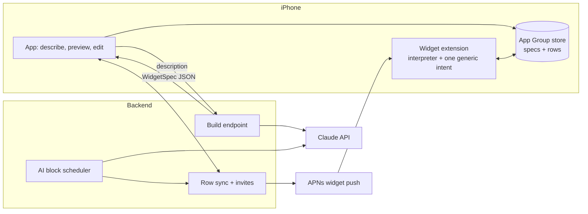

# Widgie v1 spec and plan

Status: the engine package is built and tested on the Mac (2026-11-18). The describe-to-widget loop runs end to end with a stand-in model. Nothing has run on an iPhone, because Xcode is not installed.
Written 2026-11-18.

## Direction from the user (2026-11-18)

- **Looks are code, functionality is blocks.** The user must be able to ask for any look at all. The AI writes code for the look. Storing data and acting on it stays as closed blocks.
- **A reference image is a valid description.** The user can attach an image and say "make my widget look like this".
- **iOS only.** No Android.
- **Our own model.** The product will call the company's own model. Until it exists, local Claude Code stands in for it in tests.

## Goal

A non-coder describes a widget in plain words and gets a working, tappable iPhone home screen widget.
Four reference widgets define v1: water logger, to-do list, habit tracker, word of the day.

## Definition of done for v1

On a real iPhone running iOS 26 or later, all of these hold.

- A new user types each of the four reference prompts and gets a widget that renders correctly in small and medium sizes, in full color and in tinted mode.
- A tap on the home screen changes the data and the widget shows the new state without opening the app.
- Word of the day shows a new word the next day without the user opening the app.
- A second user who opens an invite link sees the first user's changes after the next refresh.
- The widget extension stays under 30 MB of memory while rendering the largest reference widget.

## What the research changed in the brief

Every row below was checked against Apple docs or forum answers on 2026-11-18. Sources are at the end.

| Brief said | What is true | Consequence |
|---|---|---|
| iCloud sharing is free and good enough for iPhone | CloudKit cannot reload another user's widget. That needs our own APNs server. Apple also says the widget should not do sync work. | Our own backend for sync. iCloud saves nothing once a server exists. |
| Our backend covers Android later | The product is now iOS only, so this reason is gone. | The backend still wins on the other three reasons: push to a friend's widget, no sync in the widget, and hosting our own model. |
| AI block calls an LLM | It cannot run in the widget. The extension has about 30 MB and no time budget for a model call. | The server runs AI blocks on a schedule, stores the row, and pushes the widget. |
| Taps do not work while locked | Correct. A Toggle still flips on screen even if the user cancels the unlock, and there is no API to reset it. | Prototype Button against Toggle before choosing the control. |
| Blocks keep it safe with Apple | Functionality as blocks still helps. Look code is allowed in practice when it cannot reach the network or native APIs. Scriptable runs user JavaScript in widgets today, and the developer agreement section 3.3.1(B) permits interpreted code that stays inside the app's purpose. | Look code is a pure function from data to a view tree. It gets no network, no storage, and no native calls. |
| AI builds the widget | The app cannot place a widget on the home screen. The user adds it from the gallery by hand. | Onboarding must teach this once. New widgets default to the latest creation. |
| (not in brief) | On-device Apple models fit about 35 to 40 percent of iPhones and 4k to 8k tokens of context. | Cloud model for building. No on-device path in v1. |

## Architecture

One widget kind renders every creation. The user picks which creation a placed widget shows through the standard edit sheet (`AppIntentConfiguration` with an entity picker).
One intent, `RunAction(widgetID, actionID, rowID)`, handles every tap. It writes to the store and returns. WidgetKit reloads the timeline after it returns, and that reload is exempt from the daily budget.

### Data shape

`WidgetSpec` is the document the AI writes and the interpreter reads. It is the one-way door in this project, so it gets a design bakeoff at the start of phase 1.

- `tables`. Each table has an id and typed fields (text, number, bool, date).
- `queries`. A closed set of read shapes over one table: count, sum of a field, latest row, list with limit and sort, day streak. Each takes a time window (today, this week, all).
- `actions`. A closed set of writes: insert row, set field, toggle field, delete row, open the app on an input form.
- `automations`. AI blocks with a prompt, a schedule, and the table they write to.
- `look`. An AI-written JavaScript file with one function, `render(ctx)`, that turns query results into a view tree for the given widget size. It can reference action ids on tappable areas. The app stores the file with the widget. The user never sees it.
- `assets`. Images the look can place: the user's own photos and AI-generated pictures, downscaled and stored in the App Group.

The functional half has no code. Derived values come only from the closed query set, so data handling stays simple and checkable.
The look half is code, with one hard rule. It is a pure function of the data. It cannot read or write anything, so a bad look can only draw the wrong picture.

### How "any look" is met

The view tree is built from the views WidgetKit allows: text, SF Symbols, stacks, shapes, free-form paths, gradients, images, and buttons.
Code draws anything geometric or typographic. Anything code cannot draw well, such as a photo, a character, or a texture, becomes an image asset with live text and buttons drawn on top.
A reference image goes to the model as input. The model recreates the layout, colors, and type in code, and requests image assets for the parts that need them.

Three things stay out of reach on any iPhone widget, whatever we build: scrolling, video, and continuous animation. Animation is limited to a transition of at most two seconds when the data changes.

Rows live in a generic store, `row(key, dataset, day, at, ...)` with one `cell` per field value, because the AI defines columns at creation time. A dataset is the rows of one table. Each widget binds its table ids to datasets, so two widgets can share rows (see phase 1b).
Counters are append-only event rows. "Three glasses today" is a count of today's rows, so two phones logging at once never conflict.
Other fields resolve last writer wins per field, with the server as authority.

### Stack

- App and extension in Swift and SwiftUI, minimum iOS 26.
- Shared Swift package for spec types, validator, query engine, and renderer. It should build and test on this Mac without Xcode. The Command Line Tools ship SwiftUI, WidgetKit, AppIntents, and Swift Testing (checked on disk). An actual package build is not yet run.
- GRDB in the App Group container.
- Backend on Cloudflare Workers with Durable Objects.
- Our own model behind one build endpoint on the backend. The app never knows which model answers. The model must accept an image as input, or a vision step must sit in front of it.
- Local Claude Code (`claude -p`) is the stand-in model for every test until our model exists.

## Plan

Each phase ends in a check on the real artifact. Riskiest unknown first.

### Phase 0. Prerequisites and scaffold

- [ ] Install Xcode and an iOS 26 or 27 simulator (user action, see blockers)
- [ ] Confirm Apple Developer Program membership (user action)
- [ ] Decide the open decisions below
- [ ] Create the Xcode project with app target, widget extension, App Group, and the shared package
- [ ] Add lint, format, and a test command that runs the package tests
- [ ] Check: empty app and a placeholder widget run on a simulator and on a device

### Phase 1. Interpreter with hand-written specs, no AI

The unknown is whether one interpreter can render and act inside widget limits.

- [x] Look-language prototype: template with bindings against JavaScript, six look prompts, two model strengths, rendered to PNG on this Mac (`prototypes/look-language/`)
- [x] Reference-image test: image in, look out, compared side by side with the reference
- [x] Pick the look language from the renders: JavaScript
- [x] Engine design: two independent designs, one chosen as base (`docs/engine/SYNTHESIS.md`)
- [x] Engine package `Engine/`: document parser, row store, look sandbox, tree validator, renderer, builder, render tool (164 tests, `Engine/scripts/check`)
- [x] Four reference widgets as fixtures, proved in every data state and both sizes
- [x] Widget hosting code (intent, picker, timeline provider) written and compiled, never executed
- [ ] Pick the JavaScript engine on a device: JavaScriptCore against an embedded engine with a step and memory limit (see prototype results)
- [x] View tree renderer with the prototype vocabulary plus dashed strokes, blend modes, and image color adjustment
- [x] Image assets in the view tree, sized under the widget pixel cap
- [ ] Font allowlist checked against fonts that ship on iOS
- [ ] Xcode project: app target, widget extension, App Group, linking `Engine/`
- [ ] Tinted and lock screen modes for every node type (needs a device)
- [ ] `RunAction` intent and the entity picker running in a real widget
- [ ] Prototype Button against Toggle on a locked and unlocked device, pick one
- [ ] Add-to-home-screen onboarding
- [ ] Check: the four reference widgets work on a device, taps included, under 30 MB

### Phase 1b. Data owned by datasets, not widgets (approved 2026-11-20)

Today every row belongs to one widget (`row.widget`, `row.tbl`). That rules out two different widgets showing the same data, such as a dashboard that reads the water log and the habit check-ins. It is cheap to change now, with no users, no sync, and nothing shipped. After sharing ships it is a migration of every user's rows and a change to the sync format.

**Design.**

- A **dataset** is the rows of one table: the unit that widgets point at and, later, the unit that sync and invites share. It has its own key, a UUID like `WidgetKey`.
- Each widget maps its table ids to datasets in a new `binding(widget, tbl, dataset)` table. A widget is still self-contained in its document. The binding is per install and syncs like a head move (last writer wins per (widget, tbl)).
- `row` loses `widget` and `tbl` and gains `dataset`. The live index becomes `row_live(dataset, day, at)`.
- Building a new widget mints one dataset per table, so users see no change. A refinement keeps the binding of every table id that survives and mints datasets for new ones. Bindings of removed tables are kept, so restoring an old revision reconnects its old data.
- The kind check that guards refinements runs against every live widget bound to the same dataset, so two widgets can never disagree on a field's kind.
- Queries, actions, and the stale-tap check resolve (widget, table) to a dataset in the same read or write transaction.
- Deleting a widget keeps its bindings and rows. A dataset no live widget binds is garbage for the future collector.
- Migration 1 is edited in place rather than appending migration 2, because no store exists outside test runs.
- Out of scope: how the model asks for another widget's data in the grammar, and the sync and invite format. Both build on the package-level `bind` this adds.

**Steps.**

- [x] `DatasetKey`, the schema change, and `Change.insertRow(dataset:)` plus a new `Change.bind`
- [x] `RowStore.save` mints or keeps bindings; package-level `bind(widget, table, to: dataset)`
- [x] Queries, `apply`, `values`, `seed`, and staleness go through the binding
- [x] Cross-widget kind check at build
- [x] `changes(after:)` and `receive` carry bindings
- [x] Tests: two widgets on one dataset see each other's taps; a refinement keeps data; a restore reconnects old data; a kind clash across widgets is rejected; bindings survive a sync round trip; a tap on a row of an unbound dataset is ignored
- [x] Update `docs/engine/` (schema, rationale, usage) and the Data shape section above
- [x] Check: `Engine/scripts/check` passes and the four fixtures prove unchanged

**Review (2026-11-20).** Done as designed. `Engine/scripts/check` passes with 174 tests (8 new in `RowsTests/DatasetTests.swift` and `EngineTests/SharedDataTests.swift`). All 32 fixture renders are byte-identical to before. Notes:

- The proof's scratch store and the test benches now bind a widget's tables before seeding, through `RowStore.bind(tablesOf:to:)`, the same helper `save` uses.
- A bench binds at a fixed early instant, because a bind stamped with the real clock outranked the tests' simulated taps in the merge tests.
- The kind check runs in the builder before the save, not inside the save transaction. Two builds racing on a shared dataset could slip past it, but a mismatched cell already reads as absent, so the worst case is a blank value, not a crash.
- Still to design: how the model asks for another widget's data in the grammar, and system-filled datasets (steps, weather, calendar).

### Phase 2. AI builder

- [x] Build loop on the Mac: model reply, proof, one-line verdict, up to two repairs (`Engine/Evals/run.py`, prompt in `Engine/Reference/build-prompt.md`)
- [x] Fit check that catches dropped content (a query no render shows, an action with no button)
- [x] Eval set of 19 requests, run on a weaker and a stronger stand-in model
- [ ] Backend endpoint that forwards the request and image to our own model. The build loop itself runs in the app, because fit can only be measured where SwiftUI runs.
- [ ] App flow: describe in words or attach a reference image, live preview, refine by chat ("make it blue")
- [ ] Grow the eval set toward 40 requests and add a visual score, since the engine accepts some widgets that look wrong
- [ ] App Attest and per-device quotas on the endpoint
- [ ] Check: the four reference prompts and the eval set meet a valid-spec bar set from the first baseline run

### Phase 3. AI block

- [ ] Server scheduler that runs a block, writes the row, and sends a widget push
- [ ] Extension push handler and a timeline fallback for when a push is dropped
- [ ] Check: word of the day changes overnight on a device with the app closed

### Phase 4. Sync and sharing

- [ ] Anonymous account per install, Sign in with Apple when the user first shares
- [ ] Row sync through the backend
- [ ] Invite link that survives a fresh install
- [ ] Report and block, required by guideline 1.2
- [ ] Check: two devices, one shared habit tracker, change appears on the other after refresh

### Phase 5. Ship

- [ ] Age range gate and AI data consent screen
- [ ] Paywall and free tier
- [ ] Review notes that explain the data-only spec
- [ ] TestFlight build

## Open decisions

Each has a default I will use unless told otherwise.

1. **Sync route.** Default is our own backend, even though the app is iOS only. iCloud cannot refresh a friend's widget, and a server is needed to host the model anyway. The alternative is iCloud private sync with no sharing in v1.
2. **Name.** Widgy is an established widget maker on the App Store with about 26K ratings. "Widgie" sounds identical. Default is to treat Widgie as a codename and pick a distinct name before any store asset exists.
3. **Age floor.** Default is 13 and up with the Declared Age Range API, private link sharing only, and no public gallery in v1. A public gallery adds moderation duties.
4. **Minimum iOS.** Default is iOS 26, because widget push needs it. Supporting iOS 17 to 25 means those users get scheduled refresh only.
5. **Look language.** Decided. JavaScript, on the prototype evidence below.

## Prototype results (2026-11-18)

Throwaway code in `prototypes/look-language/`. Everything rendered with SwiftUI on macOS, not WidgetKit on iOS. Local Claude Code stood in for the model at two strengths (Haiku 5.5 and Sonnet 5.5).
Contact sheets: `prototypes/look-language/index.html` (round one) and `prototypes/look-language/index-round2.html` (round two).

**Round one. Template against JavaScript.** Six look descriptions, two models, three replicates, 72 looks.

| | Valid first try | Valid after one repair |
|---|---|---|
| Template, weaker model | 13 of 18 | 18 of 18 |
| Template, stronger model | 18 of 18 | 18 of 18 |
| JavaScript, weaker model | 18 of 18 | 18 of 18 |
| JavaScript, stronger model | 18 of 18 | 18 of 18 |

- The template could not take the first letter of a word or carry running state. Each gap would mean growing our own language. JavaScript already has both.
- JavaScript cost 1.2 ms and 3 MB more per render than the template on macOS. Whole-render time showed no measurable difference.
- Decision: JavaScript.

**Round two. Fit, fonts, reference images.** JavaScript only, 18 looks, one run each.

- **Fit.** 11 of 12 first drafts spilled past the widget edge by more than 2 points. After one repair call that states the measured spill, 0 of 12 did. A repair sometimes fits by dropping content, and the check does not catch that yet.
- **Fonts.** A 12-family allowlist closed the handwriting gap. Availability on iOS is not yet checked.
- **Reference images.** All 6 looks were valid on the first try. For a screenshot and for artwork the models recreated the look in code. For a photo both models placed the photo as a layer with a dark scrim and live data on top.
- **Gaps the references exposed.** No dashed or dotted stroke, no blend modes, no image color adjustment, no backdrop blur. A widget cannot be non-rectangular, so a torn or scalloped edge can only be faked.

**Open after the prototype.**

- JavaScriptCore has no public way to stop a script that runs too long. An AI-written look with an endless loop would hang the widget. The options are to check every look on the server before it ships, or to embed a small engine that has step and memory limits. This needs a device to settle.
- Nothing has run in a real widget extension. The 30 MB limit and tap behavior are untested.
- Nearly every look needs a second model call for fit. Guidance in the language reference may cut that.

## Engine build results (2026-11-18)

**What exists.** `Engine/` is one Swift package with seven targets. `Engine/scripts/check` runs the formatter, a release build, 164 tests, and the module rules. The design and its reasons are in `docs/engine/`.

**Describe-to-widget eval.** 19 requests in a user's words: the four reference widgets, six look descriptions, three reference images, and six new kinds (mood, coffee, reading log, countdown, AI affirmation, gym). Local Claude Code wrote each complete widget. The engine accepted it or returned one line for a repair, at most twice.

| Final prompt, two runs | Accepted first try | Accepted after repair | Failed |
|---|---|---|---|
| Weaker model (Haiku 5.5), 38 builds | 24 | 14 | 0 |
| Stronger model (Sonnet 5.5), 38 builds | 36 | 2 | 0 |

- Two identical runs differed by 5 first-try builds on the weaker model, so small differences in this table mean nothing.
- A build took about 45 seconds and 1.5 model calls on the weaker model, and 40 seconds and 1.05 calls on the stronger one. Each call reads about 17,000 tokens of reference text.
- Contact sheets: `Engine/.artifacts/evals/final-b/index.html` and `final-b2/index.html` (not in git).

**Accepted but wrong.** The engine checks that a widget fits and uses its data. It does not check taste or sense. Found by eye: a water level drawn as a band in the middle of the glass, a button with no visible control, a "new one" button that only deletes, hard-coded weekday labels, and to-do titles cut to about eight characters in the small size.

**What the blocks cannot express yet.**

- No action can ask an AI block to run now ("give me a new one").
- An AI block cannot see its own earlier rows, so "do not repeat" cannot be enforced.
- `week` means the calendar week. A rolling last seven days needs a workaround.

**Visual fixes (2026-11-20).**

- The fit check now treats an ellipsis that lands inside the first word ("Monst...") as cut text, so the build asks for a repair. An ellipsis after the first word, as on a long to-do title, is still accepted.
- Water, medium size: the minus and plus buttons sit together under the count, not floating against the chart.
- To-do, small size: titles wrap to two lines at 12pt, and the widget shows three rows instead of four.

**Still open.**

- Everything that needs a phone: the widget extension, real taps, the 30 MB limit, tinted mode, iOS fonts and symbols, the JavaScript engine choice.
- A cut-text error line reports the width the text took, not the room it had.
- The synthesized `full` state writes one row per past day, so history bars stay short in that state.

## Blockers that need the user

- Xcode is not installed on this Mac. Only the Command Line Tools are present. The disk has 28 GB free, and Xcode plus one simulator runtime needs roughly 20 to 25 GB, so space is tight.
- A paid Apple Developer account is needed for App Groups on a device, push, and App Attest.
- A Cloudflare account is needed from phase 2. No Anthropic API key is needed while local Claude Code stands in for the model.

## Risks

- **Minors, sharing, and third-party AI together.** Guidelines 1.2 and 5.1.2(i), COPPA, and the Texas, Utah, Louisiana, and California age laws all apply. Mitigation is in decision 3 and phase 5.
- **Shared SQLite in an App Group.** iOS can kill a suspended process that holds a file lock (crash code 0xdead10cc). GRDB has a mitigation marked experimental. Keep transactions short and watch crash reports from the first TestFlight build.
- **Push delivery is budgeted and not guaranteed.** Every pushed update also has a timeline fallback.
- **Competition.** At least three AI widget apps exist (WidgetAI, Medget, WidgetCraft), each with almost no reviews. Tappable widgets with data and sharing are the difference to protect.
- **App Review and look code.** A reviewer could read AI-written look code as downloaded code under guideline 2.5.2. The pure-function rule and the review notes are the defense. Shared widgets carry look code to another user's phone, so the same rule protects the recipient.
- **Our own model's strength.** Look quality depends on the model. The prototype runs a weaker and a stronger stand-in to show how much each language degrades.

## Sources

- Interactivity and locked behavior: https://developer.apple.com/documentation/widgetkit/adding-interactivity-to-widgets-and-live-activities
- Toggle cannot be reset after a cancelled unlock: https://developer.apple.com/forums/thread/766780
- Configurable widgets: https://developer.apple.com/documentation/widgetkit/making-a-configurable-widget
- Refresh budget: https://developer.apple.com/documentation/widgetkit/keeping-a-widget-up-to-date
- Widget push: https://developer.apple.com/documentation/widgetkit/updating-widgets-with-widgetkit-push-notifications
- Supported views: https://developer.apple.com/documentation/widgetkit/swiftui-views
- Tinted and glass rendering: https://developer.apple.com/documentation/widgetkit/optimizing-your-widget-for-accented-rendering-mode-and-liquid-glass
- Widget should not sync: https://developer.apple.com/forums/thread/830698
- SwiftData is private database only: https://developer.apple.com/documentation/swiftdata/modelconfiguration/cloudkitdatabase-swift.struct
- CloudKit web access limits: https://developer.apple.com/library/archive/documentation/DataManagement/Conceptual/CloudKitWebServicesReference/SettingUpWebServices.html
- GRDB database sharing: https://github.com/groue/GRDB.swift/blob/master/GRDB/Documentation.docc/DatabaseSharing.md
- On-device model context: https://developer.apple.com/documentation/technotes/tn3193-managing-the-on-device-foundation-model-s-context-window
- Structured outputs: https://platform.claude.com/docs/en/build-with-claude/structured-outputs
- Pricing: https://platform.claude.com/docs/en/about-claude/pricing
- App Review Guidelines: https://developer.apple.com/app-store/review/guidelines/
- Widgy listing: https://apps.apple.com/us/app/widgy-widgets-home-lock-watch/id1524540481
