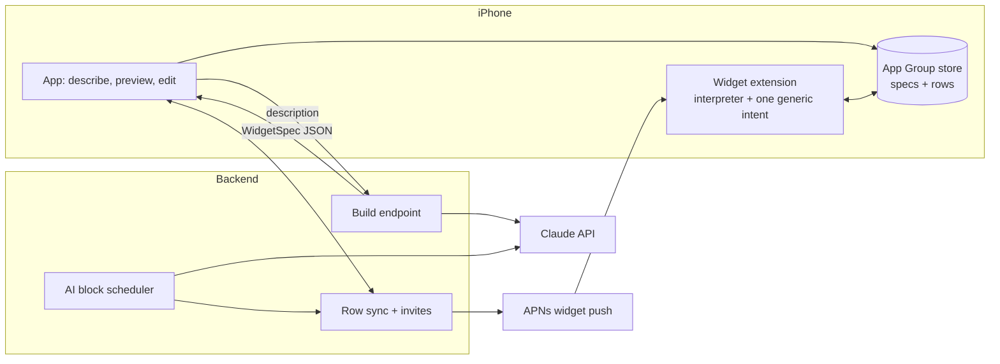

# Widgie v1 spec and plan

Status: the engine package is built and tested on the Mac (2026-11-18). The describe-to-widget loop runs end to end with a stand-in model. The app and widget extension run on the iOS simulator with real home screen taps (2026-11-21). Nothing has run on a physical iPhone yet.
Written 2026-11-18.

## Direction from the user (2026-11-18)

- **Looks are code, functionality is blocks.** The user must be able to ask for any look at all. The AI writes code for the look. Storing data and acting on it stays as closed blocks.
- **A reference image is a valid description.** The user can attach an image and say "make my widget look like this".
- **iOS only.** No Android.
- **Our own model.** The product will call the company's own model. Until it exists, local Claude Code stands in for it in tests.

## Goal

A non-coder describes a widget in plain words and gets a working, tappable iPhone home screen widget.
Six reference widgets define v1: water logger, to-do list, habit tracker, word of the day, dog fed, and thinking of you.
The last two were added on 2026-11-22 from the ICP research in `docs/research/icp-and-widgets.md`. They are the core widgets of the two segments most likely to pay and to spread through invites: shared households and couples.
Target users (decided 2026-11-22): shared households, couples and close friends, multi-trackers, ADHD adults, and learners. Aesthetic-only customizers are not a target.

## Definition of done for v1

On a real iPhone running iOS 26 or later, all of these hold.

- A new user types each of the six reference prompts and gets a widget that renders correctly in small and medium sizes, in full color and in tinted mode.
- A tap on the home screen changes the data and the widget shows the new state without opening the app.
- Word of the day shows a new word the next day without the user opening the app.
- A second user who opens an invite link sees the first user's changes after the next refresh.
- Dog fed: either partner taps "fed", and both widgets show who fed the dog and how long ago, in hours, without opening the app.
- Thinking of you: the widget shows the couple's own photo. A tap adds a heart, and each phone shows today's hearts sent and received.
- The widget extension stays under 30 MB of memory while rendering the largest reference widget.

## What the research changed in the brief

Every row below was checked against Apple docs or forum answers on 2026-11-18. Sources are at the end.

| Brief said | What is true | Consequence |
|---|---|---|
| iCloud sharing is free and good enough for iPhone | CloudKit cannot reload another user's widget. That needs our own APNs server. A forum answer advises against full sync in the widget, but Apple documents network requests in timeline providers (revised 2026-11-20, decision A in phase 1d). | Our own backend for sync. iCloud saves nothing once a server exists. The widget makes one bounded pull per reload. |
| Our backend covers Android later | The product is now iOS only, so this reason is gone. | The backend still wins on the other three reasons: push to a friend's widget, a small pull endpoint the widget can call, and hosting our own model. |
| AI block calls an LLM | It cannot run in the widget. The extension has about 30 MB and no time budget for a model call. | The server runs AI blocks on a schedule, stores the row, and pushes the widget. |
| Taps do not work while locked | Correct. A Toggle still flips on screen even if the user cancels the unlock, and there is no API to reset it. | Prototype Button against Toggle before choosing the control. |
| Blocks keep it safe with Apple | Functionality as blocks still helps. Look code is allowed in practice when it cannot reach the network or native APIs. Scriptable runs user JavaScript in widgets today, and the developer agreement section 3.3.1(B) permits interpreted code that stays inside the app's purpose. | Look code is a pure function from data to a view tree. It gets no network, no storage, and no native calls. |
| AI builds the widget | The app cannot place a widget on the home screen. The user adds it from the gallery by hand. | Onboarding must teach this once. New widgets default to the latest creation. |
| (not in brief) | On-device Apple models fit about 35 to 40 percent of iPhones and 4k to 8k tokens of context. | Cloud model for building. No on-device path in v1. |

## Architecture

One widget kind renders every creation. The user picks which creation a placed widget shows through the standard edit sheet (`AppIntentConfiguration` with an entity picker).
One intent, `RunAction(widgetID, actionID, rowID)`, handles every tap. It writes to the store and returns. WidgetKit reloads the timeline after it returns, and that reload is exempt from the daily budget.

### Data shape

`WidgetSpec` is the document the AI writes and the interpreter reads. It is the one-way door in this project, so it gets a design bakeoff at the start of phase 1.

- `tables`. Each table has an id and typed fields (text, number, bool, date).
- `queries`. A closed set of read shapes over one table: count, sum of a field, latest row, list with limit and sort, day streak. Each takes a time window (today, this week, all).
- `actions`. A closed set of writes: insert row, set field, toggle field, delete row, open the app on an input form.
- `automations`. AI blocks with a prompt, a schedule, and the table they write to.
- `look`. An AI-written JavaScript file with one function, `render(ctx)`, that turns query results into a view tree for the given widget size. It can reference action ids on tappable areas. The app stores the file with the widget. The user never sees it.
- `assets`. Images the look can place: the user's own photos and AI-generated pictures, downscaled and stored in the App Group.

The functional half has no code. Derived values come only from the closed query set, so data handling stays simple and checkable.
The look half is code, with one hard rule. It is a pure function of the data. It cannot read or write anything, so a bad look can only draw the wrong picture.

### How "any look" is met

The view tree is built from the views WidgetKit allows: text, SF Symbols, stacks, shapes, free-form paths, gradients, images, and buttons.
Code draws anything geometric or typographic. Anything code cannot draw well, such as a photo, a character, or a texture, becomes an image asset with live text and buttons drawn on top.
A reference image goes to the model as input. The model recreates the layout, colors, and type in code, and requests image assets for the parts that need them.

Three things stay out of reach on any iPhone widget, whatever we build: scrolling, video, and continuous animation. Animation is limited to a transition of at most two seconds when the data changes.

Rows live in a generic store, `row(key, dataset, day, at, ...)` with one `cell` per field value, because the AI defines columns at creation time. A dataset is the rows of one table. Each widget binds its table ids to datasets, so two widgets can share rows (see phase 1b).
Counters are append-only event rows. "Three glasses today" is a count of today's rows, so two phones logging at once never conflict.
Other fields resolve last writer wins per field, with the server as authority.

### Stack

- App and extension in Swift and SwiftUI, minimum iOS 26.
- Shared Swift package for spec types, validator, query engine, and renderer. It builds and tests on the Mac with Xcode or with the Command Line Tools alone, and builds for the iOS Simulator.
- GRDB in the App Group container.
- Backend on Cloudflare Workers with Durable Objects.
- Our own model behind one build endpoint on the backend. The app never knows which model answers. The model must accept an image as input, or a vision step must sit in front of it.
- Local Claude Code (`claude -p`) is the stand-in model for every test until our model exists.

## Plan

Each phase ends in a check on the real artifact. Riskiest unknown first.

### Phase 0. Prerequisites and scaffold

- [x] Install Xcode (Xcode 27.2, iOS 27.2 SDK, 2026-11-20)
- [x] Install the iOS 27.2 simulator runtime (`xcodebuild -downloadPlatform iOS`, about 8 GB)
- [ ] Confirm Apple Developer Program membership (user action, needed only for the device step)
- [ ] Decide the open decisions below
- [x] Create the Xcode project with app target, widget extension, App Group, and the shared package (`App/project.yml`)
- [x] Add lint, format, and a test command that runs the package tests (`scripts/check`)
- [ ] Check: empty app and a placeholder widget run on a simulator and on a device (simulator done 2026-11-21, device still open)

**Found with Xcode (2026-11-20).**

- `Engine/scripts/check` passes under the Xcode toolchain: 230 tests.
- The whole package builds for the iOS Simulator SDK (`xcodebuild -scheme WidgetEngine-Package -destination 'generic/platform=iOS Simulator'`). QuickJS, GRDB, and the WidgetKit and App Intents hosting code all compile for iOS.
- That build prints 592 warnings, all `-Wshorten-64-to-32` inside the vendored QuickJS sources. The vendored code stays unmodified, so the fix is to silence warnings for the `CQuickJS` target only.
- Xcode's built-in git stalled cloning GRDB. `-scmProvider system` works.
- `scripts/check` passes `-F` to the Command Line Tools copy of Swift Testing. With Xcode selected that mixes two toolchains. It should add the flags only when the Command Line Tools are the active developer directory.

**Phase 0 spec: the app project.**

- **Layout.** `App/` at the repo root holds the project. The project is generated from a checked-in `App/project.yml` by XcodeGen, and the `.xcodeproj` is git-ignored, so the project is reviewable text and never conflicts. The engine stays a local package reference to `../Engine`.
- **Targets.**
  - `Widgie` app, SwiftUI, iOS 26. Links `WidgetEngine`, `WidgetBuilder`, `WidgetHosting`. A single screen for now: the list of widgets from `engine.widgets()`, a button that installs one of the four reference fixtures, and a live `FaceView` preview of each. It handles form links with `Hosting.formTap(from:)` and shows the form.
  - `WidgieWidgets` extension. Links only `WidgetEngine` and `WidgetHosting` (never `WidgetBuilder`). Its bundle holds `CreationWidget` and nothing else.
  - Both list `HostingIntents` in `AppIntentsPackage.includedPackages`.
- **Identity.** Bundle id prefix `com.<you>.widgie` (codename until decision 2), App Group `group.com.<you>.widgie`, URL scheme `widgie`. Both targets carry `EngineAppGroup` and `EngineURLScheme` in Info.plist. Signing: automatic, team left empty for the simulator; the team id goes in one place in `project.yml` for the device step.
- **Fixtures in the app.** The four reference fixtures ship in the app bundle as debug-only resources, so the simulator can be tested before the AI builder exists. The app installs them through `engine.build`, the same path a real build takes.
- **Commands.** `App/scripts/build` generates the project and builds both targets for the simulator. `Engine/scripts/check` stays the engine gate. A top-level `scripts/check` runs both.
- **Check on the simulator.** Install all four fixtures, add the widget in small and medium to the simulator home screen, tap water plus and minus, habit check, to-do toggle, and confirm the face updates without opening the app. Tap a form button and confirm the app opens on the right form. Screenshot each, in full color and tinted. Record extension memory from the simulator as a first number (the 30 MB check itself needs a device).
- **simslim** (installed 2026-11-20) cuts a simulator's memory by turning off daemons. For this app always boot with `simslim on <udid> --except widgets,siri --keep com.apple.linkd`: `widgets` holds `chronod` (widget refresh), `siri` holds `siriactionsd` (runs App Intents, so widget taps), and `linkd` in the `other` group indexes App Intents. Without linkd iOS has no default `PickWidget`, so every widget stays a grey placeholder ("Intent configuration is required but was not provided"). Phase 4 also keeps `store` for push. Two-user sharing tests are where it pays most.
- **Not in this phase.** Onboarding, the describe screen, the AI builder, the font allowlist check, Button against Toggle on a locked device.

**Review (2026-11-21).** The simulator check passed on an iPhone 18 Pro, iOS 27.2, booted slim. `scripts/check` passes: 230 engine tests and a warning-free app build.

- All four reference widgets build through `engine.build` on iOS, so the proof and QuickJS run on iOS as well as macOS.
- The widget gallery and the home screen draw real faces from the extension. The picker lists every widget and switches one. A new widget defaults to the latest creation.
- Taps on the home screen change the data and redraw in about a second without opening the app: habit check and uncheck, to-do toggle, and to-do delete of one row. The store shows each write came from the extension.
- The to-do + button opens the app on the right form. A saved form reloads the widget.
- Real iOS tinted mode draws every face legibly, and taps work in it. The engine's tinted emulation matched.
- Extension memory on the simulator, debug build: 18 MB footprint, 20 MB peak, against the 30 MB cap. The device number is still owed.
- The app screen now stacks both sizes in a plain column. A `List` left too little width for a medium face, which cut it off.

Found along the way:

- simslim's `other` group holds `linkd`. Without it every widget stays a grey placeholder ("Intent configuration is required but was not provided"). The boot command now keeps it (above, and in project memory).
- The first widget placed saved Meditate, the only widget at the moment iOS first asked for a default, before linkd ran. A widget placed after that saved the latest creation, so `defaultResult()` is correct.
- A long press on a widget's button ran its tap once on the simulator (17:58:09). Confirm on a device that opening a widget's menu never runs its action.
- Habit look, tinted: once today is checked, its outline is gone, so on a streak today looks like any other done day. Fixed 2026-11-21: today is a smaller square inside a ring, and the gap marks it in every mode.
- Done to-do titles wrap to two lines to make room for the remove button. Fixed 2026-11-21: a done title keeps one line in both sizes and ends in an ellipsis.

**Home screen, water and medium (2026-11-21).** Water in small and medium, both showing one widget, on a home screen set to Clear. Plus, a quick second plus, and minus each change the data without opening the app, and a tap on one face updates the other.

- In Clear mode the water plus vanished: a plus on an `accent` disc drew as a plain white disc, because Clear draws accent nodes in the same color as the rest. The plus is now cut out of the disc (`plus.circle.fill`), and `look.md` teaches the cutout instead of `accent`. The engine's tinted emulation still draws accent nodes in a tint color, so a proof does not show this case.
- In medium the minus appeared left of the plus after the first glass and pushed the plus right, so a quick second tap landed on the minus and undid the drink. The plus now comes first.
- Sometimes the face that was just tapped keeps its old picture while the other face of the same widget redraws. Both come from the same successful reload, and the tap targets already match the new face, so the timeline is right. The picture catches up when the home screen is shown again. Check on a device.
- The gallery offered Word of the Day as the default for a new widget, though To-do was the latest creation. iOS seems to keep the default it resolved when the extension was installed. The picker lists the right order. Matters for the add-to-home-screen onboarding.

Still open from this phase: the device step (needs the Apple Developer account and a team id in `App/project.yml`).

### Phase 1. Interpreter with hand-written specs, no AI

The unknown is whether one interpreter can render and act inside widget limits.

- [x] Look-language prototype: template with bindings against JavaScript, six look prompts, two model strengths, rendered to PNG on this Mac (`prototypes/look-language/`)
- [x] Reference-image test: image in, look out, compared side by side with the reference
- [x] Pick the look language from the renders: JavaScript
- [x] Engine design: two independent designs, one chosen as base (`docs/engine/SYNTHESIS.md`)
- [x] Engine package `Engine/`: document parser, row store, look sandbox, tree validator, renderer, builder, render tool (164 tests, `Engine/scripts/check`)
- [x] Four reference widgets as fixtures, proved in every data state and both sizes
- [x] Widget hosting code (intent, picker, timeline provider) written and compiled, never executed
- [x] Pick the JavaScript engine: QuickJS-ng with step and memory budgets (phase 1d). A device must still confirm speed and memory
- [x] View tree renderer with the prototype vocabulary plus dashed strokes, blend modes, and image color adjustment
- [x] Image assets in the view tree, sized under the widget pixel cap
- [x] Font allowlist checked against fonts that ship on iOS: all 12 families resolve on the iOS 27.2 simulator (2026-11-21). `namedFontShipsHere` checks it on every `scripts/check` run on macOS, and on iOS with `xcodebuild test -scheme WidgetEngine-Package -destination 'platform=iOS Simulator,...' -only-testing:LookTests/ReferenceTests`
- [ ] Tinted and lock screen modes for every node type (needs a device)
- [ ] `RunAction` intent and the entity picker running in a real widget (simulator done 2026-11-21, device still open)
- [ ] Prototype Button against Toggle on a locked and unlocked device, pick one
- [ ] Add-to-home-screen onboarding
- [ ] Check: the four reference widgets work on a device, taps included, under 30 MB

### Phase 1b. Data owned by datasets, not widgets (approved 2026-11-20)

Today every row belongs to one widget (`row.widget`, `row.tbl`). That rules out two different widgets showing the same data, such as a dashboard that reads the water log and the habit check-ins. It is cheap to change now, with no users, no sync, and nothing shipped. After sharing ships it is a migration of every user's rows and a change to the sync format.

**Design.**

- A **dataset** is the rows of one table: the unit that widgets point at and, later, the unit that sync and invites share. It has its own key, a UUID like `WidgetKey`.
- Each widget maps its table ids to datasets in a new `binding(widget, tbl, dataset)` table. A widget is still self-contained in its document. The binding is per install and syncs like a head move (last writer wins per (widget, tbl)).
- `row` loses `widget` and `tbl` and gains `dataset`. The live index becomes `row_live(dataset, day, at)`.
- Building a new widget mints one dataset per table, so users see no change. A refinement keeps the binding of every table id that survives and mints datasets for new ones. Bindings of removed tables are kept, so restoring an old revision reconnects its old data.
- The kind check that guards refinements runs against every live widget bound to the same dataset, so two widgets can never disagree on a field's kind.
- Queries, actions, and the stale-tap check resolve (widget, table) to a dataset in the same read or write transaction.
- Deleting a widget keeps its bindings and rows. A dataset no live widget binds is garbage for the future collector.
- Migration 1 is edited in place rather than appending migration 2, because no store exists outside test runs.
- Out of scope: how the model asks for another widget's data in the grammar, and the sync and invite format. Both build on the package-level `bind` this adds.

**Steps.**

- [x] `DatasetKey`, the schema change, and `Change.insertRow(dataset:)` plus a new `Change.bind`
- [x] `RowStore.save` mints or keeps bindings; package-level `bind(widget, table, to: dataset)`
- [x] Queries, `apply`, `values`, `seed`, and staleness go through the binding
- [x] Cross-widget kind check at build
- [x] `changes(after:)` and `receive` carry bindings
- [x] Tests: two widgets on one dataset see each other's taps; a refinement keeps data; a restore reconnects old data; a kind clash across widgets is rejected; bindings survive a sync round trip; a tap on a row of an unbound dataset is ignored
- [x] Update `docs/engine/` (schema, rationale, usage) and the Data shape section above
- [x] Check: `Engine/scripts/check` passes and the four fixtures prove unchanged

**Review (2026-11-20).** Done as designed. `Engine/scripts/check` passes with 174 tests (8 new in `RowsTests/DatasetTests.swift` and `EngineTests/SharedDataTests.swift`). All 32 fixture renders are byte-identical to before. Notes:

- The proof's scratch store and the test benches now bind a widget's tables before seeding, through `RowStore.bind(tablesOf:to:)`, the same helper `save` uses.
- A bench binds at a fixed early instant, because a bind stamped with the real clock outranked the tests' simulated taps in the merge tests.
- The kind check runs in the builder before the save, not inside the save transaction. Two builds racing on a shared dataset could slip past it, but a mismatched cell already reads as absent, so the worst case is a blank value, not a crash.
- Still to design: how the model asks for another widget's data in the grammar, and system-filled datasets (steps, weather, calendar).

### Phase 1c. Day-tracking gaps in the query and action set (2026-11-20)

Real trackers need per-day sums, filtered charts, goal streaks, rolling and monthly windows, and logging for a past day. All of it is grammar, query engine, and tap plumbing. Storage does not change.

**Design.**

- **`daily` and `streak` take a measure.** The target is a table (rows per day, as now) or a number field as `"table.field"` (the sum of that field per day). Both take an optional `where`, the same equality filter `count` and `sum` take.
- **`daily` entries** stay `{ date, weekday, count }`. With a field target each entry also has `sum`. `count` is always the rows that match `where`.
- **`streak` takes an optional `goal`**. A day counts when its measure reaches the goal. For a table target it is a whole number of rows from 1 to 100, 1 when left out. For a field target it is a number above 0 and is required, since "a sum above zero" is rarely what anyone means. Today still has grace: the streak ends today, or yesterday while today has not reached the goal yet.
- **Windows.** `window` adds `month` (the calendar month that contains today) and `{ "days": N }` (the last N days, today included, N from 1 to 366, the same meaning `daily`'s `days` has). `today`, `week`, and `all` are unchanged.
- **`insertOn` action.** Like `insert`, but the row lands on the day the button names. A button for it needs `"day": "YYYY-MM-DD"`. Only today and the 365 days before it are tappable. The tree validator draws a well-formed day outside that range without a tap (a week strip holds days after today), and the store checks the day again on the tap, against the tap's own today, so a future day never lands. Every other action refuses `day`.
- `Tap` gains an optional `day`, and `RunAction` a fourth parameter. `Bindings` gains today's day so the validator can bound the button's day.
- The `full` stress state fills filtered history with matching rows and fills goal streaks with enough rows per day to meet the goal, so a goal streak still reaches three digits.

**Steps.**

- [x] `Spec`: `Measure`, `where` and `goal` on `daily` and `streak`, new windows, `insertOn`, limits, JSON round trip, `full` state
- [x] `Rows`: per-day sums and filters, goal streaks, month and rolling windows, `apply` with a day
- [x] `WidgetEngine`: `sum` in daily entries, button `day` validation, `Tap.day`, `perform`
- [x] `WidgetHosting`: `RunAction` carries the day
- [x] Reference: `blocks.md` and `look.md`, with examples and mistake lines the reference tests parse
- [x] Tests for each gap: parse and refusal lines, query results, the stale and future-day tap, the `full` state
- [x] Update `docs/engine/` (USAGE, RATIONALE)
- [x] Check: `Engine/scripts/check` passes and the four fixtures prove unchanged

**Review (2026-11-20).** Done as designed. `Engine/scripts/check` passes with 187 tests (13 new, plus new cases in the parametrized mistake and full-state tests). All 32 fixture renders and proof reports are byte-identical to `main`. Notes:

- A row streak's `goal` is a whole number from 1 to 100. A field streak's goal is any number above 0, up to 1,000,000. The 100 cap keeps the `full` state at most 100 rows a day.
- An independent review found that a week strip of day buttons would fail the look on every day but the last of the week, because `ctx.today.week` holds days after today. Out-of-range days now draw untappable instead of failing.
- `full` merges history only between queries with the same rows per day, so a 366-day `daily` beside a goal streak does not seed 100 rows a day for a year.
- Known gap: in `full`, a field streak cannot reach its goal when the only value the widget writes is 0 or negative, or needs more than 100 rows a day (a +10 ml button with a 2000 ml goal). The streak then reads 0 in that state. Layout still gets stressed by the other queries.
- Decimal sums against a goal rely on SQLite's `total()`, which adds exactly enough that ten 0.1 doses reach a goal of 1 (tested).
- Fixed in passing: a limit error said "at most 24 querys". It now uses the plural key ("queries").

### Phase 1d. Review findings: one-way doors before anything ships (approved and done 2026-11-20)

An outside review (two models) raised eight findings. Each was checked against the code. All eight hold, and three are worse than reported. This phase fixes what gets expensive once looks are generated for real users or sharing ships, and records two design decisions.

**Verified, with what the code adds.**

1. **No data path to a closed app.** `RowStore.receive` has no caller outside tests. Worse: `week` and `month` cover the whole calendar week and month, so a row written ahead of time for tomorrow already counts today, and `all` has no upper bound at all. Only `streak` and `daily` stop at today.
2. **The sandbox cannot be stopped.** Confirmed in `Sandbox.swift`. A timeout leaves a thread spinning until the process dies. In a widget extension that burns the CPU budget and keeps the abandoned VM's memory.
3. **No render-time memory caps.** Worse: an image decodes to the whole widget's pixels whatever its frame, and the decode cache keys on `crop`, so a look that crops per row decodes once per row. The 1.5 MP check runs only in the proof's fit report. The `full` state writes a 41-character text, not the 300 allowed, so the proof never sees the largest data either. `textLength` counts characters, so 300 emoji can be several KB.
4. **No tinted or dark rules.** Confirmed. Proofs force `.light`. WidgetKit tells the timeline provider neither the rendering mode nor the color scheme, so the look cannot branch on them: one tree has to work in every mode, and the renderer resolves the mode in the view.
5. **Sync format gaps.** All five confirmed. On field kinds: a bool `true` read as a number gives 1, and read as a date gives 1970-01-02. A deleted widget's kinds are not checked at all, and neither are rows that arrive by sync.
6. **Old buttons run the new action.** Confirmed: `Engine.target(of:)` resolves the action name against the current head.
7. **Narrow proof.** Confirmed. Left to phase 2, as recommended.
8. **Docs and code disagree.** The Opus review's item 11 is not in the repo, so the exact spots are unknown. An audit covers it here.

**Design.**

- **Query windows end today (1).** `week`, `month`, and `all` gain an upper bound of today, as `days` already has. `latest` and `list` follow, since they take a window. A row written ahead for a later day shows on its day, so the server can write a week of words and the midnight timeline entry flips to the next word with no network.
- **Typed cells (5a).** Each cell stores its kind beside its value (`cell.kind`: text, number, bool, date). A read takes a cell only when its kind is the field's kind, so a changed field reads as blank, as the plan already promises, on every path: local, restored, and synced. This needs no schema table and no new conflict rule. The builder's kind check runs against the kinds already present in the dataset's cells as well as live sharers, so it also covers deleted widgets and synced rows. A field with no cells can change kind, because nothing can be misread.
- **Every row change names its dataset (5b, 5c).** `setCell` and `deleteRow` gain `dataset`, like `insertRow`. The merge applies a row change only when it names the row's own dataset, or the row is not here yet; a cell remembers the dataset it claimed and reads only when it matches its row. So a change the server authorized for dataset B can never touch a row of dataset A. `Change.scope` is derived: `.dataset(key)` for rows and cells, `.account` for revisions, heads, bindings, and widget deletes. The feed returns changes grouped by scope, so the server routes datasets to their members and account state only to the user's own devices. Bindings never leave the account.
- **Remote designs are proved before they draw (5d).** A local, unsynced `proved(revision, verdict)` table. A local save marks its revision proved. A widget draws its head when the head is proved here, and otherwise its newest proved revision. With none, it stays hidden. The app proves pending revisions with the same `prove` path as `build`, for one's own other devices and for a shared widget alike. A rejected revision is never drawn. The extension never proves, so it shows the last proved revision meanwhile.
- **Remote input is bounded (5e, plus one more).** `receive(_:now:)` holds back changes stamped more than 10 minutes ahead of the local clock and returns them, so the sync layer retries later. They are not clamped, since clamping would make replicas disagree. It also refuses text cells over the text limit, so an automation or a peer cannot slip past the limits a tap obeys.
- **Taps carry their revision (6).** `Tap` gains the revision digest the button was drawn from, and `RunAction` and the form link carry it. `perform` runs the action as that revision defines it, provided the revision is in the widget's history. What the user pressed is what runs. A tap with no revision, or one outside the history, is ignored.
- **Render-time caps (3).** `AssetImages` takes a pixel budget for the whole `faces` call (1.5 MP, the number the proof uses today). A decode past it returns nothing and the validator fails with one line, so the proof and the widget enforce the same cap in the same place, and the fit check's own pixel rule goes. `composeDrawing` refuses a context over 1 MB of JSON, the same way. A static cap at parse time keeps the worst case out of reach: list and latest queries together may return at most 1,000 cells. `textLength` counts UTF-16 units, which is what JavaScript holds. `full` writes text at the real limit, so the proof renders the largest data a widget can hold.
- **Rendering-mode rules (4).** This is the contract the model learns, so it is set before real users. Dark mode stays optional, so a yellow sticky note can stay yellow.
  - A color may be `{ "light": "#...", "dark": "#..." }`. The renderer picks one from the view's color scheme.
  - Any node may set `accent: true`, which becomes `widgetAccentable()`.
  - An image may set `tint`: `fullColor`, `desaturated` (the default), or `accented`, which becomes `widgetAccentedRenderingMode`.
  - Rules in `look.md`: the backdrop goes in `widgetBackground`, never in a full-size shape, because tinted mode removes the background and draws every other node as a single color. State must show through opacity or shape, not hue alone.
  - The renderer takes its mode from a package environment value. The widget host maps WidgetKit's mode into it, and proofs set it directly. In proofs, accented mode is emulated: the background is replaced by a dark backdrop, non-accent nodes become white at their own opacity, accent nodes become a tint color, and images follow `tint`.
  - The proof adds a tinted cell and a dark cell per family. Each runs the ink check, plus a coverage check for tinted mode: a render that is mostly one solid color has its backdrop in a shape. Thresholds are set from the four fixtures and the eval set.
  - The device still has to confirm the emulation.

**Decision A. How data reaches a closed app (finding 1).** Default: the timeline provider makes one bounded pull before it renders: one request for this account's changes since its watermark, a 4 second hard timeout, merged in one short transaction, and on any failure it renders what it has. A widget push from the server triggers the reload. The server also writes AI block rows ahead of their day, which the today cap makes safe. The research line "Apple says the widget should not do sync work" gives way: it is a forum answer, and it is about full sync. Apple documents network requests in timeline providers. The alternatives fail the definition of done. A WidgetKit push carries no data. A silent push to the app is throttled, and never arrives after the user force-quits the app. Recorded in `docs/engine/` and the research table. The client code waits for phase 3, since it needs the backend.

**Decision B. JavaScript engine (finding 2).** Default: QuickJS-ng (MIT, about 70K lines of C) as a C target, vendored into `Engine/`.
- Its interrupt handler stops a look after a fixed number of steps on the same thread, so no thread is abandoned. `JS_SetMemoryLimit` caps memory.
- Budgets count steps, not milliseconds, so a proof on the Mac gives the same verdict as the phone. JavaScriptCore runs without its JIT in a third-party iOS app anyway, so the speed gap narrows on the device.
- The swap stays inside `Sandbox.swift`, as designed.
- Prototype on the Mac: every `LookTests` case and the four fixtures pass byte-identical, with time and memory measured against JavaScriptCore. The device bakeoff then confirms the speed.
- This adds the first vendored C dependency, so it needs your go-ahead.

**Steps.**

- [x] Query windows end today, with tests for a row on a later day in every window and shape
- [x] Typed cells: `cell.kind`, kind-checked reads, filters, sums, and sorts, plus the build's kind check against kinds present in the dataset (migration 1 edited in place, as in phase 1b)
- [x] Dataset on `setCell` and `deleteRow`, the dataset guard in `merge`, `Change.scope`, and the feed grouped by scope
- [x] `receive(_:now:)`: hold back future stamps, refuse oversized text, and return what was held
- [x] `proved` table, head resolution to the newest proved revision, and `Engine.proveReceived()` in `WidgetBuilder`
- [x] `Tap.revision` through `RunAction`, the form link, and `perform`
- [x] Render-time caps: image pixel budget in `AssetImages`, context size in `composeDrawing`, static cell cap, UTF-16 `textLength`, and `full` at the real text limit
- [x] Rendering modes: color pairs, `accent`, image `tint`, the mode environment, the emulated tinted and dark proof cells, and `look.md` and `blocks.md` rules with mistake lines
- [x] Re-run the four fixtures and the 19-request eval on both stand-in models with the new mode rules; note any looks the tinted cell rejects
- [x] Decision A and B written into `docs/engine/RATIONALE.md` and `SYNTHESIS.md`, and the research table updated
- [x] QuickJS-ng prototype behind `Sandbox.swift` (after your go-ahead on the dependency)
- [x] Audit `docs/engine/` against the code and fix every disagreement
- [x] Check: `Engine/scripts/check` passes. Fixture renders change only where the new rules require it, and each change is explained.

**Review (2026-11-20).** Done as designed, with the changes below. `Engine/scripts/check` passes with 230 tests (187 before), and the whole suite also passes under the address sanitizer. Two Opus agents worked in parallel worktrees, then two more worked in this checkout.

- **Rows are keyed by (key, dataset), not guarded.** As written, the guard did not converge. Two cells naming different datasets for one row ended differently depending on arrival order, and so did a forged delete. Now a change naming another dataset lands on an identity no read sees. The state is the same in every order.
- **Caps made consistent.** The cell cap is 1,000 values, not 2,000, and the context cap is 1 MB, not 512 KB. At 2,000 values, ordinary 300-unit text reached about 620 KB and failed at render a widget the static cap allowed. The worst case is now about 900 KB. Only text full of characters JSON escapes can still reach the cap, and the render refuses that with one line.
- **QuickJS memory is metered by our own allocator.** At its own limit, QuickJS usually throws `null`, which a look's own `throw null` would look the same as. Budgets: proof 500 steps and 8 MB, widget 2,000 steps and 12 MB. Every fixture takes 1 step and about 250 KB.
  - On this Mac, an endless loop stops in 8 ms at the proof budget, against a thread that spun forever before.
  - Ten runaways leave 0.03 MB behind, against 4.1 MB with JavaScriptCore.
  - Error wording is now QuickJS's.
- **Found and fixed in review.**
  - QuickJS gives every look `performance.now()`, a clock read the prelude did not block. It now fails like `Date.now()`.
  - The JSON parser and the tree validator overflowed a 512 KB thread stack under the sanitizer. The parser is now iterative, and the validator's recursive frame is small.
  - Look renders differed by a pixel level between test runs, because the shared renderer picks GPU or CPU paths by what it drew before. A test-only constructor sets `RB_DISABLE_GPU=1`. Three runs are byte-identical. This switch is undocumented, so if Apple removes it the flakiness returns, and nothing worse.
- **Fixtures.** Full-color renders are byte-identical through the engine swap and the mode work.
  - Water's drink button now marks its disc `accent`. Before, the dark plus and the blue disc both turned white in tinted mode.
  - `full` renders of to-do and word of the day changed, because `full` now writes 300-unit text. Both still end in an ellipsis with no spill.
- **Eval** (`Engine/.artifacts/evals/phase-1d/`, one run, 38 builds, 0 failed):
  - The weaker model had 12 first try, 5 after one repair, and 2 after two.
  - The stronger model had 18 first try and 1 after one repair.
  - Both are within run-to-run noise of the last baseline.
  - The tinted cover check fired once, on the weaker model's sticky-note to-do, which drew its paper as a full-size shape. The second repair fixed it.
- **Behaviour change.** A tap from an older revision still in the history runs that revision's action. Before, it was a no-op if the action had been removed. Taps drawn before this change carry no revision and are ignored, which matters only for timelines already on screen. No release exists yet.
- **Not covered by the checks.** A symbol that vanishes on an opaque disc of another color in tinted mode (the water case) is taught in `look.md`, not detected. Clear mode showed that `accent` does not save it (2026-11-21), so `look.md` now teaches a cutout.
- **Needs a device.**
  - Whether the tinted emulation matches iOS 26 tinted and clear.
  - Time per QuickJS step without JIT, and whether 2,000 steps stays well inside a reload.
  - A 12 MB runaway plus a full render inside the 30 MB extension.
  - Several image-heavy widgets reloading at once.

**Left to their phases.**

- Phase 2: proof at several sizes per family (real phones vary by about 15%), a check that buttons are visible and large enough to tap, and repairs that send the model the render as an image.
- Phase 3: the client half of decision A, and memory with several image-heavy widgets on one home screen, measured on a device. Each render is capped, but WidgetKit may hold several renders at once.
- Phase 4: test vectors for the merge (changes in, state out) exported from the Swift tests, so the backend's merge is checked against the same cases.

### Phase 1e. Who wrote a row, and when (proposed 2026-11-22, needs approval)

The two new reference widgets need two things the blocks cannot express today. Rows carry a day but no time and no author, and the look gets the date but not the time.

| Widget | Needs | Today |
|---|---|---|
| Dog fed | "Fed 3 h ago by Sam", red after 12 h | A row has `day` and `daysAgo` only. `ctx.today` has no time. |
| Thinking of you | Hearts sent and received today | No author on a row, so `where` cannot split mine from theirs. |
| Thinking of you | The couple's photo | Already covered by `assets`. The photo must travel with the shared widget. |

Proposed shape. This is a one-way door in `WidgetSpec`, so it gets the same review as phase 1d before any code.

- The engine stamps every row with `at` (the local time it was written, `"HH:MM"`) and `by` (a member id). Neither field can be declared or set by the spec, so the model cannot forge them.
- The look receives `at`, `minutesAgo`, and `by: { name, me }` on each row, and `ctx.now` as `"HH:MM"`. `minutesAgo` and `ctx.now` come from the timeline entry date, so the look still never reads a clock.
- `where` accepts `{ "by": "me" }` and `{ "by": "others" }`. Counting per named member waits until a reference widget needs it.
- A look that shows `minutesAgo` sets `reloadAt` to the next threshold it cares about, the way word of the day does. The timeline holds entries every 15 minutes for the first two hours.
- Before phase 4 there is one member, the device, so `by.me` is always true. Phase 4 fills in real members.

- [ ] Review the shape above against the block design, and decide whether `at` should be a full timestamp instead of `"HH:MM"`
- [ ] Add `at`, `by`, `minutesAgo`, `ctx.now`, and `where by` to the spec, the query engine, the proof, and `Engine/Reference/blocks.md`
- [ ] Fixtures `Engine/Fixtures/dogfed` and `Engine/Fixtures/hearts` (with a sample photo asset), proved in every data state and both sizes, full color and tinted
- [ ] Add both prompts to `Engine/Evals/cases.json` as reference cases, and run them on both stand-in models
- [ ] Check: `Engine/scripts/check` passes, the six fixtures prove, and the two new cases are accepted within three attempts

### Phase 2. AI builder

- [x] Build loop on the Mac: model reply, proof, one-line verdict, up to two repairs (`Engine/Evals/run.py`, prompt in `Engine/Reference/build-prompt.md`)
- [x] Fit check that catches dropped content (a query no render shows, an action with no button)
- [x] Eval set of 19 requests, run on a weaker and a stronger stand-in model
- [ ] Backend endpoint that forwards the request and image to our own model. The build loop itself runs in the app, because fit can only be measured where SwiftUI runs.
- [ ] App flow: describe in words or attach a reference image, live preview, refine by chat ("make it blue"). Plan in `tasks/phase-2-app-flow.md`
  - [ ] Refine misses seen on the P2 contact sheets (`Engine/.artifacts/evals/p2-refine-1`, `p2-refine-2`):
    - [ ] "track coffee instead of water": both models in both runs keep `glasses` and relabel it Coffee instead of adding a table, so past water rows count as coffee. No rows are lost.
    - [ ] "add a weekly chart": Haiku adds it to medium only in both runs and cuts the fourth title to "Book flights for the weddi...".
    - [ ] "add a weekly chart": Sonnet's small drops from three rows to two to fit it in both runs. Run 2's small chart has no weekday labels, and run 1 shrinks the full-state titles.
    - [ ] "use a handwriting font": the fit repair shrinks long titles in the full state, to tiny text on Haiku run 1 and Sonnet in both runs. Sonnet also drops small's second title line.
    - [ ] "bigger number": Sonnet run 2 also shrinks "/ 8" to a small suffix. Haiku run 1's bump is barely visible.
  - [ ] Refine follow-ups from the PR 4 review:
    - [ ] A widget holds at most 8 tables of 16 fields, and a refine can never drop a table or a field, so repeated "track X instead" refines can get stuck at the cap, and a person cannot delete a tracker's history.
    - [ ] `run.py`: `prepare_before` reuses a stale `before/` after a base fixture changes, the summary prints zero rows for groups the run did not select, and `--group` on an existing run name overwrites `results.json` with only that group.
- [ ] The home screen edit sheet lists widgets by name only, so three "Water" widgets look the same (seen in P4, `Engine/.artifacts/app-flow/p4/05-widget-picker-while-draft-open.png`). Give each entry something that tells it apart before people build several of one kind.
- [ ] Grow the eval set toward 40 requests and add a visual score, since the engine accepts some widgets that look wrong
- [ ] App Attest and per-device quotas on the endpoint
- [ ] Check: the four reference prompts and the eval set meet a valid-spec bar set from the first baseline run

### Phase 3. AI block

- [ ] Server scheduler that runs a block, writes the row, and sends a widget push
- [ ] Extension push handler and a timeline fallback for when a push is dropped
- [ ] Check: word of the day changes overnight on a device with the app closed

### Phase 4. Sync and sharing

- [ ] Anonymous account per install, Sign in with Apple when the user first shares
- [ ] Row sync through the backend
- [ ] Invite link that survives a fresh install
- [ ] Report and block, required by guideline 1.2
- [ ] Check: two devices, one shared habit tracker, change appears on the other after refresh
- [ ] Check: two devices share dog fed and thinking of you. Each shows the other's name on rows written there, and the shared photo arrives with the invite

### Phase 5. Ship

- [ ] Age range gate and AI data consent screen
- [ ] Paywall and free tier
- [ ] Review notes that explain the data-only spec
- [ ] TestFlight build

## Open decisions

Each has a default I will use unless told otherwise.

1. **Sync route.** Default is our own backend, even though the app is iOS only. iCloud cannot refresh a friend's widget, and a server is needed to host the model anyway. The alternative is iCloud private sync with no sharing in v1.
2. **Name.** Widgy is an established widget maker on the App Store with about 26K ratings. "Widgie" sounds identical. Default is to treat Widgie as a codename and pick a distinct name before any store asset exists.
3. **Age floor.** Default is 13 and up with the Declared Age Range API, private link sharing only, and no public gallery in v1. A public gallery adds moderation duties.
4. **Minimum iOS.** Default is iOS 26, because widget push needs it. Supporting iOS 17 to 25 means those users get scheduled refresh only.
5. **Look language.** Decided. JavaScript, on the prototype evidence below.

## Prototype results (2026-11-18)

Throwaway code in `prototypes/look-language/`. Everything rendered with SwiftUI on macOS, not WidgetKit on iOS. Local Claude Code stood in for the model at two strengths (Haiku 5.5 and Sonnet 5.5).
Contact sheets: `prototypes/look-language/index.html` (round one) and `prototypes/look-language/index-round2.html` (round two).

**Round one. Template against JavaScript.** Six look descriptions, two models, three replicates, 72 looks.

| | Valid first try | Valid after one repair |
|---|---|---|
| Template, weaker model | 13 of 18 | 18 of 18 |
| Template, stronger model | 18 of 18 | 18 of 18 |
| JavaScript, weaker model | 18 of 18 | 18 of 18 |
| JavaScript, stronger model | 18 of 18 | 18 of 18 |

- The template could not take the first letter of a word or carry running state. Each gap would mean growing our own language. JavaScript already has both.
- JavaScript cost 1.2 ms and 3 MB more per render than the template on macOS. Whole-render time showed no measurable difference.
- Decision: JavaScript.

**Round two. Fit, fonts, reference images.** JavaScript only, 18 looks, one run each.

- **Fit.** 11 of 12 first drafts spilled past the widget edge by more than 2 points. After one repair call that states the measured spill, 0 of 12 did. A repair sometimes fits by dropping content, and the check does not catch that yet.
- **Fonts.** A 12-family allowlist closed the handwriting gap. All 12 ship on iOS (checked on the simulator, 2026-11-21).
- **Reference images.** All 6 looks were valid on the first try. For a screenshot and for artwork the models recreated the look in code. For a photo both models placed the photo as a layer with a dark scrim and live data on top.
- **Gaps the references exposed.** No dashed or dotted stroke, no blend modes, no image color adjustment, no backdrop blur. A widget cannot be non-rectangular, so a torn or scalloped edge can only be faked.

**Open after the prototype.**

- JavaScriptCore has no public way to stop a script that runs too long. An AI-written look with an endless loop would hang the widget. The options are to check every look on the server before it ships, or to embed a small engine that has step and memory limits. This needs a device to settle.
- Nothing has run in a real widget extension. The 30 MB limit and tap behavior are untested.
- Nearly every look needs a second model call for fit. Guidance in the language reference may cut that.

## Engine build results (2026-11-18)

**What exists.** `Engine/` is one Swift package with seven targets. `Engine/scripts/check` runs the formatter, a release build, 164 tests, and the module rules. The design and its reasons are in `docs/engine/`.

**Describe-to-widget eval.** 19 requests in a user's words: the four reference widgets, six look descriptions, three reference images, and six new kinds (mood, coffee, reading log, countdown, AI affirmation, gym). Local Claude Code wrote each complete widget. The engine accepted it or returned one line for a repair, at most twice.

| Final prompt, two runs | Accepted first try | Accepted after repair | Failed |
|---|---|---|---|
| Weaker model (Haiku 5.5), 38 builds | 24 | 14 | 0 |
| Stronger model (Sonnet 5.5), 38 builds | 36 | 2 | 0 |

- Two identical runs differed by 5 first-try builds on the weaker model, so small differences in this table mean nothing.
- A build took about 45 seconds and 1.5 model calls on the weaker model, and 40 seconds and 1.05 calls on the stronger one. Each call reads about 17,000 tokens of reference text.
- Contact sheets: `Engine/.artifacts/evals/final-b/index.html` and `final-b2/index.html` (not in git).

**Accepted but wrong.** The engine checks that a widget fits and uses its data. It does not check taste or sense. Found by eye: a water level drawn as a band in the middle of the glass, a button with no visible control, a "new one" button that only deletes, hard-coded weekday labels, and to-do titles cut to about eight characters in the small size.

**What the blocks cannot express yet.**

- No action can ask an AI block to run now ("give me a new one").
- An AI block cannot see its own earlier rows, so "do not repeat" cannot be enforced.
- ~~`week` means the calendar week. A rolling last seven days needs a workaround.~~ Fixed in phase 1c: `{ "days": 7 }` and `month`.

**Visual fixes (2026-11-20).**

- The fit check now treats an ellipsis that lands inside the first word ("Monst...") as cut text, so the build asks for a repair. An ellipsis after the first word, as on a long to-do title, is still accepted.
- Water, medium size: the minus and plus buttons sit together under the count, not floating against the chart.
- To-do, small size: titles wrap to two lines at 12pt, and the widget shows three rows instead of four.

**Still open.**

- Everything that needs a phone: the 30 MB limit, tinted mode on a device, speed and memory of the JavaScript engine. The widget extension, real taps, tinted mode, and iOS fonts now run on the simulator.
- A cut-text error line reports the width the text took, not the room it had.
- The synthesized `full` state writes one row per past day, so history bars stay short in that state.

## Blockers that need the user

- A paid Apple Developer account is needed for App Groups on a device, push, and App Attest.
- A Cloudflare account is needed from phase 2. No Anthropic API key is needed while local Claude Code stands in for the model.

## Risks

- **Minors, sharing, and third-party AI together.** Guidelines 1.2 and 5.1.2(i), COPPA, and the Texas, Utah, Louisiana, and California age laws all apply. Mitigation is in decision 3 and phase 5.
- **Shared SQLite in an App Group.** iOS can kill a suspended process that holds a file lock (crash code 0xdead10cc). GRDB has a mitigation marked experimental. Keep transactions short and watch crash reports from the first TestFlight build.
- **Push delivery is budgeted and not guaranteed.** Every pushed update also has a timeline fallback.
- **Competition.** At least three AI widget apps exist (WidgetAI, Medget, WidgetCraft), each with almost no reviews. Tappable widgets with data and sharing are the difference to protect.
- **App Review and look code.** A reviewer could read AI-written look code as downloaded code under guideline 2.5.2. The pure-function rule and the review notes are the defense. Shared widgets carry look code to another user's phone, so the same rule protects the recipient.
- **Our own model's strength.** Look quality depends on the model. The prototype runs a weaker and a stronger stand-in to show how much each language degrades.

## Sources

- Interactivity and locked behavior: https://developer.apple.com/documentation/widgetkit/adding-interactivity-to-widgets-and-live-activities
- Toggle cannot be reset after a cancelled unlock: https://developer.apple.com/forums/thread/766780
- Configurable widgets: https://developer.apple.com/documentation/widgetkit/making-a-configurable-widget
- Refresh budget: https://developer.apple.com/documentation/widgetkit/keeping-a-widget-up-to-date
- Widget push: https://developer.apple.com/documentation/widgetkit/updating-widgets-with-widgetkit-push-notifications
- Supported views: https://developer.apple.com/documentation/widgetkit/swiftui-views
- Tinted and glass rendering: https://developer.apple.com/documentation/widgetkit/optimizing-your-widget-for-accented-rendering-mode-and-liquid-glass
- Widget should not sync: https://developer.apple.com/forums/thread/830698
- SwiftData is private database only: https://developer.apple.com/documentation/swiftdata/modelconfiguration/cloudkitdatabase-swift.struct
- CloudKit web access limits: https://developer.apple.com/library/archive/documentation/DataManagement/Conceptual/CloudKitWebServicesReference/SettingUpWebServices.html
- GRDB database sharing: https://github.com/groue/GRDB.swift/blob/master/GRDB/Documentation.docc/DatabaseSharing.md
- On-device model context: https://developer.apple.com/documentation/technotes/tn3193-managing-the-on-device-foundation-model-s-context-window
- Structured outputs: https://platform.claude.com/docs/en/build-with-claude/structured-outputs
- Pricing: https://platform.claude.com/docs/en/about-claude/pricing
- App Review Guidelines: https://developer.apple.com/app-store/review/guidelines/
- Widgy listing: https://apps.apple.com/us/app/widgy-widgets-home-lock-watch/id1524540481
